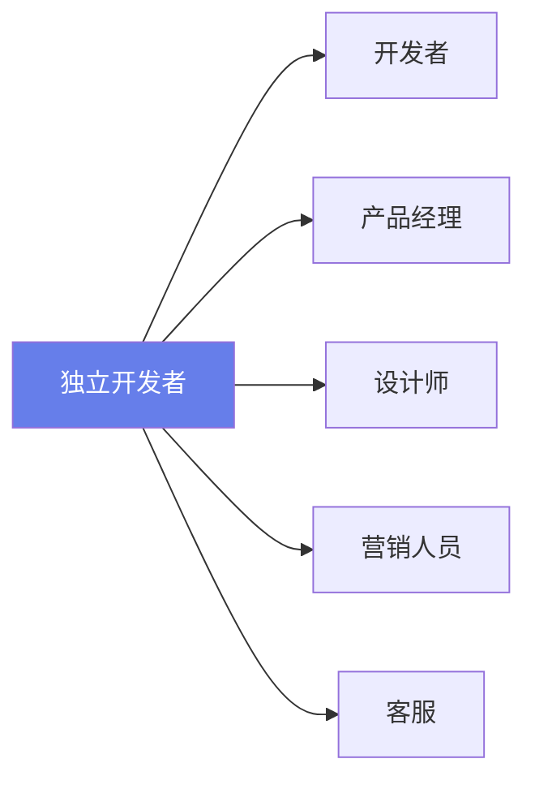
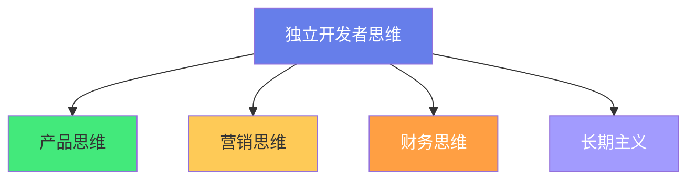
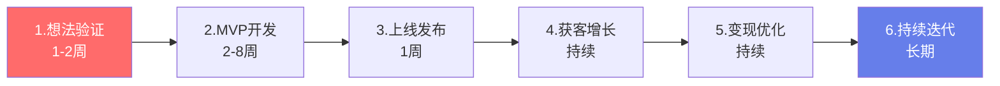
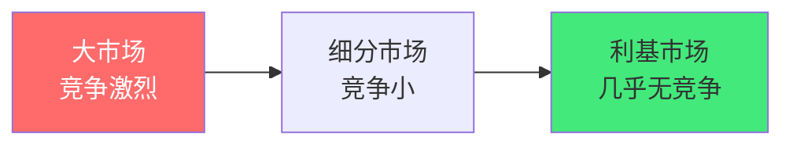

# 🏴‍☠️ 独立开发者（IndieHacker）思路

> **文档说明**：系统讲解独立开发者（IndieHacker）的核心思维、从 0 到 1 路径、产品选型、获客变现、AI 时代机遇与避坑指南，涵盖独立开发者概述（什么是 IndieHacker / 为什么做独立开发 / 适合谁 / 不适合谁）、核心思维体系（产品思维 / 营销思维 / 财务思维 / 长期主义 / 反脆弱）、从 0 到 1 完整路径（想法验证 → MVP 开发 → 上线发布 → 获客增长 → 变现优化 → 持续迭代）、产品选型策略（B2B vs B2C / SaaS vs 一次性 / 工具 vs 内容 / 利基市场选择 / 需求强度评估）、MVP 开发策略（技术栈选择 / 快速开发方法论 / 不追求完美 / 80/20 法则）、获客与营销（内容营销 / SEO / 社区运营 / Product Hunt / 冷启动 / 口碑传播 / 邮件列表）、变现模式大全（订阅制 / 买断制 / 广告 / 赞助 / 咨询 / 联盟营销 / 付费课程 / API 计费）、定价策略（免费增值 Freemium / 价格锚定 / 分层定价 / 价值定价 / 心理定价）、时间管理（全职 vs 副业 / 效率工具 / 避免干扰 / 深度工作）、AI 时代的独立开发（AI 赋能 10 倍效率 / AI 原生产品机会 / AI 辅助开发与营销 / 一人公司的 AI 杠杆）、成功案例分析（Pieter Levels / Marc Louv / Tailwind CSS / Notion / Nomad List）、常见陷阱（追风口 / 过度工程 / 忽视营销 / 完美主义 / 孤军奋战 / 收入单一）、财务规划（收入波动管理 / 应急基金 / 多元化收入 / 税务规划）、心态与坚持（孤独感 / 面对失败 / 长期主义 / 社区支持 / 身心健康）、最佳实践与资源推荐。
>
> **适用人群**：全栈开发者、想做副业/独立产品的技术人、创业者、对 SaaS 和数字产品感兴趣的人
>
> **前置知识**：[[从0到1产品落地路径]] · [[技术选型决策记录-ADR]]

---

## 一、独立开发者概述

### 1.1 什么是 IndieHacker

**IndieHacker（独立开发者）** 指不依赖大公司、独立或小团队（通常 1-3 人）开发和运营数字产品的开发者。他们既是开发者，也是产品经理、设计师、营销人员和客服。

**核心特征**：
- 🏴‍☠️ **独立**：不依赖雇主，自己掌控产品方向
- 💰 **可规模化**：数字产品边际成本趋近于零
- ⏰ **时间自由**：不打卡，自己安排时间
- 📈 **收入无上限**：产品成功后收入可以远超工资
- 🎯 **小而美**：不追求独角兽，追求可持续的利润

### 1.2 为什么做独立开发

| 动机 | 说明 |
|------|------|
| **财务自由** | 产品收入超过工资，实现财务独立 |
| **时间自由** | 不用打卡，随时随地工作 |
| **做自己想做的产品** | 不用做老板要求的功能，做自己相信的产品 |
| **学习成长** | 全栈能力（开发+产品+营销+运营） |
| **成就感** | 从 0 到 1 做出有人用的产品 |
| **副业收入** | 不辞职，先做副业增加收入 |

### 1.3 适合谁 / 不适合谁

**适合**：
- ✅ 有一定全栈开发能力（能独立做出产品）
- ✅ 有自驱力（不需要别人督促）
- ✅ 能接受不确定性（收入可能波动）
- ✅ 愿意学习非技术技能（营销、设计、客服）
- ✅ 有耐心（产品通常需要 6-12 个月才有收入）

**不适合**：
- ❌ 只想写代码，不想做营销和客服
- ❌ 追求稳定收入，不能接受波动
- ❌ 期待快速暴富（独立开发是长期主义）
- ❌ 容易放弃（前几个产品大概率失败）
- ❌ 不喜欢和用户沟通

---

## 二、核心思维体系

### 2.1 四大核心思维

| 思维 | 说明 | 常见误区 |
|------|------|---------|
| **产品思维** | 解决真实问题，不是炫技 | 「我用了最新技术」≠「用户需要」 |
| **营销思维** | 产品做出来只是开始，让人知道才是关键 | 「酒香不怕巷子深」是错的 |
| **财务思维** | 关注收入、成本、利润、现金流 | 只关注技术，不关注钱 |
| **长期主义** | 产品需要时间积累，不要期待一夜成功 | 做了 1 个月没收入就放弃 |

### 2.2 反脆弱思维

独立开发者要建立「反脆弱」的收入结构——不仅能承受波动，还能从波动中受益：

- **多元化收入**：不要只有一个产品或一种收入来源
- **低成本运营**：固定成本越低，抗风险能力越强
- **可迁移技能**：学到的营销、产品技能可以用在下一个产品
- **小步快跑**：快速验证，快速失败，快速调整

---

## 三、从 0 到 1 完整路径

### 3.1 六阶段路径

| 阶段 | 目标 | 关键动作 | 成功标志 |
|------|------|---------|---------|
| **1. 想法验证** | 确认需求真实 | 用户访谈、竞品分析、Landing Page | 有人愿意付费/留邮箱 |
| **2. MVP 开发** | 做出最小可用产品 | 只做核心功能，快速上线 | 产品能跑通核心流程 |
| **3. 上线发布** | 让第一批用户知道 | Product Hunt、社区发帖、朋友圈 | 有 10-100 个早期用户 |
| **4. 获客增长** | 持续获取新用户 | 内容营销、SEO、口碑、合作 | 月活用户持续增长 |
| **5. 变现优化** | 让产品赚钱 | 定价测试、转化率优化、追加销售 | MRR 持续增长 |
| **6. 持续迭代** | 长期运营 | 用户反馈驱动、功能迭代、团队扩展 | 稳定利润，可扩展 |

### 3.2 想法验证：最重要的一步

> **90% 的独立产品失败不是因为技术不行，而是因为解决了不存在的问题。**

**验证方法**：
1. **用户访谈**：找 10-20 个目标用户聊天，不要推销，只听
2. **Landing Page 测试**：做一个产品介绍页，放付费按钮，看有多少人点击
3. **预售**：产品还没做就开始卖，有人付钱说明需求真实
4. **竞品评论分析**：看竞品的差评，用户在抱怨什么

**验证标准**：
- 至少 5 个用户说「我愿意付钱解决这个问题」
- Landing Page 转化率 > 5%
- 预售有至少 3 个付费用户

---

## 四、产品选型策略

### 4.1 产品类型对比

| 类型 | 优点 | 缺点 | 适合 |
|------|------|------|------|
| **B2B SaaS** | 客单价高、续费稳定、企业付费意愿强 | 销售周期长、需要客服、竞争激烈 | 有企业资源/经验 |
| **B2C SaaS** | 用户量大、病毒传播 | 客单价低、流失率高、付费意愿弱 | 大众需求、有流量能力 |
| **一次性工具** | 开发快、即买即用 | 没有持续收入、需要不断卖 | 副业、快速验证 |
| **内容/课程** | 边际成本零、可自动化销售 | 前期投入大、需要个人品牌 | 有专业知识/表达能力 |
| **API 服务** | 开发者付费、可规模化 | 需要技术深度、竞争激烈 | 有特定技术能力 |
| **模板/主题** | 开发快、可批量生产 | 单价低、同质化严重 | 设计能力强 |

### 4.2 利基市场选择

**不要做大而全的产品，做小而美的利基产品**：

**利基市场特征**：
- 足够小，大公司看不上
- 足够大，能养活你自己
- 用户有明确的付费意愿
- 你有相关经验或兴趣

**示例**：
- ❌ 「项目管理工具」（大市场，Notion/Jira 竞争）
- ✅ 「自由职业者的发票管理工具」（利基，竞争小）
- ❌ 「AI 写作工具」（红海）
- ✅ 「面向法律行业的 AI 合同审查工具」（利基）

### 4.3 需求强度评估

| 指标 | 强需求 | 弱需求 |
|------|--------|--------|
| **用户行为** | 用户已经在用低效方案解决 | 用户说「挺好的」但不用 |
| **付费意愿** | 愿意立刻付费 | 「免费可以试试」 |
| **频率** | 每天/每周用 | 一年用一次 |
| **痛苦程度** | 不解决会损失钱/时间 | 不解决也无所谓 |

> **选择你自己就是目标用户的产品**——如果你自己有这个痛点，你更能理解用户，也更有动力做下去。

---

## 五、MVP 开发策略

### 5.1 技术栈选择原则

| 原则 | 说明 |
|------|------|
| **用你最熟的** | 不要为了学新技术而选，用最快能做出产品的 |
| **全栈一体化** | Next.js/Nuxt 全栈框架，前后端一起搞定 |
| **托管优先** | Vercel/Railway/Supabase，免运维 |
| **第三方服务** | 认证用 Auth0/ Clerk，支付用 Stripe，邮件用 Resend |
| **AI 优先** | 用 AI API 替代自己写复杂逻辑 |

**推荐技术栈（2026）**：
- 前端：Vue3 + Vite + Element Plus / Next.js + Tailwind
- 后端：FastAPI / NestJS / Supabase（BaaS）
- 数据库：PostgreSQL / Supabase
- 认证：Supabase Auth / Clerk
- 支付：Stripe / LemonSqueezy
- 部署：Vercel / Railway / Docker
- 邮件：Resend / Postmark
- 分析：Plausible / Umami

### 5.2 快速开发方法论

- **80/20 法则**：20% 的功能满足 80% 的需求，只做那 20%
- **不要重新发明轮子**：用开源组件、UI 库、第三方服务
- **先丑后美**：先让功能跑通，再优化 UI
- **手动自动化**：初期可以手动做的事情不要写代码自动化（如客服、数据导入）
- **每周可发布**：保持每周都有可演示的版本

### 5.3 MVP 不该做什么

| 不要做 | 原因 |
|--------|------|
| ❌ 用户系统自己写 | 用 Auth0/Supabase，省 2 周 |
| ❌ 管理后台 | 初期直接改数据库，不需要后台 |
| ❌ 多语言/i18n | 先做一种语言，有需求再加 |
| ❌ 深色模式 | 先做亮色，用户要求再加 |
| ❌ 移动端 App | 先做 Web，PWA 够用 |
| ❌ 微服务/分布式 | 单体应用足够，用户量上来再拆 |
| ❌ 完美的 UI | 能用就行，后期再优化 |

---

## 六、获客与营销

### 6.1 获客渠道

| 渠道 | 适合阶段 | 成本 | 效果 |
|------|---------|------|------|
| **Product Hunt** | 上线 | 低 | 爆发式流量，短期 |
| **Twitter/X** | 全程 | 低 | 长期积累，建立个人品牌 |
| **IndieHackers** | 全程 | 低 | 精准受众，社区支持 |
| **Reddit** | 上线/增长 | 低 | 精准社区，注意不要 spam |
| **内容营销/博客** | 增长 | 中（时间） | 长期 SEO 流量，复利 |
| **SEO** | 增长 | 中 | 长期稳定流量 |
| **邮件列表** | 全程 | 低 | 最高转化率，私域流量 |
| **口碑/推荐** | 增长 | 低 | 最有效，产品好自然传播 |
| **付费广告** | 变现后 | 高 | 快速验证，需要盈利支撑 |
| **合作/交叉推广** | 增长 | 低 | 互换用户，双赢 |

### 6.2 冷启动策略

**冷启动（0→100 用户）的方法**：

1. **从身边开始**：朋友圈、微信群、Twitter 粉丝
2. **社区发帖**：在目标用户聚集的社区分享（不要硬广，分享故事）
3. **Product Hunt 发布**：精心准备，争取当天 Top 5
4. **1v1 用户沟通**：找到前 10 个用户，亲自和他们聊，收集反馈
5. **免费给意见领袖用**：找 Twitter/Reddit 上的 KOL，免费给他们用，求反馈和推荐

### 6.3 内容营销

**内容是独立开发者最好的长期获客方式**：

- **写构建过程**：「我是如何做这个产品的」「这个功能的技术实现」
- **写教程**：解决目标用户的问题，自然植入产品
- **写对比**：「XX vs YY，哪个更好」（SEO 流量大）
- **写复盘**：「这个月收入多少，做了什么，学到了什么」
- **发布平台**：个人博客 + Twitter + IndieHackers + 掘金/知乎

> **关键**：不要只在上线时营销，要持续输出内容。内容是复利的，越写流量越多。

### 6.4 邮件列表

**邮件列表是独立开发者最重要的资产**：

- 从第一天就开始收集邮箱（Landing Page 放邮箱订阅）
- 每周发一封邮件（产品更新、有用的内容、限时优惠）
- 邮件转化率远高于社交媒体（私域流量）
- 工具：Buttondown / ConvertKit / Mailchimp

---

## 七、变现模式

### 7.1 变现模式大全

| 模式 | 说明 | 优点 | 缺点 | 示例 |
|------|------|------|------|------|
| **订阅制 SaaS** | 月付/年付 | 持续收入、可预测 | 流失率、需要持续更新 | Notion、Linear |
| **买断制** | 一次性付费 | 简单、即时收入 | 没有持续收入 | Sublime Text |
| **免费增值 Freemium** | 基础免费，高级付费 | 获客容易、转化漏斗 | 免费用户多、转化低 | Dropbox、Canva |
| **广告** | 展示广告 | 流量大时收入高 | 影响体验、需要大流量 | 免费工具站 |
| **赞助** | 企业赞助 | 稳定、不影响用户 | 需要影响力 | 开源项目、Newsletter |
| **咨询/服务** | 1v1 咨询 | 高客单价、即时收入 | 不可规模化、耗时间 | 技术咨询 |
| **联盟营销** | 推荐产品赚佣金 | 零成本、被动收入 | 收入不稳定、需要流量 | 推荐工具/课程 |
| **付费课程/电子书** | 卖知识产品 | 边际成本零、可自动化 | 前期投入大、需要个人品牌 | 编程课程 |
| **API 计费** | 按调用量付费 | 可规模化、开发者付费 | 需要技术深度、竞争 | OpenAI、Stripe |
| **打赏/赞助** | 用户自愿付费 | 简单、零门槛 | 收入不稳定、少 | 开源项目、博主 |

### 7.2 独立开发者推荐模式

**优先级排序**：
1. **SaaS 订阅制**（最推荐，持续收入）
2. **买断制 + 升级订阅**（如 Sublime Text 模式）
3. **Freemium**（获客容易，但要设计好转化）
4. **API 服务**（技术型开发者适合）
5. **数字产品（模板/课程/电子书）**（快速验证、低维护）

### 7.3 定价策略

| 策略 | 说明 | 示例 |
|------|------|------|
| **价值定价** | 按给用户创造的价值定价，不是按成本 | 节省 10 小时/月，定价 $29/月 |
| **价格锚定** | 放一个高价选项，让中间选项看起来划算 | $9/月（基础）/ $29/月（Pro）/ $99/月（团队） |
| **分层定价** | 不同功能不同价格，用户自选 | Free / Pro / Team / Enterprise |
| **年付优惠** | 年付打 7-8 折，提前收现金 | $29/月 或 $290/年（省 $58） |
| **心理定价** | $29 而不是 $30，感觉更便宜 | $9.99 / $19.99 / $49.99 |
| **限时优惠** | 上线初期低价，吸引早期用户 | Early Bird $9/月（前 100 名） |

> **定价不要太低**——低价吸引来的用户最难伺候，付费意愿低，流失率高。定一个你觉得「有点贵」的价格，然后提供对应的价值。

---

## 八、AI 时代的独立开发

### 8.1 AI 是独立开发者的 10 倍杠杆

**AI 让一个人能做以前 10 个人的工作**：

| 领域 | AI 赋能 | 以前需要 | 现在一个人 |
|------|---------|---------|-----------|
| **开发** | Cursor/Copilot 写代码、AI 调试 | 前端+后端 | 全栈一个人 |
| **设计** | AI 生成 UI、图标、Logo | 设计师 | AI + 模板 |
| **营销** | AI 写文案、SEO、社媒内容 | 营销人员 | AI + 人工审核 |
| **客服** | AI 客服机器人回答常见问题 | 客服团队 | AI + 人工升级 |
| **内容** | AI 辅助写博客、做视频 | 内容团队 | AI + 个人风格 |
| **数据分析** | AI 分析用户行为、生成报告 | 数据分析师 | AI 工具 |

### 8.2 AI 原生产品机会

**AI 时代的新产品机会**：

- 🤖 **AI 助手**：垂直领域的 AI 助手（法律、医疗、教育）
- 📝 **AI 内容工具**：AI 写作、设计、视频生成
- 🔍 **AI 搜索/问答**：基于 RAG 的垂直搜索
- 🎨 **AI 创意工具**：AI 音乐、艺术、游戏生成
- 📊 **AI 数据分析**：自然语言查询数据库、自动报告
- 💼 **AI 工作流自动化**：AI Agent 自动完成重复性工作
- 🎓 **AI 个性化教育**：自适应学习、AI 家教

### 8.3 AI 辅助开发工作流

1. **想法验证**：用 AI 做市场调研、竞品分析
2. **产品设计**：用 AI 生成 PRD、用户故事、UI 设计
3. **代码开发**：用 Cursor/Copilot 写代码、AI Code Review
4. **测试**：AI 生成测试用例、AI 调试
5. **部署**：AI 辅助配置 CI/CD、Docker
6. **营销**：AI 写 Landing Page、博客、社媒内容
7. **客服**：AI 客服机器人、AI 分析用户反馈

> **AI 不会取代独立开发者，但会用 AI 的独立开发者会取代不会用的。**

---

## 九、成功案例分析

### 9.1 Pieter Levels（@levelsio）

- **产品**：Nomad List、Remote OK、Photo AI、Interior AI
- **特点**：一个人做多个产品、快速迭代、公开收入
- **年收入**：$200 万+
- **启示**：
  - 快速做 MVP，2 周一个产品
  - 公开构建（Build in Public），建立个人品牌
  - 多个产品组合，分散风险
  - 用最简单的技术栈（PHP + jQuery），不追新技术

### 9.2 Marc Louv（@marc_louv）

- **产品**：ShipFast（Next.js 模板）、AI 工具集合
- **特点**：卖开发模板、快速做 AI 产品、Twitter 营销
- **年收入**：$100 万+
- **启示**：
  - 卖「铲子」给淘金者（开发者模板）
  - 利用 AI 快速做产品原型
  - Twitter 是最重要的营销渠道
  - 产品不需要完美，能卖就行

### 9.3 Tailwind CSS

- **产品**：Tailwind CSS 框架、Tailwind UI
- **特点**：开源框架引流 + 付费模板变现
- **年收入**：$200 万+
- **启示**：
  - 开源产品建立影响力和用户基础
  - 付费周边产品变现（UI 模板、组件库）
  - 开发者工具是好的独立产品方向
  - 长期积累，复利效应

### 9.4 共同特征

成功的独立开发者都有这些共同点：
- ✅ **持续输出**：每周/每月都有新产品或内容
- ✅ **公开构建**：在社交媒体分享过程，建立个人品牌
- ✅ **快速验证**：2-4 周做出 MVP，不行就换
- ✅ **关注营销**：50% 时间做产品，50% 时间做营销
- ✅ **长期主义**：坚持 2-3 年才看到显著收入
- ✅ **多元化收入**：多个产品/多种收入来源

---

## 十、常见陷阱

| 陷阱 | 表现 | 避坑方法 |
|------|------|---------|
| **追风口** | 什么火做什么（区块链→AI→...） | 选你自己有痛点的领域，不追热点 |
| **过度工程** | 用微服务、K8s、最新框架做 MVP | 用最简单的技术栈，单体应用够用 |
| **忽视营销** | 埋头写代码，上线后没人用 | 从第一天就开始营销，建邮件列表 |
| **完美主义** | 做了 6 个月还没上线，一直在优化 | 2-4 周必须上线，丑也要上 |
| **孤军奋战** | 不和任何人交流，自己闷头做 | 加入 IndieHackers 社区，找伙伴 |
| **收入单一** | 只有一个产品一种收入 | 多产品、多收入来源，反脆弱 |
| **定价太低** | $5/月，吸引低质量用户 | 定「有点贵」的价格，提供对应价值 |
| **不做用户沟通** | 不跟用户聊，自己猜需求 | 每周至少跟 3 个用户聊天 |
| **辞职太早** | 产品还没收入就辞职 | 副业做到收入 > 工资的 50% 再考虑 |
| **关注收入数字** | 每天看收入，焦虑 | 关注用户数和产品改进，收入是结果 |

---

## 十一、财务规划

### 11.1 收入波动管理

独立开发收入是波动的，要做好规划：

- **应急基金**：存够 6-12 个月的生活费，应对低收入期
- **多元化收入**：不要只有一个产品，多产品/多收入来源
- **副业过渡**：先做副业，收入稳定后再考虑全职
- **控制固定成本**：尽量用免费/便宜的服务，减少固定支出
- **税务规划**：了解自由职业的税务，合理避税，按时缴税

### 11.2 收入里程碑

| 阶段 | 月收入 | 状态 |
|------|--------|------|
| **$0** | 0 | 验证想法，做 MVP |
| **$1-$100** | 第一笔收入 | 验证变现模式，值得庆祝 |
| **$100-$1000** | 有稳定付费用户 | 持续优化，副业收入 |
| **$1000-$5000** | 可以考虑全职 | 接近工资水平，认真运营 |
| **$5000-$10000** | 超过大多数工资 | 全职独立开发，生活舒适 |
| **$10000+** | 财务自由 | 可以雇人、扩展产品矩阵 |

> **第一笔收入是最重要的里程碑**——它证明有人愿意为你的产品付钱，从 0 到 1 比从 1 到 100 难得多。

---

## 十二、心态与坚持

### 12.1 独立开发的心理挑战

| 挑战 | 表现 | 应对 |
|------|------|------|
| **孤独感** | 一个人工作，没有同事 | 加入社区、找伙伴、 coworking |
| **焦虑** | 担心收入、担心产品失败 | 关注过程不关注结果，定期复盘 |
| **自我怀疑** | 「我做的东西有人要吗」 | 和用户沟通，看真实反馈 |
| **拖延** | 不想做营销/客服，只想写代码 | 制定计划，先做最难的事 |
| **失败打击** | 产品没人用，收入为零 | 失败是常态，从失败中学习，快速调整 |
| **身心健康** | 久坐、不运动、作息混乱 | 固定作息、运动、社交、休息 |

### 12.2 长期主义

**独立开发是一场马拉松，不是短跑**：

- 大多数成功的独立产品是第 3-5 个产品（前几个都失败了）
- 产品通常需要 6-12 个月才有稳定收入
- 个人品牌需要 1-2 年积累
- 不要因为 3 个月没收入就放弃

> **「你不需要很厉害才开始，但你需要开始才能很厉害。」**

### 12.3 社区支持

**不要一个人战斗**：

- **IndieHackers.com**：全球独立开发者社区
- **Twitter/X**：关注 @levelsio、@marc_louv、@dannypostmaa 等
- **Reddit r/SaaS / r/indiehackers**：讨论和分享
- **国内**：即刻、独立开发者微信群、V2EX
- **找伙伴**：找一个互补的伙伴（你做技术，他做营销/设计）

---

## 十三、最佳实践与资源

### 13.1 最佳实践清单

- [ ] 先验证想法再写代码（用户访谈/Landing Page/预售）
- [ ] 用你最熟的技术栈，不要为了学新技术而选
- [ ] 2-4 周做出 MVP，丑也要上线
- [ ] 从第一天开始建邮件列表
- [ ] 50% 时间做产品，50% 时间做营销
- [ ] 每周和至少 3 个用户聊天
- [ ] 公开构建（Build in Public），在社交媒体分享过程
- [ ] 定一个「有点贵」的价格，不要太低
- [ ] 多个产品/多种收入来源，不要把鸡蛋放一个篮子
- [ ] 存 6-12 个月应急基金再考虑全职
- [ ] 关注用户数和产品改进，收入是结果
- [ ] 坚持 2-3 年，不要 3 个月没收入就放弃
- [ ] 用 AI 提升 10 倍效率，但不要依赖 AI 做决策
- [ ] 保持身心健康，运动、社交、休息

### 13.2 推荐资源

**书籍**：
- 《The Lean Startup》（精益创业）
- 《Zero to Sold》（Arvid Kahl，独立开发者圣经）
- 《The Mom Test》（用户访谈方法）
- 《Company of One》（一人公司）

**网站/社区**：
- IndieHackers.com
- ProductHunt.com
- Hacker News
- Twitter #buildinpublic

**工具**：
- 开发：Cursor（AI 编辑器）、Vercel、Supabase
- 营销：Twitter、Buffer（社媒管理）、Plausible（分析）
- 支付：Stripe、LemonSqueezy、Paddle
- 邮件：Buttondown、ConvertKit、Resend
- 设计：Tailwind CSS、shadcn/ui、Figma

---

## 十四、关联笔记

### 产品与项目
- [[从0到1产品落地路径]] · [[技术选型决策记录-ADR]] · [[需求分析与用户故事]]
- [[产品原型设计方法]] · [[项目管理与协作]]

### AI 与技术
- [[AI应用开发入门]] · [[LLM服务架构]] · [[实战-AI代码审查工具]]
- [[Vite构建工具原理]] · [[全栈项目实战]]

### 增长与运营
- [[用户增长策略]] · [[内容营销方法论]] · [[数据分析与埋点]]
- [[产品运营方法论]]

### 导航
- [[MOC-项目实战]] · [[MOC-产品与模板]] · [[Home]] · [[学习路线总览]]

> 🔍 **核心认知深度解析**
>
> **作用**：独立开发者思路解决的是「技术人如何不依赖大公司，通过开发和运营数字产品实现收入自由和时间自由」的核心问题——它不仅是技术问题，更是产品、营销、财务、心态的综合问题。
>
> **底层原理**：①独立开发的本质是「用技术杠杆 + 互联网杠杆实现收入规模化」——传统工作是「时间换钱」，时间有限所以收入有限；独立开发是「产品换钱」，一个产品可以卖给无数人，边际成本趋近于零，收入可以远超工资。技术杠杆让一个人能做以前团队的工作（全栈框架+AI+第三方服务），互联网杠杆让产品可以触达全球用户（不需要销售团队、不需要实体店）。这两个杠杆的结合，是独立开发者能够「一人公司」的根本原因。②「先验证再开发」是独立开发最重要的原则——90% 的独立产品失败不是因为技术不行，而是因为解决了不存在的问题。开发者容易陷入「解决方案思维」——我有一个技术方案，去找问题；正确的是「问题思维」——先找到真实的、用户愿意付费的问题，再找解决方案。验证方法包括用户访谈（不要推销，只听）、Landing Page 测试（看有多少人愿意留邮箱/付费）、预售（产品没做就开始卖）。验证通过了再写代码，能节省 90% 的浪费。③「MVP 不是缩小版产品，而是学习工具」——很多人以为 MVP 是「功能少一点的完整版」，这是错的。MVP 的目的是「用最小的成本验证核心假设」，它不需要好看、不需要完整、甚至不需要所有功能都自动化（可以手动）。MVP 的唯一标准是「能让用户完成核心行为，从而验证需求」。2-4 周做出 MVP 是合理的，超过 8 周说明你在做「完美产品」而不是「MVP」。④「50% 时间做营销」是独立开发者和打工者最大的思维差异——打工时产品有公司的营销团队负责，开发者只需要写代码；独立开发时，你既是开发者也是营销人员，产品做出来只是第一步，让人知道才是关键。很多开发者花 6 个月做产品，花 1 周营销，然后抱怨没人用——正确的比例是 50% 产品 + 50% 营销，甚至早期营销时间更多。内容营销（写博客/发 Twitter）是独立开发者最好的长期获客方式，它是复利的——越写流量越多，而且能建立个人品牌。⑤「定价不要太低」是反直觉但关键的原则——很多开发者因为不自信定低价，结果低价吸引来的用户付费意愿低、要求多、流失率高，反而赚不到钱。高价（你觉得「有点贵」的价格）吸引来的是真正有需求、愿意付费的高质量用户，他们更宽容、流失率更低、能提供更好的反馈。定价的核心是「价值定价」——按给用户创造的价值定价，不是按你的开发成本定价。如果你的产品帮用户每月省 10 小时，定价 $29/月是合理的。⑥「AI 是独立开发者的 10 倍杠杆」是这个时代最大的机遇——AI 让一个人能做以前 10 个人的工作：AI 写代码（Cursor/Copilot）、AI 做设计（生成 UI/Logo）、AI 写营销文案、AI 做客服、AI 分析数据。这意味着独立开发者可以更快地做产品、更低成本地运营、一个人服务更多用户。但 AI 是工具不是替代品——用 AI 提升效率，但核心决策（产品方向、用户沟通、质量把控）还是要人来做。会用 AI 的独立开发者会取代不会用的。⑦「长期主义」是独立开发的心态基础——大多数成功的独立产品是第 3-5 个产品（前几个都失败了），产品通常需要 6-12 个月才有稳定收入，个人品牌需要 1-2 年积累。3 个月没收入是正常的，不要因此放弃。独立开发是马拉松不是短跑，关注过程（每周做了什么、学了什么、和多少用户聊了）而不是结果（收入数字），结果会在坚持中自然到来。
>
> **用法要点**：① 独立开发者=不依赖大公司，1-3人开发运营数字产品，既是开发者也是产品/设计/营销/客服 ② 核心思维：产品思维(解决真实问题)/营销思维(产品做出来只是开始)/财务思维(关注收入成本利润)/长期主义(6-12个月才有收入)/反脆弱(多元化收入+低成本) ③ 从0到1六阶段：想法验证(1-2周用户访谈+Landing Page+预售)→MVP开发(2-8周只做核心功能)→上线发布(Product Hunt+社区)→获客增长(内容营销+SEO+口碑+邮件列表)→变现优化(定价测试+转化率)→持续迭代(长期) ④ 产品选型：B2B SaaS(客单价高)/B2C SaaS(用户量大)/一次性工具(开发快)/内容课程(边际成本零)/API服务(开发者付费)，选利基市场(小而美，大公司看不上但能养活你)，选你自己就是目标用户的产品 ⑤ MVP策略：用最熟技术栈/全栈一体化/托管优先(Vercel/Supabase)/第三方服务(Auth0/Stripe)/AI优先，80/20法则只做20%核心功能，先丑后美，不要自己写认证/管理后台/i18n/深色模式/App ⑥ 获客：Product Hunt(上线爆发)/Twitter(长期品牌)/IndieHackers(精准)/Reddit(社区)/内容营销(SEO复利)/邮件列表(最高转化)/口碑(最有效)，冷启动从身边+社区+1v1用户开始，50%时间做营销 ⑦ 变现：SaaS订阅(最推荐)/买断/Freemium/API/数字产品，定价用价值定价+价格锚定+分层+年付优惠，不要定太低 ⑧ AI时代：AI是10倍杠杆(开发/设计/营销/客服/数据)，AI原生产品机会(垂直助手/内容工具/RAG搜索/Agent自动化)，AI辅助全流程工作流 ⑨ 成功案例：Pieter Levels(快速多产品+公开构建)/Marc Louv(卖模板+AI产品+Twitter)/Tailwind CSS(开源引流+付费模板)，共同特征=持续输出+公开构建+快速验证+关注营销+长期主义+多元化收入 ⑩ 避坑：追风口/过度工程/忽视营销/完美主义/孤军奋战/收入单一/定价太低/不做用户沟通/辞职太早/关注收入数字 ⑪ 财务：6-12个月应急基金/多元化收入/副业过渡/控制固定成本/税务规划，里程碑$0→$100→$1000→$5000→$10000+ ⑫ 心态：孤独感(社区+伙伴)/焦虑(关注过程)/自我怀疑(用户反馈)/失败是常态(快速调整)/长期主义(坚持2-3年)/身心健康(运动+休息) ⑬ 最佳实践：先验证再写代码/用最熟技术/2-4周MVP/第一天建邮件列表/50%营销/每周3用户/公开构建/定价不低/多产品/应急基金/关注用户数/坚持2-3年/用AI提升效率/保持健康。

> 💡 **深度讲解**：独立开发者最核心的智慧是「你不是在做产品，你是在做生意——产品只是生意的一部分，营销、定价、用户、财务同样重要」——很多技术人做独立产品失败，不是因为技术不行，而是因为「只会写代码」。他们花 6 个月做了一个技术上很完美的产品，上线后发现没人用，因为他们从来没验证过需求，也从来没做过营销。独立开发的核心能力不是「写代码」，而是「发现问题→验证需求→做出解决方案→让目标用户知道→让用户愿意付费→持续优化」的全链路能力。技术只是其中一环，而且是最容易被 AI 替代的一环。「先验证再开发」是节省时间的最重要原则——90% 的产品想法是没人需要的，如果每个想法都花 3 个月开发，你会浪费大量时间。正确的做法是花 1-2 周验证（用户访谈+Landing Page+预售），验证通过了再写代码。这样即使 10 个想法只有 1 个可行，你也只浪费了 10-20 周而不是 30 个月。「MVP 不是缩小版产品」是另一个常见误解——MVP 的目的是学习，不是交付。它可以很丑、可以不完整、可以手动操作（比如用户注册后你手动创建账户），只要能验证核心假设就行。2-4 周做出 MVP 是合理的，超过 8 周说明你在做「完美产品」而不是「学习工具」。「50% 时间做营销」是独立开发者和打工者最大的思维差异——打工时有营销团队，独立开发时你就是营销团队。很多开发者觉得「营销很low」「我只想写代码」，但如果没人知道你的产品，写得再好也没用。内容营销是最好的长期获客方式——写博客、发 Twitter、做视频，不仅能获客，还能建立个人品牌，而个人品牌是独立开发者最有价值的资产。AI 时代是独立开发者的黄金时代——AI 让一个人能做以前 10 个人的工作，开发成本降低 10 倍，运营成本降低 10 倍，这意味着更多人可以成为独立开发者，也意味着竞争更激烈。但 AI 不能替代的是「发现真实问题的能力」「和用户建立信任的能力」「做出差异化产品的能力」——这些是人的核心竞争力。独立开发是一场马拉松，不是短跑——大多数成功的独立开发者坚持了 2-3 年才看到显著收入，前几个产品大概率失败。但每一次失败都在积累经验、积累用户、积累个人品牌，这些都是复利的。坚持下去，你会发现第 3 个产品比第 1 个好得多，第 5 个产品可能就成功了。如果你想做独立开发，不要等「准备好」——今天就开始，找一个你自己有痛点的问题，花 1 周做个 Landing Page 收集邮箱，有人感兴趣再做 MVP。行动是最好的老师。

> 📝 **精简总结**：独立开发者=不依赖大公司，1-3人做数字产品，全链路能力(开发+产品+营销+财务)。核心思维：产品思维/营销思维/财务思维/长期主义/反脆弱。六阶段：想法验证→MVP→上线→获客→变现→迭代。选型：利基市场+B2B SaaS优先，选自己是目标用户的产品。MVP：用最熟技术+2-4周+只做核心功能。获客：50%时间营销，内容营销+Twitter+邮件列表+口碑。变现：SaaS订阅优先，价值定价不要太低。AI时代：AI是10倍杠杆，会用AI的取代不会用的。避坑：追风口/过度工程/忽视营销/完美主义/定价低/辞职早。心态：长期主义+坚持2-3年+社区支持+身心健康。

> **学习路径建议**：先学习 [[从0到1产品落地路径]] 和 [[需求分析与用户故事]] 打好产品基础 → 研究成功案例（Pieter Levels、Marc Louv） → 实践：找一个自己有痛点的问题，做 Landing Page 收集邮箱 → 学习 [[技术选型决策记录-ADR]] → 实践：用最熟的技术 2-4 周做 MVP → 学习营销（内容营销、Twitter、Product Hunt） → 实践：上线并获取前 100 个用户 → 学习变现和定价 → 实践：让用户付费，获得第一笔收入 → 持续迭代，同时开始第二个产品 → 形成产品矩阵和多元化收入。

---

> **独立开发者最核心的智慧是「你不是在做产品，你是在做生意——产品只是生意的一部分，营销、定价、用户、财务同样重要」——很多技术人做独立产品失败，不是因为技术不行，而是因为只会写代码。他们花 6 个月做了技术上很完美的产品，上线后发现没人用，因为从来没验证过需求，也从来没做过营销。独立开发的核心能力不是写代码，而是发现问题→验证需求→做出解决方案→让目标用户知道→让用户愿意付费→持续优化的全链路能力，技术只是其中一环，而且是最容易被 AI 替代的一环。先验证再开发是节省时间最重要的原则——90% 的产品想法没人需要，每个想法都花 3 个月开发会浪费大量时间，正确做法是花 1-2 周验证（用户访谈+Landing Page+预售），验证通过再写代码，即使 10 个想法只有 1 个可行，也只浪费 10-20 周而不是 30 个月。MVP 不是缩小版产品——MVP 的目的是学习不是交付，可以很丑、可以不完整、可以手动操作，只要能验证核心假设就行，2-4 周做出 MVP 是合理的，超过 8 周说明在做完美产品而不是学习工具。50% 时间做营销是独立开发者和打工者最大的思维差异——打工时有营销团队，独立开发时你就是营销团队，很多开发者觉得营销很 low 只想写代码，但没人知道的产品写得再好也没用，内容营销是最好的长期获客方式，还能建立个人品牌，这是独立开发者最有价值的资产。AI 时代是独立开发者的黄金时代——AI 让一个人能做以前 10 个人的工作，开发和运营成本降低 10 倍，但 AI 不能替代发现真实问题的能力、和用户建立信任的能力、做出差异化产品的能力，这些是人的核心竞争力。独立开发是马拉松不是短跑——大多数成功的独立开发者坚持了 2-3 年，前几个产品大概率失败，但每次失败都在积累经验和个人品牌，这些是复利的，第 5 个产品可能就成功了。如果你想做独立开发，不要等准备好——今天就开始，找一个自己有痛点的问题，花 1 周做 Landing Page 收集邮箱，有人感兴趣再做 MVP，行动是最好的老师。**

---

## 🔗 关联笔记

- [[MOC-项目实战]] — 返回本分类知识地图，查看更多相关文档

## 📖 前置知识

- [[从0到1产品落地路径]]
- [[技术选型决策记录-ADR]]

## 🏷️ 相关标签

`#独立开发者` `#IndieHacker` `#产品思维` `#副业` `#SaaS` `#创业`

[[Home|🏠 返回首页]] · [[MOC-项目实战|📚 返回分类]]
