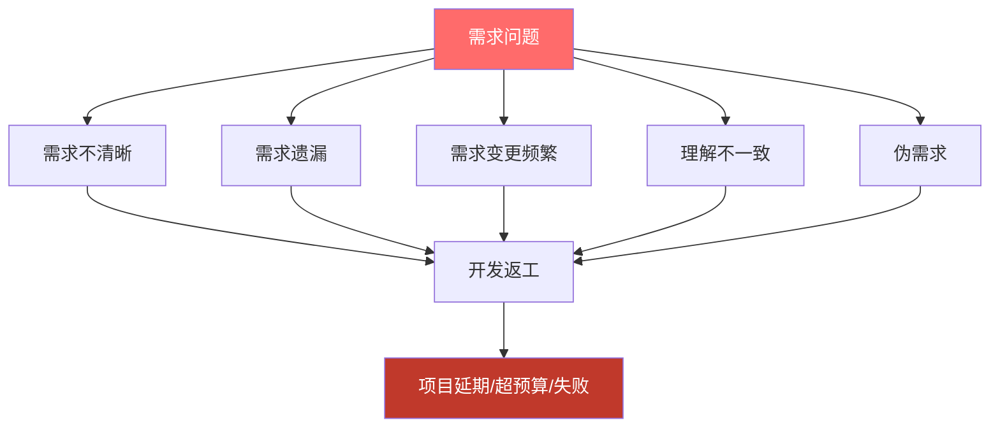
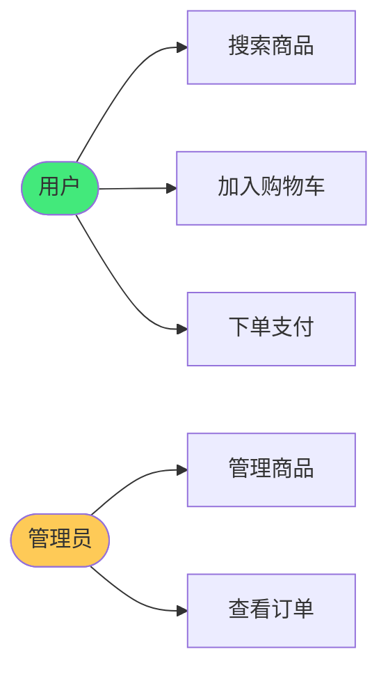
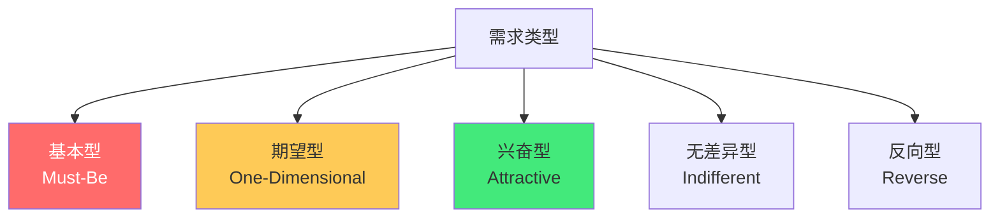

# 📋 需求分析与用户故事

> **文档说明**：系统讲解软件需求分析的方法论与用户故事（User Story）的编写实践，涵盖需求分析的概念与重要性（为什么 80% 的项目失败源于需求问题）、需求分类体系（业务需求/用户需求/功能需求/非功能需求/约束条件）、需求获取方法（用户访谈/问卷调查/竞品分析/数据分析/头脑风暴/现场观察）、需求分析技术（用户画像 Persona/用户旅程地图 Journey Map/用例图 Use Case/领域建模/亲和图）、用户故事详解（起源与价值/标准格式 As a...I want...So that.../INVEST 原则/验收标准 Given-When-Then/故事点估算 Planning Poker/优先级排序）、用户故事地图（Story Mapping，横向用户旅程+纵向优先级切分版本）、需求优先级框架（MoSCoW/Kano 模型/RICE 评分/价值-成本矩阵/WSJF）、需求文档编写规范（PRD 产品需求文档/用户故事卡/验收标准/原型链接）、敏捷需求管理（Product Backlog/Sprint Planning/Backlog Refinement/DoR 完成定义/DoD 完成定义）、需求变更管理（变更流程/影响评估/版本控制）、常见需求陷阱（镀金/范围蔓延/模糊需求/伪需求/技术驱动需求）、AI 辅助需求分析（AI 生成用户故事/AI 验收标准/AI 竞品分析）、最佳实践与模板。
>
> **适用人群**：产品经理、项目经理、全栈开发者、创业者、需要从 0 到 1 做产品的团队
>
> **前置知识**：[[MVP最小可行产品]] · [[产品原型设计方法]]

---

## 一、概述

### 1.1 为什么需求分析如此重要

> 研究表明，**软件项目失败的原因中，约 60-80% 可追溯到需求问题**——需求不清晰、需求变更频繁、需求遗漏、需求理解不一致，是项目延期、超预算、产品失败的首要原因。



**需求分析的价值**：
- 🔍 **发现真实问题**：区分「用户说的」和「用户真正需要的」
- 📐 **统一认知**：让产品、设计、开发、测试对需求有一致理解
- 💰 **降低成本**：需求阶段发现问题的成本是开发阶段的 1/10，上线后的 1/100
- 🎯 **指导开发**：清晰的需求是开发、测试、验收的依据
- 🚫 **防止范围蔓延**：明确「做什么」和「不做什么」

### 1.2 需求分类体系

| 层次 | 说明 | 示例 |
|------|------|------|
| **业务需求** | 组织层面的目标，为什么做 | 提升用户留存率 20% |
| **用户需求** | 用户要完成什么任务 | 用户能快速找到想买的商品 |
| **功能需求** | 系统必须提供什么功能 | 搜索框支持关键词搜索+筛选 |
| **非功能需求** | 系统质量属性 | 页面加载 < 2s，支持 10 万并发 |
| **约束条件** | 技术/时间/预算/合规限制 | 必须用 Java 开发，3 个月上线 |

---

## 二、需求获取方法

### 2.1 六大获取方法

| 方法 | 方式 | 优点 | 缺点 | 适用 |
|------|------|------|------|------|
| **用户访谈** | 1对1/小组深度访谈 | 深入理解动机和痛点 | 耗时、样本小 | 探索真实需求 |
| **问卷调查** | 大规模结构化问卷 | 量化数据、样本大 | 深度不足、有偏差 | 验证假设、统计趋势 |
| **竞品分析** | 分析同类产品功能 | 快速了解市场、避免重复 | 容易跟风、缺乏创新 | 功能对标、差异化 |
| **数据分析** | 用户行为数据/埋点 | 客观、真实行为 | 只能看到「是什么」，看不到「为什么」 | 发现问题、验证效果 |
| **头脑风暴** | 团队发散讨论 | 创意多、参与感强 | 容易跑题、需要引导 | 创意阶段、方案探索 |
| **现场观察** | 观察用户实际使用 | 发现用户自己都没意识到的问题 | 耗时、观察者偏差 | 复杂场景、B端产品 |

### 2.2 用户访谈技巧

```text
访谈五步法：
1. 暖场（5分钟）：建立信任，说明目的
2. 背景了解（10分钟）：用户角色、使用场景
3. 行为探索（20分钟）：过去怎么做的？遇到什么问题？
4. 需求挖掘（15分钟）：理想的体验是什么？
5. 总结确认（10分钟）：复述要点，确认理解
```

**黄金法则**：
- 多问「为什么」，少问「要不要」
- 关注「过去做了什么」，而非「未来会做什么」
- 不要引导用户，不要推销你的方案
- 听 80%，说 20%
- 记录原话，不要加工

---

## 三、需求分析技术

### 3.1 用户画像（Persona）

```markdown
## 用户画像：小张——职场新人

**基本信息**
- 年龄：24岁，工作1年
- 职业：互联网公司运营
- 收入：8K/月

**目标**
- 快速提升职场技能，获得晋升
- 高效管理时间，平衡工作和学习

**痛点**
- 知识付费课程买了很多，但完课率低
- 不知道学什么，信息过载
- 学习没有反馈，容易放弃

**使用场景**
- 通勤路上听音频课
- 周末集中学习2小时
- 睡前刷手机时看短文

**一句话描述**
> 一个渴望成长但缺乏系统方法的职场新人，
> 需要有人告诉他「学什么、怎么学、怎么坚持」。
```

### 3.2 用户旅程地图（Journey Map）


每个阶段记录：
- **用户行为**：用户做了什么
- **用户想法**：用户在想什么
- **用户情绪**：😊/😐/😡
- **痛点**：哪里不满意
- **机会点**：可以改进的地方

### 3.3 用例图（Use Case）



---

## 四、用户故事详解

### 4.1 什么是用户故事

**用户故事（User Story）** 是从用户视角描述需求的简短语句，是敏捷开发中需求表达的标准方式。

**标准格式**：
```text
作为一个<用户角色>，
我想要<功能/行为>，
以便<价值/目的>。
```

**示例**：
```text
作为一个购物用户，
我想要在商品列表页按价格排序，
以便快速找到最便宜的商品。
```

### 4.2 INVEST 原则

好的用户故事应该满足 **INVEST** 原则：

| 字母 | 单词 | 含义 | 说明 |
|------|------|------|------|
| **I** | Independent | 独立的 | 故事之间尽量独立，可单独开发和交付 |
| **N** | Negotiable | 可协商的 | 故事是对话的起点，不是固定合同 |
| **V** | Valuable | 有价值的 | 对用户有明确价值，不是技术任务 |
| **E** | Estimable | 可估算的 | 团队能估算工作量，太大要拆分 |
| **S** | Small | 小的 | 一个 Sprint 内能完成（建议 1-5 天） |
| **T** | Testable | 可测试的 | 有明确的验收标准，能验证是否完成 |

### 4.3 验收标准（Acceptance Criteria）

验收标准定义「怎么算完成」，使用 **Given-When-Then** 格式：

```text
场景：用户按价格排序

Given 我在商品列表页
When 我点击「价格从低到高」
Then 商品列表按价格升序排列
And 第一个商品是最便宜的

Given 我在商品列表页
When 我点击「价格从高到低」
Then 商品列表按价格降序排列
```

**验收标准的作用**：
- 开发的「完成定义」
- 测试的「用例来源」
- 产品的「验收依据」
- 团队的「共同认知」

### 4.4 用户故事卡

```text
┌─────────────────────────────────────────┐
│ ID: US-001                              │
│ 标题：商品价格排序                       │
│ 优先级：P1                               │
│ 故事点：3                                │
├─────────────────────────────────────────┤
│ 作为一个购物用户，                        │
│ 我想要在商品列表页按价格排序，            │
│ 以便快速找到最便宜的商品。                │
├─────────────────────────────────────────┤
│ 验收标准：                               │
│ ✓ 支持升序和降序两种排序                 │
│ ✓ 排序后URL参数更新，可分享              │
│ ✓ 排序切换不刷新页面                     │
│ ✓ 空结果时显示「暂无商品」               │
├─────────────────────────────────────────┤
│ 备注：参考淘宝/京东的排序交互             │
│ 原型：[链接]                             │
└─────────────────────────────────────────┘
```

### 4.5 故事点估算（Planning Poker）

**故事点**是相对工作量估算，不是绝对时间：

| 斐波那契数列 | 含义 |
|-------------|------|
| 1 | 极小，几小时 |
| 2 | 小，半天到1天 |
| 3 | 中，1-2天 |
| 5 | 较大，2-3天 |
| 8 | 大，3-5天 |
| 13 | 很大，需要拆分 |
| ? | 无法估算，需要更多信息 |

**Planning Poker 流程**：
1. 产品经理讲解故事
2. 团队成员独立出牌（1/2/3/5/8/13/?）
3. 亮出结果，差异最大的两人解释理由
4. 讨论后重新出牌
5. 直到达成一致（或取平均值）

> 超过 8 点的故事必须拆分——太大的故事不可估算、不可测试、不可预测。

---

## 五、用户故事地图（Story Mapping）

### 5.1 什么是故事地图

**用户故事地图**是 Jeff Patton 发明的需求组织工具，横向是用户旅程（用户使用产品的步骤），纵向是优先级（从上到下重要性递减），用于切分版本和 MVP。

### 5.2 故事地图结构

```text
                    ┌─────────────────────────────────────────────┐
                    │              用户旅程（横向）                  │
                    ├──────────┬──────────┬──────────┬──────────┤
                    │  浏览商品 │  加入购物车│  下单支付 │  查看订单 │
┌──────────┬────────┼──────────┼──────────┼──────────┼──────────┤
│ 优先级   │ MVP    │ 搜索/分类 │ 加入/删除 │ 微信支付 │ 订单列表 │
│ 纵向     │ V1.1   │ 筛选/排序 │ 数量修改 │ 支付宝   │ 订单详情 │
│ 从上到下 │ V1.2   │ 推荐商品 │ 收藏     │ 优惠券   │ 物流跟踪 │
│ 重要性   │ V2.0   │ AR试穿   │ 购物车分享│ 分期支付 │ 订单评价 │
└──────────┴────────┴──────────┴──────────┴──────────┴──────────┘
```

**构建步骤**：
1. 列出用户使用产品的所有步骤（横向）
2. 每个步骤下写出具体的用户故事（纵向）
3. 按优先级排序（最重要的在最上面）
4. 画一条「MVP 线」——线上的是第一版必须做的
5. 后续版本依次往下切

### 5.3 故事地图的价值

- **全局视角**：看到产品全貌，不迷失在细节中
- **版本切分**：自然地划分 MVP 和后续版本
- **缺口发现**：容易发现用户旅程中的断点
- **团队共识**：可视化讨论，所有人理解一致

---

## 六、需求优先级排序

### 6.1 MoSCoW 方法

| 优先级 | 含义 | 说明 |
|--------|------|------|
| **M**ust have | 必须有 | 没有就不能发布，核心功能 |
| **S**hould have | 应该有 | 重要但不紧急，有时间就做 |
| **C**ould have | 可以有 | 锦上添花，没时间就砍掉 |
| **W**on't have | 不会有 | 本期明确不做，记录下来 |

### 6.2 Kano 模型



| 类型 | 特点 | 策略 |
|------|------|------|
| **基本型** | 有了理所当然，没有会非常不满 | 必须做到，做到 100 分 |
| **期望型** | 做得越好越满意 | 投入产出比高，重点优化 |
| **兴奋型** | 没想到有了会惊喜 | 差异化亮点，打造 wow 时刻 |
| **无差异型** | 有没有都无所谓 | 砍掉，节省资源 |
| **反向型** | 有了反而不满 | 去掉，或做成可选 |

### 6.3 RICE 评分

```text
RICE 得分 = (Reach 影响人数 × Impact 影响程度 × Confidence 信心) / Effort 工作量
```

| 因子 | 说明 | 评分 |
|------|------|------|
| **Reach** | 每季度影响多少用户 | 数字 |
| **Impact** | 对单个用户的影响 | 3=巨大, 2=高, 1=中, 0.5=低, 0.25=极小 |
| **Confidence** | 对估算的信心 | 100%=高, 80%=中, 50%=低 |
| **Effort** | 需要多少人月 | 数字 |

### 6.4 价值-成本矩阵

```text
        高价值
          │
   ② 快赢  │  ① 战略重点
  (优先做)  │  (必须做)
          │
低成本 ────┼──── 高成本
          │
   ④ 可填缝 │  ③ 慎重考虑
  (有空做)  │  (可能不做)
          │
        低价值
```

---

## 七、敏捷需求管理

### 7.1 Product Backlog

**Product Backlog**（产品待办列表）是所有需求的有序列表：

- 由 Product Owner 负责维护和排序
- 顶部是最优先的，即将做的
- 底部是低优先级的，可能永远不做
- 持续细化（Refinement），顶部的故事要足够清晰
- 不是固定的，随时可以添加、修改、删除

### 7.2 Backlog Refinement（待办列表细化）

每个 Sprint 花 10-15% 时间细化 Backlog：
- 拆分大故事
- 补充验收标准
- 估算故事点
- 明确依赖关系
- 排优先级

### 7.3 DoR 和 DoD

| 概念 | 含义 | 检查项 |
|------|------|--------|
| **DoR** | Definition of Ready，准备好的定义 | 故事清晰、有验收标准、已估算、依赖明确 |
| **DoD** | Definition of Done，完成的定义 | 代码完成、测试通过、文档更新、可部署 |

> 故事满足 DoR 才能进入 Sprint，满足 DoD 才算完成。

---

## 八、常见需求陷阱

| 陷阱 | 表现 | 解决方案 |
|------|------|---------|
| **镀金（Gold Plating）** | 开发主动加需求外的功能 | 严格按验收标准，额外功能要走需求流程 |
| **范围蔓延（Scope Creep）** | 开发中不断加需求 | 变更走流程，评估影响，调整排期 |
| **模糊需求** | "做一个好的搜索" | 用用户故事+验收标准量化，追问具体场景 |
| **伪需求** | 用户说要马，实际要更快到达 | 多问为什么，找根本原因，区分手段和目的 |
| **技术驱动需求** | "因为用了微服务，所以要..." | 需求从用户价值出发，技术是实现手段 |
| **需求遗漏** | 上线后发现忘了某个场景 | 用户旅程地图检查，覆盖正常/异常/边界 |
| **过度设计** | 为不存在的需求做复杂方案 | YAGNI 原则，只做当前需要的 |
| **利益相关者冲突** | 老板要A，运营要B | 用数据说话，明确决策人，记录决策理由 |

---

## 九、AI 辅助需求分析

### 9.1 AI 能做什么

| 任务 | AI 辅助方式 |
|------|------------|
| **生成用户故事** | 输入功能描述，AI 生成标准格式的用户故事 |
| **编写验收标准** | AI 根据用户故事生成 Given-When-Then 验收标准 |
| **竞品分析** | AI 分析竞品功能，输出对比表格 |
| **用户画像** | AI 根据目标用户描述生成 Persona |
| **需求拆分** | AI 将大需求拆分为小的用户故事 |
| **优先级建议** | AI 根据 RICE/Kano 模型给出优先级建议 |
| **PRD 生成** | AI 根据需求要点生成 PRD 初稿 |
| **测试用例** | AI 根据验收标准生成测试用例 |

### 9.2 AI 提示词模板

```json
你是一位资深产品经理。请根据以下功能描述，生成：
1. 标准格式的用户故事（As a...I want...So that...）
2. 至少5条验收标准（Given-When-Then格式）
3. 可能的边界情况和异常场景
4. 建议的故事点估算（斐波那契数列）

功能描述：
{在这里描述功能}

目标用户：{用户角色}
```

> AI 是「需求助手」，不是「需求决策者」——AI 生成的内容需要人工审核和调整，最终决策由人来做。

---

## 十、最佳实践

1. **从用户价值出发**：每个需求都要回答「对用户有什么价值」
2. **用户故事要小**：超过 8 点就拆分，一个故事一个 Sprint 能完成
3. **验收标准先行**：写代码前先写验收标准，测试驱动需求
4. **可视化需求**：用故事地图、原型、流程图让需求可见
5. **持续沟通**：需求不是写完就完了，开发中持续确认和调整
6. **管理变更**：变更不可怕，可怕的是没有流程的变更
7. **记录决策**：为什么做这个、为什么不做那个，都要记录
8. **区分「需要」和「想要」**：用户说的「想要」背后是「需要」
9. **MVP 思维**：第一版只做核心，快速验证，迭代优化
10. **定期回顾**：每个 Sprint 回顾需求质量，持续改进需求流程

---

## 十一、关联笔记

### 产品与项目
- [[MVP最小可行产品]] · [[产品原型设计方法]] · [[技术债务管理]]
- [[产品需求文档写作]] · [[敏捷开发实践]]

### 全栈与AI
- [[全栈项目实战]] · [[AI应用开发入门]] · [[从0到1产品开发]]

### 知识管理
- [[第二大脑-BuildingSecondBrain]] · [[PARA-项目领域资源归档]]

### 导航
- [[MOC-项目实战]] · [[MOC-产品与模板]] · [[Home]] · [[学习路线总览]]

> 🔍 **知识点深度解析**
>
> **作用**：需求分析与用户故事解决的是「如何准确理解用户需求、清晰表达需求、合理管理需求优先级，从而避免因需求问题导致的项目失败」的核心问题——60-80% 的项目失败源于需求问题，好的需求分析是项目成功的前提，用户故事是敏捷开发中需求表达的标准方式。
>
> **底层原理**：①需求分析的核心矛盾是「用户说的 ≠ 用户想要的 ≠ 用户需要的」——用户往往只能描述「症状」而非「病因」，只能说出「想要什么」而非「需要什么」。需求分析的过程就是从「用户说的」逐层深入到「用户真正需要的」——通过访谈问「为什么」、通过观察看「实际怎么做」、通过数据验证「真实行为」，最终找到问题的本质。这就是「5 Whys」和「Jobs To Be Done」理论的核心——用户不是要买一个电钻，而是要一个墙上的洞。②用户故事的本质是「需求的对话载体」，而非「需求文档」——传统的需求文档是「合同式」的：产品写好，开发照做，出了问题互相指责。用户故事是「对话式」的：一张卡片只是一个占位符，真正的需求在产品、开发、测试的持续对话中澄清。INVEST 原则中的 N（Negotiable，可协商）正是这个含义——故事不是固定的，是可以讨论和调整的。这种「对话优于文档」的理念是敏捷的核心。③验收标准（Given-When-Then）的本质是「可执行的需求规格」——它把模糊的「功能完成」变成了具体的「在什么条件下，做什么操作，得到什么结果」。Given-When-Then 格式来自行为驱动开发（BDD），它既是开发的完成定义，又是测试的用例来源，又是产品的验收依据——一份内容，三方共用，从根源上消除了「理解不一致」。④用户故事地图（Story Mapping）的本质是「用空间结构替代线性列表」——传统的 Backlog 是一个长长的列表，容易迷失在细节中，看不到全局。故事地图用「横向用户旅程 + 纵向优先级」的二维结构，让团队既能看到产品全貌（用户从进入到完成的完整旅程），又能看到每个功能的优先级，还能自然地切分 MVP 和版本。这种「结构化可视化」是认知科学的应用——人对空间结构的理解远优于线性列表。⑤优先级排序的本质是「资源约束下的价值最大化」——资源（时间、人力、预算）永远是有限的，需求永远是做不完的，优先级排序就是在有限资源下选择做什么、不做什么，让价值最大化。MoSCoW 是简单的四分类，Kano 模型从用户满意度角度分类，RICE 是量化评分，价值-成本矩阵是二维可视化——不同方法适用于不同场景，核心都是「价值/成本」的权衡。⑥故事点估算的本质是「相对估算而非绝对估算」——人脑不擅长估算绝对时间（「这个功能需要几天？」），但擅长相对比较（「A 比 B 大两倍」）。故事点用斐波那契数列（1/2/3/5/8/13）做相对估算，Planning Poker 让团队独立出牌再讨论，避免了「权威效应」和「从众效应」。估算的目的不是精确预测，而是让团队对工作量有共识，发现理解不一致的地方。⑦敏捷需求管理的核心是「持续细化而非一次性完成」——传统瀑布模式要求需求在开发前全部确定，但实践证明这不可能（需求会变、理解会深入）。敏捷接受「需求是涌现的」，用 Product Backlog 管理动态需求列表，用 Backlog Refinement 持续细化顶部的故事，用 Sprint 交付增量价值。DoR（准备好的定义）和 DoD（完成的定义）是两个关键的质量门——确保进入开发的故事足够清晰，交付的故事真正完成。
>
> **用法要点**：① 需求分类：业务需求(为什么)/用户需求(做什么)/功能需求(怎么做)/非功能需求(质量)/约束(限制) ② 获取方法：用户访谈(深入)/问卷(量化)/竞品分析(对标)/数据分析(客观)/头脑风暴(创意)/现场观察(真实) ③ 分析技术：用户画像Persona/用户旅程地图/用例图/领域建模 ④ 用户故事格式：作为<角色>，我想要<功能>，以便<价值> ⑤ INVEST原则：独立/可协商/有价值/可估算/小/可测试 ⑥ 验收标准：Given-When-Then格式，既是完成定义又是测试用例 ⑦ 故事点：斐波那契数列(1/2/3/5/8/13)，Planning Poker估算，超8点拆分 ⑧ 故事地图：横向用户旅程+纵向优先级，切分MVP和版本 ⑨ 优先级：MoSCoW(必须/应该/可以/不会)/Kano(基本/期望/兴奋/无差异/反向)/RICE(Reach×Impact×Confidence/Effort)/价值-成本矩阵 ⑩ 敏捷管理：Product Backlog有序列表/Backlog Refinement持续细化/DoR准备好定义/DoD完成定义 ⑪ 常见陷阱：镀金/范围蔓延/模糊需求/伪需求/技术驱动/遗漏/过度设计/冲突 ⑫ AI辅助：生成用户故事/验收标准/竞品分析/画像/拆分/优先级/PRD/测试用例，AI是助手不是决策者 ⑬ 最佳实践：用户价值出发/故事要小/验收标准先行/可视化/持续沟通/管理变更/记录决策/区分需要和想要/MVP思维/定期回顾。

> 💡 **深度讲解**：需求分析与用户故事最核心的智慧是「需求不是写出来的，是聊出来的——用户故事只是一个占位符，真正的需求在产品、设计、开发、测试的持续对话中涌现和澄清」——很多团队把用户故事当成「微型需求文档」，追求写得越详细越好，结果反而失去了敏捷的本质。用户故事的价值不在于卡片上写了什么，而在于它触发了什么对话——一张写着「作为用户，我想要搜索商品」的卡片，会引出「搜索什么？怎么搜？搜不到怎么办？排序规则是什么？」等一系列讨论，这些讨论才是真正的需求分析。INVEST 原则中的 N（Negotiable，可协商）最容易被忽略，但它恰恰是用户故事的灵魂——故事不是合同，是对话的起点。验收标准（Given-When-Then）是用户故事的「锚点」——它把模糊的「完成」变成了具体的、可测试的条件。好的验收标准应该像测试用例一样具体：「Given 我在商品列表页，When 我点击价格排序，Then 商品按价格升序排列」——没有歧义，开发知道怎么做，测试知道怎么测，产品知道怎么验收。需求优先级排序是另一个被低估的能力——很多团队「什么都重要」，结果什么都做不好。好的产品经理敢于说「不」，敢于砍掉 80% 的需求，只做最有价值的 20%。Kano 模型告诉我们：基本型需求做到 100 分（没做到会被骂，做到了也不会惊喜），期望型需求重点投入（做得越好越满意），兴奋型需求打造差异化（惊喜点），无差异型直接砍掉。在 AI 时代，需求分析有了新的工具——AI 可以快速生成用户故事、验收标准、竞品分析、测试用例，大幅提升效率。但 AI 不能替代「和用户聊天」「观察用户使用」「判断什么对用户真正有价值」——这些需要人的同理心、判断力和创造力。AI 是「需求助手」，人是「需求决策者」。掌握需求分析与用户故事，就是掌握了「从模糊想法到清晰需求」的能力——这是从「执行者」到「产品创造者」的关键一步。

> 📝 **精简总结**：需求分析与用户故事=从用户需求到可执行开发任务的方法论。需求分类：业务/用户/功能/非功能/约束。获取方法：访谈/问卷/竞品/数据/头脑风暴/观察。分析技术：Persona/旅程地图/用例图。用户故事：作为<角色>我想要<功能>以便<价值>，INVEST原则(独立/可协商/有价值/可估算/小/可测试)。验收标准：Given-When-Then。故事点：斐波那契+Planning Poker，超8点拆分。故事地图：横向旅程+纵向优先级切MVP。优先级：MoSCoW/Kano/RICE/价值成本矩阵。敏捷管理：Backlog/Refinement/DoR/DoD。陷阱：镀金/蔓延/模糊/伪需求/过度设计。AI辅助：生成故事/验收/竞品/测试，人工审核。最佳实践：用户价值出发/故事小/验收先行/可视化/持续沟通/管理变更/MVP思维。

> **学习路径建议**：先学习 [[MVP最小可行产品]] 和 [[产品原型设计方法]] 建立产品思维 → 学习本文档的需求获取和分析方法 → 实践：为一个想法做用户访谈和用户画像 → 学习用户故事和验收标准 → 实践：把功能需求写成用户故事+Given-When-Then → 学习故事地图和优先级排序 → 实践：用故事地图切分 MVP 和版本 → 学习敏捷需求管理（Backlog/DoR/DoD） → 实践：用 AI 辅助生成用户故事和验收标准 → 在真实项目中应用和迭代 → 形成「从需求到交付」的完整能力。

---

> **需求分析与用户故事的本质是「需求不是写出来的，是聊出来的——用户故事只是一个占位符，真正的需求在跨角色的持续对话中涌现和澄清」——很多团队把用户故事当成微型需求文档，追求写得越详细越好，结果反而失去了敏捷的本质。用户故事的价值不在于卡片上写了什么，而在于它触发了什么对话——一张简单的卡片会引出「搜索什么？怎么搜？搜不到怎么办？」等讨论，这些讨论才是真正的需求分析。INVEST 原则中的 N（可协商）最容易被忽略，但它恰恰是用户故事的灵魂——故事不是合同，是对话的起点。验收标准（Given-When-Then）是故事的锚点——把模糊的「完成」变成具体可测试的条件，开发知道怎么做，测试知道怎么测，产品知道怎么验收，一份内容三方共用。需求优先级是另一个被低估的能力——很多团队什么都重要，结果什么都做不好。好的产品经理敢于说不，砍掉 80% 的需求只做最有价值的 20%。Kano 模型告诉我们：基本型需求做到 100 分（没做到会被骂），期望型重点投入（越好越满意），兴奋型打造差异化（惊喜点），无差异型直接砍掉。在 AI 时代，需求分析有了新工具——AI 可以快速生成用户故事、验收标准、竞品分析、测试用例，大幅提升效率。但 AI 不能替代和用户聊天、观察使用、判断什么真正有价值——这些需要人的同理心和判断力。AI 是需求助手，人是需求决策者。掌握需求分析，就是掌握了从模糊想法到清晰需求的能力——这是从执行者到产品创造者的关键一步。从今天开始，下次写需求时，先问自己：这个需求对用户的价值是什么？验收标准是什么？能不能再拆小一点？——好的需求，从好的问题开始。**

---

## 🔗 关联笔记

- [[MOC-项目实战]] — 返回本分类知识地图，查看更多相关文档

## 📖 前置知识

- [[MVP最小可行产品]]
- [[产品原型设计方法]]

## 🏷️ 相关标签

`#需求分析` `#用户故事` `#UserStory` `#产品管理` `#敏捷开发` `#INVEST`

[[Home|🏠 返回首页]] · [[MOC-项目实战|📚 返回分类]]
