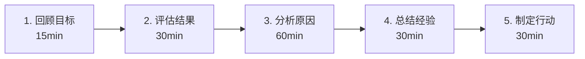
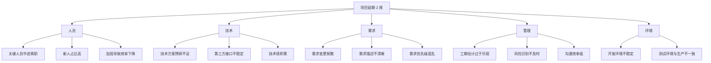

# 项目复盘模板

> **文档说明**：提供完整可复用的项目复盘（Project Retrospective / Postmortem）模板，涵盖项目概况、目标达成、过程回顾、经验教训、问题分析、改进措施、知识沉淀等核心模块，含填写示例、复盘会议流程和常用分析方法（5 Whys、鱼骨图、SWOT），帮助团队从项目中系统性学习和持续改进。
>
> **适用人群**：项目经理、技术负责人、团队 Leader、需要进行项目复盘的全栈开发者
>
> **前置知识**：[[项目启动文档模板]]、[[敏捷开发与Scrum]]、项目管理基础

---

## 一、概述

### 1. 为什么需要项目复盘

项目复盘（Retrospective）是项目结束后（或重大里程碑后），团队一起回顾项目过程、总结经验教训、制定改进措施的活动。它是团队**持续改进**的核心机制。

| 价值 | 说明 |
|------|------|
| **避免重复犯错** | 把这次的问题和教训记录下来，下次不再犯 |
| **沉淀最佳实践** | 把这次做得好的地方固化为流程和规范 |
| **团队学习** | 让每个成员从项目中学习，提升整体能力 |
| **情绪释放** | 给团队一个表达感受、释放压力的机会 |
| **过程改进** | 识别流程中的瓶颈和问题，持续优化 |
| **知识传承** | 把项目中的隐性知识转化为显性知识 |

**不复盘的后果**：
- 同样的错误在每个项目中重复出现
- 好的经验只留在个人脑子里，人员流动就丢失
- 团队只关注"做完"，不关注"做好"
- 流程问题永远得不到解决
- 团队士气低落，只干活不成长

### 2. 复盘的类型与时机

| 类型 | 时机 | 参与人 | 时长 | 侧重点 |
|------|------|--------|------|--------|
| **迭代回顾（Sprint Retrospective）** | 每个迭代结束 | 开发团队 | 1h | 团队协作、流程问题 |
| **里程碑复盘** | 重大里程碑后 | 核心团队 | 2h | 阶段成果、风险问题 |
| **项目终期复盘** | 项目上线后 1-2 周 | 全体干系人 | 3-4h | 全面回顾、经验沉淀 |
| **故障复盘（Postmortem）** | 重大故障后 | 相关人员 | 1-2h | 根因分析、改进措施 |
| **月度/季度复盘** | 每月/每季 | 团队 Leader | 1h | 趋势分析、组织改进 |

### 3. 复盘的核心原则

| 原则 | 说明 |
|------|------|
| **对事不对人** | 复盘的目的是改进流程，不是追究个人责任 |
| **坦诚开放** | 鼓励每个人说出真实想法，包括负面感受 |
| **聚焦未来** | 不只纠结过去，更关注未来如何改进 |
| **数据驱动** | 用数据和事实说话，避免主观臆断 |
| **全员参与** | 每个角色都有发言权，不只是 Leader 讲 |
| **可执行** | 改进措施要具体、可执行、有负责人、有截止时间 |
| **跟进行动** | 复盘不是结束，改进措施的执行才是关键 |

### 4. 复盘 vs 其他会议

| 会议 | 目的 | 侧重点 | 产出 |
|------|------|--------|------|
| **项目复盘** | 学习和改进 | 过程、经验、教训 | 改进措施、知识文档 |
| **项目评审** | 评估成果 | 交付物、质量、指标 | 评审结论、验收意见 |
| **项目汇报** | 信息同步 | 进度、成果、问题 | 汇报材料、决策 |
| **迭代回顾** | 团队改进 | 协作、流程、工具 | 迭代改进项 |
| **故障复盘** | 根因分析 | 故障原因、影响、修复 | 修复方案、预防措施 |

---

## 二、复盘会议流程

### 1. 标准复盘流程（4步法）



| 步骤 | 时间 | 目的 | 关键问题 | 产出 |
|------|------|------|---------|------|
| **1. 回顾目标** | 15min | 对齐项目初衷 | 我们的目标是什么？计划怎么做？ | 项目目标回顾 |
| **2. 评估结果** | 30min | 对比目标与实际 | 哪些做到了？哪些没做到？有哪些意外？ | 亮点与不足清单 |
| **3. 分析原因** | 60min | 深挖根本原因 | 为什么做得好/不好？关键因素是什么？ | 根因分析 |
| **4. 总结经验** | 30min | 提炼可复用的经验 | 我们学到了什么？哪些可以固化？ | 经验教训清单 |
| **5. 制定行动** | 30min | 落实改进 | 下一步做什么？谁负责？什么时候完成？ | 改进措施清单 |

### 2. 复盘会议规则

| 规则 | 说明 |
|------|------|
| **准时开始结束** | 严格控制时间，不拖延 |
| **手机静音** | 专注会议，不处理其他事务 |
| **每人发言** | 确保每个成员都有发言机会 |
| **不打断** | 别人发言时不打断，有不同意见记下来后面说 |
| **不追责** | 复盘不追究个人责任，聚焦流程改进 |
| **保密原则** | 复盘内容仅限团队内部，不外传 |
| **记录员** | 指定一人记录关键内容和行动项 |
| **主持人** | 指定一人引导流程，控制时间和氛围 |

### 3. 常用复盘方法

#### 方法1：5 Whys（根因分析）

```text
问题：线上故障导致服务不可用 2 小时
为什么？→ 数据库连接池耗尽
为什么？→ 慢查询占用了所有连接
为什么？→ 新上线的功能缺少索引
为什么？→ 代码评审时没有关注 SQL 性能
为什么？→ 团队没有 SQL 性能评审的规范和检查清单
根本原因：缺少 SQL 性能评审机制
```

#### 方法2：鱼骨图（因果分析）



#### 方法3：SWOT 分析

| | 正面 | 负面 |
|---|------|------|
| **内部** | **优势（Strengths）**：团队技术能力强、协作默契 | **劣势（Weaknesses）**：测试覆盖不足、文档不完善 |
| **外部** | **机会（Opportunities）**：新技术栈提升效率、开源社区支持 | **威胁（Threats）**：需求频繁变更、人员流动风险 |

#### 方法4：KPT 法（Keep/Problem/Try）

| 分类 | 说明 | 示例 |
|------|------|------|
| **Keep（保持）** | 做得好的，继续保持 | 每日站会效率高、代码评审质量好 |
| **Problem（问题）** | 遇到的问题，需要改进 | 需求变更频繁、测试环境不稳定 |
| **Try（尝试）** | 下次想尝试的新做法 | 引入自动化测试、改用看板管理 |

#### 方法5：时间线法

按时间顺序回顾项目的关键节点，每个节点讨论：
- 当时发生了什么？
- 我们做了什么决策？
- 结果如何？
- 如果重来会怎么做？

```text
项目启动 → 需求确认 → 技术设计 → 开发阶段 → 测试阶段 → 上线发布 → 运维阶段
```

---

## 三、完整复盘模板

以下是完整的项目复盘文档模板，可直接复制使用。

---

```markdown
# 项目复盘报告：[项目名称]

| 文档版本 | v1.0 |
|---------|------|
| 复盘日期 | 2026-09-07 |
| 复盘时长 | 3 小时 |
| 主持人 | [姓名] |
| 记录员 | [姓名] |
| 参与人 | [列出所有参与人] |
| 项目周期 | [开始日期] ~ [结束日期] |
| 项目状态 | ✅ 已完成 / 🟡 部分完成 / 🔴 未完成 |

---

## 1. 项目概况

### 1.1 项目背景

[简要回顾项目背景：为什么做这个项目？解决什么问题？]

### 1.2 项目目标

| 目标编号 | 目标描述 | 衡量指标 | 目标值 | 实际值 | 达成情况 |
|---------|---------|---------|--------|--------|---------|
| G1 | [目标] | [指标] | [目标值] | [实际值] | ✅达成 / 🟡部分 / ❌未达成 |
| G2 | [目标] | [指标] | [目标值] | [实际值] | ✅达成 / 🟡部分 / ❌未达成 |

### 1.3 项目范围

**计划范围**：[列出计划做的功能]

**实际范围**：[列出实际完成的功能]

**范围变更**：
| 变更内容 | 变更原因 | 变更时间 | 影响 |
|---------|---------|---------|------|
| [变更1] | [原因] | [日期] | [影响] |

### 1.4 关键数据

| 指标 | 计划 | 实际 | 偏差 |
|------|------|------|------|
| 项目工期 | [天数] | [天数] | [偏差] |
| 投入人天 | [人天] | [人天] | [偏差] |
| 功能点数 | [数量] | [数量] | [偏差] |
| Bug 数量 | [数量] | [数量] | [偏差] |
| 线上故障 | [次数] | [次数] | [偏差] |
| 代码行数 | [行数] | [行数] | [偏差] |
| 测试覆盖率 | [百分比] | [百分比] | [偏差] |

---

## 2. 亮点与不足

### 2.1 做得好的地方（Keep / Strengths）

> 列出项目中做得好的、值得保持和推广的做法

1. **[亮点1]**：[详细说明为什么好、好在哪里、带来了什么价值]
2. **[亮点2]**：[说明]
3. **[亮点3]**：[说明]

**示例**：
1. **技术方案预研充分**：项目启动前用 2 周时间做了技术 POC，验证了核心技术的可行性，避免了开发中的技术风险。
2. **代码评审质量高**：坚持每次 PR 至少 1 人评审，核心模块 2 人评审，提前发现了 30+ 个潜在问题。
3. **自动化测试覆盖好**：单元测试覆盖率达到 85%，核心模块 95%，回归测试效率提升 50%。

### 2.2 做得不好的地方（Problem / Weaknesses）

> 列出项目中遇到的问题和不足，聚焦流程和机制，不追究个人责任

1. **[问题1]**：[详细说明问题表现、影响、原因]
2. **[问题2]**：[说明]
3. **[问题3]**：[说明]

**示例**：
1. **需求变更频繁**：项目期间共发生 15 次需求变更，其中 5 次是重大变更，导致工期延长 2 周。原因是需求确认阶段不够充分，缺乏变更管控机制。
2. **测试环境不稳定**：测试环境每周平均故障 2 次，影响测试进度。原因是测试环境与生产环境配置不一致，且缺乏环境监控和自动恢复机制。
3. **文档不完善**：项目结束时技术文档只完成了 60%，API 文档有 30% 与实际不一致。原因是文档编写没有纳入开发任务，缺乏文档评审机制。

### 2.3 意外收获（Unexpected Wins）

> 列出项目中意外的收获和惊喜

1. **[收获1]**：[说明]
2. **[收获2]**：[说明]

---

## 3. 关键事件回顾

### 3.1 项目时间线

```
graph LR
    A[项目启动<br/>日期] --> B[需求确认<br/>日期]
    B --> C[技术设计<br/>日期]
    C --> D[开发阶段<br/>日期]
    D --> E[测试阶段<br/>日期]
    E --> F[上线发布<br/>日期]
    F --> G[运维阶段<br/>日期]
```css

### 3.2 关键决策回顾

| 决策点 | 决策内容 | 决策时间 | 决策依据 | 结果评价 | 如果重来会怎么做 |
|--------|---------|---------|---------|---------|----------------|
| [决策1] | [内容] | [日期] | [依据] | ✅正确 / 🟡一般 / ❌错误 | [改进] |
| [决策2] | [内容] | [日期] | [依据] | ✅正确 / 🟡一般 / ❌错误 | [改进] |

### 3.3 重大问题与处理

| 问题 | 发生时间 | 影响 | 处理方式 | 处理结果 | 经验教训 |
|------|---------|------|---------|---------|---------|
| [问题1] | [日期] | [影响] | [方式] | [结果] | [教训] |
| [问题2] | [日期] | [影响] | [方式] | [结果] | [教训] |

---

## 4. 根因分析

### 4.1 Top 3 问题根因分析

#### 问题1：[问题描述]

**5 Whys 分析**：
```
为什么会出现这个问题？→ [原因1]
为什么会[原因1]？→ [原因2]
为什么会[原因2]？→ [原因3]
为什么会[原因3]？→ [原因4]
为什么会[原因4]？→ [根本原因]
```json

**鱼骨图分析**：
- 人员：[因素]
- 技术：[因素]
- 流程：[因素]
- 需求：[因素]
- 环境：[因素]
- 管理：[因素]

**根本原因**：[总结根本原因]

#### 问题2：[问题描述]

[同上分析]

#### 问题3：[问题描述]

[同上分析]

---

## 5. 经验教训

### 5.1 技术经验

| 编号 | 经验/教训 | 适用场景 | 推荐做法 |
|------|----------|---------|---------|
| T01 | [经验] | [场景] | [做法] |
| T02 | [经验] | [场景] | [做法] |

### 5.2 流程经验

| 编号 | 经验/教训 | 适用场景 | 推荐做法 |
|------|----------|---------|---------|
| P01 | [经验] | [场景] | [做法] |
| P02 | [经验] | [场景] | [做法] |

### 5.3 管理经验

| 编号 | 经验/教训 | 适用场景 | 推荐做法 |
|------|----------|---------|---------|
| M01 | [经验] | [场景] | [做法] |
| M02 | [经验] | [场景] | [做法] |

### 5.4 团队协作经验

| 编号 | 经验/教训 | 适用场景 | 推荐做法 |
|------|----------|---------|---------|
| C01 | [经验] | [场景] | [做法] |
| C02 | [经验] | [场景] | [做法] |

---

## 6. 改进措施与行动计划

### 6.1 改进措施清单

> 每个改进措施必须具体、可执行、有负责人、有截止时间

| 编号 | 改进措施 | 对应问题 | 优先级 | 负责人 | 截止时间 | 验收标准 | 状态 |
|------|---------|---------|--------|--------|---------|---------|------|
| A01 | [具体措施] | [问题编号] | P0/P1/P2 | [姓名] | [日期] | [标准] | ⬜待开始 |
| A02 | [具体措施] | [问题编号] | P0/P1/P2 | [姓名] | [日期] | [标准] | 🔄进行中 |
| A03 | [具体措施] | [问题编号] | P0/P1/P2 | [姓名] | [日期] | [标准] | ✅已完成 |

**优先级定义**：
- **P0**：立即执行，下个项目必须落地
- **P1**：1 个月内执行，纳入近期工作计划
- **P2**：长期改进，纳入团队改进 backlog

### 6.2 流程优化建议

| 当前流程 | 问题 | 优化建议 | 预期效果 |
|---------|------|---------|---------|
| [流程1] | [问题] | [建议] | [效果] |
| [流程2] | [问题] | [建议] | [效果] |

### 6.3 工具/技术升级建议

| 工具/技术 | 当前状态 | 建议 | 预期收益 |
|----------|---------|------|---------|
| [工具1] | [状态] | [建议] | [收益] |
| [工具2] | [状态] | [建议] | [收益] |

---

## 7. 知识沉淀

### 7.1 新增文档

| 文档名称 | 文档类型 | 存放位置 | 负责人 | 状态 |
|---------|---------|---------|--------|------|
| [文档1] | 技术文档/规范/教程 | [路径] | [姓名] | ⬜待编写 |
| [文档2] | 技术文档/规范/教程 | [路径] | [姓名] | ✅已完成 |

### 7.2 更新现有文档

| 文档名称 | 更新内容 | 负责人 | 状态 |
|---------|---------|--------|------|
| [文档1] | [更新内容] | [姓名] | ⬜待更新 |

### 7.3 代码/配置沉淀

| 内容 | 类型 | 存放位置 | 说明 |
|------|------|---------|------|
| [内容1] | 代码片段/配置/脚本/模板 | [路径/仓库] | [说明] |

### 7.4 培训分享

| 主题 | 分享人 | 形式 | 计划时间 | 受众 |
|------|--------|------|---------|------|
| [主题1] | [姓名] | 内部分享/文档/视频 | [日期] | [团队] |

---

## 8. 团队反馈

### 8.1 个人收获

> 每个成员写下自己从项目中最大的收获

| 成员 | 最大收获 | 最大遗憾 | 下次想改进的 |
|------|---------|---------|------------|
| [成员1] | [收获] | [遗憾] | [改进] |
| [成员2] | [收获] | [遗憾] | [改进] |

### 8.2 团队满意度

| 维度 | 评分（1-5） | 说明 |
|------|------------|------|
| 目标清晰度 | [分数] | [说明] |
| 计划合理性 | [分数] | [说明] |
| 流程效率 | [分数] | [说明] |
| 团队协作 | [分数] | [说明] |
| 技术成长 | [分数] | [说明] |
| 工作氛围 | [分数] | [说明] |
| 成果满意度 | [分数] | [说明] |
| **综合评分** | **[平均分]** | |

### 8.3 自由发言

> 记录会议中大家的自由发言和讨论要点

- [发言1]
- [发言2]
- [发言3]

---

## 9. 附录

### 9.1 项目交付物清单

| 交付物 | 类型 | 位置/链接 | 状态 |
|--------|------|----------|------|
| [交付物1] | 代码/文档/设计稿 | [链接] | ✅ |

### 9.2 参考资料

- [资料1]：[链接]
- [资料2]：[链接]

### 9.3 变更记录

| 版本 | 日期 | 修改人 | 修改内容 |
|------|------|--------|---------|
| v1.0 | 2026-09-07 | [姓名] | 初始版本 |

---

## 确认

| 角色 | 姓名 | 确认 | 日期 |
|------|------|------|------|
| 项目经理 | [姓名] | ✅ | [日期] |
| 技术负责人 | [姓名] | ✅ | [日期] |
| 团队代表 | [姓名] | ✅ | [日期] |
```

---

## 四、使用说明

### 1. 复盘前准备

| 准备项 | 负责人 | 说明 |
|--------|--------|------|
| 数据收集 | 项目经理 | 收集项目数据：工期、人天、Bug数、覆盖率等 |
| 文档整理 | 记录员 | 整理项目文档、决策记录、Issue 列表 |
| 会议邀请 | 主持人 | 提前 3 天邀请，说明复盘目的和议程 |
| 预填写 | 全体 | 提前 1 天让大家填写亮点和不足（匿名可选） |
| 场地准备 | 记录员 | 会议室/线上会议、白板/在线协作工具、计时器 |

### 2. 复盘中引导

**主持人引导技巧**：
- 开场时明确复盘目的和规则，营造安全氛围
- 用"我们"而不是"你"，避免指责
- 当讨论偏离主题时，温和地拉回来
- 当有人沉默时，主动邀请发言
- 当讨论过于情绪化时，先接纳情绪，再回到事实
- 控制每个环节的时间，确保所有议程都能完成
- 最后总结关键结论和行动项，确保大家达成共识

**常见冷场应对**：
- 用匿名投票/便签收集，降低发言压力
- 从"做得好的地方"开始，营造积极氛围
- 主持人先分享自己的感受，带头示范
- 用具体的问题引导，而不是"大家有什么想说的"
- 分组讨论，每组派代表发言

### 3. 复盘后跟进

| 跟进项 | 负责人 | 时间 | 说明 |
|--------|--------|------|------|
| 复盘报告整理 | 记录员 | 复盘后 3 天内 | 整理会议记录，形成正式复盘报告 |
| 改进措施分配 | 项目经理 | 复盘后 1 周内 | 将改进措施分配到具体人，纳入工作计划 |
| 改进措施跟踪 | 项目经理 | 每周 | 在周会中跟踪改进措施的执行进度 |
| 改进效果评估 | 项目经理 | 1 个月后 | 评估改进措施的效果，调整优化 |
| 知识沉淀落地 | 技术负责人 | 2 周内 | 确保新增文档、代码模板等落地 |
| 下项目应用 | 全体 | 下个项目 | 确保经验教训在下个项目中应用 |

### 4. 改进措施跟踪模板

```markdown
## 改进措施跟踪表

| 编号 | 改进措施 | 负责人 | 截止时间 | 状态 | 进度说明 | 验收结果 |
|------|---------|--------|---------|------|---------|---------|
| A01 | [措施] | [姓名] | [日期] | 🟡进行中 | [进度] | - |
| A02 | [措施] | [姓名] | [日期] | ✅已完成 | - | ✅通过 |
| A03 | [措施] | [姓名] | [日期] | ❌延期 | [原因] | - |

### 每周更新
- [日期]：[更新内容]
```

---

## 五、故障复盘（Postmortem）专项模板

对于重大线上故障，使用更聚焦的复盘模板：

```markdown
# 故障复盘报告：[故障标题]

| 故障编号 | INC-2026-001 |
|---------|--------------|
| 故障等级 | P0/P1/P2/P3 |
| 发生时间 | 2026-09-07 14:30:00 |
| 恢复时间 | 2026-09-07 16:45:00 |
| 持续时长 | 2 小时 15 分钟 |
| 影响范围 | [影响的用户/服务/业务] |
| 故障负责人 | [姓名] |
| 复盘日期 | 2026-09-08 |

## 1. 故障时间线

| 时间 | 事件 | 操作人 |
|------|------|--------|
| 14:30 | 故障开始，监控告警触发 | 系统 |
| 14:35 | 运维人员收到告警，开始排查 | [姓名] |
| 14:45 | 确认数据库连接池耗尽 | [姓名] |
| 15:00 | 重启服务，临时恢复 | [姓名] |
| 15:30 | 找到根因：慢查询 | [姓名] |
| 16:00 | 添加索引，优化 SQL | [姓名] |
| 16:45 | 完全恢复，监控正常 | [姓名] |

## 2. 故障影响

- **用户影响**：[影响的用户数、业务影响]
- **业务影响**：[损失的收入、影响的业务量]
- **数据影响**：[是否有数据丢失或不一致]
- **声誉影响**：[是否有用户投诉、媒体报道]

## 3. 根因分析

### 直接原因
[直接导致故障的技术原因]

### 根本原因（5 Whys）
```
为什么？→ [原因1]
为什么？→ [原因2]
为什么？→ [原因3]
为什么？→ [原因4]
为什么？→ [根本原因]
```json

###  contributing factors（ contributing factors）
- [因素1]
- [因素2]

## 4. 处理过程回顾

| 步骤 | 做得好的 | 做得不好的 | 改进点 |
|------|---------|-----------|--------|
| 发现告警 | [好的] | [不好的] | [改进] |
| 排查定位 | [好的] | [不好的] | [改进] |
| 临时恢复 | [好的] | [不好的] | [改进] |
| 根因修复 | [好的] | [不好的] | [改进] |
| 事后验证 | [好的] | [不好的] | [改进] |

## 5. 改进措施

| 编号 | 改进措施 | 类型 | 优先级 | 负责人 | 截止时间 |
|------|---------|------|--------|--------|---------|
| F01 | [措施] | 预防/检测/恢复/流程 | P0 | [姓名] | [日期] |
| F02 | [措施] | 预防/检测/恢复/流程 | P1 | [姓名] | [日期] |

## 6. 经验教训

[从这次故障中学到的关键经验]
```

---

## 六、关联笔记

### 项目管理
- [[项目启动文档模板]] · [[开源项目README规范]] · [[敏捷开发与Scrum]]
- [[项目管理方法论]] · [[项目管理与协作]] · [[精益创业方法论]]

### 质量与运维
- [[代码评审规范]] · [[CI-CD流水线设计]] · [[监控与告警体系]]
- [[Grafana-可视化看板]] · [[线上故障排查手册]] · [[AIOps智能运维实战]]

### 团队与成长
- [[团队知识库建设方法论]] · [[个人知识IP构建]] · [[技术博客写作指南]]
- [[技术成长路径规划]] · [[高效学习方法论]]

### 导航
- [[MOC-项目实战-四级展开]] · [[MOC-产品与模板]] · [[MOC-全栈项目]]

> **学习路径建议**：项目启动时用 [[项目启动文档模板]] 制定计划 → 项目过程中用 [[敏捷开发与Scrum]] 管理迭代 → 项目结束后用本文模板进行复盘 → 复盘后的改进措施用 [[CI-CD流水线设计]] 等工具落地 → 经验教训沉淀到知识库，形成持续改进的闭环。

---

## 🔗 关联笔记

- [[MOC-项目实战]] — 返回本分类知识地图，查看更多相关文档

## 📖 前置知识

- [[项目启动文档模板]]
- [[开源项目README规范]]

## 🏷️ 相关标签

`#项目实战` `#项目管理` `#复盘` `#模板` `#产品与模板`

[[Home|🏠 返回首页]] · [[MOC-项目实战|📚 返回分类]]
