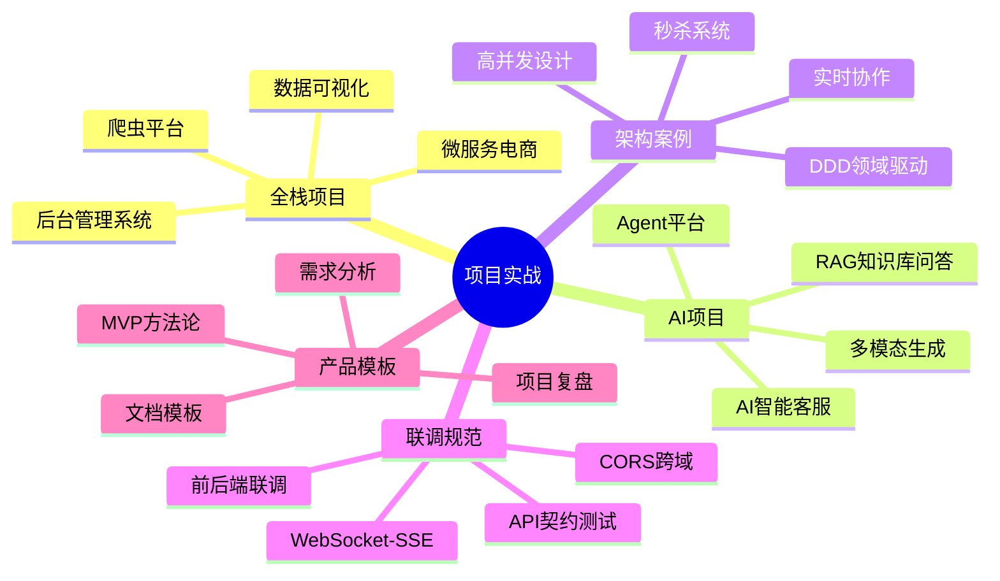
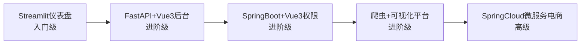
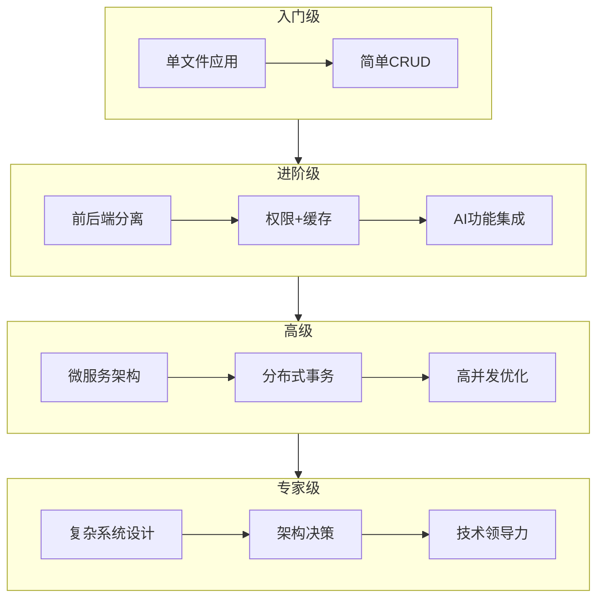

# 📌 项目实战 MOC

> **内容地图**：全栈+AI项目实战体系，涵盖全栈项目、AI项目、架构设计案例、联调规范、产品模板五大领域，共64篇实战文档。通过项目驱动学习，将理论知识转化为工程能力。
>
> **核心理念**：做项目是最好的学习方式。每个项目都覆盖完整的技术栈，从需求分析到部署上线，积累可复用的工程经验。

---

## 📚 项目分类总览

---

## 一、全栈项目实战（5篇）

> 覆盖前端+后端+数据库+部署的完整全栈项目，从简单到复杂递进。

| 项目 | 技术栈 | 难度 | 核心技能 |
|------|--------|------|---------|
| [[实战-FastAPI+Vue3后台管理系统]] | FastAPI + Vue3 + MySQL + Redis | 🟡进阶 | 全栈CRUD、权限管理、文件上传、JWT认证 |
| [[实战-SpringBoot+Vue3权限管理系统]] | SpringBoot + Vue3 + MySQL + Redis | 🟡进阶 | RBAC权限、SpringSecurity、前后端分离 |
| [[实战-SpringCloud微服务电商系统]] | SpringCloud + Vue3 + MySQL + Redis + MQ | 🔴高级 | 微服务架构、分布式事务、高并发、服务治理 |
| [[实战-Python爬虫+数据可视化平台]] | Python + Scrapy + ECharts + FastAPI | 🟡进阶 | 数据爬取、清洗、存储、可视化展示 |
| [[实战-Streamlit数据分析仪表盘]] | Streamlit + Pandas + Plotly | 🟢入门 | 快速数据应用、交互式图表、数据分析 |

### 项目学习顺序

---

## 二、AI项目实战（9篇）

> AI驱动的智能应用项目，覆盖RAG、Agent、多模态、AI网关等核心场景。

| 项目 | 技术栈 | 难度 | 核心技能 |
|------|--------|------|---------|
| [[实战-FastAPI+RAG知识库问答]] | FastAPI + LangChain + Chroma + Vue3 | 🟡进阶 | RAG全流程、向量检索、流式输出 |
| [[实战-RAG企业知识库问答系统]] | LangChain + Milvus + FastAPI + React | 🔴高级 | 企业级RAG、权限控制、文档管理、评估 |
| [[实战-Java对接大模型智能客服]] | SpringBoot + LLM + Redis + Vue3 | 🟡进阶 | 多轮对话、知识库、工单系统、SSE流式 |
| [[实战-SpringBoot+AI Agent平台]] | SpringBoot + LangChain4j + React | 🔴高级 | Agent编排、工具调用、多模型路由 |
| [[实战-Agent自动化办公助手]] | Python + LangGraph + CrewAI | 🔴高级 | 多Agent协作、办公自动化、任务编排 |
| [[实战-AI代码审查工具]] | Python + LLM + Git API | 🟡进阶 | 代码分析、自动审查、PR评论、CI集成 |
| [[实战-多模态内容生成平台]] | Python + VLM + TTS + FastAPI | 🔴高级 | 图文音视频多模态生成、工作流编排 |
| [[统一AI网关设计与实现]] | Java/Python + 多模型 + 限流 | 🔴高级 | 统一网关、多模型路由、负载均衡、计费 |
| [[Python+Java混合AI架构实战]] | Python + Java + gRPC + MQ | 🔴高级 | 多语言混合架构、服务通信、AI能力集成 |

---

## 三、架构设计案例（7篇）

> 经典架构设计案例，学习高并发、高可用、领域驱动等架构思维。

| 案例 | 核心架构 | 难度 | 关键技术 |
|------|---------|------|---------|
| [[秒杀系统架构设计]] | 高并发秒杀 | 🔴高级 | 限流、缓存、异步、库存扣减、防超卖 |
| [[高并发系统设计案例]] | 高并发通用架构 | 🔴高级 | 负载均衡、缓存策略、消息队列、分库分表 |
| [[DDD领域驱动设计实战]] | 领域驱动设计 | 🔴高级 | 限界上下文、聚合根、领域事件、CQRS |
| [[云原生架构设计]] | 云原生架构 | 🔴高级 | 微服务、容器化、Service Mesh、GitOps |
| [[实时协作系统设计]] | 实时协作 | 🔴高级 | WebSocket、OT/CRDT、冲突解决、在线状态 |
| [[多语言混合架构设计]] | 多语言架构 | 🔴高级 | 服务拆分、通信协议、数据一致性 |
| [[多模型路由与流式响应跨语言传递]] | AI网关架构 | 🔴高级 | 流式传输、跨语言、多模型管理 |

---

## 四、联调与规范（4篇）

> 前后端联调中的常见问题与最佳实践，确保团队协作高效。

| 主题 | 核心内容 | 难度 |
|------|---------|------|
| [[前后端联调规范与流程]] | 接口约定、联调流程、问题定位 | 🟢入门 |
| [[CORS跨域解决方案实战]] | 跨域原理、解决方案、Nginx配置、Cookie | 🟡进阶 |
| [[WebSocket-SSE联调实战]] | 实时通信、SSE流式、WebSocket、断线重连 | 🟡进阶 |
| [[API契约测试与Mock]] | 契约测试、Mock服务、接口版本管理 | 🟡进阶 |

---

## 五、产品与模板（16篇）

> 产品思维与项目模板，从需求到复盘的完整项目管理工具集。

### 产品方法论
- [[MVP最小可行产品]] — MVP定义、验证方法、迭代策略
- [[需求分析与用户故事]] — 需求拆解、用户故事、验收标准
- [[产品原型设计方法]] — 原型工具、交互设计、用户体验
- [[从0到1产品落地路径]] — 产品规划、开发节奏、上线推广
- [[独立开发者IndieHacker思路]] — 独立开发、产品选型、变现策略

### 技术管理
- [[技术选型决策记录-ADR]] — 架构决策记录、选型方法、技术债务
- [[技术债务管理]] — 债务识别、偿还策略、优先级排序
- [[开源项目README规范]] — README结构、 badges、使用文档

### 项目模板
- [[项目启动文档模板]] — 项目章程、目标、范围、里程碑
- [[API设计文档模板]] — RESTful API设计、接口规范、示例
- [[数据库设计文档模板]] — 表结构、索引、关系图、数据字典
- [[项目复盘模板]] — 复盘框架、经验总结、改进计划

### 枢纽与展开
- [[项目实战-枢纽]] — 项目实战核心枢纽
- [[MOC-项目实战-四级展开]] — 项目实战四级知识展开
- [[项目笔记_美化版_v2_优化版]] — 综合项目笔记

---

## 📖 项目学习路径

### 按阶段推荐项目

| 学习阶段 | 推荐项目 | 技能目标 |
|---------|---------|---------|
| 🌱 入门筑基 | Streamlit数据分析仪表盘 | 理解Web应用基本结构 |
| ⚡ 进阶实战 | FastAPI+Vue3后台管理系统 | 掌握全栈开发流程 |
| ⚡ 进阶实战 | RAG知识库问答 | 掌握AI应用开发 |
| 🏗️ 高级架构 | SpringCloud微服务电商 | 掌握微服务架构 |
| 🏗️ 高级架构 | AI Agent平台 | 掌握AI工程化 |
| 👑 专家精通 | 多模态内容生成平台 | 掌握复杂系统设计 |

### 项目能力递进

---

## 🔗 跨领域关联

| 关联领域 | 关联点 | 对应笔记 |
|---------|--------|---------|
| 前端开发 | 项目前端实现 | [[MOC-前端开发]] |
| 后端开发 | 项目后端架构 | [[MOC-后端开发]] |
| 数据库 | 数据存储设计 | [[MOC-数据库与缓存]] |
| 云原生 | 项目部署运维 | [[MOC-云原生与运维]] |
| AI工程 | AI功能开发 | [[MOC-AI与效率工具]] |
| 学习路线 | 项目学习顺序 | [[分阶段项目实战递进路线]] |

---

## 🏷️ 标签体系

`#项目实战` `#全栈` `#AI项目` `#架构设计` `#微服务` `#RAG` `#Agent` `#高并发` `#DDD` `#联调` `#产品` `#模板`

---

[[Home|🏠 返回首页]] · [[全栈+AI工程双轨融合学习路线图|🗺️ 学习路线]] · [[分阶段项目实战递进路线|📋 项目路线]]
---

## 📝 新增文档（2026-09）

- [[实战-AI智能客服系统|实战-AI智能客服系统]]

