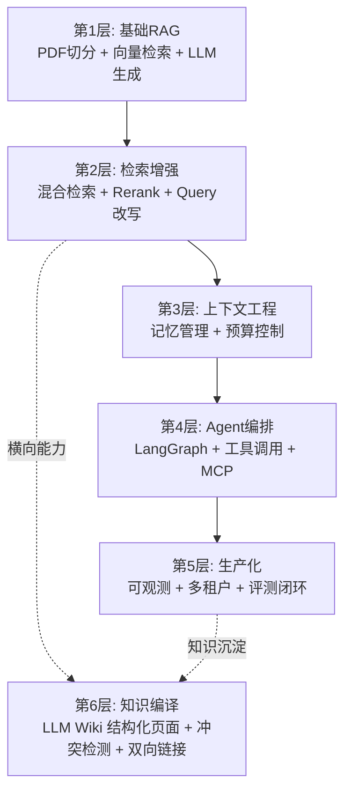

# P0/P1/P2 深度学习 MOC

> [!abstract] 这是什么
> 这是你「企业级智能知识库 + AI Agent」项目的能力补全导航页。
>
> 把应届简历最容易缺的 10 项能力，按 P0（必须）/ P1（加分）/ P2（了解）分级，
> 每篇都写成「概念 → 原理 → 可运行代码 → 坑点 → 练习」的深度指南。
>
> **学习顺序**：从 01 到 07，按编号读。

---

## 一、五层能力地图

大部分应届生停在第 1 层。你的目标是第 4-5 层，第 6 层（知识编译）是 2026 差异化加分项。

---

## 二、文档导航

### P0：必须掌握（不学不行）

| 序号 | 文档 | 解决什么问题 | 学时 |
| --- | --- | --- | --- |
| 01 | [[01-RAG评测体系深度指南]] | 怎么知道你的 RAG 效果好不好 | 2 周 |
| 02 | [[02-检索增强三件套深度指南]] | 为什么朴素向量检索不够用 | 2 周 |
| 03 | [[03-上下文工程深度指南]] | 有限 context window 里装什么 | 1.5 周 |
| 04 | [[04-MCP模型上下文协议深度指南]] | 怎么把工具标准化暴露 | 1 周 |

### P1：加分项（做了能拉开差距）

| 序号 | 文档 | 解决什么问题 | 学时 |
| --- | --- | --- | --- |
| 05 | [[05-生产化与可观测性]] | 怎么从 demo 变成能上线的系统 | 2 周 |
| 06 | [[06-Agent编排与LangGraph]] | 多步任务怎么编排 | 1.5 周 |

### P2：了解即可（知道怎么取舍）

| 序号 | 文档 | 解决什么问题 | 学时 |
| --- | --- | --- | --- |
| 07 | [[07-A2A与多模态与微调选型]] | 什么时候用什么技术 | 0.5 周 |

### P0.5：2026 新兴增量（W21 排期）

| 序号 | 文档 | 解决什么问题 | 学时 |
| --- | --- | --- | --- |
| 08 | [[08-Agentic-RAG进阶-SelfRAG与GraphRAG]] | Self-RAG/CRAG 让 RAG 会自我纠错；GraphRAG 多跳推理 | 1 周 |
| 09 | [[09-生产优化三件套]] | Semantic Cache 降本、LiteLLM 模型路由、Citation 出处 | 1 周 |
| 10 | [[10-结构化输出与健壮性]] | Pydantic 强制 JSON、错误兜底、Agent 不崩 | 3 天 |

### P1.5：知识编译层（2026 下一代知识管理）

| 序号 | 文档 | 解决什么问题 | 学时 |
| --- | --- | --- | --- |
| 11 | [[11-LLM Wiki编译型知识库深度指南]] | 文档写入时编译成结构化页面，解决知识沉淀/全局一致性/跨文档冲突 | 1 周 |

> 配套实战：[[实战-LLM Wiki编译层接入]]（代码已由 AI 完成，按手册验证即可）。

---

## 三、学习建议

> [!tip] 怎么用这套文档
> 1. **先看 MOC**，知道每篇讲什么
> 2. **按 01→07 顺序读**，前一篇是后一篇的前置
> 3. **每章的 ⭐ 练习必须做完**，⭐⭐ 选做，⭐⭐⭐ 有余力再做
> 4. **每学完一篇，就回项目里加对应功能**，用 [[01-RAG评测体系深度指南]] 里的 golden QA 验证
> 5. **遇到坑点（⚠️/🚨）停下来看**，这些都是面试官爱问的

> [!success] 学习节奏
> 每周投入：工作日每天 2 小时 + 周末 6 小时 ≈ 20 小时
> P0 四篇：6.5 周
> P1 两篇：3.5 周
> P2 一篇：0.5 周
> **总计约 10-11 周**

---

## 四、验收标准

学完后你应该能：

- [ ] 独立设计 40+ 条 golden QA，覆盖四类题型
- [ ] 手推 Hit@K / MRR / BM25 / RRF 公式
- [ ] 跑通「混合检索 → Rerank → 生成」完整流水线
- [ ] 写一个 FastMCP Server，把知识库暴露给 Claude Desktop
- [ ] 接入 Langfuse，trace 一次完整 RAG 调用
- [ ] 用 LangGraph 写一个多步 Agent（如周报生成）
- [ ] 讲清楚「为什么选 RAG 不选微调」

---

## 五、关联

- 项目入口：[[实战-RAG企业知识库问答系统]]
- 知识编译层：[[11-LLM Wiki编译型知识库深度指南]]、[[实战-LLM Wiki编译层接入]]
- 学习计划：[[开发计划]]
- 排期表：`学习排期表.html`
- 起点：[[01-RAG评测体系深度指南]]
