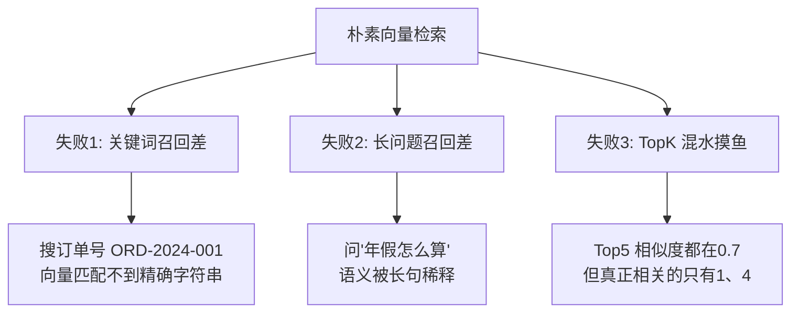
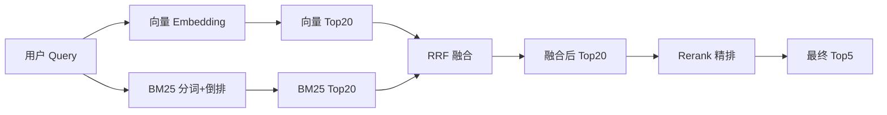
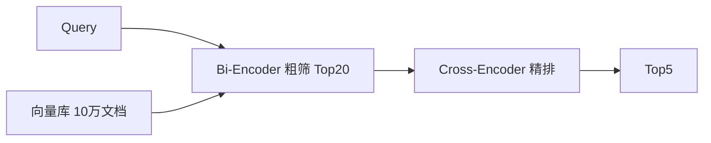
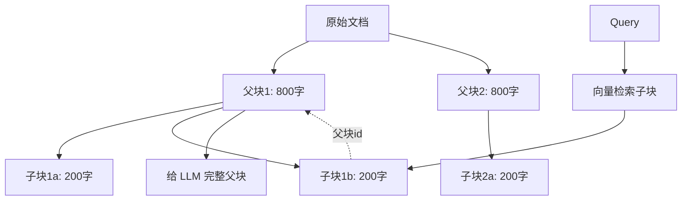
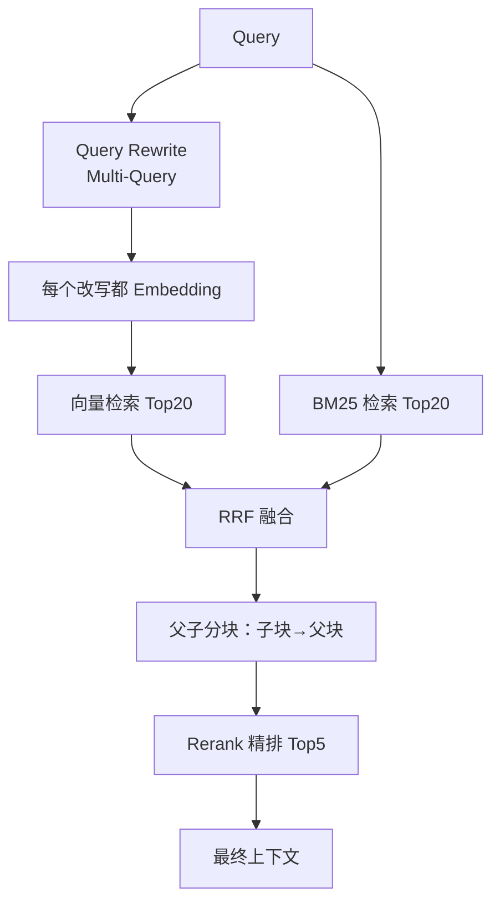

# 检索增强三件套深度指南

> [!abstract] 本章你会学到
> 为什么朴素向量检索会失败、BM25 是怎么打分的（手推公式）、怎么用 RRF 把 BM25 和向量融合、Rerank 精排为什么慢但准、Query Rewrite 和 HyDE 分别解决什么问题、父子分块怎么平衡「切片精准 vs 上下文完整」、语义分块怎么用。
>
> **前置知识**：[[01-RAG评测体系深度指南]]（你得先有评测尺子才能验证优化效果）。
> **预计学时**：2 周。
> **面试权重**：⭐⭐⭐⭐⭐。

---

## 第一章 为什么朴素向量检索不够用

### 1.1 三类典型失败

朴素 RAG 的检索流程是：问题 → Embedding → 向量库 TopK。它有三类典型失败：



| 失败类型 | 例子 | 解法 |
| --- | --- | --- |
| 关键词召回差 | 订单号、人名、错别字 | BM25 混合检索 |
| 长问题召回差 | 口语化、长难句 | Query Rewrite / Multi-Query |
| TopK 混水摸鱼 | 向量相似度都差不多 | Rerank 精排 |

### 1.2 一个反直觉的事实

> [!tip] 🎯 面试高频
> **LLM 接到正确的上下文时，95% 的情况都能答对。答错基本是因为上下文里根本没有正确答案。**
>
> 所以优化优先级永远是：**先把检索搞对，再调 prompt，再换模型**。
>
> 很多人花两周调 prompt，其实问题在检索。

---

## 第二章 BM25：经典稀疏检索

### 2.1 原理：词频 + 逆文档频率

BM25 是 Elasticsearch 默认算法，1990 年代就有了，2026 年还在 RAG 里用。核心公式：

```text
score(q, d) = Σ over q_i of  IDF(q_i) · (f(q_i,d) · (k1+1)) / (f(q_i,d) + k1 · (1 - b + b · |d|/avgdl))
```

三个关键参数：

| 参数 | 作用 | 经验值 |
| --- | --- | --- |
| **IDF** | 词越稀有越重要（「的」「是」权重低，「年假」「订单号」权重高） | 自动算 |
| **k1** | 控制词频饱和（一个词出现 10 次不是出现 1 次的 10 倍） | 1.2–2.0，常用 1.5 |
| **b** | 控制文档长度归一（长文档不该因为字数多就天然分高） | 0.5–0.8，常用 0.75 |

### 2.2 手推一个完整例子

假设语料库有 3 个文档：

```text
d1: 年假 是 带薪 假期
d2: 病假 需要 医生 证明
d3: 年假 和 病假 不冲突
```

查询：`年假 病假`

**Step 1：算 IDF**

总文档数 N=3。
- 「年假」出现在 d1、d3 → df=2 → IDF = log((3-2+0.5)/(2+0.5)+1) = log(0.6+1) = log(1.6) ≈ 0.47
- 「病假」出现在 d2、d3 → df=2 → IDF ≈ 0.47

**Step 2：算 d3 的 BM25 分**

d3 长度 6 个词，平均长度 avgdl=(5+4+6)/3≈5。k1=1.5, b=0.75。

「年假」在 d3 出现 1 次：
- 分子 = 1 · (1.5+1) = 2.5
- 分母 = 1 + 1.5 · (1 - 0.75 + 0.75 · 6/5) = 1 + 1.5 · (0.25 + 0.9) = 1 + 1.725 = 2.725
- 子分 = 0.47 · 2.5/2.725 ≈ 0.43

「病假」同理 ≈ 0.43

**d3 总分 ≈ 0.86**（最高，因为两个词都命中）

**Step 3：算 d1 的分**

「年假」出现 1 次，「病假」没出现。
- 「年假」子分：d1 长度 5，dl=5，分母 = 1 + 1.5·(0.25+0.75·5/5) = 1 + 1.5·1 = 2.5
- 子分 = 0.47 · 2.5/2.5 = 0.47
- d1 总分 = 0.47

**Step 4：排名**
1. d3: 0.86（两个词都命中）
2. d1: 0.47（只命中年假）
3. d2: 0.47（只命中病假）

### 2.3 中文分词：jieba

BM25 基于词，中文要先分词：

```python
import jieba

# 精确模式
list(jieba.cut("年假怎么申请"))
# ['年假', '怎么', '申请']

# 搜索引擎模式（更细）
list(jieba.cut_for_search("机器学习和深度学习"))
# ['机器', '学习', '深度', '学习', '机器学习', '深度学习']
```

> [!danger] 坑：专业词分错
> 「订单号」被分成「订单」「号」，「API Key」被分成「API」「Key」。解法：
> 1. 加自定义词典：`jieba.add_word("订单号")`
> 2. 或者用别的中文分词（pkuseg、hanlp）
> 3. 把行业术语整理成一个文件，启动时批量加载

```python
# 加载自定义词典
jieba.load_userdict("industry_terms.txt")
# industry_terms.txt 每行一个词
# 订单号
# 报销单
# 年假
```

### 2.4 最小可用 BM25 实现

```python
# backend/app/retrieval/bm25_retriever.py
import math
from collections import Counter
import jieba

class BM25Retriever:
    def __init__(self, docs: list[tuple[str, str]], k1: float = 1.5, b: float = 0.75):
        """
        Args:
            docs: list of (doc_id, text)
            k1: 词频饱和参数，1.2-2.0
            b: 长度归一参数，0.5-0.8
        """
        self.docs = docs
        self.k1 = k1
        self.b = b
        # 预分词
        self.tokens = {did: list(jieba.cut(text)) for did, text in docs}
        # 文档频率（df）
        self.df = Counter()
        for toks in self.tokens.values():
            for w in set(toks):
                self.df[w] += 1
        self.N = len(docs)
        self.avgdl = sum(len(t) for t in self.tokens.values()) / self.N if self.N else 0

    def score(self, query_tokens: list[str], doc_id: str) -> float:
        toks = self.tokens[doc_id]
        tf = Counter(toks)
        dl = len(toks)
        s = 0.0
        for w in query_tokens:
            if w not in tf:
                continue
            # IDF
            idf = math.log((self.N - self.df[w] + 0.5) / (self.df[w] + 0.5) + 1)
            freq = tf[w]
            # BM25 公式
            num = freq * (self.k1 + 1)
            den = freq + self.k1 * (1 - self.b + self.b * dl / self.avgdl)
            s += idf * num / den
        return s

    def search(self, query: str, top_k: int = 20) -> list[tuple[str, float]]:
        q_tokens = list(jieba.cut(query))
        scored = [(did, self.score(q_tokens, did)) for did, _ in self.docs]
        return sorted(scored, key=lambda x: -x[1])[:top_k]


# 用法
docs = [
    ("d1", "年假是带薪假期，工作满一年可休5天"),
    ("d2", "病假需要医生证明，按医疗期发放工资"),
    ("d3", "年假和病假不冲突，可分别申请"),
]
retriever = BM25Retriever(docs)
print(retriever.search("年假 病假", top_k=3))
# [('d3', 0.86), ('d1', 0.47), ('d2', 0.47)]
```

---

## 第三章 混合检索：BM25 + 向量 + RRF

### 3.1 为什么不能直接加分数

BM25 分可能是 12.5，向量相似度是 0.83。量纲不同，直接加起来毫无意义。

**RRF（Reciprocal Rank Fusion）** 只看排名不看分数：

```text
RRF_score(d) = Σ over ranker r of  weight_r / (k + rank_r(d))
```

k 通常取 60。直觉：排第 1 的得 1/(60+1)≈0.016，排第 10 的得 1/(60+10)≈0.014，差距小但方向对。

### 3.2 为什么 RRF 有效

- **对分数尺度不敏感**：不管 BM25 分是 12 还是 1.2，只看排名
- **鲁棒**：不需要调权重（默认 0.5/0.5 就行）
- **简单**：O(n) 时间

### 3.3 RRF 实现

```python
# backend/app/retrieval/hybrid.py
def rrf_fuse(
    vector_results: list[tuple[str, float]],
    bm25_results: list[tuple[str, float]],
    k: int = 60,
    weights: tuple[float, float] = (0.5, 0.5),
) -> list[tuple[str, float]]:
    """
    Args:
        vector_results: 向量检索结果 [(doc_id, score), ...] 按相关度降序
        bm25_results:   BM25 检索结果 [(doc_id, score), ...] 按相关度降序
        k: RRF 常数，默认 60
        weights: (向量权重, BM25 权重)
    Returns:
        融合后 [(doc_id, rrf_score), ...] 按 RRF 分降序
    """
    scores = {}
    # 向量通道
    for rank, (doc_id, _) in enumerate(vector_results, start=1):
        scores[doc_id] = scores.get(doc_id, 0) + weights[0] / (k + rank)
    # BM25 通道
    for rank, (doc_id, _) in enumerate(bm25_results, start=1):
        scores[doc_id] = scores.get(doc_id, 0) + weights[1] / (k + rank)
    return sorted(scores.items(), key=lambda x: -x[1])


# 手算例子
vec = [("d1", 0.9), ("d2", 0.8), ("d3", 0.7)]
bm25 = [("d3", 12.5), ("d1", 10.2), ("d4", 8.1)]
fused = rrf_fuse(vec, bm25)
# d1: 0.5/61 + 0.5/63 = 0.0082 + 0.0079 = 0.0161
# d3: 0.5/63 + 0.5/61 = 0.0079 + 0.0082 = 0.0161
# d2: 0.5/62 = 0.0081
# d4: 0.5/63 = 0.0079
# 排名: d1=d3 > d2 > d4
```

### 3.4 完整混合检索流程



### 3.5 怎么调权重

> [!danger] 坑：上来就调权重
> 默认 0.5/0.5 就行。先用评测集跑基线，再看：
> - 哪类问题 BM25 输？（关键词类 → 加大 BM25 权重）
> - 哪类问题向量输？（语义类 → 加大向量权重）
>
> 不要凭感觉调，要靠评测数据。

---

## 第四章 Rerank 精排

### 4.1 Bi-Encoder vs Cross-Encoder

| 模型类型 | 工作方式 | 速度 | 精度 |
| --- | --- | --- | --- |
| **Bi-Encoder**（向量模型） | 问题和文档分别编码成向量 | 快（向量可预计算） | 粗 |
| **Cross-Encoder**（Rerank 模型） | 把「问题+文档」拼在一起过模型 | 慢（每条候选都要过一次） | 准 |

**为什么需要两阶段**：Cross-Encoder 准但慢，不可能对整个向量库（10 万文档）都跑一遍。所以先用 Bi-Encoder 粗筛 Top20，再用 Cross-Encoder 精排到 Top5。



### 4.2 开源 Rerank 模型

```bash
pip install sentence-transformers
```

```python
from sentence_transformers import CrossEncoder

# bge-reranker 是开源 SOTA
reranker = CrossEncoder("BAAI/bge-reranker-v2-m3")

def rerank(
    query: str,
    candidates: list[tuple[str, str]],  # [(doc_id, text), ...]
    top_n: int = 5,
) -> list[tuple[str, str]]:
    pairs = [(query, text) for _, text in candidates]
    scores = reranker.predict(pairs)
    ranked = sorted(zip(candidates, scores), key=lambda x: -x[1])
    return [(doc_id, text) for (doc_id, text), _ in ranked[:top_n]]
```

### 4.3 用 LLM 当 Reranker

没有 GPU 跑 bge-rerank 时，可以用 LLM 重排：

```python
import json

RERANK_PROMPT = """下面是查询和候选段落，请按相关性从高到低编号。
查询：{query}
候选：
{candidates}
只输出 JSON 数组，如 [3, 0, 5]，不要解释。"""

def llm_rerank(
    query: str,
    candidates: list[tuple[str, str]],
    top_n: int = 5,
    llm=None,
) -> list[tuple[str, str]]:
    numbered = "\n".join(
        f"[{i}] {text[:200]}" for i, (_, text) in enumerate(candidates)
    )
    prompt = RERANK_PROMPT.format(query=query, candidates=numbered)
    out = llm.chat(prompt, temperature=0.0)
    order = json.loads(out)
    return [candidates[i] for i in order[:top_n]]
```

> [!danger] 坑：Rerank 把延迟打穿
> Cross-Encoder 对每条候选都要过一次模型，20 条候选就是 20 次推理。生产上：
> - 召回 20 → Rerank 到 5
> - 首字延迟控制在 1 秒内
> - 离线预计算常用 query 的 Rerank 结果

---

## 第五章 Query Rewrite / Multi-Query

### 5.1 为什么需要改写

用户的原始问题经常：
- 口语化：「那个假怎么请？」
- 有错别字：「年假几天」写成「年假几天」
- 太短：「请假？」

这些问题直接拿去检索，召回差。让 LLM 先改写成 3 个不同角度的查询，每个查一次，合并结果。

### 5.2 Multi-Query 实现

```python
REWRITE_PROMPT = """把用户问题改写成 3 个不同角度的检索查询，
覆盖关键词、同义词、语义变体。不要回答问题，只生成查询。
原问题：{q}
只输出 JSON 数组：["查询1", "查询2", "查询3"]"""

def multi_query(query: str, llm, n: int = 3) -> list[str]:
    out = llm.chat(REWRITE_PROMPT.format(q=query), temperature=0.3)
    rewritten = json.loads(out)
    # 原问题 + n 个改写，一起检索
    return [query] + rewritten

# 用法
queries = multi_query("年假怎么请？", llm)
# ["年假怎么请？", "年假申请流程", "年休假申请条件", "年假审批"]
all_docs = []
for q in queries:
    all_docs.extend(vector_store.query(q, top_k=5))
# 去重 + RRF 融合
```

### 5.3 HyDE（Hypothetical Document Embeddings）

**思路**：先让 LLM 写一段「假设的答案」，再用这段假答案去向量检索——因为答案和文档在语义空间里更接近。

```python
HYDE_PROMPT = """请写一段 100 字的假设性回答，帮助检索相关资料。
问题：{q}"""

def hyde_embed(query: str, llm, embed_model):
    hypothetical_doc = llm.chat(HYDE_PROMPT.format(q=query))
    return embed_model.embed(hypothetical_doc)  # 用假答案去检索
```

> [!warning] 什么时候用 HyDE
> HyDE 适合开放域问答（不知道答案时猜一个）。
> **企业知识库场景慎用**：LLM 写的假设答案可能本身就是错的，把错答案拿去检索会越检索越偏。

---

## 第六章 父子分块（Parent-Child Chunking）

### 6.1 切片的矛盾

| 切法 | 问题 |
| --- | --- |
| 切太碎（200 字） | 向量准，但上下文不完整，一句话被切断 |
| 切太大（800 字） | 上下文完整，但向量不精准，混了无关内容 |

### 6.2 父子分块解法



**做法**：
- 子块（child）200 字，用来做向量检索（精准）
- 父块（parent）800 字或整个段落，检索到子块后返回父块给 LLM（完整上下文）

### 6.3 实现

```python
def split_parent_child(
    text: str,
    parent_size: int = 800,
    child_size: int = 200,
    overlap: int = 50,
) -> list[dict]:
    # 先按 parent_size 切父块
    parents = [text[i:i+parent_size] for i in range(0, len(text), parent_size - overlap)]
    chunks = []
    for p_id, parent in enumerate(parents):
        # 再在父块内切子块
        for j in range(0, len(parent), child_size - overlap):
            child = parent[j:j+child_size]
            chunks.append({
                "text": child,
                "parent_id": p_id,
                "parent_text": parent,
            })
    return chunks

# 检索时
def retrieve_with_parent(query: str, vector_store, top_k: int = 5):
    # 1. 向量检索命中 child
    child_hits = vector_store.query(query, top_k=top_k)
    # 2. 根据 parent_id 拿出 parent_text
    seen_parents = set()
    parents = []
    for hit in child_hits:
        pid = hit["parent_id"]
        if pid not in seen_parents:
            seen_parents.add(pid)
            parents.append(hit["parent_text"])
    return parents  # 给 LLM 的是完整父块
```

> [!danger] 坑：父块太大撑爆上下文
> 一个父块 800 字 × TopK=5 = 4000 字，加上系统提示和历史，很容易超 context window。父块大小要和 Token 预算一起算（见 [[03-上下文工程深度指南]]）。

---

## 第七章 语义分块（Semantic Chunking）

### 7.1 思路

固定大小切片是「按字数切」，语义分块是「按意思切」——相邻句子语义突然变化时再切。

```python
def semantic_split(text: str, threshold: float = 0.7) -> list[str]:
    sentences = split_into_sentences(text)
    groups = []
    current = [sentences[0]]
    for i in range(1, len(sentences)):
        sim = cosine_similarity(
            embed(sentences[i-1]), embed(sentences[i])
        )
        if sim < threshold:
            groups.append("".join(current))
            current = [sentences[i]]
        else:
            current.append(sentences[i])
    groups.append("".join(current))
    return groups
```

**什么时候用**：长文档、文章类、技术文档。
**什么时候不用**：结构已经很清晰的文档（如带标题的 PDF），按标题切就行。

---

## 第八章 完整检索流水线（生产级）



---

## 第九章 常见坑点

> [!danger] 坑 1：RRF 权重瞎调
> 默认 0.5/0.5。先用评测集跑基线，再看哪类问题哪个通道输，再加权。

> [!danger] 坑 2：Rerank 把延迟打穿
> 20 条候选过 Cross-Encoder 可能要 1-2 秒。生产上：
> - 离线预计算常用 query
> - 用更快的 rerank 模型（如 bge-reranker-base）
> - 异步预取

> [!danger] 坑 3：HyDE 把事实查错方向
> LLM 写的假设答案可能本身就错。企业知识库场景慎用。

> [!danger] 坑 4：父块太大撑爆上下文
> 一个父块 800 字 × TopK=5 = 4000 字。要和 Token 预算一起算。

> [!danger] 坑 5：中文分词把专业词切错
> 「订单号」切成「订单」「号」会让 BM25 召回下降。用 `jieba.add_word()` 加自定义词典。

> [!danger] 坑 6：embedding 模型和查询不对称
> 文档用模型 A embedding，查询用模型 B embedding，向量空间对不上。**文档和查询必须用同一个 embedding 模型**。

> [!danger] 坑 7：召回 100 条再 Rerank 到 1
> Rerank 到 1 条信息太少，模型答不出来。一般 Rerank 到 3-5 条。

> [!danger] 坑 8：Chunk 没有 overlap
> 两个 chunk 之间没有重叠，正好切断了一句重要的话。overlap 设 10-15%。

---

## 第十章 本章总结与练习

> [!note] 💡 深度讲解
> 检索是 RAG 的瓶颈，不是生成。一个反直觉的事实：**LLM 接到正确的上下文时，95% 的情况都能答对**；答错基本是因为上下文里根本没有正确答案。所以优化优先级永远是：先把检索搞对，再调 prompt，再换模型。
>
> 三件套的关系：混合检索（BM25+向量）解决「关键词 vs 语义」的覆盖问题；Rerank 解决「召回准但排序不准」的问题；Query Rewrite 解决「用户问得不清楚」的问题。三者层层叠加，每加一层都要用评测集验证是不是真的涨了。

> [!success] 📝 要点
> - BM25 是稀疏检索，擅长关键词；向量是稠密检索，擅长语义
> - 混合检索用 RRF 融合排名（不能直接加分数，量纲不同）
> - Rerank 用 Cross-Encoder 精排，慢但准，放在召回之后
> - Query Rewrite / Multi-Query 扩召回；HyDE 企业场景慎用
> - 父子分块解决「切片精准 vs 上下文完整」的矛盾

> [!question] 🎯 梯度练习
>
> **基础题（⭐）**
> 1. 用 3 个文档、5 个词手算一遍 BM25 分数
> 2. 解释 RRF 为什么不能直接加分数
> 3. 写一个 jieba 分词 + 自定义词典的例子
>
> **进阶题（⭐⭐）**
> 1. 实现 RRF 融合，用评测集对比「纯向量」vs「混合检索」的 Hit@5 差异
> 2. 接 bge-reranker，对比「混合检索 Top5」vs「混合检索 Top20 → Rerank Top5」
> 3. 实现 Multi-Query，对比召回数量变化
>
> **实战题（⭐⭐⭐）**
> 1. 故意构造 5 个向量检索失败的 query（订单号、错别字、长问题），看混合检索能不能救回
> 2. 做一次完整的检索优化：基线 → 混合 → Rerank → 记录每步的 Hit@5 变化
> 3. 写一篇博客：《我怎么把 RAG 的 Hit@5 从 0.6 提到 0.8》

---

## 第十一章 20 道高频面试问答

> [!question] Q1：为什么不用纯向量检索？
> 答：向量擅长语义匹配，但对精确字符串（订单号、人名、错别字）召回差。BM25 擅长关键词，向量擅长语义。混合检索用 RRF 融合两路结果，互补。

> [!question] Q2：RRF 为什么不能直接加分数？
> 答：BM25 分可能是 12.5，向量相似度是 0.83，量纲不同。直接加起来毫无意义。RRF 只看排名不看分数，天然解决量纲问题。

> [!question] Q3：RRF 里的 k=60 是什么意思？
> 答：常数 k 控制「排名差距的惩罚」。k 越大，排名 1 和排名 10 的差距越小；k 越小，越偏向第一名。经验值 60，一般不用调。

> [!question] Q4：为什么 Rerank 要用 Cross-Encoder 而不是 Bi-Encoder？
> 答：Bi-Encoder 把 query 和 doc 分别编码，快但粗；Cross-Encoder 把「query+doc」拼在一起过模型，能捕捉细粒度交互，但慢。所以两阶段：Bi-Encoder 粗筛 Top20，Cross-Encoder 精排 Top5。

> [!question] Q5：Rerank 为什么慢？
> 答：Cross-Encoder 对每条候选都要过一次模型。20 条候选 = 20 次推理。生产上：召回 20 → Rerank 到 5；常用 query 离线预计算。

> [!question] Q6：BM25 和 TF-IDF 的区别？
> 答：TF-IDF 词频线性增长，一个词出现 10 次就是 10 次的权重；BM25 有 k1 参数让词频饱和（出现 5 次以上边际递减），还有 b 参数做文档长度归一。

> [!question] Q7：中文 BM25 怎么处理？
> 答：先分词（jieba），再对词序列建倒排表。专业词用 `jieba.add_word()` 加自定义词典，防止被错切。

> [!question] Q8：什么是父子分块？为什么要用？
> 答：子块（200字）用来做向量检索（精准），父块（800字）作为上下文给 LLM（完整）。解决「切太碎丢上下文 / 切太长向量不准」的矛盾。

> [!question] Q9：语义分块和固定大小分块怎么选？
> 答：结构清晰的文档（带标题的 PDF）按标题切就行；长文章/技术文档用语义分块（相邻句子语义突变才切）。

> [!question] Q10：什么是 Multi-Query？
> 答：让 LLM 把用户问题改写成 3 个不同角度的查询，每个查一次，合并结果。解决用户问得太口语/太短导致召回差。

> [!question] Q11：HyDE 什么时候用？为什么企业场景慎用？
> 答：HyDE 让 LLM 先写一段假设答案，再用假答案去检索。开放域问答能用；企业场景慎用，因为 LLM 写的假设答案可能本身就错，把错答案拿去检索越检索越偏。

> [!question] Q12：query rewrite 和 multi-query 区别？
> 答：rewrite 是把一个问题改成另一个更好的问题（数量 1）；multi-query 是改成多个查询（数量 N）一起查再合并。

> [!question] Q13：怎么调混合检索权重？
> 答：默认 0.5/0.5。用 golden QA 跑基线，看哪类问题哪个通道输——关键词类输就加大 BM25 权重，语义类输就加大向量权重。不要凭感觉调。

> [!question] Q14：TopK 设多少合适？
> 答：先 5 起步。Recall 不够就调大到 10，但会撑爆上下文。调大后必须配合 Rerank，把无关的挤掉。

> [!question] Q15：为什么要做 chunk overlap？
> 答：两个 chunk 之间没有重叠，正好切断了一句重要的话。overlap 设 10-15%，防止边界截断。

> [!question] Q16：embedding 模型为什么文档和查询要同一个？
> 答：不同模型的向量空间不同。文档用模型 A embedding，查询用模型 B，向量对不上，相似度全错。

> [!question] Q17：怎么判断检索层是不是瓶颈？
> 答：跑评测看 Hit@K。Hit@K<0.7 就是检索层问题，别去调 prompt。

> [!question] Q18：Rerank 后 Top5 和 Rerank 前 Top5 差别大吗？
> 答：差别经常很大。向量 Top5 里可能有 2-3 个只是语义像但其实无关；Rerank 后会把真正相关的顶上来。生产上 Rerank 能让 Hit@5 涨 10-20%。

> [!question] Q19：为什么不直接用 Elasticsearch 的向量搜索？
> 答：能，但自己写 RRF 更可控（你能看到两路各出了什么），也方便接 Rerank。生产上 ES 也是合理选择，看团队栈。

> [!question] Q20：你做过的检索优化最有成就感的一次？
> 答：订单号类问题 Hit@5 从 0.2 到 0.9。纯向量检索根本匹配不到精确字符串，加 BM25 通道后立刻解决。这就是「先定位到层再优化」的典型。

---

## 第十二章 关联笔记

> [!tip] 检索策略的下一阶段：从"切块检索"到"知识编译"
> 本章讲的所有手段（混合检索、Rerank、改写、父子/语义分块）都还在**"查询时检索碎片"**的范式内——知识仍然是碎片化、无沉淀的。
>
> 再往前一步，是在文档**写入时**就把碎片编译成结构化的知识页面（实体抽取、页面沉淀、冲突检测、双向链接），这就是 [[11-LLM Wiki编译型知识库深度指南]] 的主题。
>
> 认知路径：**朴素向量检索 → 检索增强三件章（本章）→ Agentic RAG（[[08-Agentic-RAG进阶-SelfRAG与GraphRAG]]）→ 知识编译层（LLM Wiki）**。

- 上一篇：[[01-RAG评测体系深度指南]]
- 下一篇：[[03-上下文工程深度指南]]
- 相关：[[实战-RAG企业知识库问答系统]]
- 演进：[[11-LLM Wiki编译型知识库深度指南]]、[[实战-LLM Wiki编译层接入]]
