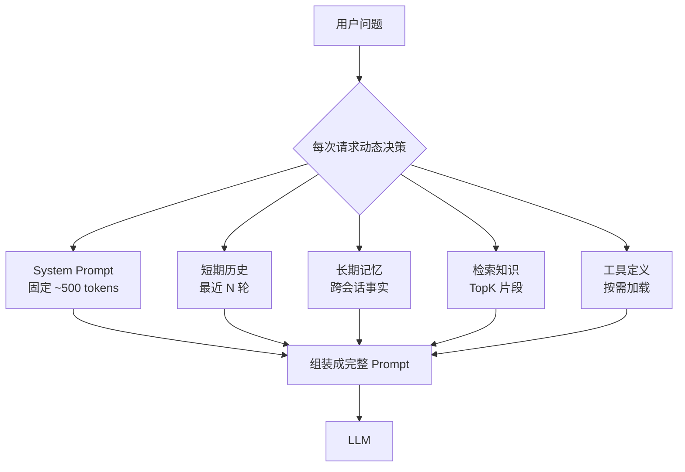
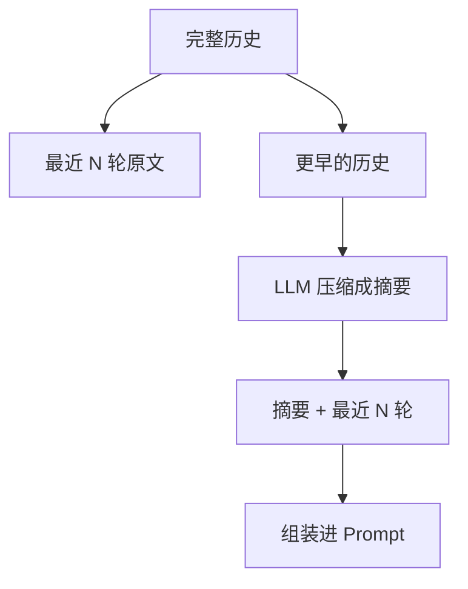
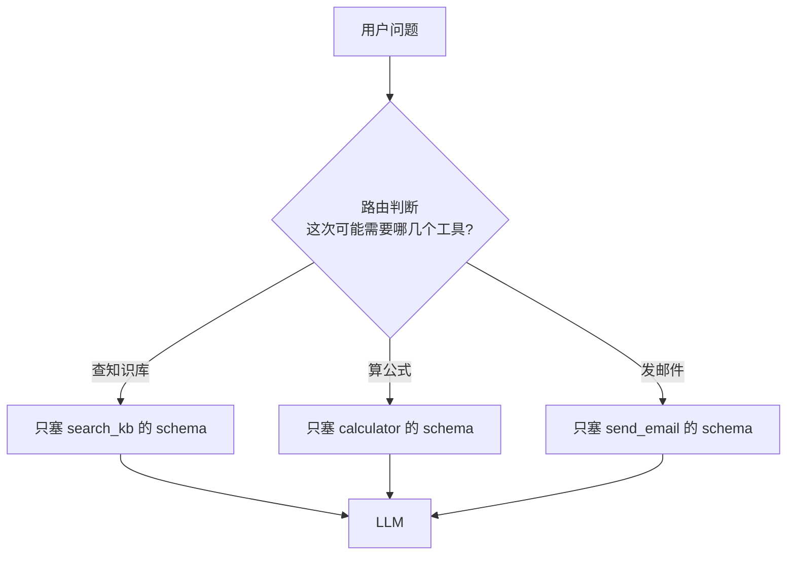

# 上下文工程深度指南

> [!abstract] 本章你会学到
> 为什么 Prompt Engineering 过时了、上下文里到底装哪五类东西、短期记忆怎么用滑动窗口、长期记忆怎么跨会话、对话长了怎么压缩、Token 预算超了怎么裁剪、工具 schema 怎么按需加载、完整的 assemble_context 怎么写。
>
> **前置知识**：[[02-检索增强三件套深度指南]]。
> **预计学时**：1.5 周。
> **面试权重**：⭐⭐⭐⭐⭐（2025-2026 上下文工程已超越 Prompt Engineering 成为核心学科）。

---

## 第一章 为什么 Prompt Engineering 过时了

### 1.1 从「一句话怎么写」到「运行时装什么」

2023 年大家讨论「怎么写一个好 prompt」。2025–2026 年讨论「**怎么在有限的 context window 里装下最相关的信息**」。这就是上下文工程（Context Engineering）。

| 维度 | Prompt Engineering | 上下文工程 |
| --- | --- | --- |
| 关注点 | 一句话怎么写 | 运行时动态决定塞什么 |
| 时间 | 静态（写死） | 动态（每次请求都不一样） |
| 输入 | 只有当前问题 | 系统提示 + 历史 + 记忆 + 检索 + 工具 |
| 核心矛盾 | 表达清楚 | 有限空间里装最相关的 |

### 1.2 上下文里到底装什么



| 来源 | 大小 | 怎么管 |
| --- | --- | --- |
| System Prompt | 固定 ~500 tokens | 写好就不动 |
| 短期历史 | 滑动窗口 | deque 保留最近 N 轮 |
| 长期记忆 | 按需检索 | 向量库/Key-Value |
| 检索知识 | TopK | 按预算裁剪 |
| 工具定义 | 几十~几百 tokens/个 | 按需加载，不全塞 |

---

## 第二章 短期记忆：滑动窗口

### 2.1 原理

最简单的记忆管理：保留最近 N 轮对话，更早的丢掉。

**为什么是 N 轮而不是 N 条**：一问一答算一轮，maxlen 要乘 2。

```python
from collections import deque

class ShortTermMemory:
    def __init__(self, max_turns: int = 10):
        # 每轮 = user + assistant 两条 message
        self.window = deque(maxlen=max_turns * 2)

    def add(self, role: str, content: str):
        self.window.append({"role": role, "content": content})

    def render(self) -> list[dict]:
        return list(self.window)
```

### 2.2 试一下

```python
mem = ShortTermMemory(max_turns=3)
mem.add("user", "年假多少天？")
mem.add("assistant", "年假 5 天...")
mem.add("user", "病假呢？")
mem.add("assistant", "病假按医疗期...")
mem.add("user", "能一起请吗？")
mem.add("assistant", "可以...")

mem.render()
# 6 条消息，正好 3 轮
```

### 2.3 缺点

对话超过 3 轮后，最早的内容就被丢了。如果用户问「我刚才说的那个项目叫什么？」，系统已经忘了。

---

## 第三章 长期记忆：跨会话事实

### 3.1 原理

把跨会话需要记住的事实存下来，下次对话相关时检索出来。

| 类型 | 生命周期 | 存什么 | 怎么取 |
| --- | --- | --- | --- |
| 短期 | 本次会话 | 对话历史 | 直接放 messages |
| 长期 | 跨会话 | 用户的事实/偏好 | 向量检索 |

### 3.2 实现

```python
class LongTermMemory:
    EXTRACT_PROMPT = """从下面对话中提取出「关于用户的、未来还会用到的事实」，
如姓名、偏好、项目名、正在做什么、技术栈。
没有就返回空数组。
对话：{conversation}
只输出 JSON 数组：["事实1", "事实2"]"""

    def __init__(self, vector_store):
        self.store = vector_store

    def extract_and_save(self, conversation: str, llm):
        facts = json.loads(llm.chat(
            self.EXTRACT_PROMPT.format(conversation=conversation),
            temperature=0,
        ))
        for f in facts:
            self.store.add_text(f, metadata={"type": "user_fact"})

    def retrieve(self, question: str, top_k: int = 3) -> list[dict]:
        return self.store.query(question, top_k=top_k)
```

### 3.3 什么时候触发提取

不要每轮都提取（贵）。在这些时机提取：
- 用户主动说「记住我是张三」
- 对话结束时（会话关闭）
- 检测到明确的事实陈述（「我在做一个电商项目」）

> [!danger] 坑：长期记忆污染
> LLM 抽出来的事实可能是错的（如把「我喜欢吃辣」记成「我不吃辣」）。
>
> **生产建议**：
> 1. 让用户能看到、编辑、删除长期记忆
> 2. 记忆带时间戳，过期自动清理
> 3. 重要事实（如姓名）让用户确认后再存

---

## 第四章 历史压缩（Summary Memory）

### 4.1 原理

对话长了之后，全塞历史会爆 context。做法：把老对话压成一段摘要。



### 4.2 实现

```python
SUMMARIZE_PROMPT = """请把以下对话历史压缩成不超过 200 字的摘要，
保留：用户身份、关键决策、未完成的任务、技术细节。
对话：{history}"""

class CompressingMemory:
    def __init__(self, max_recent_turns: int = 6, llm=None):
        self.summary = ""
        self.recent = deque(maxlen=max_recent_turns * 2)
        self.llm = llm

    def add(self, role: str, content: str):
        self.recent.append({"role": role, "content": content})
        # 当 recent 满了，把最早的一条并进 summary
        if len(self.recent) == self.recent.maxlen:
            old = self.recent.popleft()
            new_summary = self.llm.chat(
                SUMMARIZE_PROMPT.format(history=self.summary + "\n" + str(old))
            )
            self.summary = new_summary

    def render(self):
        msgs = []
        if self.summary:
            msgs.append({"role": "system", "content": f"之前对话摘要：{self.summary}"})
        msgs.extend(self.recent)
        return msgs
```

### 4.3 经验参数

| 参数 | 经验值 | 为什么 |
| --- | --- | --- |
| max_recent_turns | 6 | 保留最近 6 轮原文，更早的才压 |
| 摘要长度 | 200 字 | 太长就失去压缩意义 |
| 触发时机 | deque 满了就压 | 不要每轮都压（贵） |

> [!danger] 坑：压缩太早
> 对话才 3 轮就压缩，会把刚说的细节压没。**保留最近 6 轮原文，更早的才压成摘要**。

---

## 第五章 Token 预算与动态裁剪

### 5.1 为什么需要预算

LLM 的 context window 是硬约束（如 128K），但你塞太多：
- 成本上升（input tokens 要钱）
- 性能下降（注意力被稀释）
- 超 window 直接报错

### 5.2 精确算 Token 数

```python
# 粗略估算
def estimate_tokens(text: str) -> int:
    return int(len(text) * 1.5)  # 中文 1 字 ≈ 1.5 tokens

# 精确计算（生产用）
import tiktoken
enc = tiktoken.encoding_for_model("gpt-4")
def count_tokens(text: str) -> int:
    return len(enc.encode(text))
```

### 5.3 按预算组装上下文

```python
def assemble_context(
    system_prompt: str,
    history: list[dict],
    facts: list[str],
    retrieved_chunks: list[dict],
    tool_schemas: list[dict],
    budget: int = 6000,
) -> tuple[list[dict], int]:
    """
    按预算组装上下文，超预算时按优先级裁剪。
    优先级：system > 工具 > 历史 > 事实 > 检索片段
    """
    used = count_tokens(system_prompt)
    used += sum(count_tokens(json.dumps(t)) for t in tool_schemas)
    used += count_tokens(json.dumps(history))
    used += sum(count_tokens(f) for f in facts)

    chunks = []
    for chunk in retrieved_chunks:  # 已按相关度降序
        size = count_tokens(chunk["text"])
        if used + size > budget:
            break
        chunks.append(chunk)
        used += size
    return chunks, used
```

### 5.4 裁剪优先级

当预算超了，按这个顺序裁：

1. **检索片段**（最相关的先保留，不相关的直接丢）
2. **长期记忆**（不重要的事实先丢）
3. **历史**（更早的对话先丢，或压缩成摘要）
4. **工具定义**（本次用不到的工具 schema 不塞）
5. **System Prompt**（最后才动，一般不动）

---

## 第六章 工具预算：按需加载工具

### 6.1 为什么不全塞工具定义

10 个工具每个 schema 200 tokens，就是 2000 tokens 白白浪费。而且塞太多工具，LLM 更容易选错。

### 6.2 做法：两步走



### 6.3 实现

```python
TOOL_ROUTER_PROMPT = """用户问题：{q}
可用工具：
- search_kb: 查公司知识库
- calculator: 做数学计算
- send_email: 发邮件
这次问题可能需要哪几个工具？只输出 JSON 数组：["search_kb"]"""

def select_tools(question: str, all_tools: list[dict], llm) -> list[dict]:
    names = json.loads(llm.chat(
        TOOL_ROUTER_PROMPT.format(q=question),
        temperature=0,
    ))
    return [t for t in all_tools if t["name"] in names]
```

---

## 第七章 完整上下文组装

```python
def build_full_context(question: str, user_id: str, llm, vector_store):
    # 1. System Prompt（固定）
    system = SYSTEM_PROMPT

    # 2. 短期历史
    history = short_term_memory.render()

    # 3. 长期记忆（按问题检索）
    facts = long_term_memory.retrieve(question, top_k=3)
    facts_text = "\n".join(f["text"] for f in facts)

    # 4. 检索知识
    retrieved = vector_store.query(question, top_k=5)

    # 5. 工具选择
    tools = select_tools(question, ALL_TOOLS, llm)

    # 6. 按预算组装
    chunks, used = assemble_context(
        system, history, facts, retrieved,
        [t["schema"] for t in tools],
        budget=6000,
    )

    # 7. 拼最终 prompt
    user_content = f"""【相关事实】
{facts_text}

【参考资料】
{chr(10).join(c['text'] for c in chunks)}

【问题】
{question}
"""
    return [
        {"role": "system", "content": system},
        *history,
        {"role": "user", "content": user_content},
    ], tools
```

---

## 第八章 常见坑点

> [!danger] 坑 1：把所有工具定义都塞给 LLM
> 10 个工具每个 200 tokens，2000 tokens 白浪费。用 router 按需加载。

> [!danger] 坑 2：压缩太早
> 对话才 3 轮就压，会把刚说的细节压没。保留最近 6 轮原文。

> [!danger] 坑 3：长期记忆污染
> LLM 抽出的事实可能是错的。让用户能看到、编辑、删除。

> [!danger] 坑 4：多轮对话状态不一致
> 用户第二轮说「不是，是订单 A」，系统还拿着第一轮的「订单 B」去检索。把上一轮的工具调用结果也放进 history。

> [!danger] 坑 5：预算算错
> 中文 token 数 ≠ 字数。用 tiktoken 精确算，不要拍脑袋。

> [!danger] 坑 6：检索片段和历史抢占
> 历史太长把检索片段挤掉了。组装时先放历史，再放检索，超预算先裁检索的尾部。

---

## 第九章 本章总结与练习

> [!note] 💡 深度讲解
> 上下文工程的本质是「**在固定大小的盒子里，装最相关的东西**」。这和检索增强的思想一脉相承：检索是从知识库里挑，上下文工程是从历史/事实/工具里挑。面试时讲清楚「你怎么决定塞什么、不塞什么、超预算了裁谁」，比你能调通多少个 API 都值钱。
>
> 2025–2026 上下文工程已超越 Prompt Engineering 成为生产 AI 的核心学科。它的核心不是「写一个好 system prompt」，而是「**每次请求都动态决策：这次该装什么进去**」。

> [!success] 📝 要点
> - 五类上下文来源：system / 短期历史 / 长期记忆 / 检索结果 / 工具定义
> - 短期用滑动窗口（deque），长期用向量检索，更老的用摘要压缩
> - Token 预算是硬约束，超了按优先级裁剪
> - 工具 schema 按需加载，不要全塞
> - 长期记忆要让用户能编辑，防止污染

> [!question] 🎯 梯度练习
>
> **基础题（⭐）**
> 1. 写一个 maxlen=10 的 deque 滑动窗口，验证溢出时自动丢最早的
> 2. 用 tiktoken 精确算一段 1000 字中文的 token 数
> 3. 解释短期记忆和长期记忆的区别
>
> **进阶题（⭐⭐）**
> 1. 实现 CompressingMemory，跑 20 轮对话看压缩摘要是否保留了关键事实
> 2. 实现工具 router，把 5 个工具按需选 2 个塞给 LLM
> 3. 写一个 assemble_context，支持预算裁剪和优先级
>
> **实战题（⭐⭐⭐）**
> 1. 做一次 20 轮长对话，记录每次请求的 token 数，画出上下文增长曲线
> 2. 对比「全塞历史」vs「滑动窗口+压缩」的回答质量和成本

---

## 第十章 20 道高频面试问答

> [!question] Q1：什么是上下文工程？和 Prompt Engineering 区别？
> 答：Prompt Engineering 关心一句话怎么写；上下文工程关心「每次请求动态决定塞什么进 context」。2025-2026 它超越 Prompt 成为核心学科。

> [!question] Q2：上下文里一般装哪几类东西？
> 答：五类：system prompt（固定）、短期历史（最近 N 轮）、长期记忆（跨会话事实）、检索结果（TopK）、工具定义（按需加载）。

> [!question] Q3：短期记忆怎么做？
> 答：deque 滑动窗口，maxlen 设为 N 轮 × 2（一问一答）。溢出自动丢最早的。

> [!question] Q4：长期记忆怎么存？
> 答：LLM 从对话里抽事实，写进向量库；下次问题相关时检索出来。要让用户能编辑、删除，防止污染。

> [!question] Q5：为什么要做历史压缩？
> 答：对话长了全塞历史会爆 context。做法：保留最近 N 轮原文，更早的压成一段摘要。

> [!question] Q6：摘要压多早合适？
> 答：保留最近 6 轮原文，更早的才压。压太早会把刚说的细节压没。

> [!question] Q7：Token 预算怎么算？
> 答：用 tiktoken 精确数。中文 1 字 ≈ 1.5 tokens，不要拍脑袋。超预算按优先级裁：检索片段 → 长期记忆 → 历史 → 工具 → system。

> [!question] Q8：为什么不全塞工具定义？
> 答：10 个工具每个 200 tokens = 2000 tokens 白浪费。而且塞太多 LLM 容易选错。用 router 按问题选 2-3 个塞。

> [!question] Q9：工具 router 怎么做？
> 答：让 LLM 根据问题和工具描述判断「这次可能需要哪几个工具」，只把选中的 schema 塞进 prompt。

> [!question] Q10：上下文工程的核心矛盾是什么？
> 答：context window 有限，但相关信息分散在历史/记忆/检索/工具多个来源。核心是「在固定盒子里装最相关的」。

> [!question] Q11：为什么 system prompt 要放在最前面？
> 答：LLM 对开头和结尾注意力最强（lost-in-the-middle）。system 放开头，关键指令放结尾。

> [!question] Q12：lost-in-the-middle 是什么？
> 答：研究发现 LLM 对上下文开头和结尾注意力强，中间容易忽略。所以关键信息别塞中间。

> [!question] Q13：怎么防止长期记忆污染？
> 答：LLM 抽出的事实可能错。让用户能看到、编辑、删除；带时间戳过期清理；重要事实让用户确认。

> [!question] Q14：多轮对话怎么保持状态一致？
> 答：上一轮的工具调用结果也要放进 history。不然用户第二轮说「不是，是 A」，系统还拿第一轮的 B 去检索。

> [!question] Q15：为什么要按预算裁剪而不是直接调大 window？
> 答：window 不是越大越好。越长 input tokens 越贵、注意力越稀释、延迟越高。在预算内装最相关的。

> [!question] Q16：中文 token 数和字数怎么换算？
> 答：粗略 1 字 ≈ 1.5 tokens。精确用 tiktoken。

> [!question] Q17：压缩后的摘要放哪里？
> 答：作为 system 级消息放在 history 最前面，标明「之前对话摘要：...」。

> [!question] Q18：什么时候需要长期记忆？
> 答：跨会话需要记住用户偏好/身份/项目时。单轮 RAG 不需要。

> [!question] Q19：工具描述怎么写 LLM 才爱用对？
> 答：写清楚「什么时候用、什么时候不要用」。docstring 是 LLM 选工具的唯一依据。

> [!question] Q20：上下文工程和检索增强什么关系？
> 答：一脉相承。检索是从知识库里挑；上下文工程是从历史/事实/工具里挑。都是「在有限空间里挑最相关的」。

---

## 第十一章 关联笔记

- 上一篇：[[02-检索增强三件套深度指南]]
- 下一篇：[[04-MCP模型上下文协议深度指南]]
- 相关：[[实战-RAG企业知识库问答系统]]
