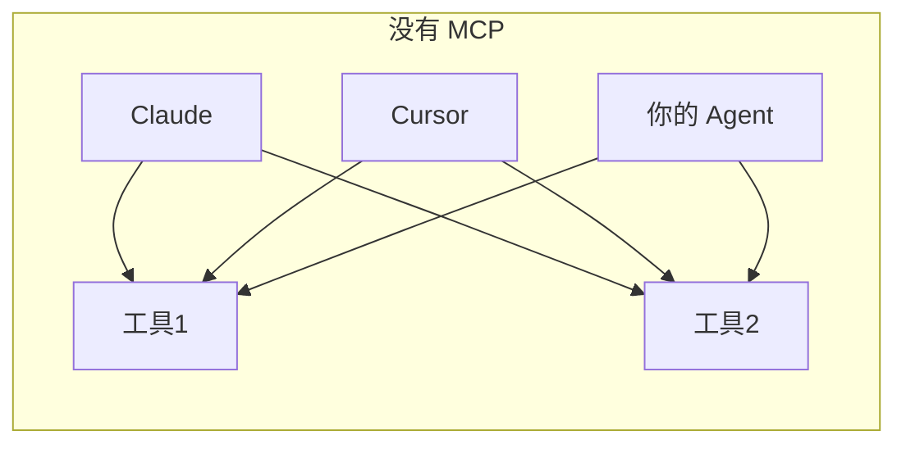
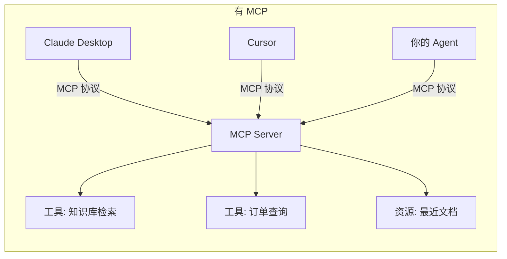
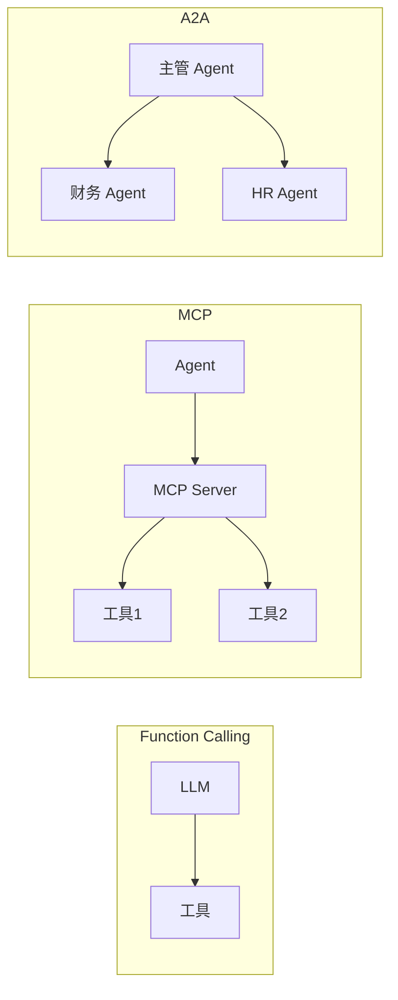

# MCP 模型上下文协议深度指南

> [!abstract] 本章你会学到
> MCP 解决什么问题、三原语（Tools/Resources/Prompts）、怎么写一个 FastMCP Server、怎么在 Claude Desktop 里接入、MCP 和 Function Calling 以及 A2A 的区别、生产部署要注意什么。
>
> **前置知识**：[[03-上下文工程深度指南]]、会写 Function Calling。
> **预计学时**：1 周。

---

## 第一章 MCP 解决什么问题

### 1.1 没有 MCP 之前：每个电器自己配电源线

Function Calling 是「一个模型接一组工具」，每接一个新工具就要改一次 prompt、改一次后端。换个模型或换个客户端，工具定义要重新写一遍。



### 1.2 MCP：AI 世界的 USB 接口

MCP（Model Context Protocol）是 Anthropic 2024 年底推出的开放协议，把「工具/数据/资源」标准化成一个 Server，任何支持 MCP 的客户端都能接。



> [!tip] 🎯 面试话术
> 「MCP 之于 AI Agent，就像 USB 之于电脑。以前每个外设自己配电源线，现在统一插 USB。我的项目把知识库检索封装成 MCP Server，Claude Desktop 和 Cursor 都能直接查。」

---

## 第二章 MCP 三原语

| 原语 | 作用 | 你的例子 |
| --- | --- | --- |
| **Tools** | 可调用的函数（有副作用） | search_knowledge_base、get_document |
| **Resources** | 可读取的数据（只读） | /docs/{doc_id} |
| **Prompts** | 预置的提示模板 | onboarding_help |

### Tools vs Resources

| 维度 | Tools | Resources |
| --- | --- | --- |
| 有无副作用 | 有（会改状态） | 无（只读） |
| 谁主动 | LLM 决定调用 | 客户端/用户主动拉 |
| 例子 | 发邮件、查订单 | 读文档列表 |

---

## 第三章 写一个 MCP Server

### 3.1 安装

```bash
pip install mcp
```

### 3.2 最小 Server

```python
# backend/app/mcp_server/server.py
from mcp.server.fastmcp import FastMCP
from app.services.rag_service import rag_service

mcp = FastMCP("company-knowledge-base")

@mcp.tool()
def search_knowledge_base(query: str, top_k: int = 5) -> str:
    """在公司知识库里搜索相关段落。
    当用户问公司制度、考勤、年假、报销等问题时使用。
    不要用于闲聊或与公司无关的问题。"""
    results = rag_service.retrieve(query, top_k=top_k)
    return "\n---\n".join(
        f"[{r['document_name']}]\n{r['text']}" for r in results
    )

@mcp.tool()
def get_document(doc_id: str) -> str:
    """根据文档 ID 获取文档全文。"""
    return rag_service.get_document_text(doc_id)

@mcp.resource("docs://recent")
def recent_docs() -> str:
    """返回最近上传的 10 个文档列表。"""
    return "\n".join(rag_service.list_recent_docs(limit=10))

if __name__ == "__main__":
    mcp.run(transport="stdio")
```

### 3.3 工具描述为什么重要

> [!danger] 坑：工具描述写得太烂
> LLM 是靠工具的 docstring 决定调不调的。
>
> 反例：
> ```python
> @mcp.tool()
> def search(q: str) -> str:
>     """搜索"""
> ```
>
> 正例：
> ```python
> """在公司知识库里搜索相关段落。
> 当用户问公司制度、考勤、年假、报销等问题时使用。
> 不要用于闲聊或与公司无关的问题。"""
> ```

---

## 第四章 在 Claude Desktop 里接入

### 4.1 配置文件位置

- macOS: `~/Library/Application Support/Claude/claude_desktop_config.json`
- Windows: `%APPDATA%\Claude\claude_desktop_config.json`

### 4.2 配置内容

```json
{
  "mcpServers": {
    "my-kb": {
      "command": "python",
      "args": ["-m", "app.mcp_server.server"],
      "cwd": "/path/to/backend",
      "env": {
        "OPENAI_API_KEY": "sk-..."
      }
    }
  }
}
```

### 4.3 验证

1. 完全退出 Claude Desktop
2. 重新打开
3. 输入框旁边应该出现一个 🔌 图标
4. 问「我们公司年假多少天？」，Claude 会自动调你的 MCP Server

---

## 第五章 MCP vs Function Calling vs A2A

| 维度 | Function Calling | MCP | A2A |
| --- | --- | --- | --- |
| 连接谁 | LLM → 工具 | Agent → 工具/资源 | Agent → Agent |
| 工具归属 | 模型后端自己定义 | 独立 Server，多客户端复用 | 独立 Agent |
| 接入成本 | 每加一个工具改代码 | 工具方写好 Server，客户端零代码 | 每个 Agent 暴露 A2A 端点 |
| 适用场景 | 单产品内部工具 | 跨团队、跨产品能力复用 | 多 Agent 协作 |



---

## 第六章 常见坑点

> [!danger] 坑 1：MCP Server 阻塞了主进程
> MCP 用 stdio 通信，Server 必须独立进程跑。不要在 FastAPI 主进程里直接 `mcp.run()`。

> [!danger] 坑 2：工具描述写得太烂
> LLM 靠 docstring 决定调不调。写清楚「什么时候用、什么时候不要用」。

> [!danger] 坑 3：忘了鉴权
> MCP Server 如果暴露在公网，任何人都能查你的知识库。要么只跑 stdio（本地），要么加 API Key。

> [!danger] 坑 4：返回结果太长
> 一次检索返回 10 段，每段 500 字，就是 5000 字。top_k=5，每段截断 200 字。

> [!danger] 坑 5：异步任务没处理
> 检索可能要 2 秒，stdio 会超时。要么在 MCP Server 里做缓存，要么用 SSE 传输。

---

## 第七章 本章总结与练习

> [!note] 💡 深度讲解
> MCP 的本质是「**能力的标准化封装**」。2026 年 JD 上写「熟悉 MCP」，不是要你背协议字段，而是要你理解：为什么需要这个协议、它解决了什么碎片化问题、你自己能不能写一个 Server 把内部能力暴露出去。
>
> 我的项目里，知识库检索在内部用 Function Calling 调；同时我把它封装成 MCP Server，这样 Claude Desktop 和 Cursor 也能直接查——这是 MCP 的典型价值：一次封装，处处可用。

> [!success] 📝 要点
> - MCP 三原语：Tools / Resources / Prompts
> - 写一个 FastMCP Server，把知识库检索暴露出去
> - 对比 MCP 和 Function Calling 的取舍
> - 生产上要考虑鉴权和进程隔离
> - A2A 是 Agent 之间的协议，和 MCP（Agent 调工具）不同

> [!question] 🎯 梯度练习
> - ⭐ 写一个 MCP Server，暴露 `search_kb` 工具
> - ⭐⭐ 在 Claude Desktop 里接入你的 MCP Server，问一个公司制度问题
> - ⭐⭐ 给工具加上「什么时候不要用」的描述，观察 LLM 是否更倾向正确调用
> - ⭐⭐⭐ 对比 MCP 和直接 Function Calling，写一段取舍分析

---

## 第九章 20 道高频面试问答

> [!question] Q1：什么是 MCP？解决什么问题？
> 答：Model Context Protocol，Anthropic 2024 年推出的开放协议。把「工具/数据」标准化成一个 Server，任何支持 MCP 的客户端（Claude Desktop/Cursor）都能接，不用每个客户端重写工具集成。

> [!question] Q2：MCP 和 Function Calling 区别？
> 答：Function Calling 是 LLM 调后端工具，工具归属在模型后端；MCP 把工具独立成 Server，跨客户端复用。前者是「一个模型配一组工具」，后者是「一次封装处处可用」。

> [!question] Q3：MCP 三原语是什么？
> 答：Tools（可调用函数，有副作用）、Resources（只读数据）、Prompts（预置提示模板）。

> [!question] Q4：Tools 和 Resources 区别？
> 答：Tools 有副作用（发邮件、查订单）；Resources 只读（读文档列表）。

> [!question] Q5：MCP Server 跑在哪？
> 答：独立进程，通过 stdio（本地）或 SSE（远程）和客户端通信。不要在 FastAPI 主进程里直接跑。

> [!question] Q6：怎么在 Claude Desktop 里接 MCP？
> 答：改 claude_desktop_config.json，加 mcpServers 段，指定 command/args/cwd/env。重启 Claude Desktop，输入框旁出现 🔌 图标。

> [!question] Q7：FastMCP 是什么？
> 答：MCP 官方的 Python SDK，用 `@mcp.tool()` 装饰器就能把一个函数暴露成 MCP 工具。几行代码起一个 Server。

> [!question] Q8：工具描述为什么重要？
> 答：LLM 靠 docstring 决定调不调、怎么调。描述要写清楚「什么时候用、什么时候不要用」。

> [!question] Q9：MCP 怎么鉴权？
> 答：stdio 模式（本地）天然安全；暴露公网要加 API Key 或 OAuth。

> [!question] Q10：MCP 和 A2A 区别？
> 答：MCP 是 Agent 调工具；A2A 是 Agent 调另一个 Agent。MCP 的对方是被动函数，A2A 的对方是有自主决策的 Agent。

> [!question] Q11：MCP 传输方式有哪些？
> 答：stdio（本地进程通信）、SSE/HTTP（远程）。本地开发用 stdio，生产跨服务用 SSE。

> [!question] Q12：MCP Server 返回结果太长怎么办？
> 答：top_k 调小、每段截断、分页返回。不要一次把 100 段塞回去。

> [!question] Q13：MCP 能接多少工具？
> 答：理论上不限，但一次塞太多 LLM 选不对。按上下文工程原则按需暴露。

> [!question] Q14：MCP 是 Anthropic 专属吗？
> 答：不是，是开放协议。Cursor、VS Code 插件、开源 Agent 框架都支持。

> [!question] Q15：MCP Server 崩了怎么办？
> 答：客户端要做超时和重试。stdio 模式下进程死了客户端能感知到，提示用户重启。

> [!question] Q16：和 OpenAPI Function Calling 比有什么优势？
> 答：OpenAPI 是模型特定的 schema；MCP 是模型无关的协议。同一个 Server 能接 GPT/Claude/开源模型。

> [!question] Q17：为什么 MCP 2025 年突然火？
> 答：之前每个客户端都要为每个工具写一遍集成。MCP 把这层标准化了，工具方写一次，所有客户端都能用。

> [!question] Q18：MCP 适合我这个项目吗？
> 答：适合把知识库检索封装成 MCP Server，这样 Claude Desktop 和 Cursor 都能直接查你的知识库。这是面试可讲的点。

> [!question] Q19：MCP 有什么坑？
> 答：工具描述写得太烂 LLM 不会调；返回太长撑爆 context；没鉴权暴露公网就漏数据；异步任务 stdio 会超时。

> [!question] Q20：你怎么给面试官讲 MCP？
> 答：「MCP 之于 AI Agent 就像 USB 之于电脑。以前每个外设自己配电源线，现在统一插 USB。我把知识库检索封装成 MCP Server，Claude Desktop 和 Cursor 都能直接查。」

---

## 第十章 关联笔记

- 上一篇：[[03-上下文工程深度指南]]
- 下一篇：[[05-生产化与可观测性]]
- 相关：[[07-A2A与多模态与微调选型]]
