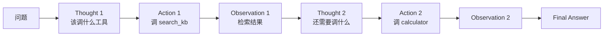
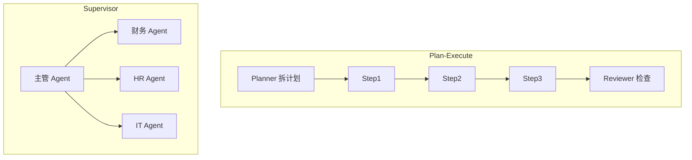
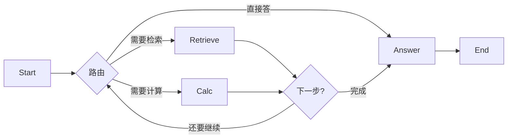
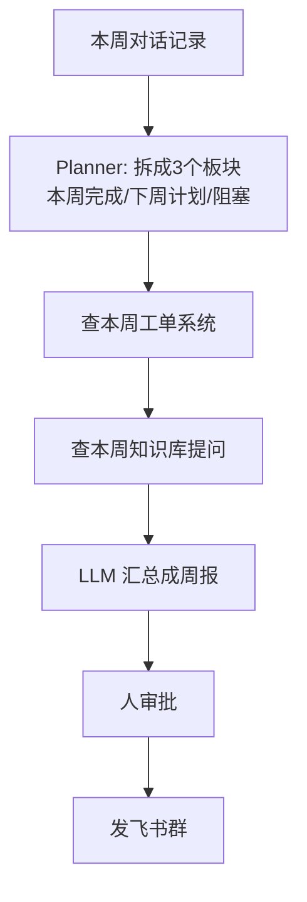

# Agent 编排与 LangGraph

> [!abstract] 本章你会学到
> 为什么裸 ReAct 不行、三种主流编排模式（ReAct / Plan-Execute / Supervisor）、LangGraph 怎么用有向图管理状态、Checkpointer 怎么做人机协同和断点续跑、怎么在你的知识库项目里加一个「自动归档周报」Agent。
>
> **前置知识**：[[03-上下文工程深度指南]]、Function Calling 熟练。
> **预计学时**：1.5 周。

---

## 第一章 为什么裸 ReAct 不行

### 1.1 ReAct 是什么

让 LLM 循环「思考 → 调工具 → 观察 → 再思考」直到得出答案：



### 1.2 裸 ReAct 的三个问题

| 问题 | 现象 |
| --- | --- |
| 死循环 | LLM 反复调同一个工具，永远不退出 |
| 没有计划 | 走一步看一步，绕远路 |
| 状态散 | 没有集中管理中间结果，难调试 |

---

## 第二章 三种编排模式对比

| 模式 | 适合 | 例子 |
| --- | --- | --- |
| **ReAct** | 单步推理、工具调用少 | 查个知识库 |
| **Plan-Execute** | 多步、长任务 | 「帮我调研行业并写报告」 |
| **Supervisor** | 多个专业 Agent 协作 | 「主管 Agent 派任务给财务/HR Agent」 |



---

## 第三章 LangGraph 核心概念

### 3.1 StateGraph

LangGraph 把 Agent 流程画成一张有向图：节点 = 函数，边 = 跳转条件，State = 全局共享状态。



### 3.2 最小示例

```python
from typing import TypedDict, Literal
from langgraph.graph import StateGraph, END

class AgentState(TypedDict):
    question: str
    chunks: list
    answer: str

def retrieve_node(state: AgentState) -> AgentState:
    state["chunks"] = rag_service.retrieve(state["question"])
    return state

def answer_node(state: AgentState) -> AgentState:
    state["answer"] = llm.answer(state["question"], state["chunks"])
    return state

def should_continue(state: AgentState) -> Literal["retrieve", "answer"]:
    if not state["chunks"]:
        return "retrieve"
    return "answer"

graph = StateGraph(AgentState)
graph.add_node("retrieve", retrieve_node)
graph.add_node("answer", answer_node)
graph.set_entry_point("retrieve")
graph.add_conditional_edges("retrieve", should_continue, {
    "retrieve": "retrieve",
    "answer": "answer",
})
graph.add_edge("answer", END)

app = graph.compile()
result = app.invoke({"question": "年假多少天？"})
```

---

## 第四章 Checkpointer：断点续跑与人机协同

### 4.1 为什么需要 Checkpointer

长任务跑到一半崩了，从头再来一遍成本太高。Checkpointer 把 State 存下来，下次从断点继续。

### 4.2 实现

```python
from langgraph.checkpoint.sqlite import SqliteSaver

checkpointer = SqliteSaver.from_conn_string("checkpoints.db")
app = graph.compile(checkpointer=checkpointer)

# 每次运行带一个 thread_id，用于恢复
config = {"configurable": {"thread_id": "session_123"}}
result = app.invoke({"question": "..."}, config=config)

# 崩了之后恢复
state = app.get_state(config)
app.invoke(None, config=config)  # 从断点继续
```

### 4.3 人机协同（Human-in-the-loop）

跑到某个节点暂停，等人确认再继续：

```python
from langgraph.graph import END
graph.add_node("confirm", confirm_node)
graph.add_edge("retrieve", "confirm")
graph.add_conditional_edges("confirm", human_approval, {
    "approved": "answer",
    "rejected": END,
})
```

---

## 第五章 在你项目里加一个「周报 Agent」



```python
# 简化版
def weekly_report_agent(user_id: str):
    state = {
        "user_id": user_id,
        "this_week_tickets": [],
        "this_week_questions": [],
        "report_draft": "",
    }
    # Step1: 拉本周工单
    state["this_week_tickets"] = tickets_api.list_this_week(user_id)
    # Step2: 拉本周提问
    state["this_week_questions"] = langfuse_traces.list_this_week(user_id)
    # Step3: 让 LLM 生成周报
    state["report_draft"] = llm.generate_report(state)
    # Step4: 等人确认
    approve = ask_user(state["report_draft"])
    if approve:
        feishu_api.send(state["report_draft"])
```

---

## 第六章 常见坑点

> [!danger] 坑 1：节点函数有副作用但没在 State 里
> LangGraph 是纯函数式，节点间通过 State 通信。别在节点里改全局变量。

> [!danger] 坑 2：死循环没设 max_iterations
> ReAct 循环必须有上限，超过就强制结束并报错。

> [!danger] 坑 3：Checkpointer 选了 SQLite 没考虑并发
> 生产用 Postgres checkpointer。

> [!danger] 坑 4：Supervisor 把所有活都派给子 Agent
> 主管 Agent 应该只做路由和汇总，不要自己干子 Agent 的活。

---

## 第七章 本章总结与练习

> [!note] 💡 深度讲解
> 2026 年 Agent 框架已经收敛到 LangGraph（字节 Coze 之外）。面试时讲清楚「你为什么用 StateGraph、节点之间怎么传 State、Checkpointer 解决什么问题」，比「我用过 LangChain」高一个段位。
>
> 我的项目里不是无脑上 Agent——单轮问答用直接 RAG 就够；只在「周报自动生成」「多文档调研」这种多步任务才上 LangGraph。**不要为了用 Agent 而用 Agent**。

> [!success] 📝 要点
> - 三种编排：ReAct（单步）/ Plan-Execute（多步计划）/ Supervisor（多 Agent 协作）
> - LangGraph = StateGraph（节点+边+State）
> - Checkpointer 解决断点续跑和人机协同
> - 不要为了用 Agent 而用 Agent，单轮 RAG 就够的场景别上

> [!question] 🎯 梯度练习
> - ⭐ 写一个 ReAct 节点：先检索，再生成
> - ⭐⭐ 用 LangGraph 重写你的 RAG 主流程，加 Checkpointer
> - ⭐⭐⭐ 做一个「周报 Agent」：自动拉本周对话生成周报，人审批后发飞书

---

## 第九章 20 道高频面试问答

> [!question] Q1：什么是 ReAct？
> 答：Reason + Act 循环。LLM 一步步「思考 → 调工具 → 观察结果 → 再思考」直到得出答案。适合单步推理。

> [!question] Q2：裸 ReAct 有什么问题？
> 答：容易死循环（反复调同一工具）、没有全局计划（走一步看一步）、状态散（难调试）。所以需要 LangGraph 这样的框架。

> [!question] Q3：ReAct / Plan-Execute / Supervisor 区别？
> 答：ReAct 单步循环；Plan-Execute 先拆计划再逐步执行；Supervisor 主管 Agent 把任务派给多个子 Agent。

> [!question] Q4：LangGraph 核心概念？
> 答：StateGraph——节点是函数，边是跳转条件，State 是全局共享状态。它把 Agent 流程画成有向图。

> [!question] Q5：State 怎么在节点间传？
> 答：节点函数接收 State，返回更新后的 State。LangGraph 自动合并。不要用全局变量。

> [!question] Q6：Checkpointer 解决什么？
> 答：断点续跑和人机协同。长任务崩了从 State 恢复；跑到某个节点暂停等人审批再继续。

> [!question] Q7：什么时候用 LangGraph，什么时候用裸 ReAct？
> 答：单轮 RAG 不用。多步任务（周报生成、多文档调研）才上。**不要为了用 Agent 而用 Agent**。

> [!question] Q8：Supervisor 模式适合什么场景？
> 答：有多个专业 Agent（财务/HR/法务），主管 Agent 不干活，只派活和汇总。

> [!question] Q9：LangGraph 和 LangChain 关系？
> 答：LangGraph 是 LangChain 团队出的编排层，专门解决 Agent 流程控制。LangChain 是工具链。

> [!question] Q10：怎么防止 ReAct 死循环？
> 答：设 max_iterations，超过就强制结束并报错。

> [!question] Q11：Checkpointer 生产用什么？
> 答：SQLite 适合 demo，生产用 Postgres checkpointer。

> [!question] Q12：人机协同（Human-in-the-loop）怎么做？
> 答：在某个节点前暂停，把中间结果给人看，人点「通过/拒绝」再继续。LangGraph 的 interrupt 机制支持。

> [!question] Q13：为什么节点函数要纯？
> 答：LangGraph 是状态机，节点间通过 State 通信。用全局变量会破坏可追溯性和恢复能力。

> [!question] Q14：你做的 Agent 是什么场景？
> 答：周报自动生成。Planner 拆「本周完成/下周计划/阻塞」三块；分别拉工单系统和 Langfuse 对话；LLM 汇总成周报；人审批后发飞书群。

> [!question] Q15：Plan-Execute 和 Supervisor 区别？
> 答：Plan-Execute 是一条线（计划→执行→检查）；Supervisor 是树状（主管派活给多个子 Agent）。

> [!question] Q16：LangGraph 有什么坑？
> 答：节点函数有副作用但没在 State 里；死循环没设 max_iter；Checkpointer 选了 SQLite 没考虑并发。

> [!question] Q17：为什么不用 LangChain Agent？
> 答：LangChain Agent 是黑盒循环，状态不可见、难调试。LangGraph 显式画图，每个节点和跳转都看得见。

> [!question] Q18：怎么观测 Agent 跑了什么？
> 答：Langfuse trace 每个节点。LangGraph 集成 Langfuse 后，节点、tool call、LLM call 都在 trace 里。

> [!question] Q19：Agent 越多越好吗？
> 答：不是。每多一个 Agent 就多一层路由成本和延迟。能直接 RAG 解决的别上 Agent。

> [!question] Q20：怎么给面试官讲 Agent？
> 答：「我不是无脑上 Agent。单轮问答直接 RAG；多步任务（周报）才用 LangGraph。我做的是周报 Agent：拉工单+对话→LLM 汇总→人审批→发飞书。」

---

## 第十章 关联笔记

- 上一篇：[[05-生产化与可观测性]]
- 下一篇：[[07-A2A与多模态与微调选型]]
