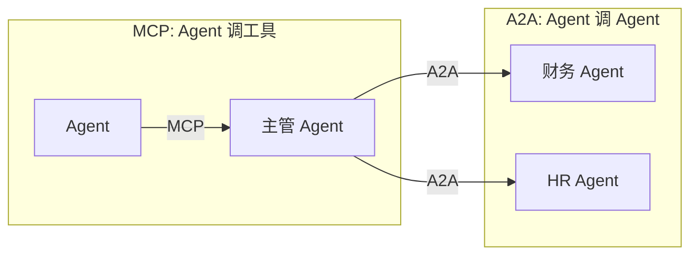
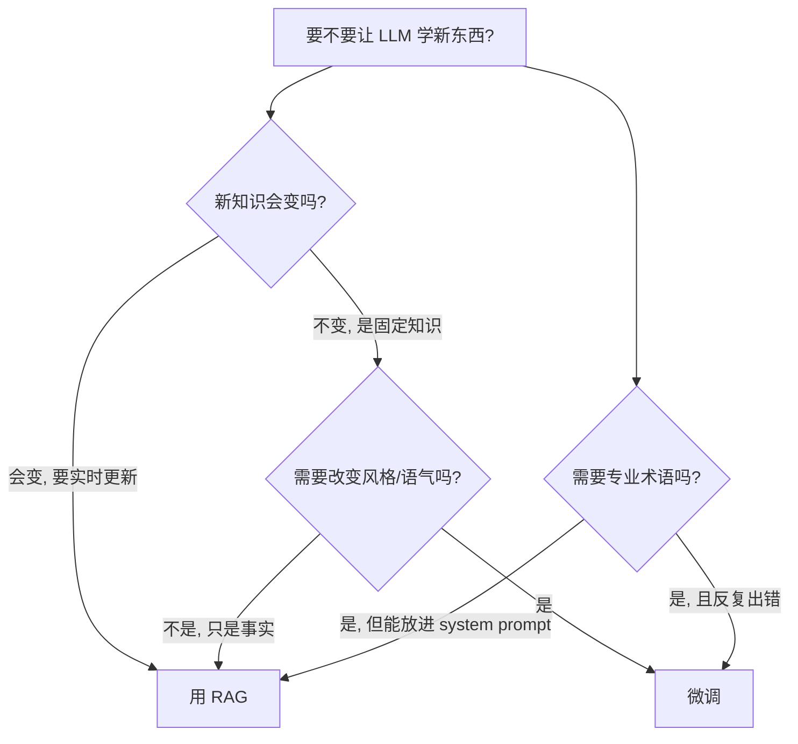

# A2A 与多模态与微调选型

> [!abstract] 本章你会学到
> A2A（Agent-to-Agent）和 MCP 的区别、多模态 RAG 怎么搞（图片/PDF 表格/扫描件）、什么时候该 RAG 什么时候该微调、微调的成本和坑。
>
> **前置知识**：[[04-MCP模型上下文协议深度指南]]、[[06-Agent编排与LangGraph]]。
> **预计学时**：0.5 周。**P2：了解即可，不要求动手实现。**

---

## 第一章 A2A：Agent 之间的协议

### 1.1 MCP 和 A2A 一张图分清



| 维度 | MCP | A2A |
| --- | --- | --- |
| 连接 | Agent → 工具 | Agent → Agent |
| 对方是什么 | 被动的函数 | 有自主决策能力的另一个 Agent |
| 谁主导 | 调用方 | 被调方（Agent 自己决定怎么完成） |
| 2026 成熟度 | 生产可用 | 早期，Google 推 |

### 1.2 什么时候需要 A2A

- 你有多个垂直 Agent（财务/HR/法务），各有自己的知识和工具
- 一个用户问题需要跨多个领域
- 主管 Agent 不直接干活，只负责派活和汇总

**面试一句话**：「MCP 是 Agent 调工具，A2A 是 Agent 调另一个 Agent。我现在的项目用 MCP 就够，A2A 是 P2 了解项。」

---

## 第二章 多模态 RAG

### 2.1 你的知识库可能不只是文字

| 输入类型 | 处理方式 |
| --- | --- |
| PDF 文字版 | 直接抽文本 |
| 扫描件 PDF | OCR（PaddleOCR / Tesseract） |
| 图片（截图、照片） | 多模态模型（GPT-4o / Qwen-VL）描述后 embedding |
| 表格 | 转 Markdown 表格再切 |
| PPT | 抽每页文字 + 图片描述 |

### 2.2 图片怎么进向量库

```python
from openai import OpenAI
client = OpenAI()

def image_to_text(image_path: str) -> str:
    """用多模态模型把图片描述成文字，再 embedding"""
    with open(image_path, "rb") as f:
        b64 = base64.b64encode(f.read()).decode()
    resp = client.chat.completions.create(
        model="gpt-4o-mini",
        messages=[{
            "role": "user",
            "content": [
                {"type": "text", "text": "详细描述这张图里的内容、数据、文字。"},
                {"type": "image_url", "image_url": {"url": f"data:image/jpeg;base64,{b64}"}},
            ],
        }],
    )
    return resp.choices[0].message.content
```

然后把描述文本和文字 chunk 一起 embedding、一起入库。

### 2.3 成本

| 方案 | 一张图成本 |
| --- | --- |
| 多模态模型描述 | ~$0.001 |
| OCR（PaddleOCR 本地） | 免费 |
| 直接把图片喂给 GPT-4o 回答 | ~$0.01/次 |

**建议**：入库时用多模态模型「描述一次」存起来，回答时只检索文字描述，不要每次都传图。

---

## 第三章 RAG vs 微调：什么时候用哪个

### 3.1 决策树



### 3.2 一张表对比

| 维度 | RAG | 微调 |
| --- | --- | --- |
| 知识更新 | 改文档就好 | 要重新训 |
| 数据量 | 几篇文档就能起 | 几百~几千条样本 |
| 成本 | 低（API 费） | 高（GPU + 标注） |
| 可解释性 | 强（能看到出处） | 弱（黑盒） |
| 改风格/语气 | 做不到 | 能做到 |
| 适合 | 企业知识库、事实问答 | 固定领域、风格一致的对话 |

### 3.3 应届生的建议

> [!tip] 🎯 不要踩的坑
> 面试官问「你为什么不用微调？」——标准答案：
>
> 「我的场景是企业知识库，文档每周都在更新。微调需要重新训才能更新知识，成本高、迭代慢、还没法溯源。RAG 改个文档就上线，还能给答案附上出处。只有在需要固定风格（如客服话术统一成某种语气）或者模型在我的领域反复答错专业术语时，才考虑微调。」
>
> **本科面试不需要真的做微调**，能讲清楚为什么不做，比硬做一个 LoRA 项目加分多了。

---

## 第四章 常见坑点

> [!danger] 坑 1：为了「酷」上 A2A
> 你的项目只有你一个 Agent，硬套 A2A 是过度设计。

> [!danger] 坑 2：多模态每次都传原图
> 入库时用多模态模型描述一次存文字，回答时只检索文字。

> [!danger] 坑 3：上来就微调
> 企业知识库场景，RAG 永远是第一选择。微调是最后选项。

> [!danger] 坑 4：微调数据没去重
> 训练集里 100 条相似问题，模型会过拟合这 100 条。

---

## 第五章 本章总结与练习

> [!note] 💡 深度讲解
> P2 这章不要求你动手做。面试官问「你知道 A2A 吗」「你考虑过微调吗」，你能讲清楚「是什么、什么时候用、为什么我没用」就够了。**知道什么时候不用，比知道怎么用更显成熟**。

> [!success] 📝 要点
> - MCP 是 Agent 调工具，A2A 是 Agent 调 Agent
> - 多模态 RAG：图片入库时用多模态模型描述成文字
> - RAG vs 微调：知识会变用 RAG，要改风格用微调
> - 本科面试不需要真的做微调

> [!question] 🎯 梯度练习
> - ⭐ 口述 MCP 和 A2A 的区别
> - ⭐⭐ 给一张产品截图，用 GPT-4o 描述成文字，再 embedding 入库
> - ⭐⭐⭐ 写一段「为什么我选 RAG 不选微调」的面试话术

---

## 第七章 20 道高频面试问答

> [!question] Q1：MCP 和 A2A 区别？
> 答：MCP 是 Agent 调工具；A2A 是 Agent 调另一个 Agent。MCP 的对方是被动函数，A2A 的对方是有自主决策的 Agent。

> [!question] Q2：什么时候需要 A2A？
> 答：有多个垂直 Agent（财务/HR/法务），主管 Agent 不干活只派活。本科项目一般用不到，了解即可。

> [!question] Q3：多模态 RAG 怎么处理图片？
> 答：入库时用多模态模型（GPT-4o/Qwen-VL）把图片描述成文字，再 embedding。回答时只检索文字描述，不要每次都传图。

> [!question] Q4：扫描件 PDF 怎么处理？
> 答：OCR（PaddleOCR/Tesseract）先转文字，再走正常 RAG 流程。

> [!question] Q5：表格怎么进 RAG？
> 答：转 Markdown 表格再切。不要把表格当纯文本切，会丢结构。

> [!question] Q6：什么时候用 RAG，什么时候用微调？
> 答：知识会变、要实时更新 → RAG；要改风格/语气、固定领域反复答错 → 微调。

> [!question] Q7：为什么企业知识库不推荐微调？
> 答：文档每周都在更新，微调要重新训才能更新知识，成本高、迭代慢、还没法溯源。RAG 改个文档就上线。

> [!question] Q8：微调需要多少数据？
> 答：几百到几千条高质量样本。本科面试不需要真做，能讲清楚为什么不做就行。

> [!question] Q9：LoRA 是什么？
> 答：低秩适配，只训一小部分参数，成本比全量微调低很多。本科了解概念即可。

> [!question] Q10：多模态每次都传原图为什么贵？
> 答：GPT-4o 一张图约 $0.01。入库时描述一次存文字，回答时只检索文字，成本降 10 倍。

> [!question] Q11：A2A 是哪家推的？
> 答：Google 2025 年推的开放协议。和 MCP（Anthropic）是两个阵营。

> [!question] Q12：你这个项目为什么不上 A2A？
> 答：我只有一个 Agent，硬套 A2A 是过度设计。MCP 把工具暴露出去就够了。

> [!question] Q13：微调能解决幻觉吗？
> 答：不能。微调让模型更像某个风格，但事实性错误还是要靠 RAG 提供正确上下文。

> [!question] Q14：多模态 RAG 有什么坑？
> 答：图片描述太抽象（「一张图」），检索不到；每次都传原图成本高；表格转 Markdown 丢结构。

> [!question] Q15：RAG 和微调能结合吗？
> 答：能。RAG 提供事实，微调让回答风格统一。但本科项目先把 RAG 做扎实。

> [!question] Q16：什么是 VLM？
> 答：Vision-Language Model，能同时看图和文字的模型，如 GPT-4o、Qwen-VL。

> [!question] Q17：为什么说「知道什么时候不用比知道怎么用更重要」？
> 答：面试官怕你为了炫技硬上技术。能讲清楚「我为什么不用 A2A/微调」比硬做一个 demo 更显成熟。

> [!question] Q18：扫描件 OCR 错了怎么办？
> 答：选好 OCR 引擎（PaddleOCR 中文好）；关键字段做后处理；OCR 错的 chunk 标记低置信度，检索时降权。

> [!question] Q19：多模态 RAG 适合什么场景？
> 答：产品手册带图、医疗影像报告、建筑图纸问答。纯文字知识库用不到。

> [!question] Q20：你怎么给面试官讲选型？
> 答：「我选 RAG 不选微调，因为知识每周更新；我用 MCP 不用 A2A，因为只有一个 Agent；多模态了解但项目是纯文字。知道边界比堆技术重要。」

---

## 第八章 关联笔记

- 上一篇：[[06-Agent编排与LangGraph]]
- 返回：[[00-总览MOC]]
