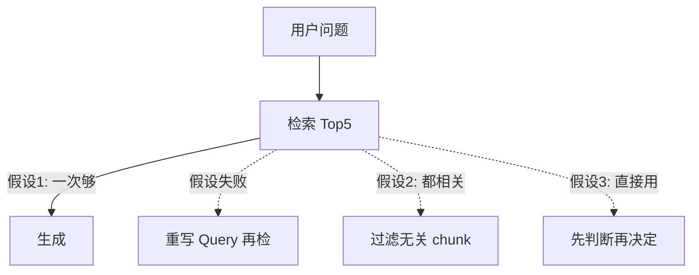
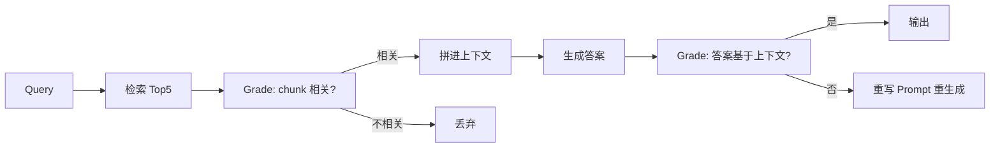
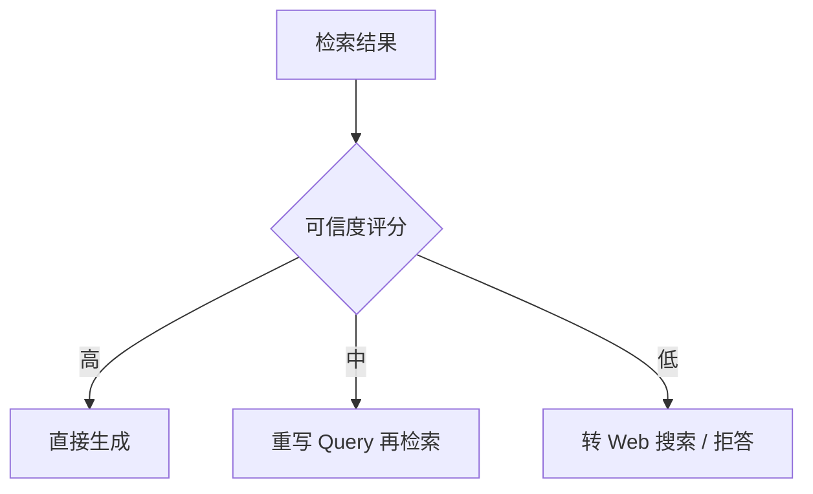
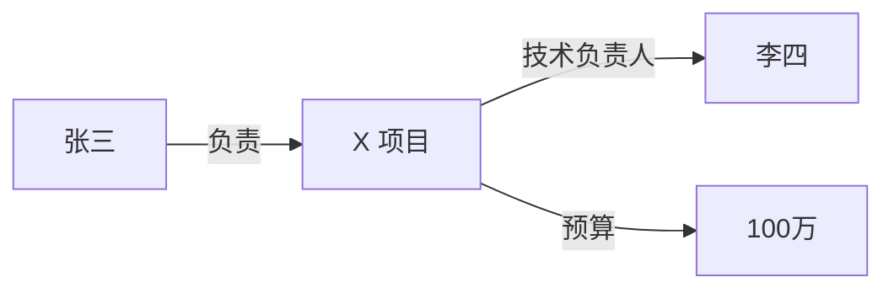
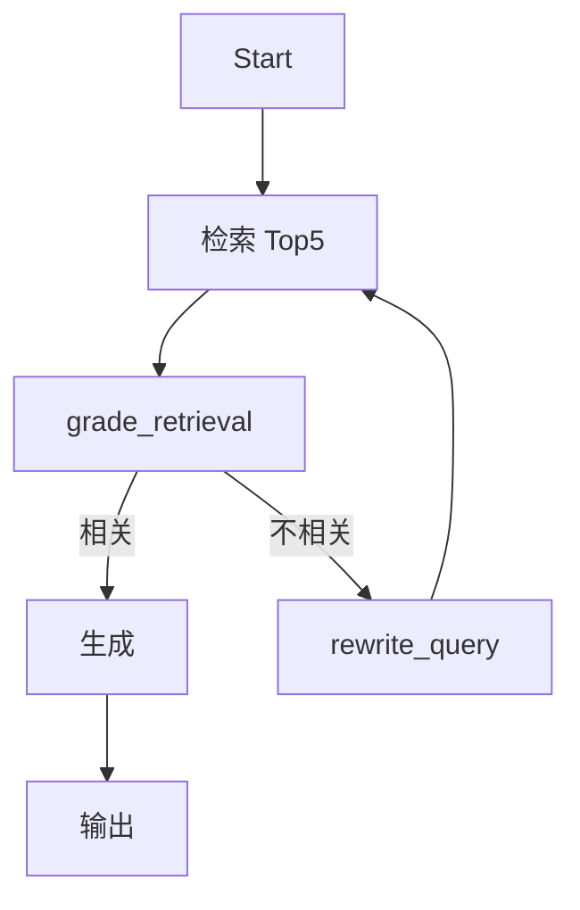

# Agentic RAG 进阶：Self-RAG 与 GraphRAG

> [!abstract] 本章你会学到
> 为什么「一次检索完事」在 2026 年已经过时、Self-RAG 怎么让模型自己判断检索结果够不够、CRAG（Corrective RAG）的三条修复路径、GraphRAG 怎么用知识图谱解决「A 项目负责人的 leader 是谁」这种多跳问题、怎么在你现有的 LangGraph 图里加一个 `grade_retrieval` 节点。
>
> **前置知识**：[[01-RAG评测体系深度指南]]、[[06-Agent编排与LangGraph]]。
> **预计学时**：1 周。
> **面试权重**：⭐⭐⭐⭐⭐（2026 年 JD 高频）。

---

## 第一章 为什么朴素 RAG 在 2026 年不够用

### 1.1 朴素 RAG 的三个假设

朴素 RAG 默认三件事：
1. 一次检索就够
2. 检索回来的内容一定相关
3. LLM 能直接用这些上下文生成

这三个假设在 2026 年的真实场景里经常同时不成立：



### 1.2 两类进阶范式

| 范式 | 解决什么 | 代表 |
| --- | --- | --- |
| **Self-RAG / CRAG** | 检索结果不够好时怎么办 | 让模型自己打分、决定重检索或拒答 |
| **GraphRAG** | 跨实体多跳问题 | 建知识图谱，回答「X 的 Y 的 Z」 |

---

## 第二章 Self-RAG：让模型自己打分

### 2.1 核心思想

Self-RAG（Self-Reflective RAG）给每个 chunk 打一个「相关性分」，不相关的直接丢掉；再给生成结果打一个「是否基于上下文」的分，低了就重写。



### 2.2 实现 grade_retrieval 节点

```python
GRADE_PROMPT = """判断【检索到的片段】是否能回答【用户问题】。
只输出 JSON：{{"relevant": true/false, "reason": "..."}}
问题：{q}
片段：{ctx}"""

def grade_retrieval_node(state: AgentState) -> AgentState:
    kept = []
    for chunk in state["chunks"]:
        out = llm.chat(GRADE_PROMPT.format(q=state["question"], ctx=chunk["text"][:500]))
        try:
            data = json.loads(out)
            if data["relevant"]:
                kept.append(chunk)
        except:
            kept.append(chunk)  # 解析失败保守保留
    state["chunks"] = kept
    state["all_relevant"] = len(kept) > 0
    return state
```

### 2.3 条件边：不够相关就重检索

```python
def decide_after_grade(state: AgentState) -> str:
    if not state["all_relevant"]:
        return "rewrite"   # 重写 query 再检索
    if len(state["chunks"]) < 2:
        return "rewrite"   # 太少，再检一次
    return "generate"

graph.add_conditional_edges("grade", decide_after_grade, {
    "rewrite": "rewrite_query",
    "generate": "generate_answer",
})
```

---

## 第三章 CRAG：Corrective RAG

### 3.1 三条修复路径

CRAG 比 Self-RAG 多了一条「如果检索真的不行，就转成 Web 搜索或拒答」：



### 3.2 实现

```python
ROUTER_PROMPT = """判断这个问题应该走哪条路：
- knowledge: 公司内部制度/文档问题
- web: 实时信息/行业新闻/公司文档没有的
- refuse: 明显的闲聊或越权问题
问题：{q}
只输出 JSON: {{"route": "knowledge|web|refuse"}}"""

def route_node(state):
    out = llm.chat(ROUTER_PROMPT.format(q=state["question"]))
    route = json.loads(out)["route"]
    return {"next": route}

graph.add_conditional_edges("route", lambda s: s["next"], {
    "knowledge": "retrieve",
    "web": "web_search",
    "refuse": "refuse_node",
})
```

> [!tip] 本科项目简化版
> 你不需要真的接 Web 搜索。在路由节点里把 `web` 分支直接映射到「拒答+提示用户」就行。面试讲清楚「我知道 CRAG 有三条路径，项目里只做了 knowledge→refuse 两条」。

---

## 第四章 GraphRAG：知识图谱增强

### 4.1 朴素 RAG 答不了的问题

试一下：「**张三负责的那个项目的技术负责人是谁？**」

朴素 RAG 要从多个 chunk 里同时找到「张三负责 X 项目」和「X 项目技术负责人是李四」，但向量检索把它们当成独立 chunk 召回，LLM 很难在上下文中做实体跳转。

GraphRAG 的解法：从文档里抽实体和关系，建成图谱。



### 4.2 微软开源 graphrag

```bash
pip install graphrag
graphrag init --root ./kb
# 修改 settings.yaml 配置 LLM key
graphrag index --root ./kb
graphrag query --root ./kb --method global --query "张三负责项目的技术负责人是谁？"
```

### 4.3 什么时候上 GraphRAG

| 场景 | 朴素 RAG | GraphRAG |
| --- | --- | --- |
| 单跳事实题（年假多少天） | ✅ 够 | 过度 |
| 多跳关系题（张三的 leader 的 leader） | ❌ 答不好 | ✅ |
| 全局摘要（「整个知识库讲了哪几类问题」） | ❌ | ✅ |
| 实体稠密的文档（组织架构、项目列表） | 一般 | ✅ |

> [!danger] 坑：GraphRAG 构建成本高
> 建图谱要对每个 chunk 调一次 LLM 抽实体，1000 个 chunk 就是 1000 次调用。本科项目：跑一个小数据集（50 篇文档）演示就行，别真上生产规模。

### 4.4 GraphRAG vs LLM Wiki：建"图"还是建"页"

GraphRAG 不是唯一的"知识结构化"路线。还有一种思路是 **LLM Wiki**——不建图谱，而是把每个实体编译成一个**结构化、人类可读可编辑的 Markdown 页面**：

| 维度 | GraphRAG | LLM Wiki |
| --- | --- | --- |
| 产物 | 实体-关系图谱（三元组） | 结构化 Markdown 页面 |
| 擅长 | 多跳关系推理 | 知识沉淀、全局概述、可编辑可审计 |
| 人可读/可编辑 | 弱 | 强（天然兼容 Obsidian） |
| 承载长论述 | 弱 | 强 |
| 关系图遍历 | 强 | 弱（靠双向链接） |

> **记忆口诀**：GraphRAG 建"图"，重关系、重推理；LLM Wiki 建"页"，重沉淀、重可读。二者互补，详见 [[11-LLM Wiki编译型知识库深度指南]]。

---

## 第五章 在你项目里落地 Self-RAG（最小可用版）



```python
# backend/app/graphs/self_rag.py
from langgraph.graph import StateGraph, END

def self_rag_graph(rag, llm):
    g = StateGraph(dict)

    g.add_node("retrieve", lambda s: {"chunks": rag.retrieve(s["q"], top_k=5)})
    g.add_node("grade", grade_retrieval_node)
    g.add_node("rewrite", rewrite_query_node)
    g.add_node("generate", lambda s: {"answer": llm.answer(s["q"], s["chunks"])})

    g.set_entry_point("retrieve")
    g.add_edge("retrieve", "grade")
    g.add_conditional_edges("grade", decide_after_grade, {
        "rewrite": "rewrite",
        "generate": "generate",
    })
    g.add_edge("rewrite", "retrieve")
    g.add_edge("generate", END)
    return g.compile()
```

---

## 第六章 常见坑点

> [!danger] 坑 1：grade 节点又调一次 LLM，成本翻倍
> Self-RAG 每次查询多调 5 次 LLM（每个 chunk 打一次分）。生产上：先 Rerank 到 Top3，再 grade Top3。

> [!danger] 坑 2：死循环
> rewrite 节点改完 query 还是找不到相关 chunk，会无限循环。加 max_iterations=2。

> [!danger] 坑 3：GraphRAG 构建一次跑几小时
> 1000 个 chunk 抽实体要 $20+。本科项目用 50 篇文档演示。

> [!danger] 坑 4：grade 模型选错
> 打分要用小模型（gpt-4o-mini），别用 GPT-4o，成本 10 倍。

> [!danger] 坑 5：把 Self-RAG 讲成「我用了 GraphRAG」
> 这俩是不同技术。面试别混。

---

## 第七章 本章总结与练习

> [!note] 💡 深度讲解
> Self-RAG/CRAG 的本质是**把 RAG 从「单次函数调用」升级成「带循环的状态机」**。这和你学的 LangGraph 完全是一套思想。2026 面试问「你怎么处理检索结果不好的情况」，标准答案就是「我加了一个 grade 节点，不相关就重写 query 再检」。
>
> GraphRAG 是锦上添花，不是必做。讲清楚「我知道它解决多跳问题，但我项目文档量不够，所以用朴素 RAG 就够」反而显成熟。

> [!success] 📝 要点
> - Self-RAG：检索→grade→不够就重写 query
> - CRAG：加路由，知识库没有的转 Web/拒答
> - GraphRAG：实体+关系图谱解决多跳
> - 本科项目重点做 Self-RAG grade 节点，GraphRAG 演示即可

> [!question] 🎯 梯度练习
> - ⭐ 在 LangGraph 里加 grade_retrieval 节点，过滤不相关 chunk
> - ⭐⭐ 加 rewrite_query 节点，重写后重检索，设 max_iter=2
> - ⭐⭐⭐ 用微软开源 graphrag 跑一个小数据集，对比多跳题 Recall

---

## 第八章 20 道面试问答

> [!question] Q1：Self-RAG 是什么？
> 答：让模型自己给检索结果打相关性分，不相关就重写 query 再检。

> [!question] Q2：CRAG 和 Self-RAG 区别？
> 答：CRAG 多了一条「检索真不行就转 Web/拒答」的路径。

> [!question] Q3：grade 节点为什么要用小模型？
> 答：每个 chunk 打一次分，成本敏感。gpt-4o-mini 够了。

> [!question] Q4：怎么防止死循环？
> 答：max_iterations=2，超过就强制生成或拒答。

> [!question] Q5：GraphRAG 解决什么问题？
> 答：多跳关系题（张三的 leader 的 leader 是谁），朴素 RAG 做不了实体跳转。

> [!question] Q6：GraphRAG 为什么贵？
> 答：每个 chunk 要调 LLM 抽实体和关系，1000 个 chunk 就是 1000 次调用。

> [!question] Q7：你项目用了 GraphRAG 吗？
> 答：没有。我的文档量不大，多跳问题少，朴素 RAG 够。我跑过 demo 知道怎么用。

> [!question] Q8：grade 节点加在哪一步？
> 答：检索后、生成前。先 Rerank 到 Top3 再 grade，省钱。

> [!question] Q9：Self-RAG 成本怎么控制？
> 答：Rerank 先粗筛到 3 条再 grade；grade 用小模型；重检索只跑一次。

> [!question] Q10：路由节点怎么设计？
> 答：LLM 判断 query 走 knowledge/web/refuse 三条路。

> [!question] Q11：什么是 Agentic RAG？
> 答：把 RAG 从「单次检索+生成」变成「带循环和决策的 Agent 流程」，Self-RAG/CRAG 都是。

> [!question] Q12：比朴素 RAG 多了什么？
> 答：循环（重检索）、决策（grade/route）、自我纠错。

> [!question] Q13：GraphRAG 的数据结构？
> 答：实体节点 + 关系边，存成图数据库或临时 JSON。

> [!question] Q14：GraphRAG 适合什么文档？
> 答：组织架构、项目列表、人员关系这类实体稠密的文档。

> [!question] Q15：Self-RAG 指标怎么测？
> 答：用 multi-source 题型，看加了 grade 节点后 faithfulness 涨了多少。

> [!question] Q16：grade 失败怎么办？
> 答：JSON 解析失败时保守保留 chunk，不要直接丢。

> [!question] Q17：为什么不一开始就用 GraphRAG？
> 答：构建成本高，文档少的时候 ROI 低。先朴素 RAG 跑通，多跳题多了再上。

> [!question] Q18：CRAG 的 Web 分支怎么做？
> 答：接 Tavily/SerpAPI。本科项目可以 stub 成拒答。

> [!question] Q19：Self-RAG 延迟会涨多少？
> 答：多一次 grade LLM 调用，约 500ms-1s。可接受。

> [!question] Q20：你怎么讲这个故事？
> 答：「我发现多源题 faithfulness 低，定位到检索里混了无关 chunk，加了 grade 节点过滤，重写 query 再检一次，faithfulness 从 0.7 涨到 0.88。」

---

## 第九章 关联笔记

- 上一篇：[[07-A2A与多模态与微调选型]]
- 下一篇：[[09-生产优化三件套]]
- 相关：[[06-Agent编排与LangGraph]]、[[01-RAG评测体系深度指南]]
- 知识编译：[[11-LLM Wiki编译型知识库深度指南]]、[[实战-LLM Wiki编译层接入]]
