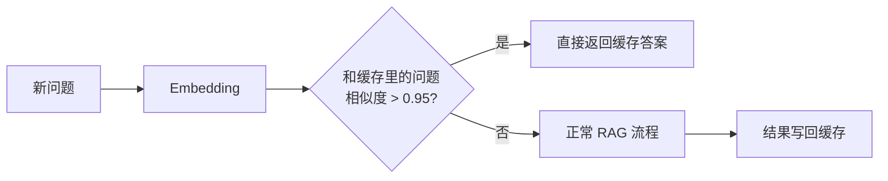

# 生产优化三件套：Semantic Cache / LiteLLM / Citation

> [!abstract] 本章你会学到
> 为什么 Semantic Cache 能降本 60%、怎么用 Redis 实现相似度缓存、LiteLLM 怎么让你一个接口切 OpenAI/DeepSeek/Qwen、怎么做模型路由（简单题便宜模型、复杂题贵模型）、Citation 引用溯源怎么做才能让企业客户买单。
>
> **前置知识**：[[05-生产化与可观测性]]。
> **预计学时**：1 周。

---

## 第一章 Semantic Cache：相似问题直接返回

### 1.1 为什么需要它

企业知识库里，20% 的问题是反复问的（年假多少天、报销流程）。每次都重新检索+调 LLM，纯浪费。

**普通缓存**：一模一样的字符串才命中。
**语义缓存**：意思一样就命中（「年假几天」和「年假有多少天」）。



### 1.2 实现

```python
import redis
import json

r = redis.Redis(host="localhost", port=6379, decode_responses=True)

class SemanticCache:
    def __init__(self, embed_model, threshold: float = 0.95, ttl: int = 86400 * 7):
        self.embed = embed_model
        self.threshold = threshold
        self.ttl = ttl

    def get(self, question: str) -> str | None:
        q_emb = self.embed(question)
        # 从缓存里取最近 N 条，算余弦
        for key in r.scan_iter("cache:q:*", count=100):
            item = json.loads(r.get(key))
            if cosine(q_emb, item["embedding"]) > self.threshold:
                return item["answer"]
        return None

    def set(self, question: str, answer: str):
        key = f"cache:q:{hashlib.md5(question.encode()).hexdigest()}"
        r.setex(key, self.ttl, json.dumps({
            "q": question,
            "answer": answer,
            "embedding": self.embed(question),
        }))
```

> [!tip] 生产优化
> 朴素实现要扫所有 key，慢。生产用 Redis 的 RediSearch 模块或 pgvector 把缓存也存向量，直接 KNN 查询。

### 1.3 怎么量效果

```python
# 记录命中率
hit = 0
total = 0
for q in real_questions:
    total += 1
    if cache.get(q):
        hit += 1
print(f"命中率: {hit/total:.1%}")
```

简历上写：**「Semantic Cache 命中率 35%，月省 API 成本 ¥xxx」**。

---

## 第二章 LiteLLM：一个接口切所有模型

### 2.1 为什么不能写死 OpenAI

- 某天 OpenAI 挂了，整个产品停摆
- DeepSeek 便宜 10 倍，日常问题用它
- GPT-4o 贵但准，复杂题用它
- 客户要求数据不出境，用本地 Qwen

### 2.2 接 LiteLLM

```bash
pip install litellm
```

```python
from litellm import completion

def chat(messages, model="deepseek-chat"):
    resp = completion(
        model=model,
        messages=messages,
        temperature=0.0,
    )
    return resp.choices[0].message.content
```

同一份代码，改一个 `model` 字符串就换模型：
- `gpt-4o-mini`
- `deepseek-chat`
- `claude-3-5-sonnet`
- `ollama/qwen2.5`

### 2.3 模型路由

```python
ROUTE_PROMPT = """判断问题复杂度，只输出一个词：
- simple: 事实查询、单跳问题
- complex: 多源综合、推理、代码
问题：{q}
只输出 simple 或 complex"""

def smart_chat(question, messages):
    level = llm_small.chat(ROUTE_PROMPT.format(q=question))
    if "complex" in level:
        return chat(messages, model="gpt-4o")
    return chat(messages, model="deepseek-chat")
```

> [!tip] 成本账
> DeepSeek 输入 ¥1/百万 token，GPT-4o ¥18/百万。80% 简单题走 DeepSeek，总成本降 70%。

---

## 第三章 Citation：答案挂出处

### 3.1 为什么企业客户要它

没有出处的 RAG 答案没人敢信。Citation 让用户能点「[1]」跳到原文那段。

### 3.2 怎么做

生成时让 LLM 输出带引用：

```python
CITATION_PROMPT = """根据【上下文】回答问题。
每个事实陈述后面挂 [编号]，编号对应上下文片段。
如果上下文没有，说「知识库未覆盖」。

上下文：
[1] {chunk1}
[2] {chunk2}
[3] {chunk3}

问题：{q}
"""
```

```python
def answer_with_citation(question, chunks):
    context = "\n".join(f"[{i+1}] {c['text']}" for i, c in enumerate(chunks))
    answer = llm.chat(CITATION_PROMPT.format(context=context, q=question))
    # 把 [1] 转成可点击链接
    for i, c in enumerate(chunks, 1):
        answer = answer.replace(f"[{i}]",
            f"<a href='/docs/{c['doc_id']}#chunk-{c['chunk_id']}'>[{i}]</a>")
    return answer
```

---

## 第四章 常见坑点

> [!danger] 坑 1：Semantic Cache 阈值设太低
> 0.90 以下容易把「年假几天」和「病假几天」误判成相似。0.95 起步。

> [!danger] 坑 2：缓存了错误答案
> LLM 第一次答错了，缓存了，之后一直返回错的。**缓存 TTL 别太长（7 天），bad case 发现后手动删 key**。

> [!danger] 坑 3：LiteLLM 把错误吃掉
> LiteLLM 统一了接口，但错误码也统一了。不同模型 rate limit 行为不一样，要单独处理。

> [!danger] 坑 4：模型路由判错
> 明明是 complex 题走了简单模型，答案质量暴跌。路由本身也要评测。

> [!danger] 坑 5：Citation 编号对不上
> LLM 编了一个上下文里没有的 [5]。生成后要校验：所有 [n] 都在 chunk 数量范围内。

---

## 第五章 本章总结与练习

> [!note] 💡 深度讲解
> 这三件事的共同点：**都是「让系统更便宜、更可信」**。Semantic Cache 省钱，模型路由省钱，Citation 可信。面试中小公司最在意成本和可信度，这三件事比再上一个新模型更值钱。

> [!success] 📝 要点
> - Semantic Cache：相似问题直接返回，命中率 30%+ 就回本
> - LiteLLM：一个接口切所有模型，做模型路由降本 70%
> - Citation：答案挂出处，企业客户刚需

> [!question] 🎯 梯度练习
> - ⭐ 用 Redis 实现 Semantic Cache，阈值 0.95
> - ⭐⭐ 接 LiteLLM，做 simple/complex 路由
> - ⭐⭐⭐ 实现 Citation 并在前端渲染成可点击链接

---

## 第六章 15 道面试问答

> [!question] Q1：Semantic Cache 和普通缓存区别？
> 答：普通缓存按字符串精确匹配；语义缓存按 embedding 相似度匹配，「年假几天」和「年假多少天」能命中。

> [!question] Q2：阈值设多少？
> 答：0.95 起步，太低会误命中。上线后看 bad case 调。

> [!question] Q3：缓存了错误答案怎么办？
> 答：TTL 别太长（7 天），发现 bad case 手动删 key。

> [!question] Q4：LiteLLM 解决什么？
> 答：一个 Python SDK 接口，同时支持 OpenAI/Claude/DeepSeek/本地模型，换模型不改业务代码。

> [!question] Q5：模型路由怎么判？
> 答：让小模型先把问题分成 simple/complex，simple 走便宜模型，complex 走强模型。

> [!question] Q6：能降多少成本？
> 答：80% 简单题走 DeepSeek，总成本降 70%。

> [!question] Q7：Citation 怎么做？
> 答：上下文编号 [1][2][3]，生成时让 LLM 在事实后挂编号，前端把编号转成链接。

> [!question] Q8：为什么企业要 Citation？
> 答：没有出处没人敢信。Citation 让用户能跳原文核对。

> [!question] Q9：怎么防止 LLM 编不存在的引用？
> 答：生成后校验所有 [n] 都在 chunk 数量范围内，超出就报错重生成。

> [!question] Q10：Semantic Cache 用什么存？
> 答：Redis + RediSearch 或 pgvector。本科项目用 Redis 扫 key 演示就行。

> [!question] Q11：模型挂了怎么办？
> 答：LiteLLM 支持 fallback，主模型失败自动切备用。

> [!question] Q12：怎么量缓存效果？
> 答：记录命中率和省了多少 token/钱。

> [!question] Q13：路由判错怎么办？
> 答：路由本身也要评测。复杂题走便宜模型是事故。

> [!question] Q14：Citation 一定是数字吗？
> 答：也可以用脚注或侧边栏展示，但编号最简单。

> [!question] Q15：你怎么讲这个故事？
> 答：「我加了 Semantic Cache，命中率 35%，月省 ¥xxx；接了 LiteLLM 做路由，80% 问题走 DeepSeek；Citation 让企业客户能点出处，这是 demo 和产品的差距。」

---

## 第七章 关联笔记

- 上一篇：[[08-Agentic-RAG进阶-SelfRAG与GraphRAG]]
- 下一篇：[[10-结构化输出与健壮性]]
- 相关：[[05-生产化与可观测性]]
