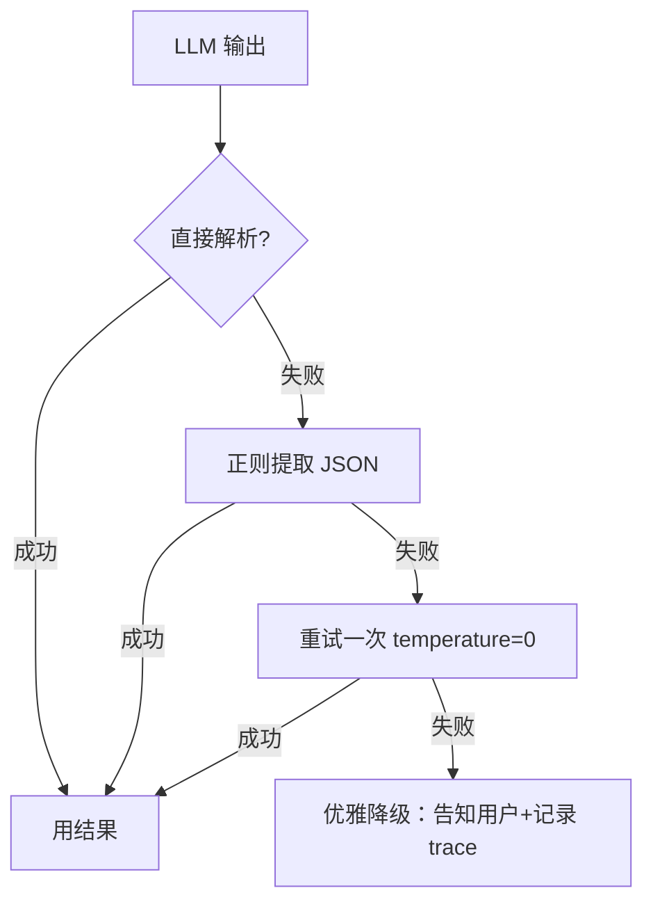

# 结构化输出与健壮性

> [!abstract] 本章你会学到
> 为什么裸 Function Calling 经常解析失败、怎么用 Pydantic + `response_format` 强制 LLM 输出严格 JSON、JSON 解析失败怎么兜底、Agent 多步调用怎么保证不崩、为什么「健壮性」是 demo 和产品的分水岭。
>
> **前置知识**：[[06-Agent编排与LangGraph]]。
> **预计学时**：3-5 天。

---

## 第一章 裸 Function Calling 的三个崩溃现场

### 1.1 现场一：JSON  trailing comma

LLM 返回：
```json
{"tool": "search", "q": "年假",}
```
Python `json.loads` 直接报错。

### 1.2 现场二：markdown 包裹

LLM 返回：
````
```json
{"tool": "search", "q": "年假"}
```
````
你得自己剥 ```json 围栏。

### 1.3 现场三：幻觉参数

LLM 编了一个不存在的参数 `tool_name` 而不是 `tool`。

---

## 第二章 Pydantic 强制结构化输出

### 2.1 OpenAI response_format

```python
from pydantic import BaseModel
from openai import OpenAI

client = OpenAI()

class ToolCall(BaseModel):
    tool: str
    q: str

resp = client.chat.completions.create(
    model="gpt-4o-mini",
    messages=[{"role": "user", "content": "查年假"}],
    response_format={"type": "json_object"},
)
data = ToolCall.model_validate_json(resp.choices[0].message.content)
# data.tool, data.q 直接用，类型安全
```

### 2.2 配合 function calling 的 schema

```python
tools = [{
    "type": "function",
    "function": {
        "name": "search_kb",
        "description": "在公司知识库搜索",
        "parameters": ToolCall.model_json_schema(),
    }
}]
```

---

## 第三章 兜底：解析失败怎么办

### 3.1 三层兜底



### 3.2 实现

```python
import json, re
from pydantic import ValidationError

def safe_parse(raw: str, model_cls):
    # 1. 剥 markdown 围栏
    m = re.search(r"```(?:json)?\s*(.+?)```", raw, re.DOTALL)
    if m:
        raw = m.group(1)
    # 2. 去掉 trailing comma
    raw = re.sub(r",\s*}", "}", raw)
    raw = re.sub(r",\s*]", "]", raw)
    try:
        return model_cls.model_validate_json(raw)
    except ValidationError as e:
        return None
```

---

## 第四章 Agent 多步调用的健壮性

| 故障 | 兜底 |
| --- | --- |
| 工具调用超时 | 重试 1 次，再失败告知用户 |
| 工具返回空 | 换 query 重检索 |
| LLM 输出格式错 | 上面的 safe_parse |
| 死循环 | max_iterations=5 |
| API 限流 | 指数退避 |

---

## 第五章 常见坑点

> [!danger] 坑 1：不用 response_format 让 LLM 自由输出
> 线上 10% 概率解析失败。生产必须用 `response_format={"type":"json_object"}`。

> [!danger] 坑 2：解析失败直接 500
> 用户看到白屏。必须兜底成「系统繁忙，请重试」+ 记录 trace。

> [!danger] 坑 3：max_iterations 不设
> Agent 死循环烧钱。设 5。

> [!danger] 坑 4：Pydantic model 改了 prompt 没改
> schema 和 prompt 描述不一致，LLM 输出对不上。

---

## 第六章 本章总结与练习

> [!note] 💡 深度讲解
> 健壮性不是「加分项」，是 demo 和产品的分界线。面试官问「你线上崩过吗」，你能讲出「JSON 解析失败我怎么兜底、死循环怎么防」，比你能跑通 10 个 demo 都值钱。

> [!success] 📝 要点
> - 用 Pydantic + response_format 强制 JSON
> - safe_parse 三层兜底：剥围栏→去逗号→重试
> - Agent 必须设 max_iterations
> - 所有故障都要优雅降级，不要 500

> [!question] 🎯 梯度练习
> - ⭐ 写一个 safe_parse 函数处理 3 种畸形 JSON
> - ⭐⭐ 给你的工具调用加 response_format 和 Pydantic model
> - ⭐⭐⭐ 故意构造 5 个 LLM 输出错误，看你的兜底是否都接住

---

## 第七章 10 道面试问答

> [!question] Q1：为什么要用 response_format？
> 答：不强制的话 LLM 10% 概率输出畸形 JSON，线上直接崩。

> [!question] Q2：JSON 解析失败怎么办？
> 答：剥 markdown 围栏→去 trailing comma→重试一次→还失败就优雅降级。

> [!question] Q3：怎么防止 Agent 死循环？
> 答：max_iterations=5，超过强制结束。

> [!question] Q4：Pydantic 输出有什么好处？
> 答：类型安全，字段对不上直接报错，不用手动判空。

> [!question] Q5：LLM 幻觉参数怎么办？
> 答：response_format + Pydantic 校验，多出来的字段直接报错。

> [!question] Q6：工具超时怎么处理？
> 答：重试 1 次，再失败告知用户并记录 trace。

> [!question] Q7：为什么 temperature=0？
> 答：结构化输出要稳定，temperature>0 同样的输入输出不一样。

> [!question] Q8：你线上崩过吗？
> 答：JSON 解析失败过。我加了 safe_parse 三层兜底，崩溃率从 10% 降到 0。

> [!question] Q9：怎么测健壮性？
> 答：故意构造 5 种畸形输出，看兜底是否都接住。

> [!question] Q10：demo 和产品的差距？
> 答：demo 跑通就完了；产品要处理 100 种用户不会按预期操作的情况。

---

## 第八章 关联笔记

- 上一篇：[[09-生产优化三件套]]
- 返回：[[00-总览MOC]]
