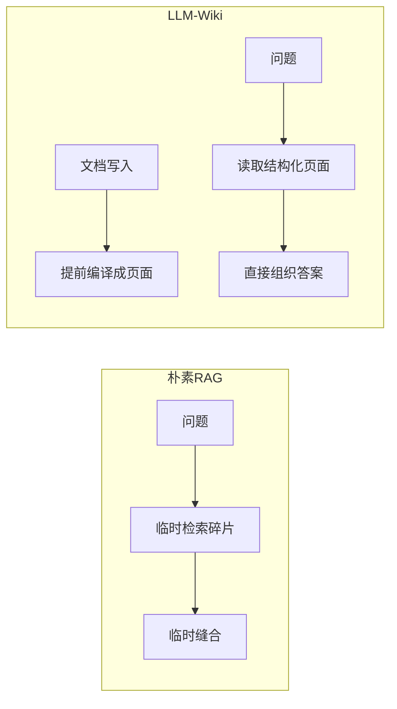
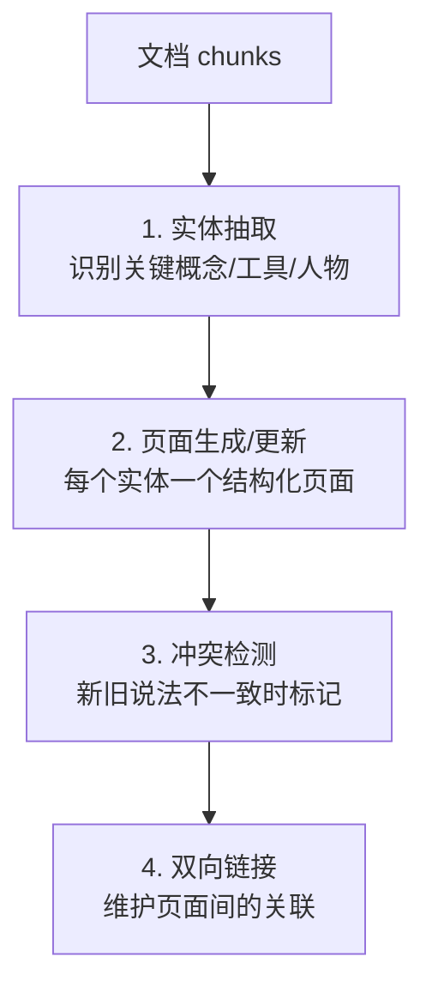
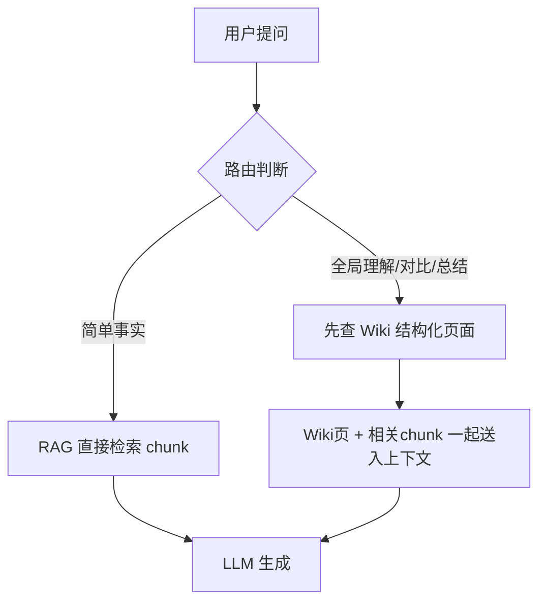
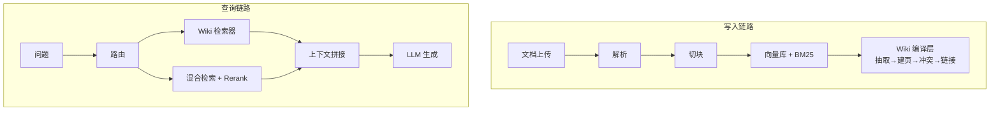

# LLM Wiki 编译型知识库深度指南

> [!abstract] 本章你会学到
> 为什么朴素 RAG「只存不整、知识无积累」、LLM Wiki 如何在**文档写入时就把碎片编译成结构化的知识页面**、它和 GraphRAG / 知识图谱 / 微调的边界在哪、以及在你现有的 FastAPI + ChromaDB 架构上，知识编译层是怎么分层落地的。
>
> **前置知识**：[[02-检索增强三件套深度指南]]、[[08-Agentic-RAG进阶-SelfRAG与GraphRAG]]、[[03-上下文工程深度指南]]。
> **预计学时**：1 周。
> **面试权重**：⭐⭐⭐⭐（2026 年「下一代知识管理」方向的高频开放题）。

> [!important] 学习方式说明
> 本专题的**可运行代码已由 AI 辅助完成**（`app/wiki/` 模块、`Wiki.vue` 前端）。
> **你需要手动完成的是**：理解每个模块的原理 → 能脱稿讲清架构 → 做完全部梯度练习 → 能用自己的话回答面试题。
> 代码是"参考答案"，不是"交差了事"——面试官追问的是你对设计取舍的理解。

---

## 第一章 为什么需要 LLM Wiki

### 1.1 朴素 RAG 的「知识沉淀」缺口

你目前的 RAG 流程已经很完整了：

```
文档上传 → 切块 → 向量化 → 入库 → 查询时检索 → Rerank → 生成
```

但它有一个根本性的设计倾向：**知识只在"提问那一刻"被临时拼装，用完即抛**。这带来三个问题：

| 问题 | 具体表现 |
| --- | --- |
| **知识碎片化** | 文档被切成 500 字的 chunk，chunk 之间没有关联。问"X 和 Y 的区别"，检索到的是两个孤立的片段，模型要自己临时拼 |
| **新旧知识无关联** | 上传第二份文档时，系统只是把新 chunk 塞进向量库，**不会更新第一份文档沉淀的认知**。如果两份文档对同一事物说法不同，模型可能在不同问题里给出矛盾答案 |
| **知识无复利** | 一个被 10 份文档反复提及的核心概念，和一个只在某份文档角落出现一次的名词，在向量库里地位完全相同——都是一个 chunk。高频核心知识没有被"提炼"出来 |

### 1.2 一个直观的对比

假设你上传了 5 份讲 RAG 的文档，然后问：**「RAG 和微调的区别是什么？」**

- **朴素 RAG**：检索到 5 个分别提到 RAG 或微调的 chunk，每个 chunk 只讲了一部分。模型要在生成时**临时**把碎片缝合成对比，容易漏点、容易矛盾。
- **LLM Wiki**：在每次上传文档时，系统已经把「RAG」「微调」编译成了两个**结构化页面**（含定义、要点、相关概念）。回答时直接读取这两个页面，对比关系是**提前整理好的**，一致性和完整度都更高。



### 1.3 一句话定位

> **RAG 是"查询时检索"（retrieve at query time），LLM Wiki 是"写入时编译"（compile at write time）。**
> 前者把理解成本推迟到每次提问，后者把理解成本前置到文档入库的那一刻，并让知识**沉淀、复利、可审计**。

---

## 第二章 LLM Wiki 核心原理

### 2.1 编译型 vs 检索型

借鉴 Karpathy 提出的概念，可以把知识系统分成两种范式：

| 维度 | 检索型（RAG） | 编译型（LLM Wiki） |
| --- | --- | --- |
| 处理时机 | 提问时临时检索 | 入库时提前编译 |
| 知识形态 | 向量 chunk（机器读的） | 结构化 Markdown 页面（人可读、可编辑） |
| 知识关联 | chunk 之间无显式关联 | 页面间有双向链接，主动维护 |
| 知识更新 | 新 chunk 直接入库 | 新信息**合并进已有页面**，并检测冲突 |
| 全局一致性 | 弱（不同 chunk 可能矛盾） | 强（同一实体只有一个"权威页面"） |
| 人类可审计 | 难（向量不可读） | 易（页面就是 Markdown） |
| 大规模成本 | 低（检索便宜） | 高（每个实体要调 LLM 编译） |

### 2.2 编译的四个核心动作

LLM Wiki 在文档写入时，对文档做四件事：



1. **实体抽取（Entity Extraction）**：LLM 读文档，识别"哪些是值得建页面的实体"，并给出类型（概念/工具/接口/流程…）和一句话摘要。
2. **页面生成/更新（Page Management）**：
   - 新实体 → 生成一个结构化 Markdown 页面（概述 / 核心要点 / 详细说明 / 相关内容）。
   - 已有实体 → 把新文档的信息**增量合并**进旧页面，而不是建重复页面。
3. **冲突检测（Conflict Detection）**：合并前对比新旧内容，如果对同一事实给出互斥说法，打上 `conflict_flags` 标记，在页面上醒目展示，交人工裁决。
4. **双向链接（Linking）**：扫描页面正文里的 `[[页面名]]`，解析成真实页面 ID，维护 `related_page_ids`，形成知识网络。

### 2.3 为什么页面用 Markdown 而不是直接建图

这是 LLM Wiki 和 GraphRAG 的关键分野（下一章细讲）：

- **知识图谱**（GraphRAG）的产物是 `(实体, 关系, 实体)` 三元组，**机器友好、人类难读**，擅长多跳推理，但不擅长承载"一段完整的论述"。
- **Wiki 页面**的产物是 Markdown 长文，**人类可读、可编辑、可溯源**，擅长承载"关于这个实体的完整认知"，并天然兼容 Obsidian 这类工具。

> 你可以把 Wiki 页面理解成"**以实体为单位的、AI 帮你写好的 Obsidian 笔记**"。

---

## 第三章 LLM Wiki 与相关技术的边界

这是面试最容易混淆的地方，务必能讲清楚。

### 3.1 LLM Wiki vs GraphRAG

| 维度 | LLM Wiki | GraphRAG |
| --- | --- | --- |
| 产物 | 结构化 Markdown 页面 | 实体-关系图谱 + 社区摘要 |
| 核心数据结构 | 页面（文档） | 三元组（图） |
| 擅长 | 知识沉淀、全局概述、人类可读可编辑 | 多跳关系推理（"X 的 Y 的 Z 是谁"） |
| 人可编辑 | 是（直接改 Markdown） | 否（要改图） |
| 承载长论述 | 强 | 弱 |
| 关系推理 | 弱（靠双向链接，不做图遍历） | 强 |
| 代表实现 | Karpathy llm-wiki 思想 | 微软 graphrag |

> [!note] 记忆口诀
> **GraphRAG 建"图"，重关系、重推理；LLM Wiki 建"页"，重沉淀、重可读。**
> 两者不是替代，而是互补：图回答"谁和谁什么关系"，页面回答"这个东西到底是什么"。

### 3.2 LLM Wiki vs 微调

参考 [[微调与RAG选型]] 的决策框架：

- **微调**解决的是"**怎么说 / 会不会某项技能**"（风格、格式、行为模式），是模型能力层面的事。
- **LLM Wiki**解决的是"**知识怎么组织、怎么沉淀**"（事实、关联、一致性），是知识管理层面的事。

两者完全不在一个层面，甚至可以叠加：微调塑造回答风格，Wiki 提供结构化知识。

### 3.3 LLM Wiki vs RAG：不是替代，是分层

这是本专题最重要的认知：

> **LLM Wiki 不是 RAG 的替代品，而是叠加在 RAG 之上的"知识编译层"。**

- 底层 RAG 仍然是**全量数据的召回底座**（便宜、高并发、可扩展）。
- 上层 Wiki 是**高频核心知识的结构化沉淀**（一致性、全局理解、可审计）。
- 查询时由路由决定：简单事实直接查 chunk，全局理解先查 Wiki 页再回溯源。



---

## 第四章 在你项目里的架构设计

### 4.1 整体分层

知识编译层在你现有架构中的位置：



### 4.2 新增的后端目录

```
app/
├── models/
│   └── wiki_page.py          # WikiPage 数据模型
├── wiki/                     # 【知识编译层】
│   ├── compiler.py           # 编译引擎（协调器）
│   ├── entity_extractor.py   # 实体抽取
│   ├── page_manager.py       # 页面生成/更新/版本
│   ├── conflict_detector.py  # 冲突检测
│   ├── linker.py             # 双向链接维护
│   └── wiki_retriever.py     # 查询时的 Wiki 页面检索
├── routers/
│   └── wiki.py               # Wiki API
└── schemas/
    └── wiki.py               # Pydantic schemas
```

### 4.3 数据模型核心字段（`wiki_page.py`）

你需要理解每个字段为什么存在：

| 字段 | 作用 |
| --- | --- |
| `title` | 实体名，同一知识库内唯一（查重的依据） |
| `content` | 结构化 Markdown 正文 |
| `summary` | 一句话摘要（列表展示 + 检索打分用） |
| `entity_type` | 实体类型（图谱着色、分类筛选） |
| `kb_id` | 所属知识库（隔离边界） |
| `source_doc_ids` | 来源文档列表——**知识可溯源的关键** |
| `related_page_ids` | 双向链接解析出的关联页面 |
| `conflict_flags` | 冲突标记，交人工裁决 |
| `status` | compiled / stale（待重编译）/ failed |
| `version` | 版本号，每次更新 +1 |

### 4.4 三个关键集成点

| 集成点 | 文件 | 触发时机 |
| --- | --- | --- |
| 写入触发 | `services/document_service.py` | 文档处理完成后，**独立后台线程**调 `compile_document`，不阻塞主流程 |
| 查询增强 | `services/rag_service.py` | 检索时多走一步 `retrieve_wiki`，把 Wiki 页作为高优先级上下文 |
| API 暴露 | `routers/wiki.py` | 页面 CRUD、重编译、图谱数据 |

> [!warning] 为什么编译要放独立线程
> 编译一个文档要对每个实体调多次 LLM（抽取 + 建页 + 冲突检测），耗时可能几十秒。
> 如果放在文档处理主流程里，用户上传后要等很久才能看到"完成"。
> 所以代码里用**独立 daemon 线程 + 独立数据库会话**，文档处理和 Wiki 编译解耦。

---

## 第五章 核心模块实现剖析

> 这一章带你**读懂 AI 写的代码**。每个模块都要能回答"它解决什么问题、核心逻辑是什么、失败时怎么降级"。

### 5.1 实体抽取器（entity_extractor.py）

**解决什么**：从文档里识别"哪些实体值得建页面"。

**核心逻辑**：
1. 把 chunk 合并（控制长度，按 `WIKI_PAGE_MAX_TOKENS` 截断）。
2. 用**低温度（temperature=0.1）**让 LLM 输出结构化 JSON：实体名、类型、摘要、关联实体。
3. 容错解析：去 Markdown 代码块包裹 → JSON 解析 → 去重、校验类型。

**关键设计**：
- Prompt 里**限定实体类型枚举**，避免 LLM 输出五花八门的类型。
- 要求"实体名称规范统一"，避免"RAG / 检索增强生成"被当成两个实体。
- LLM 返回空或 JSON 解析失败时，**降级为"不抽取"**，不影响主流程。

### 5.2 页面管理器（page_manager.py）

**解决什么**：实体 → 结构化页面，以及旧页面的增量更新。

**两条路径**：
- **新建**：用 `PAGE_PROMPT` 让 LLM 按固定结构（概述 / 核心要点 / 详细说明 / 相关内容）生成页面，相关概念用 `[[]]` 包裹。
- **更新**：用 `UPDATE_PROMPT` 让 LLM 合并新旧信息，保留准确内容、去重、矛盾处用 `> [!warning]` 标注。

**关键设计**：
- 更新时 `source_doc_ids` 去重合并（一个页面可由多个文档共同支撑）。
- `conflict_flags` 是**追加而非覆盖**（保留历史冲突记录）。
- LLM 更新失败时，把页面标记为 `stale` 并**保留旧内容**，绝不返回空页面。

### 5.3 冲突检测器（conflict_detector.py）

**解决什么**：避免新旧文档矛盾时模型"随机选一个说法"。

**核心逻辑**：
- Prompt 里**明确区分"冲突"和"补充"**：只有"对同一事实给出互斥说法"才算冲突，详略不同、补充信息都不算。
- 明确要求"**不确定时判定无冲突**"——刻意压低误报率（误报会让用户频繁看到假警报，逐渐失去信任）。

**输出**：`[{field, existing_claim, new_claim, detail, doc_id}]`，前端渲染成红色警告框。

### 5.4 双向链接维护器（linker.py）

**解决什么**：把页面正文里的 `[[页面名]]` 变成真实的页面关联。

**核心逻辑**：
1. 用正则 `\[\[([^\[\]|]+)(?:\|[^\[\]]+)?\]\]` 匹配链接（兼容 `[[页面名|别名]]`）。
2. 建立"标题 → 页面 ID"索引，支持精确匹配和"去空格/小写"的宽松匹配。
3. 解析出每个页面的 `related_page_ids`，有变化才更新。

### 5.5 编译引擎（compiler.py）

**解决什么**：把上面四个模块串成一条流水线。

**核心流程**：
```
取 chunks → 抽取实体 → 逐实体：
    找相关 chunk（含实体名的优先）
    已有页面？→ 冲突检测 → 更新
    没有？    → 新建
→ 更新双向链接 → 返回统计
```

**关键细节**：`_find_relevant_chunks` 会优先选"包含实体名"的 chunk，太少则回退到全部 chunk，并限制最多 6 个——**控制每次 LLM 调用的输入成本**。

### 5.6 查询检索器（wiki_retriever.py）

**解决什么**：判断"这个问题该不该用 Wiki"，并找出最相关的页面。

**两个判断**：
- `should_use_wiki`：问题含"是什么/区别/原理/总结/架构"等**全局信号词**才启用；纯事实题（"多少/电话/几号"）直接走 chunk。
- `_score`：标题命中权重最高（0.6），摘要次之，正文最轻，超过阈值才返回，最多 2 页。

> [!note] 为什么不用 embedding 做 Wiki 检索
> 用 embedding 当然更准，但每次查询都要多一次向量计算，增加延迟和成本。
> 对"标题/摘要匹配"这种小规模场景，关键词加权打分已经够用，且**零额外成本、可解释**。这是一个有意识的取舍。

---

## 第六章 Wiki 与 RAG 的协同检索

### 6.1 上下文拼接顺序

在 `rag_service.py` 的 `_build_prompt` 中，上下文被分成两段：

```
## 知识百科   ← Wiki 页面（结构化、高优先级）
【百科1】RAG
...

## 参考资料   ← 原始 chunk（补充细节、可溯源）
【资料1】（来源：xxx.pdf）
...
```

系统提示词明确告诉模型：**百科优先参考，资料用于补充细节和核对**。

### 6.2 为什么 Wiki 页和 chunk 要一起送

- 只送 Wiki 页：页面是"二手整理"，可能在 LLM 编译时丢失细节或产生偏差，且无法溯源到原文。
- 只送 chunk：回到了碎片化、临时缝合的老问题。
- **一起送**：Wiki 页提供"骨架和全局认知"，chunk 提供"血肉和事实核对"，模型既能高屋建瓴，又能核对原文。

### 6.3 Token 预算控制

参考 [[03-上下文工程深度指南]]：
- Wiki 页最多注入 2 页（`WIKI_MAX_PAGES_PER_QUERY`）。
- 每页正文长度在编译时就被 `WIKI_PAGE_MAX_TOKENS` 约束。
- chunk 仍由 `CONTEXT_MAX_TOKENS` 统一兜底，避免上下文超长。

---

## 第七章 成本控制与能力边界

### 7.1 成本从哪来

LLM Wiki 的成本**全部集中在写入时的编译环节**：

| 动作 | 每文档 LLM 调用次数 |
| --- | --- |
| 实体抽取 | 1 次 |
| 每个实体建页/更新 | 1 次 |
| 每个实体冲突检测（仅更新时） | 1 次 |

若一个文档抽取 10 个实体、其中 5 个是旧实体，大约要 1 + 10 + 5 = 16 次 LLM 调用。这是它**不适合超大规模**的根本原因。

### 7.2 成本控制手段（代码已内置）

1. 限制单文档实体数：`WIKI_MAX_ENTITIES_PER_DOC = 15`。
2. 限制每个实体送入的 chunk 数（最多 6 个）。
3. 冲突检测用低温度、短输出。
4. Wiki 检索零额外 embedding 成本（关键词打分）。
5. 可配置 `WIKI_AUTO_COMPILE`，批量导入时可临时关闭，导完手动 `recompile`。

### 7.3 能力边界（什么时候不该用）

> [!warning] 明确边界，面试反而加分
> - **百万级文档、高并发、多租户**：逐页编译的成本和延迟会爆炸，**RAG 才是底座**，Wiki 只覆盖高频核心知识。
> - **知识时效性极强、变动极频繁**（如实时库存、股价）：页面刚编译就过时，维护成本高。
> - **纯事实查询为主**的场景（查号码、查地址）：Wiki 没有价值，直接 chunk 检索。
> - **文档量极小**（几篇短文档）：直接全量塞 context 都够，没必要编译。

### 7.4 适用场景

- 个人知识库、学习笔记、小团队项目文档（几十到几百篇）。
- 需要"全局概述、概念对比、跨文档一致性"的企业知识库。
- 需要知识可审计、可人工编辑、可溯源的场景。

---

## 第八章 常见坑点

> [!warning] ⚠️ 坑1：同一实体被建成多个页面
> 实体名不统一（"RAG" vs "检索增强生成" vs "检索增强生成技术"）会导致重复页面。
> **解法**：抽取 prompt 强制名称规范 + 建页前按标题查重 + 宽松匹配（去空格小写）。

> [!warning] ⚠️ 坑2：冲突误报泛滥
> 把"补充信息、详略不同"误判成冲突，会让用户满屏红警报、逐渐无视。
> **解法**：Prompt 明确"补充不算冲突 + 不确定判无冲突"，刻意压低召回、提高准确率。

> [!warning] ⚠️ 坑3：编译失败留下空页面
> LLM 调用超时/限流时如果直接写库，会产生空白页面。
> **解法**：LLM 返回空就不建页；更新失败标记 `stale` 并保留旧内容。

> [!warning] ⚠️ 坑4：线程间共用数据库会话
> 后台编译线程如果复用请求线程的 Session，会出现线程安全问题。
> **解法**：每个后台线程用 `SessionLocal()` 开独立会话，finally 里关闭。

> [!warning] ⚠️ 坑5：删除页面后残留悬空链接
> 删了 A 页面，其他页面的 `related_page_ids` 里还指向 A。
> **解法**：删除后重跑一次 `linker.update_relations`，并在图谱构建时过滤无效 ID。

> [!warning] ⚠️ 坑6：上下文膨胀
> Wiki 页 + chunk 一起送，容易超出 context window。
> **解法**：限制页数、页长，统一由 `CONTEXT_MAX_TOKENS` 兜底。

---

## 第九章 本章总结与练习

> [!note] 💡 深度讲解
> LLM Wiki 的本质是**把"理解和组织知识"的成本从查询时前置到写入时**，让知识从"一次性碎片"变成"可复利的结构化资产"。
> 它和 RAG 不是替代关系，而是**编译层 + 检索层的双层架构**；和 GraphRAG 是"页面 vs 图谱"的互补关系。
>
> 2026 年面试问"你觉得 RAG 之后知识管理往哪走"，一个成熟的回答是：**"RAG 解决召回，编译层解决沉淀，二者分层协同；我在项目里用 Wiki 页面承载高频核心知识，用 RAG 做全量底座，并通过路由按需调度。"**

> [!success] 📝 要点
> - 检索型（查询时）vs 编译型（写入时）
> - 编译四动作：抽取 → 建页/更新 → 冲突检测 → 双向链接
> - LLM Wiki 建"页"（可读可编辑），GraphRAG 建"图"（多跳推理）
> - 双层架构：RAG 底座 + Wiki 沉淀 + 路由调度
> - 成本集中在写入，通过限制实体数/chunk 数控制

> [!question] 🎯 梯度练习
> - ⭐ 通读 `app/wiki/` 全部代码，能脱稿画出"写入编译 + 查询路由"的完整数据流图。
> - ⭐ 手动上传 2-3 篇主题相关的文档，观察 Wiki 页面如何生成；故意在第二份文档里写一个与第一份矛盾的事实，观察冲突标记。
> - ⭐⭐ 关闭 `WIKI_AUTO_COMPILE`，批量上传 5 篇文档后，调用 `/wiki/kb/{id}/recompile` 一次性编译，对比自动编译的成本差异。
> - ⭐⭐ 修改 `entity_extractor.py` 的 prompt，新增一种实体类型（如 `metric` 指标），并在前端类型筛选和图谱着色中补全。
> - ⭐⭐⭐ 用你现有的 `evaluation/` 评测体系，为"全局理解型"问题设计 10 条 golden QA，对比开启/关闭 Wiki 增强的答案质量（faithfulness / 完整性）。
> - ⭐⭐⭐ 尝试把 Wiki 能力通过 MCP 暴露（参考 [[04-MCP模型上下文协议深度指南]]），让外部 Agent 能读取结构化知识页面。

---

## 第十章 面试问答

> [!question] Q1：什么是 LLM Wiki？
> 答：一种"写入时编译"的知识管理方式——文档入库时就由 LLM 把关键实体编译成结构化、可读可编辑的 Markdown 页面，并维护页面关联与知识冲突。

> [!question] Q2：它和 RAG 的区别？
> 答：RAG 是查询时临时检索碎片，用完即抛；LLM Wiki 是写入时提前编译、持续沉淀。不是替代，是分层：RAG 做全量召回底座，Wiki 做高频知识沉淀。

> [!question] Q3：它和 GraphRAG 的区别？
> 答：GraphRAG 产物是实体-关系图谱，擅长多跳推理；LLM Wiki 产物是 Markdown 页面，擅长承载完整论述、人类可读可编辑。一个重关系，一个重沉淀。

> [!question] Q4：为什么不用它替代 RAG？
> 答：编译成本集中在写入、随实体数线性增长，百万级文档下成本和延迟爆炸。RAG 的检索便宜、高并发、可扩展，仍是底座；Wiki 只覆盖高频核心知识。

> [!question] Q5：编译具体做哪些事？
> 答：实体抽取 → 页面生成或增量更新 → 新旧知识冲突检测 → 双向链接维护。

> [!question] Q6：知识冲突怎么处理？
> 答：合并前用 LLM 对比新旧内容，只有互斥说法才算冲突，标记到页面醒目展示交人工裁决；提示词刻意"不确定判无冲突"以压低误报。

> [!question] Q7：怎么保证知识可溯源？
> 答：每个页面记录 `source_doc_ids`，查询时 Wiki 页和原始 chunk 一起送入上下文，chunk 带来源文档名，既能读整理后的认知，又能核对原文。

> [!question] Q8：编译为什么放后台线程？
> 答：一个文档要对每个实体做多次 LLM 调用，耗时几十秒。放独立线程 + 独立数据库会话，文档处理和知识编译解耦，不阻塞用户。

> [!question] Q9：编译失败怎么办？
> 答：新建时 LLM 返回空就不建页；更新失败把页面标记为 stale 并保留旧内容，绝不产生空页面。

> [!question] Q10：查询时怎么决定用不用 Wiki？
> 答：问题含"是什么/区别/原理/总结/架构"等全局信号词才启用；纯事实题直接查 chunk。页面按标题/摘要加权打分，超过阈值才返回，最多 2 页。

> [!question] Q11：成本怎么控制？
> 答：限制单文档实体数、每实体送入的 chunk 数；冲突检测短输出；Wiki 检索用关键词打分零额外成本；批量导入时可关自动编译、导完手动重编译。

> [!question] Q12：Wiki 检索为什么不用 embedding？
> 答：标题/摘要匹配是小规模场景，关键词加权已够用，零额外成本、可解释、无额外延迟；用 embedding 更准但增加成本，是有意识的取舍。

> [!question] Q13：它和微调冲突吗？
> 答：完全不冲突。微调解决"怎么说/技能"（行为层），Wiki 解决"知识怎么组织"（知识层），可叠加：微调塑风格，Wiki 提供知识。

> [!question] Q14：删除页面怎么处理关联？
> 答：删除后重跑链接维护，清理其他页面中指向它的关联；图谱构建时也会过滤无效 ID，避免悬空链接。

> [!question] Q15：什么场景不该用 LLM Wiki？
> 答：百万级高并发、知识时效性极强、纯事实查询为主、文档量极小的场景。这些场景要么 RAG 更优，要么直接全量塞 context 即可。

> [!question] Q16：页面为什么用 Markdown？
> 答：人类可读、可编辑、可审计，天然兼容 Obsidian 等工具，能承载完整论述；图谱三元组做不到这些。

> [!question] Q17：同一实体怎么避免重复建页？
> 答：抽取 prompt 强制名称规范统一，建页前按标题查重，并做去空格/小写的宽松匹配。

> [!question] Q18：Wiki 页和 chunk 一起送会不会冲突？
> 答：不会。提示词明确百科优先、chunk 用于核对；若两者矛盾，提示词要求模型指出矛盾点。Token 预算也会限制总量。

> [!question] Q19：你怎么验证 Wiki 真的有用？
> 答：为全局理解型问题建 golden QA，用同一套评测体系对比开关 Wiki 的 faithfulness 和完整性，用数据说话，而不是"感觉变好了"。

> [!question] Q20：你怎么讲这个项目的故事？
> 答：「我发现朴素 RAG 对'对比/总结/全局概述'类问题一致性差、知识无沉淀，于是在 RAG 底座上叠加了知识编译层，文档写入时把核心实体编译成结构化页面、检测跨文档冲突、维护双向链接；查询时按问题类型路由，全局题先查 Wiki 再核对原文。我用评测集验证了全局题的答案质量提升。」

---

## 第十一章 关联笔记

- 上一篇：[[10-结构化输出与健壮性]]
- 相关：[[02-检索增强三件套深度指南]]、[[08-Agentic-RAG进阶-SelfRAG与GraphRAG]]
- 知识层：[[03-上下文工程深度指南]]、[[01-RAG评测体系深度指南]]
- 工具层：[[04-MCP模型上下文协议深度指南]]
- 选型：[[微调与RAG选型]]
- 实战：[[实战-LLM Wiki编译层接入]]
