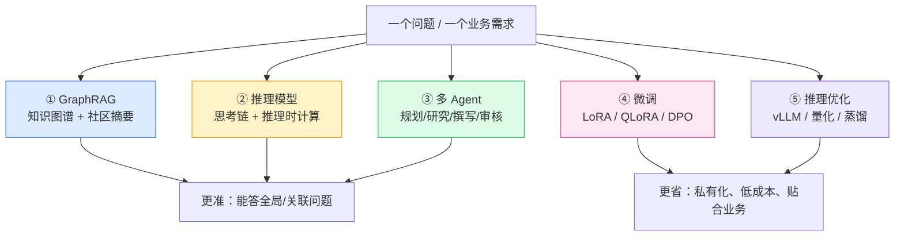
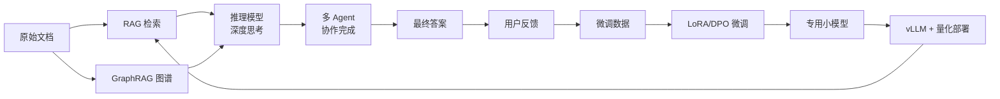

# 前沿能力总览与学习路线图

## 概述

在完成"RAG 底座 + LLM Wiki 编译层 + 四层能力"之后，本项目继续补齐 2025-2026 年最具代表性、也最贴合求职的五个前沿方向。它们不是孤立的炫技，而是围绕"**让知识库答得更准、更会思考、更能协作、成本更低**"展开的。

> 一句话记忆：
> - **GraphRAG**：把知识"连成网"，回答全局问题
> - **推理模型**：让模型"先想再答"，解决复杂问题
> - **多 Agent**：让多个角色"分工协作"，完成复杂任务
> - **微调**：让模型"学你的风格"，贴合你的业务
> - **推理优化**：让模型"跑得更快更省"，能上生产

## 五大方向全景图

## 它们之间的关系（重要）

很多初学者会问：这五个是不是"五选一"？答案是**它们处在一条完整的链路中**：

- **检索侧**：RAG（向量）+ GraphRAG（图谱）互补：向量擅长"找相似"，图谱擅长"理关系、看全局"。
- **生成侧**：推理模型是"更聪明的大脑"，多 Agent 是"团队协作"。
- **降本侧**：微调 + 推理优化，让你用便宜的小模型，达到接近大模型的效果。

## 学习优先级与周期建议

| 优先级 | 方向 | 求职价值 | 建议周期 | 是否需要 GPU | 指导文档 |
|---|---|---|---|---|---|
| P0 | GraphRAG | 极高（RAG 进阶必考） | 1 周 | 否 | [[01-GraphRAG知识图谱学习指导]] |
| P0 | 推理模型 | 极高（当下最热） | 3-5 天 | 否（调 API） | [[02-推理模型与推理时计算学习指导]] |
| P0 | 多 Agent | 极高（Agent 岗位核心） | 1 周 | 否（原生）/ 可选 | [[03-LangGraph多Agent协作学习指导]] |
| P1 | 模型微调 | 高（算法/工程加分） | 1-2 周 | 是（或云 GPU） | [[04-模型微调学习指导]] |
| P1 | 推理优化 | 高（工程落地必备） | 1 周 | 是（部署） | [[05-推理优化与部署学习指导]] |

> 建议：**前三个（GraphRAG、推理模型、多 Agent）务必吃透**，它们不依赖 GPU，用 API 就能跑通，是面试中最容易被深挖的部分。后两个（微调、推理优化）理解原理 + 跑通一次即可，面试时能讲清楚"什么时候用、怎么用、有什么坑"。

## 本项目中已经为你做好的部分

AI 已经完成了可运行的代码，你不需要从零写，但**必须理解并能讲清楚**：

| 方向 | 已完成的代码 | 你需要做的 |
|---|---|---|
| GraphRAG | 3 个模型、图谱构建、社区检测、图检索、路由、前端图谱页 | 跑通 + 理解 + 手动练习 |
| 推理模型 | 推理链解析、推理服务、RAG 集成、前端思考链展示 | 用真实模型体验 + 理解 |
| 多 Agent | 原生状态机、LangGraph 编排、路由、前端流程可视化 | 对比 native 与 LangGraph |
| 微调 | 数据导出、LoRA/QLoRA/DPO 脚本、合并脚本 | 准备数据 + （有 GPU 时）跑一次 |
| 推理优化 | vLLM 启动、量化、蒸馏脚本 | 理解原理 + 部署一次 |

## 学习方法建议

1. **先跑通，再深究**：每个方向先按文档把代码跑起来，看到效果，再回头理解原理。
2. **用"三位一体"法**：每个概念都问自己三个问题——它解决什么问题（作用）、它怎么做到的（原理）、我怎么用（用法）。
3. **对着面试学**：每篇文档末尾都有"面试要点"，学完后尝试不看答案，自己讲一遍。
4. **做差异化**：这套组合拳（RAG + Wiki + GraphRAG + 推理 + 多 Agent）已经超过大多数简历，你要做的是把它们**串成一个完整的故事**，而不是堆砌名词。

## 拓展阅读

- 微软 GraphRAG 官方论文与文档
- DeepSeek-R1 论文（推理模型的开源里程碑）
- LangGraph 官方教程（多 Agent 编排）
- LLaMA-Factory（一站式微调框架，强烈推荐初学者使用）
- vLLM 官方文档（推理部署事实标准）
