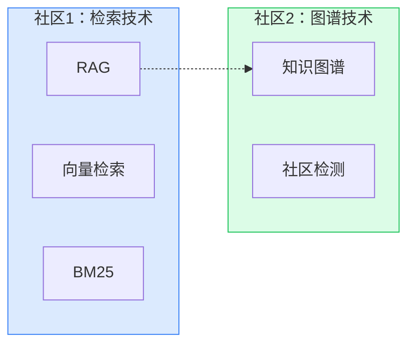
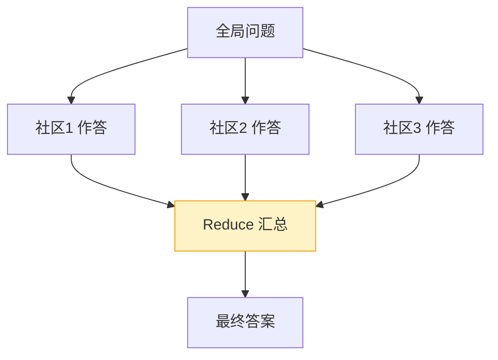

# GraphRAG 知识图谱学习指导

## 概述

普通 RAG 用"向量相似度"找文档片段，它有一个天生的短板：**只看"像不像"，不看"关系"**。

举个例子，问"RAG 的核心组件有哪些？"，向量检索能找到提到 RAG 的片段；但如果问"**整个知识库讲了哪几个主题？它们之间什么关系？**"，向量检索就抓瞎了——因为没有任何一个片段"长得像"这个全局问题。

**GraphRAG**（Graph + RAG）就是把知识构建成"实体 + 关系"的图谱，再用图谱来回答问题。它由微软在 2024 年提出，是 RAG 进阶的标志性技术。

### 三位一体拆解

| 维度 | 内容 |
|---|---|
| **作用**：解决什么问题 | ① 回答全局/总结/关联型问题；② 多跳推理（A→B→C 的关系链）；③ 消除向量检索"只见树木不见森林"的问题 |
| **原理**：核心逻辑 | 抽取实体（节点）→ 建立关系（边）→ 社区检测（把密集相连的节点聚成社区）→ 社区摘要 → 局部/全局检索 |
| **用法**：怎么用 | 构建图谱（build）→ 局部检索（local）或全局检索（global），前端力导向图可视化 |

## 原理：GraphRAG 是怎么工作的

### 第一步：实体与关系抽取

把文档喂给 LLM，让它抽取结构化的"实体"和"关系"：

```
实体（节点）：RAG、向量检索、知识图谱
关系（边）：RAG --依赖--> 向量检索
          RAG --结合--> 知识图谱
```

本项目复用了 [[11-LLM Wiki编译型知识库深度指南]] 中已有的 `entity_extractor`（实体抽取器），它已经能输出实体名、类型、描述和关联实体。

### 第二步：社区检测（Community Detection）

图谱可能有成千上万个节点，无法直接整体理解。于是用算法把"密集相连"的节点聚成若干**社区**（可以理解为"话题群"）。



本项目的社区检测实现：
- **优先**用 `networkx` 的 Louvain 算法（如果安装了）；
- **否则**用自实现的「标签传播」（Label Propagation）：每个节点把标签更新为邻居中出现最多的标签，最终相同标签的节点属于同一社区。优点是无需第三方依赖、可并行。

### 第三步：社区摘要

对每个社区，用 LLM 生成"主题 + 摘要"。这是把"图"压缩成"可理解的文本"的关键。

### 第四步：两种检索方式

| 检索方式 | 流程 | 适用问题 |
|---|---|---|
| **局部检索 Local** | 匹配实体 → 扩展邻居（1-2 跳）→ 组装子图上下文 → 生成答案 | "关于某个具体实体"的问题 |
| **全局检索 Global** | 问题匹配相关社区 → 每个社区分别作答（Map）→ 汇总（Reduce） | "整体主题/总结/对比"的问题 |

全局检索的核心是 **Map-Reduce**：



## 实操：在项目中跑通

### 1. 构建图谱

在前端进入「图谱检索」页面，选择知识库，点击「构建图谱」，等待状态变为「完成」。

或通过 API：
```bash
# 触发构建（后台线程）
curl -X POST http://localhost:8000/api/graphrag/kb/1/build \
  -H "Authorization: Bearer <token>" \
  -H "Content-Type: application/json" \
  -d '{"doc_ids": null}'

# 查询状态
curl http://localhost:8000/api/graphrag/kb/1/status \
  -H "Authorization: Bearer <token>"
```

### 2. 查看图谱数据

```bash
curl http://localhost:8000/api/graphrag/kb/1/graph \
  -H "Authorization: Bearer <token>"
```
返回 `nodes`（节点）、`edges`（边）、`communities`（社区），前端用 ECharts 力导向图渲染。

### 3. 局部 / 全局检索

```bash
# 局部
curl -X POST http://localhost:8000/api/graphrag/kb/1/local \
  -H "Authorization: Bearer <token>" \
  -H "Content-Type: application/json" \
  -d '{"question": "RAG 依赖什么检索技术？"}'

# 全局
curl -X POST http://localhost:8000/api/graphrag/kb/1/global \
  -H "Authorization: Bearer <token>" \
  -H "Content-Type: application/json" \
  -d '{"question": "总结这个知识库的主要内容"}'
```

## 手动练习（必须自己完成）

1. **对比实验**：对同一个问题，分别用普通 RAG 和 GraphRAG 全局检索，记录答案差异，理解图谱的价值。
2. **手画图谱**：选一篇你熟悉的文档，手工列出 5-10 个实体和它们的关系，再和程序抽取的结果对比。
3. **更换社区检测算法**：`pip install networkx`，重新构建图谱，对比标签传播和 Louvain 的社区划分差异。
4. **调参**：尝试调整邻居扩展跳数（hops）、社区数量，观察对答案的影响。

## 常见问题

- **Q：图谱构建很慢/很贵？**
  A：实体抽取需要大量 LLM 调用，建议限制单文档实体数（`WIKI_MAX_ENTITIES_PER_DOC`），并在文档更新时增量构建，而非全量重建。
- **Q：实体抽取质量差？**
  A：优化抽取 Prompt（给出明确的实体类型和示例）、降低 temperature、对同名实体做归一化合并。
- **Q：GraphRAG 会取代向量 RAG 吗？**
  A：不会。二者互补：向量检索负责"广度召回"，图谱负责"关系与全局"。生产中通常是混合使用。

## 面试要点

- 能讲清楚"普通 RAG 的局限"和"GraphRAG 如何解决"。
- 能画出完整流程图：实体抽取 → 关系建立 → 社区检测 → 社区摘要 → 局部/全局检索。
- 能解释社区检测的算法（Louvain/标签传播）和 Map-Reduce 全局检索。
- 能说出 GraphRAG 的成本（大量 LLM 调用）和适用场景。
- 高频追问："GraphRAG 和向量 RAG 怎么选？" → 答：互补，具体问题用局部、全局问题用全局检索、混合最优。
