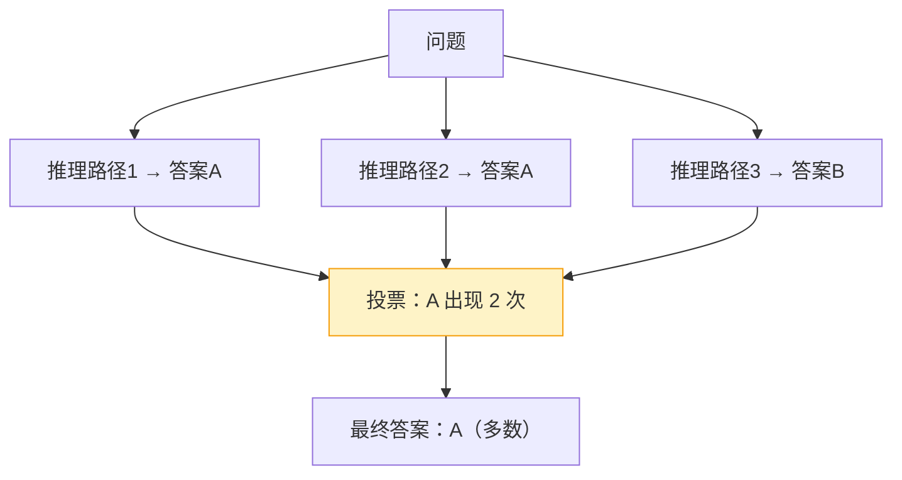

# 推理模型与推理时计算学习指导

## 概述

2024 年底到 2025 年，AI 领域最大的变化是**推理模型（Reasoning Model）的崛起**。代表作是 OpenAI 的 o1/o3、DeepSeek-R1 等。

普通模型（如 GPT-4o）是"**快思考**"：你问，它立刻答，类似直觉。
推理模型（如 DeepSeek-R1）是"**慢思考**"：它会先进行一段内部"思考"（推理链），把复杂问题拆解、推导、自我检查，再给出答案。

> 类比：考试时，普通模型是"看到题就写答案"，推理模型是"在草稿纸上打草稿、验算后再写"。

### 三位一体拆解

| 维度 | 内容 |
|---|---|
| **作用**：解决什么问题 | 数学、逻辑、代码、复杂规划等"需要多步推导"的问题；显著降低复杂任务的错误率 |
| **原理**：核心逻辑 | 用强化学习（RL）训练模型学会"长思考"，生成一段推理链（Chain of Thought），再从推理链得出答案 |
| **用法**：怎么用 | 调用推理模型，分离"思考过程"和"最终答案"，前端折叠展示思考链 |

## 原理：推理模型为什么更聪明

### 1. 推理链（Chain of Thought, CoT）

推理模型在给出最终答案前，会生成一段"思考过程"，例如：

```
用户：一个水池，进水管 5 小时注满，出水管 8 小时放空，同时开多久注满？

推理模型思考：
  进水管每小时注 1/5，出水管每小时放 1/8。
  同时开每小时净注水 = 1/5 - 1/8 = 3/40。
  注满需要 40/3 ≈ 13.33 小时。

最终答案：约 13 小时 20 分钟。
```

把大问题拆成小步骤，每一步都用模型的"下一步预测"来完成，这就是"推理时计算"（Test-time Compute）的核心思想：**让模型在推理时多花算力，换取更高的准确率**。

### 2. 推理模型是怎么训练的

以 DeepSeek-R1 为代表，关键是用**强化学习**让模型"学会思考"：
- 让模型大量尝试生成推理链；
- 用"答案是否正确"作为奖励信号；
- 能推出正确答案的思考方式被强化，错误的被抑制。

### 3. 推理链的两种返回形式

| 形式 | 说明 | 代表 |
|---|---|---|
| 独立字段 `reasoning_content` | 思考过程和答案分开返回 | DeepSeek-R1、豆包 thinking |
| 标签 `<think>...</think>` | 思考过程写在标签里 | 开源 R1 风格模型 |

本项目的 `extract_reasoning()` 函数同时兼容这两种形式。

## 推理时计算（Test-time Compute）

这是理解推理模型的关键概念，也是面试高频词。

**核心思想**：传统提升模型靠"扩大训练规模"（预训练），推理模型靠"**扩大推理时的算力**"——让模型在回答时多想一会儿。

常见的推理时计算技术：

| 技术 | 做法 | 适用 |
|---|---|---|
| **长思考链** | 让模型生成更长的推理过程 | 通用复杂问题 |
| **Self-Consistency（自洽性）** | 多次独立推理，对答案投票取多数 | 数学、逻辑等有确定答案的问题 |
| **Best-of-N** | 生成 N 个答案，用验证器选最好的 | 通用 |
| **验证器（Verifier）** | 用另一个模型检查答案对错 | 数学、代码 |

本项目实现了 **Self-Consistency**：多次采样推理，按最终答案投票，取最一致的结果。



## 实操：在项目中跑通

### 1. 配置推理模型

在 `.env` 中设置：
```bash
REASONING_ENABLED=true
REASONING_MODEL=deepseek-r1   # 或你平台支持的推理模型
```

### 2. 推理问答

在前端「智能问答」页面，点击输入框旁的「深度推理」按钮（黄色 CPU 图标），回答后可以展开"深度思考过程"。

或通过 API：
```bash
curl -X POST http://localhost:8000/api/chat/reasoning \
  -H "Authorization: Bearer <token>" \
  -H "Content-Type: application/json" \
  -d '{"kb_id": 1, "question": "请详细分析 RAG 的核心组件", "use_reasoning": true}'
```

返回：
```json
{
  "answer": "最终答案……",
  "reasoning": "思考过程……",
  "reasoned": true,
  "sources": [...]
}
```

### 3. 自动判断是否需要推理

简单问题（如"你好"）自动走普通模型，复杂问题才推理，省时省钱。判断逻辑在 `needs_reasoning()`，可在 `.env` 中调整阈值。

## 手动练习（必须自己完成）

1. **对比体验**：对同一道复杂题，分别用普通模型和推理模型，对比准确率和思考过程。
2. **观察思考链**：找一道数学题/逻辑题，仔细阅读推理模型的完整思考链，看它在哪一步"想明白"。
3. **Self-Consistency 实验**：开启 `SELF_CONSISTENCY_ENABLED`，用一道数学题测试，观察多次推理的答案是否一致。
4. **读 R1 论文**：阅读 DeepSeek-R1 论文（有中文版），理解"推理能力是怎么用 RL 训练出来的"。

## 常见问题

- **Q：推理模型思考链又长又慢，成本高？**
  A：是的，推理 token 也计费。建议只对复杂问题启用（自动判断），简单问题走普通模型。
- **Q：思考链是真的"思考"吗？**
  A：本质仍是"预测下一个 token"，但 RL 训练让这个生成过程呈现出有效的多步推理结构，从而在复杂任务上更准确。
- **Q：推理模型还需要 RAG 吗？**
  A：需要。推理模型本身不掌握你的私有知识，RAG 负责"提供事实"，推理模型负责"深度加工"。二者结合最强。

## 面试要点

- 能解释"推理模型和普通模型的区别"（慢思考 vs 快思考）。
- 能讲清楚"Test-time Compute（推理时计算）"的思想和价值。
- 能说出至少两种推理时计算技术（Self-Consistency、Best-of-N、验证器）。
- 能解释推理模型的训练思路（强化学习 + 可验证奖励）。
- 高频追问："推理模型这么强，为什么还要 RAG？" → 答：推理模型缺私有/实时知识，RAG 提供事实，推理模型负责加工，互补。
- 高频追问："推理模型的成本问题怎么解决？" → 答：按需启用、模型蒸馏、小模型 + 推理优化。
