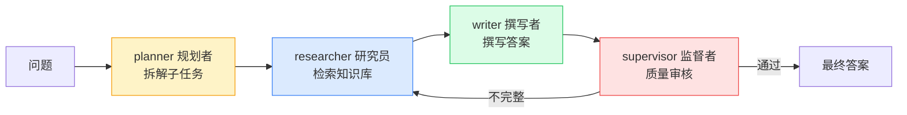

# LangGraph 多 Agent 协作学习指导

## 概述

单个 Agent（如本项目的工具调用 Agent）是"一个全能员工"：它自己决定检索、计算、回答。但当任务复杂时，"一个人干所有事"会力不从心。

**多 Agent（Multi-Agent）** 就是让多个"各有专长"的 Agent 像团队一样分工协作：有人规划、有人查资料、有人写报告、有人审核。

> 类比：单 Agent 是"一个全科医生"，多 Agent 是"一个医疗团队"——有分诊医生、检查科、主治医生、主任审核。

**LangGraph** 是 LangChain 团队推出的、用来构建"有状态、可循环、多 Agent"应用的框架，是目前 Agent 编排的主流工具之一。

### 三位一体拆解

| 维度 | 内容 |
|---|---|
| **作用**：解决什么问题 | 复杂任务的分工、需要多步协作/人工审核/角色协同的场景；流程可控、可回溯 |
| **原理**：核心逻辑 | 把任务建模为"状态（State）在节点（Node，即 Agent）之间流转"的图（Graph），支持条件分支、循环、人工介入 |
| **用法**：怎么用 | 定义状态和各 Agent 节点 → 编排流转图 → 运行；本项目提供原生状态机兜底，无需安装 LangGraph |

## 原理：多 Agent 是怎么协作的

### 1. 核心概念：状态、节点、边

LangGraph 把应用抽象成一张图：

| 概念 | 含义 | 类比 |
|---|---|---|
| **State（状态）** | 在整个流程中流转、共享的数据 | 团队共享的"任务文档" |
| **Node（节点）** | 一个 Agent / 一个处理步骤 | 团队中的一个角色 |
| **Edge（边）** | 节点之间的流转规则（可条件分支） | 工作交接给谁 |

### 2. 三种常见的多 Agent 模式

| 模式 | 结构 | 适用 |
|---|---|---|
| **ReAct** | 单个 Agent 在"思考→行动→观察"中循环 | 通用工具调用 |
| **Plan-and-Execute** | 先规划步骤，再逐步执行，最后可重规划 | 步骤明确的复杂任务 |
| **Supervisor（主管/监督者）** | 一个主管调度多个专职 Agent | 多角色分工协作 |

本项目三种都实现了（见 `app/orchestration/`）：
- `react_graph.py`：ReAct 智能体
- `plan_execute.py`：规划-执行-重规划
- `multi_agent.py`：researcher / writer / supervisor 多 Agent

### 3. 原生状态机兜底（本项目特色）

LangGraph 是"可选依赖"，如果没安装，本项目用一个**原生状态机**（`native_multi_agent.py`）实现同样的多 Agent 协作，包含四个角色：



每一步都会记录到 `steps`，前端用时间线（Timeline）展示"多 Agent 是怎么协作的"。

## 实操：在项目中跑通

### 1. 原生状态机（无需安装，推荐先跑）

在前端「AI Agent」页面 → 「多 Agent 协作」标签，选择知识库，输入复杂问题，观察协作流程时间线。

或通过 API：
```bash
curl -X POST http://localhost:8000/api/agent/multi-agent \
  -H "Authorization: Bearer <token>" \
  -H "Content-Type: application/json" \
  -d '{"question": "梳理 RAG 的完整流程并说明各组件作用", "kb_id": 1, "backend": "native"}'
```

返回 `answer`（答案）、`steps`（每一步的角色和产出）、`backend`。

### 2. LangGraph 编排（需要安装）

```bash
pip install langgraph langchain-openai
```

然后把 `backend` 改为 `langgraph-multi-agent`（或 `langgraph-react` / `langgraph-plan-execute`）：
```bash
curl -X POST http://localhost:8000/api/agent/multi-agent \
  -H "Authorization: Bearer <token>" \
  -H "Content-Type: application/json" \
  -d '{"question": "...", "kb_id": 1, "backend": "langgraph-multi-agent"}'
```

未安装 LangGraph 时，接口会返回明确的错误提示和安装指引。

## 手动练习（必须自己完成）

1. **跑通原生状态机**：用一个复杂问题，逐步观察四个角色的产出，理解"为什么要分工"。
2. **安装并对比 LangGraph**：安装 LangGraph，对比三种模式（ReAct / Plan-Execute / Supervisor）的差异。
3. **画协作图**：选一个任务（如"写一份行业调研报告"），自己设计需要哪些角色、如何流转，再用代码实现。
4. **加一个新角色**：尝试在原生状态机中增加一个"critic（批评者）"或"fact-checker（事实核查）"角色。
5. **人工介入**：阅读 LangGraph 的 `interrupt` 机制，理解如何在关键节点"暂停、等人审批"。

## 常见问题

- **Q：多 Agent 一定比单 Agent 好吗？**
  A：不一定。多 Agent 调用链更长、成本更高、更易出错。简单任务用单 Agent，复杂任务才值得多 Agent。
- **Q：LangGraph 和 LangChain 是什么关系？**
  A：LangChain 是构建 LLM 应用的基础库，LangGraph 是其团队推出的、专注"有状态、可循环、多 Agent"编排的框架，更适合复杂 Agent。
- **Q：多 Agent 如何避免"无限循环"？**
  A：设置最大迭代/重规划次数、监督者的终止条件、超时机制。
- **Q：除了 LangGraph 还有什么选择？**
  A：AutoGen（微软，多 Agent 对话）、CrewAI（角色化团队，上手简单）、OpenAI Swarm（轻量）等。

## 面试要点

- 能解释"为什么需要多 Agent / 单 Agent 的局限"。
- 能讲清楚 LangGraph 的核心概念（State / Node / Edge）和它相比普通链的优势（支持循环、状态、人工介入）。
- 能说出至少三种多 Agent 模式（ReAct、Plan-and-Execute、Supervisor）。
- 能讲清楚如何控制多 Agent 的成本与循环（最大步数、终止条件）。
- 高频追问："多 Agent 更慢更贵，为什么还用？" → 答：复杂任务单 Agent 完不成，分工带来质量和可控性，且能处理需要审核/协作的真实业务流程。
- 高频追问："LangGraph / AutoGen / CrewAI 区别？" → 答：LangGraph 偏图编排与可控性，AutoGen 偏多 Agent 对话，CrewAI 偏角色化快速搭建。
