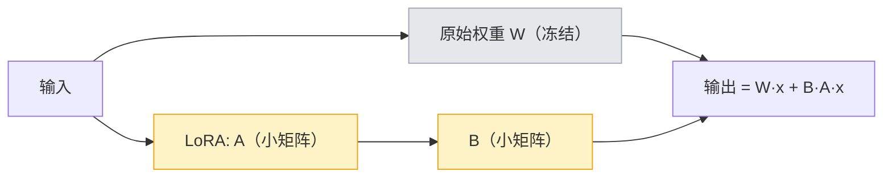

# 模型微调学习指导

## 概述

**微调（Fine-tuning）** 是在一个已经预训练好的模型基础上，用你自己的数据继续训练，让它"学会"你的业务风格、领域知识或特定回答方式。

> 类比：预训练模型是"读完大学的通识人才"，微调是"入职后的岗前培训"，让他适应你公司的具体工作。

### 什么时候才需要微调？（重要）

初学者最容易犯的错：**什么都想微调**。其实大多数问题有更简单的方案：

| 你的需求 | 优先方案 | 需要微调吗 |
|---|---|---|
| 让模型知道私有知识 | RAG / GraphRAG | 否 |
| 改变输出格式/风格 | 好的 Prompt / 系统提示词 | 通常否 |
| 工具调用、流程编排 | Agent / 多 Agent | 否 |
| RAG 和 Prompt 都做不到，且有大量高质量数据 | **微调** | 是 |
| 数据隐私要求极高、必须私有化 | 微调 + 私有部署 | 是 |
| 想降低成本（用小模型替代大模型） | 蒸馏 + 微调 | 是 |

**一句话**：先 RAG、再 Prompt、最后才微调。微调需要数据、算力和维护，成本不低。

### 三位一体拆解

| 维度 | 内容 |
|---|---|
| **作用**：解决什么问题 | 让模型贴合领域、风格、格式；私有化部署；配合蒸馏降低成本 |
| **原理**：核心逻辑 | 在预训练权重基础上，用领域数据继续训练，调整模型参数 |
| **用法**：怎么用 | 准备数据 → 选择全参/LoRA/QLoRA 训练 → 评估 → 合并部署 |

## 原理：三种微调方式

### 1. 全参微调（Full Fine-tuning）

更新模型的所有参数。效果最好，但显存和算力要求极高（7B 模型全参微调通常需要数十 GB 显存），且容易"灾难性遗忘"。一般只在大规模、高投入场景使用。

### 2. LoRA（Low-Rank Adaptation，低秩适配）

**核心思想**：不动原始权重，只在每层旁边加一个很小的"低秩矩阵"（适配器），只训练这一小部分参数。



- 可训练参数量降到原来的 0.1%-1%，显存大幅下降、速度快；
- 原始模型不被破坏，适配器可插拔、可切换；
- 是目前最主流的微调方式。

### 3. QLoRA（Quantized LoRA）

把基础模型先 **4bit 量化**加载（大幅降低显存），再在其上做 LoRA。让单张 8-16GB 显存的消费级显卡也能微调 7B 甚至更大模型，精度损失很小。

### 微调的两个阶段（SFT 与 DPO）

| 阶段 | 全称 | 数据 | 作用 |
|---|---|---|---|
| **SFT** | Supervised Fine-Tuning（监督微调） | 问题 → 标准答案 | 教会模型"怎么答" |
| **DPO** | Direct Preference Optimization（直接偏好优化） | 同一问题的好答案(chosen) vs 差答案(rejected) | 教会模型"更偏好哪种答法" |

DPO 是一种简单高效的偏好对齐方法（相比复杂的 RLHF），直接用偏好数据优化模型，让输出更符合人类偏好。

## 实操：在项目中跑通

### 微调脚本清单（`scripts/finetune/`）

本项目提供了"数据准备 → 训练 → 合并"的完整脚本，注意区分两种微调路径：

| 脚本 | 用途 | 说明 |
|---|---|---|
| `export_dataset.py` | 从**数据库**导出 SFT/DPO 数据 | 推荐，含 golden_qa + 历史问答 + 点赞点踩反馈 |
| `prepare_finetune_data.py` | 从 **golden_qa.json 文件**导出 SFT | 轻量，不依赖数据库，适合快速体验 |
| `train_lora.py` | **本地** LoRA / QLoRA 训练 | 需 GPU，自托管，支持 `--qlora` |
| `train_dpo.py` | **本地** DPO 偏好对齐 | 需 GPU |
| `merge_lora.py` | 合并 LoRA 适配器为完整模型 | 部署前必须 |
| `run_finetune.py` | 提交**云端托管**微调任务（OpenAI 风格） | 无需 GPU，按平台计费，适合不想自己训练 |

> 两条路径二选一：
> - **想自己掌控、有 GPU、私有化**：用 `export_dataset` + `train_lora` + `merge_lora`；
> - **想省事、无 GPU**：用 `prepare_finetune_data`（或 export）+ `run_finetune` 提交到支持托管微调的平台。

### 1. 准备数据

本项目能从知识库自动导出微调数据：

```bash
# 前端：进入「AI Agent」或通过 API 预览/导出
# 或在 backend 目录运行命令行：
python scripts/finetune/export_dataset.py --type sft --kb-id 1 --out sft.jsonl
python scripts/finetune/export_dataset.py --type dpo --kb-id 1 --out dpo.jsonl
```

- **SFT 数据来源**：golden_qa 评测集 + 历史高质量问答；
- **DPO 数据来源**：用户点赞（好答案）/ 点踩（差答案）的反馈。

数据为标准 JSONL（messages 格式），可直接用于训练，也兼容 LLaMA-Factory、unsloth 等框架。

### 2. LoRA / QLoRA 训练

```bash
# 安装训练依赖（可选，不影响主项目）
pip install torch transformers peft accelerate datasets bitsandbytes trl

# LoRA
python scripts/finetune/train_lora.py \
  --model Qwen/Qwen2.5-1.5B-Instruct \
  --data sft.jsonl --out ./lora_out

# QLoRA（显存不足时加 --qlora）
python scripts/finetune/train_lora.py \
  --model Qwen/Qwen2.5-1.5B-Instruct \
  --data sft.jsonl --out ./lora_out --qlora
```

### 3. DPO 训练

```bash
python scripts/finetune/train_dpo.py \
  --model Qwen/Qwen2.5-1.5B-Instruct \
  --data dpo.jsonl --out ./dpo_out
```

### 4. 合并适配器并部署

微调得到的是小适配器，合并成完整模型后才能被 vLLM 等部署：
```bash
python scripts/finetune/merge_lora.py \
  --base Qwen/Qwen2.5-1.5B-Instruct \
  --adapter ./lora_out --merged ./merged_model
```

## 手动练习（必须自己完成）

1. **数据准备**：导出并人工检查 SFT 数据，理解"数据质量决定微调效果"。
2. **跑通一次 LoRA**（有 GPU 或用云 GPU / Google Colab）：用小模型（如 Qwen2.5-1.5B）跑通完整流程，观察可训练参数占比。
3. **用 LLaMA-Factory**：强烈推荐初学者用 LLaMA-Factory（Web UI，封装好 LoRA/QLoRA/DPO），跑通一次训练。
4. **评估对比**：微调前后用同一组问题测试，观察效果变化，警惕"灾难性遗忘"。
5. **DPO 练习**：积累点赞/点踩数据，跑一次 DPO，感受偏好对齐。

## 常见问题

- **Q：没有 GPU 能学微调吗？**
  A：理解原理和数据准备不需要 GPU；真正训练可用云 GPU（AutoDL、Colab 等），小模型 + QLoRA 花费很低。
- **Q：微调需要多少数据？**
  A：LoRA 通常几百到几千条高质量数据即可见效，质量远比数量重要。
- **Q：什么是灾难性遗忘？**
  A：微调后模型"忘掉"了原有的通用能力。对策：用 LoRA、数据多样化、控制学习率和训练轮数。
- **Q：微调后还要 RAG 吗？**
  A：通常要。微调改变"风格/能力"，RAG 提供"事实/最新知识"，二者职责不同。

## 面试要点

- 能讲清楚"什么时候需要微调、什么时候不该"（先 RAG/Prompt 再微调）。
- 能对比 Full / LoRA / QLoRA 的区别、显存和适用场景。
- 能讲清楚 LoRA 的原理（低秩矩阵、冻结主干、可插拔）。
- 能区分 SFT 和 DPO，以及 DPO 相比 RLHF 的优势（简单、无需奖励模型）。
- 能说出微调的常见坑（数据质量、灾难性遗忘、过拟合）。
- 高频追问："LoRA 为什么有效？" → 答：模型的权重更新往往是低秩的，用小矩阵即可近似，从而大幅减少参数。
- 高频追问："微调/RAG/Agent 分别解决什么问题？" → 答：RAG 给知识、Agent 给流程、微调改能力与风格。
