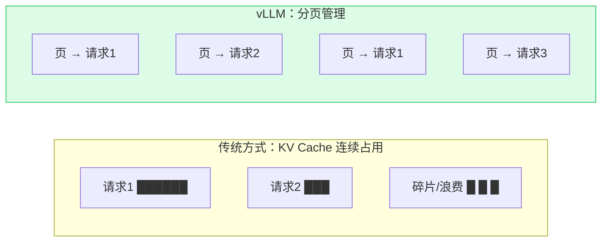
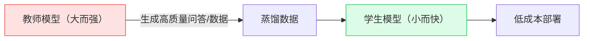
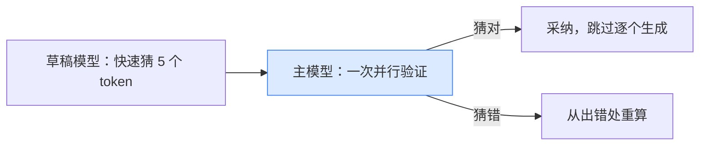

# 推理优化与部署学习指导

## 概述

模型训练/微调好之后，真正上线要面对一个问题：**推理（Inference）的速度、显存和成本**。

直接用 HuggingFace 原生方式部署，往往吞吐低、并发差、显存浪费。**推理优化**就是用一系列工程手段，让模型"跑得更快、占得更少、并发更高"。这是 LLM 工程落地的必备能力，也是面试中区分"只会调 API"和"懂工程部署"的关键。

### 三位一体拆解

| 维度 | 内容 |
|---|---|
| **作用**：解决什么问题 | 提升吞吐、降低延迟、减少显存与部署成本、支持高并发 |
| **原理**：核心逻辑 | 优化显存管理（PagedAttention）、压缩模型（量化）、用小模型（蒸馏）、减少串行计算（投机解码） |
| **用法**：怎么用 | vLLM 部署 + 量化压缩 + 蒸馏小模型 + 投机解码 |

## 推理优化四大手段

### 1. vLLM：高吞吐推理引擎（事实标准）

**核心技术 PagedAttention**：像操作系统管理内存一样，把 KV Cache（推理时的缓存）分成固定大小的"页"，按需分配、可共享，大幅减少显存碎片和浪费。



- 吞吐相比原生 HuggingFace 可提升数倍到数十倍；
- 提供 OpenAI 兼容接口，本项目改个 `LLM_BASE_URL` 就能接入；
- 支持连续批处理（Continuous Batching）、张量并行、前缀缓存等。

### 2. 量化（Quantization）

把权重从 16bit 压缩到 8bit/4bit，降低显存、提升速度，精度损失通常很小。

| 量化方式 | 说明 | 典型场景 |
|---|---|---|
| **AWQ** | 激活感知权重量化，通用、效果好 | GPU 推理（推荐） |
| **GPTQ** | 逐层二阶量化，生态成熟 | GPU 推理 |
| **GGUF** | llama.cpp 生态，支持多种精度 | CPU / 边缘设备 |
| **SmoothQuant** | 权重+激活量化 | 高吞吐推理 |

> 注意区分：**训练时的 QLoRA**（为了省显存做微调）和**部署时的量化**（为了省显存做推理），目的不同。

### 3. 知识蒸馏（Knowledge Distillation）

**核心思想**：用强大的"教师模型"（大模型）指导训练一个"学生模型"（小模型）。



在 LLM 应用中，最实用的是**数据蒸馏**：用大模型在你的知识库上批量生成高质量问答，再用这些数据微调小模型（见 [[04-模型微调学习指导]]）。小模型由此"学会"大模型的能力，部署成本却低得多。DeepSeek-R1 蒸馏出的一系列小模型就是典型案例。

### 4. 投机解码（Speculative Decoding）

**核心思想**：用一个很小的"草稿模型"快速猜出多个 token，再由主模型一次性"并行验证"，猜对的直接采纳。



在不损失输出质量的前提下降低延迟（因为验证是并行的，比逐个生成快）。

## 实操：在项目中跑通

### 1. vLLM 部署

```bash
# 安装（建议 Linux + GPU）
pip install vllm

# 方式一：命令行
vllm serve Qwen/Qwen2.5-1.5B-Instruct \
  --host 0.0.0.0 --port 8001 \
  --max-model-len 4096 --gpu-memory-utilization 0.9

# 方式二：本项目脚本
python scripts/inference/serve_vllm.py \
  --model Qwen/Qwen2.5-1.5B-Instruct --port 8001
```

启动后是 OpenAI 兼容服务（`http://localhost:8001/v1`），把本项目 `.env` 的 `LLM_BASE_URL` 指向它即可。

### 2. 量化

```bash
# AWQ
pip install autoawq
python scripts/inference/quantize.py \
  --model Qwen/Qwen2.5-1.5B-Instruct --method awq --out ./quantized_awq

# 用 vLLM 加载量化模型
vllm serve ./quantized_awq --quantization awq
```

### 3. 蒸馏数据

```bash
# 需要配置有效的教师模型 API Key
python scripts/inference/distill.py \
  --kb-id 1 --out distill_sft.jsonl --questions-per-doc 5
# 然后用 train_lora.py 训练学生模型
```

### 4. 投机解码

```bash
# 在 vLLM 启动时指定草稿模型
python scripts/inference/serve_vllm.py \
  --model Qwen/Qwen2.5-7B-Instruct \
  --draft-model Qwen/Qwen2.5-0.5B-Instruct
```

## 手动练习（必须自己完成）

1. **部署一次 vLLM**（有 GPU 或云 GPU）：对比 vLLM 与原生 HuggingFace 的吞吐和并发差异。
2. **量化实验**：对一个模型做 AWQ 量化，对比量化前后的显存、速度和精度。
3. **完整蒸馏链路**：用大模型生成蒸馏数据 → 训练小模型 → 部署，计算成本对比。
4. **接入主项目**：把 vLLM 地址配到 `.env`，让整个知识库系统跑在你自己部署的模型上。
5. **压测**：用工具（如 wrk、locust）对部署的服务做并发压测，理解 QPS、延迟等指标。

## 常见问题

- **Q：vLLM 支持 Windows 吗？**
  A：新版本对 Windows 支持有限，推荐使用 Linux（或 WSL2、Docker）。
- **Q：量化会不会让答案变差？**
  A：4bit 量化在大多数任务上精度损失很小，但对极敏感场景需评估，可选用更稳健的量化方式或保留 8bit。
- **Q：蒸馏和直接微调有什么区别？**
  A：蒸馏的数据/信号来自教师模型，本质是"模仿大模型"；普通微调数据来自人工标注。二者常结合使用。
- **Q：成本优化的完整思路？**
  A：能缓存就缓存（前缀/语义缓存）→ 简单问题用小模型 → 蒸馏 + 微调 → 量化 + vLLM → 按需调用大模型。

## 面试要点

- 能讲清楚"为什么需要推理优化"，并列出至少三种手段。
- 能解释 vLLM 的 PagedAttention 原理（分页管理 KV Cache、连续批处理）。
- 能对比常见量化方式（AWQ/GPTQ/GGUF）及其适用场景。
- 能讲清楚知识蒸馏的思路和"用大模型养小模型"的成本逻辑。
- 能解释投机解码的原理（草稿模型猜、主模型并行验证）。
- 高频追问："如何把一个 LLM 服务的成本降低？" → 答：缓存、模型分级、蒸馏微调、量化、高吞吐引擎、按需调用，形成完整成本优化闭环。
- 高频追问："KV Cache 是什么？为什么重要？" → 答：推理时缓存已计算的 Key/Value 避免重复计算，是显存占用和吞吐优化的核心。
