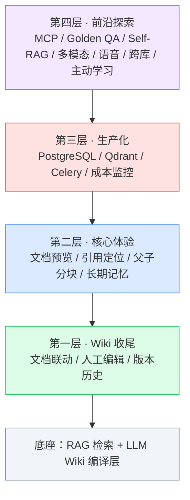

# 四层能力总览与学习路线图

## 概述

这个项目（企业级智能知识库 + AI Agent 平台）的核心是：**RAG 做全量检索底座，LLM Wiki 做知识编译沉淀层**。在这个基础上，我们把"一个知识库系统从 Demo 到生产可用、再到前沿探索"要做的事情，划分为四层。

> 类比：搭一个房子。
> - **第一层**：主体结构封顶（Wiki 能增删改、能留痕）
> - **第二层**：精装修、通水电（用户用起来顺手、答得准）
> - **第三层**：接入市政管网、办房产证（能扛住真实流量、算得清成本）
> - **第四层**：智能家居、未来科技（对接外部 Agent、自我进化）

四层不是"四选一"，而是**逐级叠加**的关系。求职面试时，能讲清楚"为什么需要这一层、它解决了什么问题"，比单纯堆功能更重要。

## 四层全景图

## 每一层解决什么问题

| 层级 | 一句话定位 | 解决的核心痛点 | 对应学习指导 |
|---|---|---|---|
| 第一层 | Wiki 功能收尾 | AI 编译的页面不能人工修正、改了没历史、文档删了页面还在 | [[01-第一层-Wiki功能收尾学习指导]] |
| 第二层 | 核心体验增强 | 看不到原文、引用点不开、长对话记不住、片段太碎 | [[02-第二层-核心体验增强学习指导]] |
| 第三层 | 生产化部署 | SQLite 扛不住并发、任务阻塞、花了多少钱不知道 | [[03-第三层-生产化部署学习指导]] |
| 第四层 | 前沿探索 | 外部 Agent 用不了、答得差不知道为什么、只会处理文字 | [[04-第四层-前沿探索学习指导]] |

## 推荐学习顺序与周期

> 求职导向：**先保证能跑通、能讲清楚，再追求广度。**

| 阶段 | 内容 | 建议周期 | 优先级 | 验收目标 |
|---|---|---|---|---|
| 第 1 周 | 第一层 + 第二层 | 7 天 | P0（最高） | 能演示：编辑 Wiki、回滚、点引用跳原文、长对话不失忆 |
| 第 2 周 | 第三层 | 7 天 | P1 | 能切换 Qdrant/PostgreSQL，讲清 Celery 异步，看到成本看板 |
| 第 3 周 | 第四层 | 7~10 天 | P2 | 能演示 MCP 对接、Self-RAG、跨库问答、语音 |
| 持续 | 主动学习迭代 | 长期 | P2 | 用负反馈数据持续优化，形成"项目自我进化"故事 |

### 学习技巧

1. **先跑通再读码**：每一层先按文档把功能跑起来、亲手点一遍，再回头读实现代码。
2. **带着问题学**：每个功能先问自己"如果没有它会怎样"，再看代码怎么解决。
3. **做"费曼讲解"**：学完一层，试着用大白话给"完全不懂技术的人"讲一遍，讲不明白的地方就是没吃透。
4. **记面试话术**：每个功能准备一句"这是什么、解决什么问题、怎么实现的"，这就是面试答案。

## 实操：你需要亲手完成的部分

AI 已经完成了所有可运行代码。**你需要自己做的是"学习 + 验证 + 能讲清楚"**，具体清单：

- [ ] 按顺序阅读 4 篇学习指导（每篇都有"手动实操"章节）
- [ ] 启动项目，亲手演示每一层的功能（启动方式见 `产品/docs/本地启动指南.md`）
- [ ] 完成每篇指导里的"练习任务"
- [ ] 对照每篇的"验收清单"自测
- [ ] 用每篇的"面试话术"给自己录音试讲

## 常见问题

**Q：我时间紧，能不能只做某几层？**
A：求职最低要求是第一层 + 第二层（这是"好用"的底线）。第三层是"生产化"的分水岭，能显著拉开和普通 CRUD 项目的差距。第四层用于制造"亮点和记忆点"，可按目标公司岗位选做。

**Q：这些代码我一行没写，面试被问住怎么办？**
A：所以你需要完成"手动实操"和"练习任务"——不是让你重写，而是让你**改参数、看变化、读关键代码、能推演流程**。能讲清楚每一行为什么这么写，和亲手写的在面试中几乎等价。

## 拓展

- 项目整体规划：[[开发计划]]
- 求职时间线：[[8个月求职冲刺路线图]]
- 前序实战：[[实战-LLM Wiki编译层接入]]
- 深度原理：[[11-LLM Wiki编译型知识库深度指南]]
