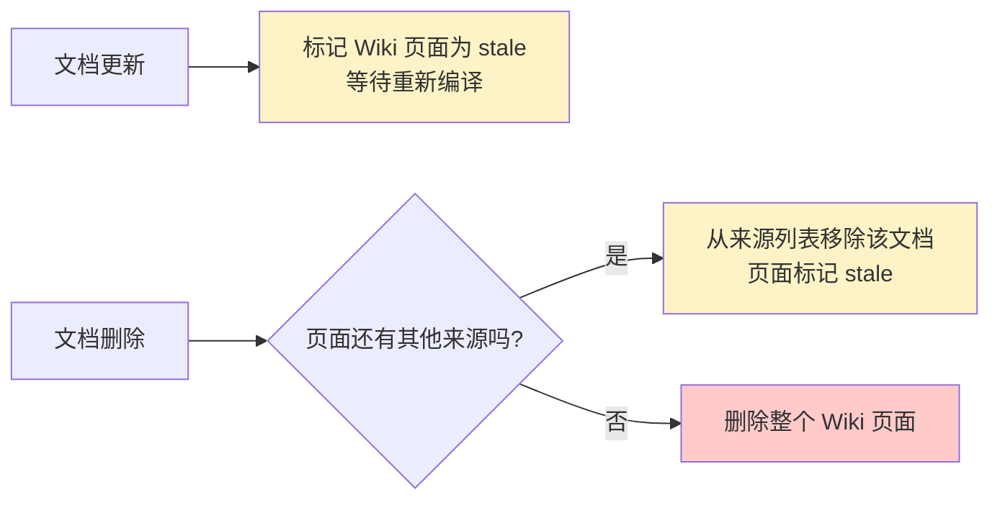
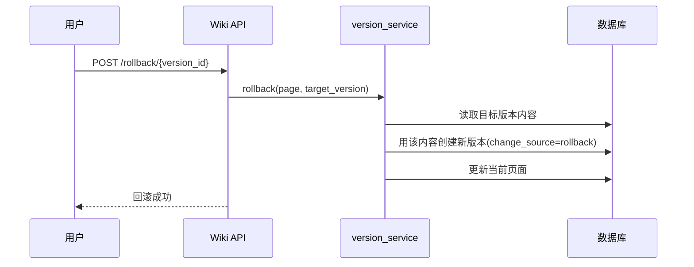

# 第一层 · Wiki 功能收尾学习指导

## 概述

第一层给 LLM Wiki 补上三件"没有就不能叫完整系统"的能力：

1. **文档联动**：文档被删除或更新时，对应的 Wiki 页面要同步处理，不能"文档没了、页面还在胡说"。
2. **人工编辑**：AI 编译的页面不可能 100% 正确，必须允许人手动修改。
3. **版本历史**：每次 AI 编译或人工修改都要留快照，改错了能回滚。

> 三位一体理解：
> - **作用**：让 Wiki 从"一次性生成的静态文档"变成"可维护、可追溯的活知识"。
> - **底层原理**：每次变更前先存快照，再覆盖；删除/更新通过"关联关系"反向联动。
> - **用法要点**：见下方实操。

## 原理

### 1. 文档联动：三种场景

关键设计：**一个 Wiki 页面可能由多个文档共同编译而来**（`source_doc_ids` 是个列表）。所以删文档时不能直接删页面，要先判断"它还有没有其他来源"。

- `document_service.detach_document_from_wiki`：删文档时，把它从页面的 `source_doc_ids` 中移除；来源全没了才删页面，否则标记 `stale`。
- `document_service.mark_wiki_stale_for_document`：更新文档时，先把相关页面标记为 `stale`（过期），等重新编译。

### 2. 人工编辑

`page_manager.manual_edit`：
- 保存一篇 `manual`（人工）来源的快照；
- 覆盖内容，版本号 +1；
- **不改变 `source_doc_ids`**（人工编辑不影响这个页面"来源于哪些文档"的事实）。

### 3. 版本历史与回滚

新增 `WikiPageVersion` 模型，每次变更存一条快照：

| 字段 | 含义 |
|---|---|
| `page_id` | 属于哪个页面 |
| `version` | 版本号 |
| `title/content/summary` | 当时的完整内容快照 |
| `change_source` | 变更来源：`compile`(AI编译) / `manual`(人工) / `rollback`(回滚) |
| `editor_id` | 谁改的（人工时） |

**回滚的关键设计**：回滚不是"删除历史、回到过去"，而是**把目标版本的内容复制出来，另存为一个新版本**。这样历史永远完整、可审计。

## 实操：你需要亲手做的部分

### 步骤 1：启动项目并准备数据

1. 按 `产品/docs/本地启动指南.md` 启动后端和前端。
2. 创建一个知识库，上传 **2~3 个文档**（让 Wiki 编译出页面）。
3. 进入"Wiki"页面，确认能看到编译好的页面。

### 步骤 2：验证人工编辑

1. 打开任意 Wiki 页面，点击右上角 **"编辑"**。
2. 在文本框里随便改几句话（比如加一行"这是我的人工备注"），点击 **"保存"**。
3. 观察：页面内容更新，版本号 +1。

### 步骤 3：验证版本历史与回滚

1. 点击 **"历史版本"**，能看到时间线：`AI编译` → `人工编辑`。
2. 在最早的版本上点 **"回滚到此版本"**。
3. 观察：页面内容回到旧版本，但版本列表里**多了一条"回滚"记录**（理解为什么这么设计）。

### 步骤 4：验证文档联动

1. 回到知识库详情页，**删除一个文档**。
2. 回到 Wiki 页面：
   - 如果该页面有多个来源 → 页面还在，但来源列表少了这个文档；
   - 如果该页面只来源于这个文档 → 页面被删除。
3. 重新上传一个文档（同名），观察页面是否重新编译。

### 步骤 5：读关键代码（求职重点）

按顺序读，重点理解"为什么"：

- `app/wiki/version_service.py`：`save_version` / `rollback`
- `app/wiki/page_manager.py`：`manual_edit` / `update_page`
- `app/services/document_service.py`：`detach_document_from_wiki` / `mark_wiki_stale_for_document`

## 验收清单

- [ ] 能在界面上编辑 Wiki 页面并保存
- [ ] 能看到历史版本时间线，并能回滚
- [ ] 能说清"回滚为什么要另存新版本，而不是删除历史"
- [ ] 删文档后，Wiki 页面行为符合预期（多来源保留、单来源删除）
- [ ] 能在白板上画出"文档删除时 Wiki 页面的判断流程"

## 练习任务

1. **改提示词**：在 Wiki 编译的 prompt 里加一句要求（如"每页末尾加一个'注意事项'小节"），重新编译，观察变化。
2. **加字段**：思考如果要记录"人工编辑的原因"，`WikiPageVersion` 该加什么字段？（动手加，练习模型迁移）
3. **找 bug**：如果一个页面同时被两个文档引用，两个文档都删除，会发生什么？顺着代码推演一遍。

## 常见问题

**Q：为什么不用数据库自带的审计功能，而要单独建版本表？**
A：版本表存的是"完整内容快照 + 变更来源 + 操作人"，能直接还原任意历史版本，且与业务解联；数据库审计只记录操作日志，不便于直接回滚。

**Q：人工编辑后，AI 重新编译会不会覆盖我的修改？**
A：重新编译会走 `update_page`，它会先存快照再覆盖。所以人工版本不会丢，可通过历史版本找回。这是"留痕"设计的价值。

## 面试话术

> "我给 Wiki 层做了三件收尾工作：一是文档和页面的联动，删除/更新文档时通过 source_doc_ids 反向维护页面状态；二是人工编辑入口；三是基于快照表的版本管理，回滚采用'目标版本另存为新版本'的方式保证历史可审计。这让 Wiki 从一次性生成变成可维护、可追溯的活知识。"

## 拓展

- 上一层：[[00-四层能力总览与学习路线图]]
- 下一层：[[02-第二层-核心体验增强学习指导]]
- 深度原理：[[11-LLM Wiki编译型知识库深度指南]]
