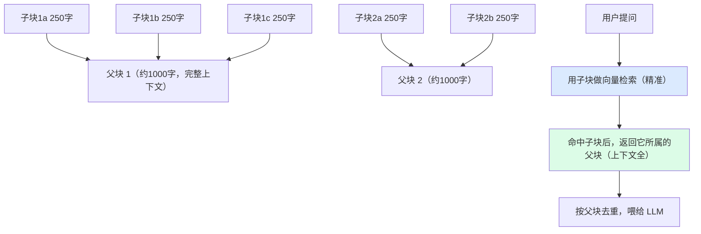
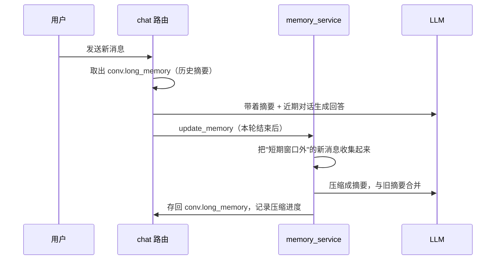

# 第二层 · 核心体验增强学习指导

## 概述

第二层解决"用户用起来不爽、答得不准"的四个问题：

1. **文档预览**：上传后看不到原文，不知道系统读到了什么。
2. **引用精确定位**：答案给了来源，但只能看到片段，点不开原文对应位置。
3. **父子分块**：切块太小则上下文不全、太大则检索不精准——用"小块检索、大块返回"兼得。
4. **对话长期记忆**：聊久了早期信息被截断，系统"失忆"。

> 三位一体理解：
> - **作用**：让回答"看得来源、找得到原文、上下文完整、记得住历史"。
> - **底层原理**：父子分块是检索粒度与上下文粒度的解耦；长期记忆是用 LLM 把旧对话压缩成摘要。
> - **用法要点**：见实操。

## 原理

### 1. 父子分块（本层重点）

普通切块的矛盾：
- 切得**小**（250 字）：向量语义集中，检索精准，但丢上下文，答案片面。
- 切得**大**（1000 字）：上下文全，但一个块里主题混杂，向量"不聚焦"，检索不准。

**父子分块**的解法：

实现要点：
- `text_splitter.split_parent_child`：先切 1000 字父块，再把每个父块切成 250 字子块，记录 `char_start/char_end`。
- `vector_store.add_parent_child_documents`：只存子块，metadata 里带上 `parent_content`（父块全文）和位置。
- 查询时：命中子块 → 取出父块 → 按 `(document_id, parent_index)` 去重，避免同一父块被多次返回。

### 2. 文档预览与引用定位

- `GET /docs/{doc_id}/preview`：文本类返回解析后的内容，PDF 返回文件 URL。
- 引用定位：来源里带 `document_id` 和 `char_start/char_end`，点击"定位到原文"，打开预览并**高亮命中区间**。

### 3. 对话长期记忆

普通 RAG 只保留最近 N 轮对话（省 token），但早期信息会丢。

`memory_service` 的做法：

关键设计：
- `Conversation` 新增 `long_memory`（累积摘要）和 `memory_upto_msg_id`（已压缩到哪条消息，避免重复压缩）。
- 每次回答后，把"滑出短期窗口"的消息用 LLM 压缩，合并进摘要。
- 下次提问时，摘要作为"长期记忆"放进 prompt。

## 实操：你需要亲手做的部分

### 步骤 1：开启父子分块并对比

1. 在 `.env` 中确认 `PARENT_CHUNK_ENABLED=True`。
2. 上传一个较长的文档（建议 3000 字以上），问答时观察返回的来源片段——**应该是较完整的大段，而不是碎片**。
3. （可选）把 `PARENT_CHUNK_ENABLED=False` 重新处理，对比两种方式返回片段的完整度。

### 步骤 2：验证文档预览

1. 进入知识库详情页，在文档列表点 **"预览"**。
2. PDF 应在弹窗内直接显示；Word/TXT/MD 应显示解析后的文本。

### 步骤 3：验证引用定位

1. 在问答页提一个问题，等答案出来。
2. 在"参考来源"里点 **"定位到原文"**。
3. 弹窗打开，命中的原文区间被**黄色高亮**。

### 步骤 4：验证长期记忆

1. 同一个对话里，先告诉系统一个事实，例如："我叫张三，我负责的项目代号是凤凰"。
2. 连续聊 **10 轮以上**（聊别的，把早期信息挤出短期窗口）。
3. 再问："我叫什么？我负责的项目代号是？"
4. 系统应能从长期记忆摘要中答出（若关闭记忆则会忘）。

### 步骤 5：读关键代码

- `app/services/text_splitter.py`：`split_parent_child`（注意 `search_cursor` 如何避免重复定位）
- `app/services/vector_store.py`：`add_parent_child_documents` 和查询去重
- `app/services/memory_service.py`：摘要压缩与合并
- `app/services/rag_service.py`：`memory_summary` 如何进入 prompt

## 验收清单

- [ ] 能演示父子分块返回的是完整大段
- [ ] 能说清"为什么不直接把块切大一点"
- [ ] 能预览 PDF 和文本类文档
- [ ] 点引用能打开原文并看到高亮
- [ ] 长对话后系统仍记得早期事实
- [ ] 能画出父子分块的存取流程图

## 练习任务

1. **调参数**：把 `PARENT_CHUNK_SIZE` 改为 600、`CHILD_CHUNK_SIZE` 改为 150，重新处理，观察检索效果变化，记录你的结论。
2. **看摘要**：在数据库里直接查看 `conversations.long_memory` 字段，读 LLM 压缩出的摘要，判断质量。
3. **逆向思考**：如果父块不存全文、只存父块 ID，系统需要多查几次？这会带来什么问题？（理解为什么 metadata 里直接带父块内容）

## 常见问题

**Q：父子分块会让向量库变大吗？**
A：向量库里只存子块（子块数量和普通切块差不多），父块全文存在子块的 metadata 里，会增加一些存储，但不增加向量数量、不增加 embedding 成本。

**Q：长期记忆摘要会不会把关键信息压丢？**
A：可能。所以摘要 prompt 要强调"保留人名、时间、决策、承诺等关键事实"。这也是为什么保留"短期窗口 + 长期摘要"两层结构，而不是全部压成摘要。

**Q：char_start/char_end 是必须的吗？**
A：它用于精确定位和高亮。即使没有，也能用"来源文本在全文中搜索"来定位（代码里做了这个兜底），但搜索可能因文本重复而错位，所以位置信息更可靠。

## 面试话术

> "我在核心体验上做了四件事：父子分块解决检索粒度和上下文粒度的矛盾，用小块检索、命中后返回父块并去重；文档预览和引用定位让答案可溯源、可高亮；长期记忆用 LLM 把滑出窗口的历史压缩成累积摘要，解决长对话失忆。"

## 拓展

- 上一层：[[01-第一层-Wiki功能收尾学习指导]]
- 下一层：[[03-第三层-生产化部署学习指导]]
- 检索原理：[[02-检索增强三件套深度指南]]
- 记忆原理：[[03-上下文工程深度指南]]
