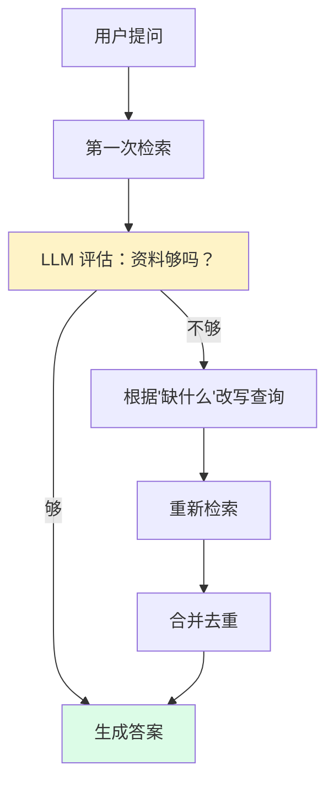
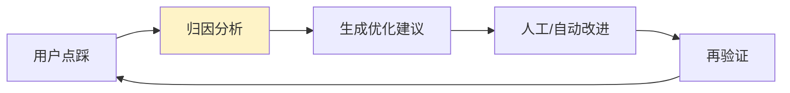

# 第四层 · 前沿探索学习指导

## 概述

第四层是"加分项与记忆点"，让项目体现你对前沿方向的理解。共 7 个能力：

1. **MCP 暴露 Wiki**：把 Wiki 能力通过标准协议开放给外部 Agent（Claude、Cursor 等）。
2. **Golden QA 补全**：补齐"全局理解型"评测题，检验 Wiki 层的价值。
3. **Self-RAG**：检索后自检，资料不足自动改写查询重检索。
4. **多模态**：上传图片，用 VLM 生成描述，使其可检索。
5. **语音问答**：语音输入 + 语音播报。
6. **跨库检索**：一次提问检索多个知识库。
7. **主动学习**：分析点踩，归因并给出优化建议，形成自我进化闭环。

> 这一层的核心叙事是：**"系统不仅能答，还能对接外部生态、能自我评估、能自我进化。"**

## 原理

### 1. MCP：把 Wiki 变成"外部 Agent 可调用的工具"

MCP（Model Context Protocol）是一个**标准协议**，让外部 Agent 能发现并调用你提供的工具。打个比方：
- 没有 MCP：你的知识库是一个"网站"，别人只能手动打开。
- 有了 MCP：你的知识库变成一个"标准插座"，任何支持 MCP 的 Agent 都能插上就用。

本项目新增 4 个 Wiki 工具：

| 工具 | 作用 |
|---|---|
| `list_wiki_pages` | 列出知识库的页面（可按类型过滤） |
| `search_wiki_pages` | 按问题检索 Wiki 页面（适合全局理解） |
| `read_wiki_page` | 读取指定页面完整内容 |
| `get_wiki_graph` | 获取页面关联图谱，用于跨实体推理 |

### 2. Golden QA：补齐"全局理解型"问题

原评测集只有"事实查找"（如"退款几天到账"），这类问题普通 RAG 就能答。要检验 Wiki 层的价值，需要"全局理解型"问题：
- **概述**："这个知识库主要讲了什么？"
- **总结**："总结售后政策的核心要点"
- **对比**："质量问题退货和七天无理由退货的区别？"
- **流程梳理**："从报销到到账的完整流程"

已在 `golden_qa.json` 补到 20 条（10 事实 + 10 全局）。

### 3. Self-RAG：检索-评估-重检索

通过 `SELF_RAG_ENABLED` 开关控制。默认关闭，因为它会多调用 LLM、增加成本和延迟——这本身就是一个"效果 vs 成本"的工程权衡点。

### 4. 多模态：图片变可检索文本

`document_parser.parse_image`：
1. 优先用 VLM（多模态大模型）看图，生成内容描述、识别文字；
2. VLM 失败则降级本地 OCR；
3. 得到的文本像普通文档一样切片、入库，于是图片也能被检索到。

### 5. 语音问答

前端使用浏览器原生能力（**无需后端、免费**）：
- **语音输入**：`webkitSpeechRecognition`（Chrome/Edge），语音转文字。
- **语音播报**：`speechSynthesis`，朗读答案。

### 6. 跨库检索

`rag_service.retrieve_across_kbs`：
- 分别检索每个知识库，每条结果带上 `kb_id`；
- 合并、去重、按全局分数排序；
- 接口 `POST /chat/global`，不传 `kb_ids` 则检索你所有的库。

### 7. 主动学习：自我进化闭环

`active_learning`：
- 收集所有"点踩"的回答；
- 对每条重新检索，**归因**为三类：
  - `missing_knowledge`：知识库缺资料；
  - `poor_retrieval`：文档在但没检索到；
  - `poor_generation`：检索到了但生成差；
- 按原因聚合，给出优化建议（补文档 / 调阈值 / 改提示词）。

## 实操：你需要亲手做的部分

### 步骤 1：体验跨库问答

1. 至少建 **2 个知识库**并分别上传文档。
2. 问答页点右上角 **"跨库问答"**，选择多个知识库（或不选=全部）。
3. 提一个跨库问题，观察结果里来源带"跨库"标签、且来自不同知识库。

### 步骤 2：体验多模态

1. 知识库详情页上传一张**带文字或图表的图片**（截图即可）。
2. 处理完成后，针对图片内容提问（如"这张图里写了什么"）。
3. 观察是否能根据 VLM 描述答出。

### 步骤 3：体验语音

1. 问答页点击输入框左侧的**麦克风**（用 Chrome/Edge），允许麦克风权限，说一句话。
2. 文字出现在输入框后发送。
3. 在回答上点**麦克风图标**，听语音播报。

### 步骤 4：体验 Self-RAG

1. `.env` 设 `SELF_RAG_ENABLED=True`，重启。
2. 提问，观察后端日志里的"评估充足/不足、改写查询"过程。
3. 思考：为什么默认关闭它？（成本/延迟）

### 步骤 5：体验主动学习

1. 对若干回答故意**点踩**（最好挑确实答得不好的）。
2. 打开"数据看板"，查看"主动学习"卡片：满意度、归因分布、建议。
3. 对照建议，判断归因是否合理。

### 步骤 6：体验 MCP（需要 MCP 客户端）

1. 后端以 MCP 方式启动（见 `04-MCP模型上下文协议深度指南`）。
2. 在 Claude Desktop / Cursor 等客户端配置连接本服务。
3. 让外部 Agent 调用 `search_wiki_pages` 等工具，验证它能读到你的 Wiki。

### 步骤 7：读关键代码

- `app/mcp_server/server.py`：4 个 Wiki 工具
- `app/retrieval/self_rag.py`：评估与重检索
- `app/services/active_learning.py`：负反馈归因
- `app/services/document_parser.py`：`parse_image`
- `app/services/rag_service.py`：`retrieve_across_kbs`

## 验收清单

- [ ] 能演示跨库问答并指出来源所属知识库
- [ ] 能演示图片上传后可检索
- [ ] 能演示语音输入和播报
- [ ] 能讲清 Self-RAG 流程及"为什么默认关闭"
- [ ] 能演示主动学习归因并解释三类原因
- [ ] 能说清 MCP 的作用与"标准插座"类比
- [ ] 能讲清 Golden QA 为什么要补"全局理解型"

## 练习任务

1. **写评测题**：为你的知识库再写 5 条"全局理解型"问题并跑评测，对比 Wiki 开启前后的得分。
2. **调归因**：读 `active_learning` 的归因逻辑，思考它在什么情况下会误判？如何改进（比如改成 LLM 归因）？
3. **MCP 加工具**：仿照现有写法，给 MCP 加一个"获取文档统计"的工具，练习 MCP 扩展。
4. **成本权衡**：列出 Self-RAG、多模态、查询改写各自增加的成本，思考什么场景值得开。

## 常见问题

**Q：这么多功能，我简历上写得下吗？**
A：不要罗列。挑 2~3 个和目标岗位最相关的讲深（例如投递 Agent 方向讲 MCP + 多 Agent，投递 RAG 方向讲 Self-RAG + Wiki + 评测），其余作为"我还做了……"的一句话带过。

**Q：语音为什么不在后端做？**
A：浏览器原生 Web Speech API 已能满足需求且零成本、零依赖。后端方案（如 Whisper）适合需要更高识别准确率或离线场景，可作为"备选方案"在面试中提一句，体现你的技术判断力。

**Q：主动学习和 Self-RAG 有什么区别？**
A：Self-RAG 是**单次问答内**的实时自检（检索不够马上重检索）；主动学习是**跨多次问答的事后分析**（用历史负反馈改进系统）。一个是"事中"，一个是"事后"。

## 面试话术

> "我在前沿方向做了探索：用 MCP 把 Wiki 能力标准化暴露给外部 Agent；补齐全局理解型评测题验证 Wiki 价值；实现 Self-RAG 做检索自检与重检索；支持多模态图片入库；通过浏览器原生能力做语音；实现跨库检索；以及基于负反馈归因的主动学习闭环，让系统能自我评估和迭代。"

## 拓展

- 总览：[[00-四层能力总览与学习路线图]]
- 上一层：[[03-第三层-生产化部署学习指导]]
- MCP 原理：[[04-MCP模型上下文协议深度指南]]
- Self-RAG 原理：[[08-Agentic-RAG进阶-SelfRAG与GraphRAG]]
- 多模态选型：[[07-A2A与多模态与微调选型]]
