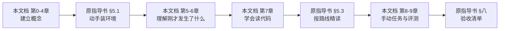
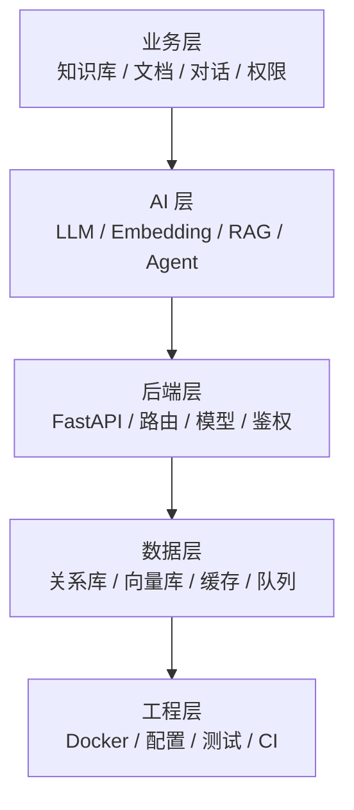
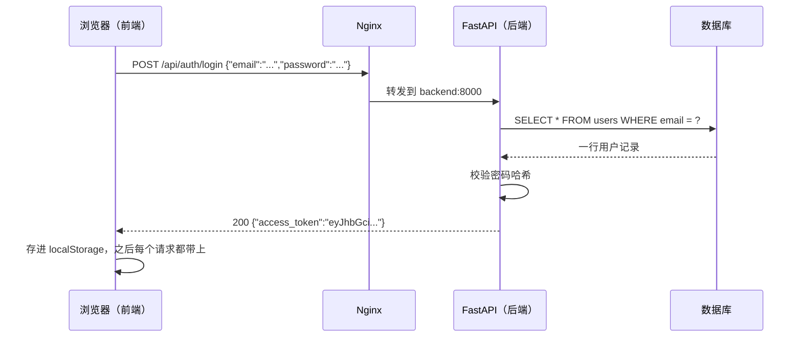
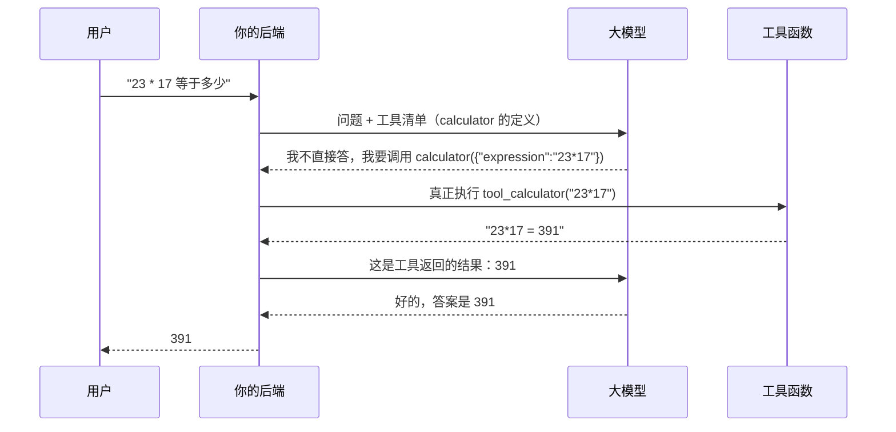
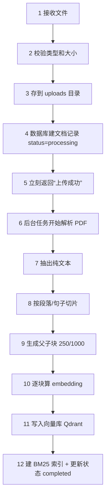

# 项目学习指导书 · 零基础精讲版

> 这份文档只解决一件事：**把《项目学习指导书》里那些"一看就懂、一做就懵"的地方，一句一句讲清楚。**

---

## 写在最前面：这份文档为什么存在

你的原话是：

> "每个部分我都需要详细了解，如果太笼统这是我初学者完全不能理解的内容。"

这个判断是对的。原《项目学习指导书》不是写得不好，而是**它写的是施工图，不是教科书**。

用盖房子打比方：

| 文档 | 它回答的问题 | 类比 |
|---|---|---|
| 原《项目学习指导书》 | 做什么、先做哪个、做到什么程度算过、哪里有坑 | 施工图 + 验收单 |
| **本文档** | 这是什么、为什么要有它、我现在应该看到什么、报错在说什么 | 师傅带你认工具、讲原理 |

施工图上写着"此处预埋 DN50 套管"，工程师一看就懂；但一个从没进过工地的人，需要有人告诉他：套管是什么、为什么预埋、不预埋会怎样、图纸上那个符号在哪。

**这份文档就是那个"师傅"。**

### 三条使用规则

1. **名词第一次出现必须解释。** 本文档里凡是加粗的术语，第一次出现时都会给"一句话定义 + 生活比喻 + 在本项目哪里"。如果还有没解释的，是我写漏了，直接告诉我补。
2. **先看"你现在该看到什么"，再看"为什么"。** 新手最容易卡在"命令敲完了，不知道算不算成功"。所以每一段操作后面都有**可观察证据**。
3. **不要一次读完。** 这份文档按"你此刻要干的事"组织，不是按知识体系。今天要装环境，就只读第 5 章。

### 本文档与原指导书怎么配合



一句话：**原指导书告诉你"去哪"，本文档告诉你"脚下踩的是什么"。**

---

## 第 0 章 先看清全貌：你要造的到底是个什么东西

### 0.1 一句话版本

> 这是一个"**会自动读书的图书管理员**"：你把公司的手册、PDF 丢给它，它读完后，任何人用大白话提问，它都能翻到对应的那几页，用那几页的内容回答，并告诉你"这句话出自第几份文件的第几段"。

这句话里有四个动作，对应四个技术名词，后面会反复出现：

| 动作 | 技术名词 | 一句话解释 |
|---|---|---|
| 把书拆成小卡片 | **切片（Chunking）** | 整本书太长，模型一次看不完，先拆成一段一段 |
| 给每张卡片编"意思坐标" | **向量化（Embedding）** | 把一段文字变成一串数字，意思相近的数字也相近 |
| 你提问，它找最像的卡片 | **检索（Retrieval）** | 按"意思坐标"找距离最近的几张卡片 |
| 把卡片给模型，让它照着答 | **生成（Generation）** | 模型只根据这几张卡片回答，不许自由发挥 |

这四个动作连起来，就是本项目名字里的 **RAG**（Retrieval-Augmented Generation，检索增强生成）。

> [!note] 为什么叫"增强"
> 大模型本来不知道你公司的内部文档。RAG 的做法是：**先替它把资料找出来，再让它带着资料回答**。资料"增强"了它的回答能力，所以叫检索增强。

### 0.2 你点一次"发送"，系统里发生 12 件事

这是全书的骨架。后面每一章，都会回到这张表里的某一行。

| # | 发生了什么 | 用大白话说 | 对应代码 |
|---|---|---|---|
| 1 | 浏览器发一个 HTTP 请求 | 把你的问题打包寄出去 | `frontend/src/api/chat.ts` |
| 2 | Nginx 把请求转给后端 | 前台收件，转给后屋 | `frontend/nginx.conf` |
| 3 | 后端验证"你是谁" | 查身份证（JWT） | `app/utils/deps.py` |
| 4 | 后端验证"你能不能看这个库" | 查门禁卡（RBAC） | `app/utils/deps.py` |
| 5 | 把你的问题存进数据库，先占一个"回答中"的空位 | 挂号，留个病历位 | `app/routers/chat.py` |
| 6 | 把你的问题改写成 3 种说法 | 同一个意思换几种问法，提高命中率 | `app/retrieval/query_rewrite.py` |
| 7 | 每种说法算成一个向量 | 把文字变成坐标 | `app/services/vector_store.py` |
| 8 | 去向量库找最像的 20 个片段 | 按坐标找最近的卡片 | Qdrant / Chroma |
| 9 | 同时用关键词再找 20 个 | 另一路人马按"字面"找 | `app/retrieval/bm25_retriever.py` |
| 10 | 两路结果按名次融合，再精排出 5 个 | 两个猎头推荐的人选，合并面试 | `app/retrieval/hybrid.py` → `reranker.py` |
| 11 | 把 5 个片段拼成一段提示词，交给大模型 | 把资料和问题一起递给答题的人 | `app/services/rag_service.py` |
| 12 | 模型一个字一个字往外吐，前端边收边显示 | 打字机效果（SSE 流式） | `routers/chat.py` + `api/chat.ts` |

**先记住第 7、8、9、10 这四步。** 它们是这个项目最值钱的部分，也是面试问得最狠的部分。第 3 章会展开讲。

> [!tip] 怎么看这张表
> 不要背。每次看到代码里一个不认识的函数，问自己："它在 12 步里的第几步？" 只要能定位，你就不会迷路。

### 0.3 为什么这东西不好做：三个真问题

新手常以为"接个大模型 API 就完事了"。真做起来，难点在这三处：

**问题一：找得准。**
用户问"水果坏了能退吗"，文档里写的是"生鲜商品不支持七天无理由退货"。两句话**一个字都不重合**，但意思相关。纯按字面找，找不到；纯按语义找，遇到型号"XR-2000"又可能找错。
→ 所以本项目用**混合检索**：语义找一遍 + 关键词找一遍，再合并。

**问题二：答得实。**
模型有个坏毛病：资料里没有，它也会编一个很像的答案。企业知识库最怕这个。
→ 所以本项目做了**引用来源、拒答约束、句子级溯源校验**三件事。

**问题三：改得动。**
你把切片大小从 500 改成 300，效果是变好还是变差？凭感觉说不清。
→ 所以本项目有一套**评测体系**：先出考卷和标准答案，改一次代码跑一次分，用数字说话。

**这三个问题，就是本项目所有高级功能的由来。** 后面你看到"混合检索""评测体系""溯源校验"这些词，不要当成技术堆砌——每一个都是被具体问题逼出来的。

### 0.4 本章自测

1. 用一句话向别人解释这个项目是干什么的。
2. "切片"和"向量化"分别解决什么问题？
3. 12 步里，哪几步是"找资料"，哪几步是"用资料回答"？

答不上来就重读 0.1 和 0.2，不用往后翻。

---

## 第 1 章 名词地图：先混个脸熟

> 这一章不要求记住，只要求"见过"。真正的理解发生在后面动手的时候。
> 用法：读到不懂的词，回这里查；查完还不懂，看 1.4 节的求助方法。

### 1.1 五层词汇，别混在一起

新手最容易犯的错，是把不同层的词当成一回事。比如把"向量数据库"和"业务数据库"混着理解，后面就全乱了。



**读法**：上层依赖下层。业务层的"知识库"，落到数据层就是一张表 + 一堆向量。面试时被问细节，你要能一路往下说。

### 1.2 核心 24 词（先看这一张）

| 词 | 一句话定义 | 生活比喻 | 在本项目哪里 |
|---|---|---|---|
| **大模型（LLM）** | 能理解和生成自然语言的神经网络 | 一个读了很多书、但没读过你公司文件的人 | 硅基流动 / DeepSeek 的 API |
| **Token** | 模型处理文本的最小单位，也是计费单位 | 按"字数"收费，但切法不是按字 | `.env` 里的长度限制、成本统计 |
| **Prompt（提示词）** | 你发给模型的全部内容，包括指令和资料 | 给答题人看的题目 + 参考资料 | `app/prompts/` |
| **上下文窗口** | 模型一次最多能看多少 Token | 桌子就这么大，资料多了放不下 | `CONTEXT_MAX_TOKENS` |
| **Embedding（向量化）** | 把文字变成一串数字（本项目 1024 个） | 给每句话发一个"意思坐标" | `services/vector_store.py` |
| **向量** | 那串数字本身 | 坐标点 | Qdrant 里存的东西 |
| **余弦相似度** | 衡量两个向量"方向"有多接近 | 两个人指的方向夹角越小越像 | 向量检索的打分 |
| **向量数据库** | 专门存向量、按相似度找邻居的数据库 | 按"意思"排序的图书馆索引 | Qdrant（生产）/ Chroma（开发） |
| **切片（Chunk）** | 把长文档切成的一段短文 | 把一本书拆成一叠卡片 | `services/text_splitter.py` |
| **Top-K** | 只取最相似的 K 个片段 | 只叫前 5 名进来面试 | `TOP_K=5` |
| **RAG** | 先检索资料、再让模型照着答 | 开卷考试 | 整个项目的主线 |
| **BM25** | 按关键词出现频率打分的经典算法 | 按"关键词命中次数"排名的老办法 | `retrieval/bm25_retriever.py` |
| **混合检索** | 语义找一遍 + 关键词找一遍 | 两个猎头各推一批人 | `retrieval/hybrid.py` |
| **RRF** | 按"名次"而不是"分数"融合两路结果 | 两个评委各排一个榜，看谁两家都上榜 | `hybrid.rrf()` |
| **Rerank（精排）** | 对初筛结果再用模型细看一遍 | 海选之后的复试 | `retrieval/reranker.py` |
| **Agent（智能体）** | 会自己决定"要不要用工具、用哪个"的模型 | 不是答题，是办事 | `services/agent_service.py` |
| **Function Calling** | 模型输出"我要调用某函数"的结构化请求 | 模型写一张申请单，你的代码去执行 | `TOOL_DEFINITIONS` |
| **ReAct** | 想 → 做 → 看结果 → 再想 的循环 | 边试边改 | `agent_service.chat()` |
| **SSE** | 服务器保持连接、持续推送数据的 HTTP 技术 | 打字机，而不是等全文写好再给你 | `/api/chat/stream` |
| **JWT** | 一段带签名的"身份证字符串" | 盖了章的通行证 | `utils/security.py` |
| **RBAC** | 按角色控制权限 | owner 能改，viewer 只能看 | `kb_members` 表 |
| **MCP** | 让外部客户端发现并调用你工具的标准协议 | 通用插座 | `app/mcp_server/` |
| **评测（Eval）** | 用固定考卷 + 标准答案给系统打分 | 月考 | `app/evaluation/` |
| **Docker** | 把程序和依赖打包成"集装箱" | 连厨房一起搬走 | `docker-compose.yml` |

### 1.3 六组最容易混的词

**① LLM 与 Embedding 模型：两个不同的东西**

- LLM 负责"说话"（生成答案），Embedding 模型负责"定位"（把文字变向量）。
- 它们通常由同一个服务商提供，但是**两个模型名**，要分别配置。
- 常见错误：只配了 `LLM_MODEL`，忘了 `EMBEDDING_MODEL` → 上传文档时向量化失败。

**② 关系数据库与向量数据库：存的东西不一样**

| | 关系数据库（PostgreSQL / SQLite） | 向量数据库（Qdrant / Chroma） |
|---|---|---|
| 存什么 | 用户、知识库、文档元数据、消息 | 每个切片的向量 + 原文 |
| 怎么查 | `WHERE id = 3`，精确匹配 | "找最像的 5 个"，模糊匹配 |
| 类比 | 户籍档案柜 | 按长相相似度找人的系统 |

本项目两个都用：**Postgres 管"是谁、有哪些文档"，Qdrant 管"哪段话意思最像"。**

**③ RAG 与微调：两条不同的路**

- RAG：**不动模型**，每次把资料塞给它。适合知识经常更新、要求引用出处。
- 微调（Fine-tuning）：**改模型参数**，让它学会某种风格或格式。适合固定任务、格式要求高。
- 一句话：**知识用 RAG，风格用微调。** 本项目主线是 RAG，微调只有一个示例脚本。

**④ Agent 与普通问答：一个答题，一个办事**

- 普通问答：问题进来 → 检索 → 回答。路径固定。
- Agent：问题进来 → 模型自己判断"要不要查知识库 / 要不要算数 / 要不要看时间" → 调工具 → 看结果 → 决定下一步。路径不固定。
- 关键区别：**Agent 的下一步是模型自己选的，不是你写死的。**

**⑤ 切片大小与父子分块：不是一回事**

- 切片大小：一段切多长（比如 500 字）。
- 父子分块：**用小块建索引（250 字），用大块返回给模型（1000 字）**。
- 为什么：小块词密度高、检索准；大块上下文完整、回答全。两个粒度各干各的事。

**⑥ Token 与字数：不是一比一**

- 中文大致一个字接近一个 Token，但**具体取决于模型的分词器**，标点、英文、数字的切法都不同。
- 所以"我的文档 1 万字"不等于"1 万 Token"。估算成本时留 30% 余量。

### 1.4 看到不懂的词，三步处理

1. **先查本文档附录 A**（60 词总表）。查到了，看完"一句话定义"就回到原文，不要陷进去。
2. **查不到，用固定句式问 AI**：

```text
我在读一个 RAG 项目，遇到一个词：【XXX】。
请按这个顺序回答，不要展开其他内容：
1. 它是什么？一句话。
2. 它解决什么问题？不用它会怎样？
3. 它在"文档上传→切片→向量化→检索→生成"这条链路里的哪一步？
4. 给一个生活比喻。
5. 我在这个项目里能在哪个文件看到它？
```

3. **记进生词本。** 一个词查过三次还记不住，说明它在你当前的学习阶段不重要——先跳过，不丢人。

> [!warning] 新手最大的时间黑洞
> 看到"Pydantic""依赖注入""联合类型收窄"就去系统学一遍 Python/TypeScript。
> **不要。** 这个项目的策略是"卡在哪补哪"。一个概念只要不影响你完成当前这一步，就先放着。

### 1.5 本章自测

1. "向量数据库"和"关系数据库"各自存什么？为什么不能只用一个？
2. RAG 和微调，什么情况下选哪个？
3. 父子分块里，"建索引"用的是父块还是子块？为什么？

---

## 第 2 章 前置知识：只学这个项目用得到的那一点

> 这一章的目标不是让你学会编程，是让你**看得懂这个项目在干什么**。
> 每节末尾有自测，答对就往下走，不要恋战。

### 2.1 一个网页请求的一生

这是理解一切的地基。哪怕你后面什么都不记，记住这一节也够用了。

**场景**：你在登录页输入邮箱密码，点"登录"。



**逐项拆解**：

| 名词 | 是什么 | 在本例中 |
|---|---|---|
| **URL** | 请求的地址 | `/api/auth/login` |
| **HTTP 方法** | 动作类型。GET 取、POST 交、DELETE 删 | POST（提交登录信息） |
| **请求体（Body）** | 随请求发送的数据，通常是 JSON | `{"email":"...","password":"..."}` |
| **JSON** | 一种 `{键: 值}` 格式的文本 | 前后端之间的"普通话" |
| **状态码** | 结果代号。200 成功、400 参数错、401 没登录、403 没权限、404 不存在、500 服务器崩了 | 200 |
| **响应体** | 服务器返回的数据 | `{"access_token":"..."}` |
| **Token** | 登录后拿到的凭证，之后请求放在 `Authorization` 头里 | `Bearer eyJhbGci...` |

> [!important] 一个必须建立的直觉
> **前端不直接连数据库。** 前端只会"发请求"，所有数据都由后端从数据库取出来、加工成 JSON 再返回。
> 所以你在页面上看到的每一个数字，背后一定有一个接口。

**自己验证一次（装好环境后做）**：

1. 浏览器按 `F12` 打开开发者工具；
2. 切到 **Network（网络）** 面板；
3. 在页面上点一次"登录"；
4. 你会看到一条 `login` 请求，点开它：
   - **Headers** 里看请求地址、方法、状态码；
   - **Payload** 里看你发出去的用户名密码；
   - **Response** 里看后端返回的 token。

**这一刻比读十篇文章都有用**：你亲眼看见了"请求"和"响应"。

### 2.2 前后端分离：到底分的是什么

| | 前端 | 后端 |
|---|---|---|
| 代码在哪 | `frontend/` | `backend/` |
| 跑在哪 | 用户的浏览器 | 服务器（或你的电脑） |
| 负责什么 | 长什么样、点了之后发什么请求 | 数据怎么存、规则怎么算、权限怎么判 |
| 用什么写 | Vue 3 + TypeScript | Python + FastAPI |
| 怎么交流 | **只通过 HTTP + JSON** | 同左 |

**为什么要分**：

1. 可以分别部署、分别扩容（前端放 CDN，后端加机器）；
2. 换界面不用动业务逻辑；
3. 手机 App、小程序可以复用同一套后端接口。

**一个常见的误解**：前端代码里看到 `if (user.role === 'owner')` 就以为"权限在前端做"。不是。前端只是**决定按钮显不显示**，真正的拦截在后端 `require_kb_role()`。前端隐藏按钮只是体验，后端校验才是安全。

### 2.3 数据库：五个词就够

把数据库想成一个 Excel 文件：

- **表（Table）** = 一个 sheet，比如 `users`；
- **行（Row）** = 一条记录，比如"张三这个用户"；
- **列（Column）** = 一个字段，比如 `email`；
- **主键（Primary Key）** = 这一行的唯一编号，通常是 `id`；
- **外键（Foreign Key）** = 指向另一张表的 `id`，用来表达"属于关系"。

本项目的三张核心表（简化）：

```text
users
  id | email            | password_hash | role
  1  | zhang@example.com | $2b$12$...     | user

knowledge_bases
  id | name          | owner_id
  3  | 电商退换货政策 | 1          ← owner_id 是外键，指向 users.id

documents
  id | kb_id | filename          | status
  7  | 3     | 售后退换货政策.pdf | completed   ← kb_id 是外键，指向 knowledge_bases.id
```

**"行级数据隔离"是什么意思**：张三只能看到 `owner_id = 1` 或共享给他的知识库。这条规则写在每个查询的 `WHERE` 里，不是靠前端藏起来。

**索引是什么**：书的目录。没有索引，数据库要从第一页翻到最后一页（全表扫描）；有索引，直接翻到对应位置。
本项目实测过：同一条列表查询，加复合索引后从 **2.62ms 降到 0.05ms**（`scripts/explain_index.py`）。

**SQLite 和 PostgreSQL 的区别**：

| | SQLite | PostgreSQL |
|---|---|---|
| 形态 | 一个文件（`knowledge_base.db`） | 一个独立运行的服务 |
| 适合 | 本地开发、单机、零配置 | 生产、多用户并发 |
| 本项目 | 裸跑时默认 | Docker 默认 |

### 2.4 容器：为什么不"装环境"，而是"发集装箱"

**先看问题**：

> 你电脑上跑得好好的，发给同事，他说"启动不了"。
> 原因是：你装的是 Python 3.11，他是 3.13；你有某个系统库，他没有。

**Docker 的思路**：不只发代码，把**代码 + 运行环境 + 依赖**一起打包。

| 名词 | 是什么 | 比喻 |
|---|---|---|
| **镜像（Image）** | 一个只读的包，含系统、Python、依赖、代码 | 做月饼的模具 |
| **容器（Container）** | 镜像跑起来的实例 | 压出来的月饼 |
| **Dockerfile** | 描述"怎么造镜像"的脚本 | 模具的图纸 |
| **docker-compose** | 描述"同时起哪几个容器、怎么连"的清单 | 一整条生产线的排班表 |
| **数据卷（Volume）** | 挂在容器外面的存储，容器删了数据还在 | 放在车间外面的仓库 |
| **端口映射** | 把容器内的端口暴露到宿主机 | 给厂房开一扇对外的门 |

**端口映射 `127.0.0.1:8000:8000` 三段分别是什么**：

```text
127.0.0.1 : 8000 : 8000
   ↑         ↑      ↑
 谁能访问   宿主机的端口   容器内的端口
```

- 第一段 `127.0.0.1` 表示**只有这台电脑能访问**。同一 Wi-Fi 下的手机打不开，这是故意的（Qdrant、Redis 没有密码）。
- 想用手机演示，只把 frontend 那行改成 `"80:80"`，其他别动。

**一个必须知道的坑**：`docker compose down` 会删容器，但**不会删数据卷**；`docker compose down -v` 会连数据卷一起删。后者等于清库，别乱敲。

### 2.5 配置文件 `.env`：为什么密钥不能写进代码

**问题**：代码要提交到 GitHub，但数据库密码、API Key 不能给别人看。

**做法**：代码里只写"去读环境变量"，真实值放在一个**不进版本库**的文件里。

| 文件 | 作用 | 进 Git 吗 |
|---|---|---|
| `.env.example` | 模板，列出所有配置项，值都是占位符 | ✅ 进，给别人看格式 |
| `.env` | 真实配置，含密钥 | ❌ 绝对不进 |

本项目的两层配置：

1. **仓库根目录 `.env`**：只放一个 `POSTGRES_PASSWORD`，给 `docker-compose.yml` 做变量替换；
2. **`backend/.env`**：应用的全部配置（数据库地址、LLM Key、各种开关），由容器通过 `env_file` 注入。

**为什么 `SECRET_KEY` 必须改**：

- 它是用来给 JWT 签名的"印章"。
- 如果全世界的代码里都用同一个默认值，等于所有人的印章长得一样——**任何人都能伪造任意用户的 token**。
- 所以本项目设计成：`DEBUG=false`（容器环境）时，检测到还是默认值就**直接拒绝启动**。这不是 bug，是故意的保护。

> [!tip] 记住这个模式
> **"配置错误就在启动时大声失败"，远好于"带着一个公开密钥悄悄对外服务"。**
> 这条思路在后面很多地方会重复出现（数据库没就绪就重试、失败要显式退出）。

### 2.6 本章自测

1. 浏览器点"登录"后，数据经过了哪几个环节？按顺序说。
2. 前端隐藏了一个按钮，等于权限做好了吗？为什么？
3. `127.0.0.1:8000:8000` 里的 `127.0.0.1` 限制了什么？
4. 为什么 `.env` 不能提交，而 `.env.example` 可以？

答案都在上文，答不出就回去找。**不要带着模糊往下走**，第 5 章会用到。

---

## 第 3 章 RAG 到底怎么工作（本项目的灵魂）

> 这一章是全书最重要的一章。读完你应该能在白纸上画出"上传到回答"的完整流程，并说出每一步在干什么。

### 3.1 先说清楚：为什么不能把文档直接丢给大模型

三个原因，一个比一个现实：

**原因一：它没读过你的文档。**
大模型的知识来自训练数据，截止到某个时间点。你公司的制度、产品手册、售后政策，它一个字都没见过。

**原因二：它会编。**
你问"我们退款几个工作日到账"，它不知道，但它不会说"不知道"，而是编一个"通常 3-7 个工作日"。语气非常自信。这在企业场景是事故。

**原因三：装不下。**
一个知识库可能有几百份文档、几十万字。模型的上下文窗口有限（比如 32K Token），装不下；就算装得下，每次都把全部文档发过去，**又慢又贵**。

**RAG 的解法一句话**：**不要让它读全部，先替它找到最相关的几段，再让它只读这几段。**

### 3.2 五个动作：切、算、找、拼、答

#### 动作一：切（Chunking）

**做什么**：把一份 50 页的 PDF 切成几百个 500 字左右的小段。

**为什么**：

1. 整篇太长，塞不进上下文；
2. 检索需要"粒度"。你问一个具体问题，返回整篇文档没用，返回相关的那一段才有用；
3. 切片越聚焦，向量越能代表一个明确的意思。

**切多大**：本项目默认 `CHUNK_SIZE=500` 字，`CHUNK_OVERLAP=50` 字。

- **重叠（overlap）** 是干什么的：如果一句话正好被切在边界上，两边各留 50 字重复，保证这句话至少在一段里是完整的。
- 500 是万能值吗？**不是。** 它只是起点。制度类条文适合小一点（250-400），叙述类文档适合大一点（600-1000）。到底多少，用评测说话（第 9 章）。

**父子分块（本项目的一个设计）**：

| 粒度 | 大小 | 用来干什么 |
|---|---|---|
| 子块 | 250 字 | 建索引、算相似度、BM25 打分 |
| 父块 | 1000 字 | 最终交给模型阅读 |

为什么这么设计：

- 250 字里出现一次"XR-2000"，密度是 1/250；1000 字里出现一次，密度是 1/1000。**词密度高，关键词才好打分。**
- 但 250 字上下文不完整，模型可能看不懂。所以**打分用小粒度，返回用大粒度**。

一句话记住：**索引粒度和返回粒度可以不一样。** 这是父子分块的全部价值。

#### 动作二：算（Embedding）

**做什么**：把每段文字变成 1024 个小数。

**为什么这样能表示意思**：

模型在训练时见过海量句子。它学到的规律是：**经常出现在相似上下文里的句子，应该落在相近的位置**。所以"退货怎么办"和"如何申请退款"虽然字面不同，坐标却很近。

**关键认知**：

- Embedding 模型**不是**在"理解逻辑"，它在编码"共现模式"。
- 所以它对**否定词**（"不支持退货" vs "支持退货"）和**精确编号**（"XR-2000" vs "XR-2001"）不敏感。
- 这正是后面要加 BM25 的原因。

**本项目配置**：`EMBEDDING_MODEL=BAAI/bge-m3`，`EMBEDDING_DIM=1024`。

> [!warning] 一个高频错误
> 换 embedding 模型时，**维度必须一起改**。原来 1024 维，换成一个 768 维的模型，向量库里的旧数据全部对不上，检索会直接报错或返回垃圾。

#### 动作三：找（Retrieval）

**3.1 向量检索怎么找**

把问题也算成一个向量，然后算它和库里每个向量的**余弦相似度**：

```text
相似度 = 两个向量夹角的余弦值
      = 1 表示方向完全相同
      = 0 表示毫不相关
      = -1 表示完全相反（文本里几乎不会出现）
```

取分数最高的 K 个（本项目 `TOP_K=5`）。

**3.2 为什么还要 BM25**

设想文档里有个型号 `XR-2000`。用户问"XR-2000 的保修期多久"。

- 向量检索：它看到的是"型号 + 保修"的整体语义，可能把 `XR-2001`、`XR-3000` 的段落也找出来，因为"长得都差不多"。
- BM25：它只数关键词。`XR-2000` 这个罕见的词一旦命中，得分很高。

**BM25 的三个直觉**（不用背公式）：

| 因素 | 直觉 | 参数 |
|---|---|---|
| 词频（TF） | 一个词在这段里出现越多，越相关；但多到一定程度就"饱和"，不会无限加分 | `k1` |
| 逆文档频率（IDF） | 越罕见的词越有区分度。"的"出现在每段里，等于没信息；"XR-2000"只出现在一段里，信息量极大 | 无 |
| 长度归一化 | 长文档天然词多，要惩罚，否则长文档永远赢 | `b` |

> [!note] 中文为什么需要 jieba
> 英文单词有空格，`return policy` 天然是两个词。中文"退货政策"是一串，必须先切成"退货 / 政策"才能统计词频。
> 没装 jieba 时，本项目会退化成按单字匹配——效果明显变差，但不会报错。

**3.3 两路怎么合：RRF**

问题来了：向量分数是 `[0,1]`，BM25 分数可能是 `0~15`。**两个量纲不同的分数，不能直接相加，也不能直接比大小。**

RRF 的做法很聪明：**不比分数，只比名次。**

```text
每个片段得分 = Σ  权重 × 1 / (k + 名次)
```

- `k` 是平滑常数，本项目 `RRF_K=60`；
- 名次从 0 开始，所以代码里写的是 `k + rank + 1`；
- 一个片段如果在两路里都排得靠前，得分会叠加，自然胜出。

**手算一遍（这是面试最爱问的）**：

假设向量路排名 `A, B, C`，BM25 路排名 `C, D, A`，权重各 0.5，k=60：

| 片段 | 向量路贡献 | BM25 路贡献 | 总分 |
|---|---|---|---|
| A | 1/61 = 0.01639 | 1/63 = 0.01587 | **0.03226** |
| C | 1/63 = 0.01587 | 1/61 = 0.01639 | **0.03226** |
| B | 1/62 = 0.01613 | — | 0.01613 |
| D | — | 1/62 = 0.01613 | 0.01613 |

结论：

- A 和 C 并列第一，因为**两路都提名了**；
- B 和 D 并列第二，因为只有一路提名；
- 注意：**A 在向量路第一，C 在 BM25 路第一，但融合后同分。** 这正是 RRF 的公平之处——它不看谁家分数高，只看"被多少人认可、排得多靠前"。

本项目权重是 `VECTOR_WEIGHT=0.6`、`BM25_WEIGHT=0.4`，所以 A 会略高于 C（0.01619 vs 0.01608）。这说明**权重会影响结果**，也是你做对照实验的一个变量。

**3.4 Rerank（精排）**

- **召回**：从几万个片段里粗筛出 20 个。要求快、宽，宁可错杀不可放过。
- **精排**：对这 20 个逐一判断"和问题到底相关吗"，重新排序，取前 5 个。要求准，慢一点没关系。

为什么两阶段：让模型看 20 个片段，比让它看整个库便宜得多；但比只看向量分数准得多。

本项目默认用 **LLM 精排**（`RERANK_PROVIDER=llm`），每段只送前 200 字（`RERANK_MAX_CHARS=200`），因为判断"相关不相关"不需要看完整段——这一条直接省了约 80% 的精排 token。

#### 动作四：拼（Prompt）

把检索到的 5 段资料编号，塞进系统提示词：

```text
你是企业知识库助手。请只根据下面的参考资料回答。
如果资料里没有答案，明确说"知识库中暂无相关资料"，不要编造。

## 参考资料
【资料1】（来源：售后退换货政策.pdf）
7天无理由退货自签收次日起算……

【资料2】（来源：生鲜品类规则.pdf）
生鲜商品不支持7天无理由退货……

用户问题：水果坏了能退吗
```

**三个细节，都是踩过坑才加的**：

1. **编号 + 来源**：模型回答时能引用"资料2"，前端才能显示来源卡片。
2. **"资料没有就说没有"**：不加这句，模型一定会编。
3. **资料边界包裹**：防止文档里藏着"忽略以上指令"这类注入攻击（`utils/guard.py` 的 `wrap_context`）。

#### 动作五：答（Generation）

模型开始生成。本项目用 **SSE 流式**：不是等全文生成完再返回，而是**生成一个字就发一个字**。

为什么这么做：

- 体感快。首字延迟从 8 秒降到 1 秒，用户不会以为卡死。
- 实现简单。SSE 就是普通 HTTP，只是服务器不关连接，持续写 `data: {...}\n\n`。

```text
data: {"token":"7"}
data: {"token":"天"}
data: {"token":"无"}
...
data: {"done":true,"sources":[...]}
```

前端用 `fetch` + `ReadableStream` 一段一段读，读到一个 `data:` 就渲染一段。

### 3.3 亲手做一次"假 RAG"（20 行，不用装任何东西）

在看 300 行的工业代码之前，先用 20 行理解"检索"到底在干什么。

新建一个文件 `demo.py`，粘贴：

```python
import math, re
from collections import Counter

def vec(text):
    # 用"相邻两个字"当特征：这是最粗糙的"字面指纹"
    chars = re.sub(r"\s+", "", text)
    grams = [chars[i:i+2] for i in range(len(chars)-1)]
    return Counter(grams)

def cosine(a, b):
    keys = set(a) | set(b)
    dot = sum(a.get(k, 0) * b.get(k, 0) for k in keys)
    na = math.sqrt(sum(v * v for v in a.values()))
    nb = math.sqrt(sum(v * v for v in b.values()))
    return dot / (na * nb) if na and nb else 0.0

docs = [
    "7天无理由退货自签收次日起算。",
    "生鲜商品不支持7天无理由退货。",
    "退款将在3个工作日内原路退回。",
]
q = "水果坏了能退吗"
for d in docs:
    print(round(cosine(vec(q), vec(d)), 3), d)
```

运行 `python demo.py`，输出是：

```text
0.0 7天无理由退货自签收次日起算。
0.0 生鲜商品不支持7天无理由退货。
0.0 退款将在3个工作日内原路退回。
```

**三行全是 0.0。** 但人一眼就知道第二句是相关的。

这就是**字面检索的死穴**：用户不会用文档里的词提问。他说"水果"，文档写"生鲜"；他说"坏了"，文档写"不支持无理由退货"。一个字都不重合，余弦相似度就是 0。

**怎么修**：把 `vec()` 从"字面指纹"换成真正的 Embedding 模型。模型见过大量"水果—生鲜""坏了—质量问题"的共现，会把它们放到相近的位置。这时第二句的分数会明显高于另外两句。

**这个 20 行实验告诉你三件事**：

1. 检索的本质是"算相似度、排序、取前 K"，不神秘；
2. 真正的难度在"怎么把意思表示成向量"，这就是 Embedding 模型的价值；
3. 字面匹配（BM25）和语义匹配（向量）各有盲区，所以要合起来用。

### 3.4 本项目的 RAG 比教科书多了什么

教科书版 RAG 只有五步。本项目在每个环节都加了东西，每一件都对应一个具体问题：

| 加的东西 | 解决什么问题 | 代码位置 | 默认 |
|---|---|---|---|
| 父子分块 | 小块检索准、大块上下文全 | `services/text_splitter.py` | 开 |
| 查询改写（Multi-Query） | 用户问法太口语，一次检索打不中 | `retrieval/query_rewrite.py` | 开，3 条 |
| HyDE | 问题太短，和文档文体不像 | 同上 | 关（多一次 LLM） |
| 混合检索 + RRF | 语义和关键词各有盲区 | `retrieval/hybrid.py` | 开 |
| Rerank 精排 | 初筛 20 个里有噪音 | `retrieval/reranker.py` | 开 |
| Self-RAG | 检索结果不够好，要不要重查 | `retrieval/self_rag.py` | 关（多 N 次 LLM） |
| 检索缓存 | 同一个问题重复算 embedding，浪费钱 | `services/retrieval_cache.py` | 开，600s |
| 溯源校验 | 模型说的话在资料里找不到依据 | `services/grounding_service.py` | 开 |
| 拒答约束 | 资料没有却硬答 | `prompts/system.py` | 开 |
| 上下文工程 | 历史对话太长，Token 超预算 | `context_engine/` | 部分接线 |

> [!important] 读代码前的心理准备
> 你打开 `rag_service.py` 会觉得"怎么这么短"——因为它只负责"编排"，具体活儿都分给上面这些模块了。
> **看主流程去 `rag_service.py`，看某个能力怎么实现去对应文件。** 不要在 `rag_service.py` 里找 BM25 的公式，它不在那儿。

### 3.5 一次检索的真实成本（为什么处处在省 token）

很多人以为 RAG 贵在"生成答案"。实际算一笔账（一次提问）：

| 步骤 | 调用次数 | 说明 |
|---|---|---|
| 查询改写成 3 条 | 1 次 LLM | 便宜 |
| 3 条查询分别 embedding | 3 次 | 每条都是新文本，缓存必然 miss |
| 向量检索 | 1 次 | 便宜 |
| BM25 | 0 次网络 | 本地算 |
| LLM 精排 | 1 次，20 个候选 | **最贵**：20 × 1000 字 ≈ 1.2-1.5 万 token |
| 生成答案 | 1 次 | 中等 |

所以本项目做了两个优化，都不改架构、只改参数：

1. **精排只看前 200 字** → 精排 token 降约 80%；
2. **批量 embedding**（`query_batch`）→ 3 次网络往返合成 1 次。

还有一个更隐蔽的：**检索缓存**。同一个问题第二次问，直接返回上次的片段，一次 embedding 都不算。

> [!tip] 这条思路可以迁移到任何 LLM 项目
> **问自己：这次调用要回答的问题，真的需要看完全部内容吗？**
> 精排要回答"这段相关吗"——前 200 字就够；裁判要回答"这段有幻觉吗"——得看全。
> 按"任务真正需要的信息量"给输入，而不是"手头有什么就给什么"。

### 3.6 本章自测

1. 为什么不能把整份文档直接塞给大模型？说三个原因。
2. 父子分块里，为什么 BM25 必须用子块建索引？
3. RRF 为什么不能直接比较向量分数和 BM25 分数？
4. 用上面的手算表，如果 `k` 从 60 改成 10，A 和 C 的分数会变大还是变小？为什么？

第 4 题答案：变大。分母变小，`1/(k+rank)` 整体变大，但**排序不变**（因为大家都在同一尺度上放大）。这也是 RRF 稳健的原因之一。

---

## 第 4 章 Agent：从"会答题"到"会办事"

> 这一章理解两个点就够：Function Calling 到底谁在执行；ReAct 循环什么时候停。

### 4.1 普通问答与 Agent 的分岔点

| | 普通 RAG 问答 | Agent |
|---|---|---|
| 路径 | 固定：检索 → 拼 Prompt → 回答 | 不固定：模型自己决定下一步 |
| 能否算数 | 不能（模型心算经常错） | 能（调计算器工具） |
| 能否查时间 | 不能（它不知道现在几点） | 能（调时间工具） |
| 能否多次检索 | 不能（一次检索定生死） | 能（不够就换关键词再查） |
| 适合 | 有明确答案的知识问答 | 需要多步、需要外部动作的任务 |

### 4.2 Function Calling：模型不执行代码，它只"填申请单"

这是新手最大的误解，必须讲透。

**错误理解**：模型自己去执行了计算器。
**正确理解**：



**三个关键点**：

1. 模型输出的是一个 **JSON 结构的"调用请求"**，不是执行结果；
2. 真正执行的是**你的代码**（`TOOL_EXECUTORS`）；
3. 执行结果必须**再发回给模型**，它才知道发生了什么。

所以"工具"本质上是：**给模型看的说明书 + 你写的执行函数**，两样缺一不可。

**工具描述为什么决定成败**：

```python
# 差的描述：模型不知道什么时候该用
"description": "查询知识图谱"

# 好的描述：告诉它适用和不适用
"description": "查询知识图谱中的实体及其关系。适用于：询问两个概念之间的关系、
                跨文档关联。不适用于：查具体数值、条款原文——那类问题用 search_knowledge_base。"
```

模型是靠描述来决定调不调的。描述写得含糊，它要么不调，要么乱调。

### 4.3 ReAct 循环：想 → 做 → 看 → 再想

**ReAct = Reason + Act**。它不是一个库，是一种循环模式。

用"现在几点，顺便算一下 23×17"走一遍：

```text
第 1 轮
  想：用户问了两件事，先查时间
  做：调用 get_current_time()
  看：当前时间是 2026年11月03日 星期二 16:20:00
第 2 轮
  想：时间有了，还要算 23×17
  做：调用 calculator({"expression":"23*17"})
  看：23*17 = 391
第 3 轮
  想：两个问题都解决了，可以回答
  做：不再调用工具，直接输出最终答案
结束
```

**循环必须有终止条件**，否则模型可能一直调工具。本项目的三道闸：

| 闸 | 作用 |
|---|---|
| 模型不再请求工具 | 正常结束 |
| 最大轮数（`MAX_ITERATIONS`） | 防止死循环 |
| 工具预算（`TOOL_BUDGET=10`） | 防止工具太多把上下文撑爆 |

**为什么要有工具预算**：每个工具的定义都要占 Token。工具越多，Prompt 越长，模型越容易选错。10 个工具是经验上限。

### 4.4 本项目的三个工具

| 工具 | 什么时候用 | 实现 |
|---|---|---|
| `get_current_time` | 问现在几点、今天几号 | `datetime.now()` |
| `calculator` | 任何数学运算 | AST 白名单解析，只允许数字和运算符 |
| `search_knowledge_base` | 问公司内部信息 | 复用 `rag_service.retrieve()`，和普通问答同一套召回 |

**注意第三个**：Agent 检索时**不能直接查向量库**，必须复用 RAG 的检索链路。否则 Agent 模式的召回质量会低于普通问答——这是一个已经踩过的坑，代码里有注释。

**为什么计算器要用 AST 白名单**：如果直接 `eval("23*17")`，用户输入 `__import__('os').system('rm -rf /')` 就完蛋了。AST 白名单只允许数字、加减乘除、括号，其他一律拒绝。

### 4.5 本章自测

1. 模型调用工具时，真正执行代码的是谁？
2. 为什么工具执行完还要把结果发回给模型？
3. ReAct 循环如果不定终止条件，可能发生什么？

---

## 第 5 章 环境：从零到能打开页面

> 这一章是纯操作。每条命令都按"直译 → 真正做了什么 → 你应该看到什么 → 报错怎么办"讲。

### 5.1 先搞清楚：你在哪个终端里敲命令

Windows 上有三种终端，新手第一大坑就是**在错误的终端里敲命令**。

| 终端 | 长什么样 | 路径写法 | 适合 |
|---|---|---|---|
| **PowerShell** | 蓝色窗口，提示符 `PS C:\...>` | `C:\Users\23981\...` | 跑 Windows 命令、`npm` |
| **Git Bash** | 黑窗口，提示符 `$` | `/c/Users/23981/...` | git、部分 Linux 命令 |
| **WSL2 Ubuntu** | 黑窗口，提示符 `$`，`pwd` 显示 `/home/...` | `/mnt/c/Users/23981/...` | **Docker 推荐** |

**怎么确认自己在哪**：

```bash
pwd          # 看当前路径：/mnt/c/... 是 WSL，/c/... 是 Git Bash，C:\ 是 PowerShell
uname -a     # 出现 Linux ... microsoft-standard-WSL2 就是 WSL
```

**三条实用规则**：

1. **Docker 命令推荐在 WSL2 Ubuntu 里敲**（本项目验证过的路径）。
2. **Python 虚拟环境不能跨系统混用**：WSL 里建的 `venv` 在 Windows 里跑不了，反之亦然。
3. **路径里有中文和空格**：一定要加引号。本项目路径含 `AI文档`、`+`、空格，不加引号必炸。

### 5.2 需要装什么，为什么

| 工具 | 为什么需要 | 验证命令 | 什么时候需要 |
|---|---|---|---|
| **Docker Desktop** | 跑 5 个容器，不用你手动装 PostgreSQL/Qdrant | `docker --version` | 方式 A 必须 |
| **WSL2 + Ubuntu** | Docker Desktop 在 Windows 上的运行底座 | `wsl -l -v` | Windows 跑 Docker 必须 |
| **Git** | 版本管理，改坏了能回滚 | `git --version` | 强烈建议 |
| **Python 3.11** | 只有"裸跑后端"才需要 | `python --version` | 方式 B |
| **Node.js 20** | 只有"裸跑前端"才需要 | `node -v` | 方式 B |
| **一个 LLM API Key** | 没有它，问答、向量化、评测全都跑不了 | 控制台能看到 `sk-` 开头 | 必须 |

> [!note] 最快路径
> 只装 **Docker Desktop + Git**，再申请一个 Key。**不用单独装 Python 和 Node**——镜像里都有。
> Python/Node 是你后面要打断点调试时才需要的。

**Key 怎么申请（以硅基流动为例）**：

1. 打开 `https://cloud.siliconflow.cn`，注册；
2. 左侧"API 密钥" → 新建；
3. 复制 `sk-` 开头的字符串；
4. 同一个 Key 同时支持对话模型和 Embedding 模型，不用申请两个。

### 5.3 五个容器分别是什么

| 容器 | 它是什么 | 存什么 | 端口 | 挂了会怎样 |
|---|---|---|---|---|
| **postgres** | 关系数据库 | 用户、知识库、文档元数据、消息 | 5432 | 后端连不上，启动失败 |
| **redis** | 内存数据库 | 缓存、Celery 队列、限流计数 | 6379 | 基础模式可降级；celery 模式直接报错 |
| **qdrant** | 向量数据库 | 每个切片的向量 | 6333 / 6334 | 检索返回空，问答"答非所问" |
| **backend** | FastAPI 应用 | 不存数据，只处理请求 | 8000 | 前端所有接口 502 |
| **frontend** | Nginx + 静态页面 | 不存数据，托管 Vue 打包产物 | 80 | 页面打不开 |

**为什么后端要等数据库"健康"才启动**：

`docker-compose.yml` 里写了 `depends_on: condition: service_healthy`。意思是：不是"容器起来了"就行，要等它的健康检查真的通过。

为什么这么严：数据库进程启动了，但还没准备好接受连接。后端这时候去连，会报 `Connection refused`，然后容器退出、重启、再退出——看起来像"后端有 bug"，其实是启动顺序问题。

> [!warning] 一个反直觉的点
> `depends_on` 默认只等"容器启动"，不等"服务就绪"。必须写 `condition: service_healthy`，而且被依赖的服务**必须真的配了 healthcheck**，否则 compose 会直接报错。
> Qdrant 官方镜像里没有 `curl`，所以本项目用 bash 的 `/dev/tcp` 探活——这是被逼出来的写法，不是随便写的。

### 5.4 逐条命令：每一条到底在干什么

#### 第 1 条：进入仓库根目录

```bash
cd "/mnt/c/Users/23981/Desktop/AI文档/BewhY_L知识库/全栈工程知识库/99-项目实战/企业级智能知识库 + AI Agent 平台/企业级智能知识库 + AI Agent 平台"
```

**为什么是这个路径**：外层是 Obsidian 库，内层同名目录才是 git 仓库根（有 `docker-compose.yml` 的那一层）。

**怎么确认走对了**：

```bash
ls
# 应该看到：README.md  backend  docker  docker-compose.yml  frontend  scripts
```

如果看到的是 `项目前期构建`、`docs`、`开发指导`，说明你少进了一层。

#### 第 2 条：复制配置文件

```bash
cp backend/.env.example backend/.env
```

**直译**：把 `backend/.env.example` 复制一份，命名为 `backend/.env`。

**为什么**：`.env.example` 是模板（进 Git），`.env` 是真实配置（不进 Git）。程序只读 `.env`。

**你应该看到**：没有任何输出。Linux 的哲学是"没消息就是好消息"。

**验证**：

```bash
ls -l backend/.env
# 应该是一个普通文件，大小几千字节
```

**报错**：`cp: cannot create regular file 'backend/.env': Is a directory`
→ 说明 `backend/.env` 被 Docker 建成了目录。跑 `python scripts/preflight.py --fix` 会自动删掉空目录。

#### 第 3 条：生成一个真正的 SECRET_KEY

```bash
python -c "import secrets; print(secrets.token_urlsafe(48))"
```

**直译**：用 Python 的 `secrets` 模块生成一个 48 字节的随机字符串。

**为什么**：`SECRET_KEY` 是给 JWT 签名的印章。模板里那个 `your-secret-key-change-this-in-production` 是公开的，用它等于没锁门。

**你应该看到**：一串类似 `Xq7v...` 的随机字符（约 64 个字符）。

**然后**：打开 `backend/.env`，把 `SECRET_KEY=` 后面替换成这串字符。

> [!warning] 两个细节
> 1. **`.env` 必须存成 UTF-8**。用 GBK 保存后，中文配置会变乱码，而且不报错——`APP_NAME` 会把 Swagger 标题写成 `浼佷笟鏅鸿...`。
> 2. 容器里 `DEBUG=false`，如果检测到还是默认值，后端会**直接拒绝启动**并打印原因。这是故意的。

#### 第 4 条：填 LLM 配置

打开 `backend/.env`，改这三行：

```ini
LLM_API_KEY=sk-你的真实key
LLM_BASE_URL=https://api.siliconflow.cn/v1
LLM_MODEL=zai-org/GLM-5.3-Flash
EMBEDDING_MODEL=BAAI/bge-m3
```

**每一项是什么**：

| 配置 | 作用 | 填错会怎样 |
|---|---|---|
| `LLM_API_KEY` | 身份凭证 | 401 Unauthorized |
| `LLM_BASE_URL` | 服务商地址，必须 OpenAI 兼容 | 404 或连接超时 |
| `LLM_MODEL` | 对话模型名 | 400 模型不存在 |
| `EMBEDDING_MODEL` | 向量模型名 | 上传文档时报"embedding 不支持" |

**模型名去哪查**：服务商的"模型广场"页面，复制**完全一致的 ID**。多一个后缀、少一个版本号都会 400。

#### 第 5 条：启动前体检

```bash
python scripts/preflight.py --fix
```

**这条命令在干什么**：

1. 检查 `backend/.env` 是不是被 Docker 建成了目录；
2. 检查 `backend/uploads`、`backend/data` 存不存在；
3. 检查 compose 配置有没有明显矛盾；
4. 检查 runtime 配置（比如密钥是不是还是默认值）。

**为什么需要它**：Docker 的 bind mount 有个静默陷阱——**源路径不存在时，Docker 会替你建一个空目录**。于是：

- `backend/.env` 变成目录 → 报 `is a directory`，看不出真因；
- `uploads` 变成空目录 → 不报错，但上传的文件"消失"了；
- `data` 变成空目录 → 不报错，但检索结果空了。

**你应该看到**：

```text
[OK] backend/.env 存在且是文件
[OK] backend/uploads 存在
[OK] backend/data 存在
[OK] compose 配置检查通过
可以启动。
```

**如果看到 `[问题]`**：按它给的命令处理，不要跳过。

#### 第 6 条：启动五个容器

```bash
docker compose up -d --build
```

**逐段拆解**：

| 片段 | 含义 |
|---|---|
| `docker compose` | 用当前目录的 `docker-compose.yml` |
| `up` | 创建并启动所有服务 |
| `-d` | detached，后台运行，不占着终端 |
| `--build` | 先根据 Dockerfile 重新构建镜像（改了代码或依赖时必须加） |

**第一次会慢**：要下载 PostgreSQL、Redis、Qdrant 镜像，还要装 Python 依赖和 npm 包。10-20 分钟正常。

**你应该看到**：

```text
[+] Running 5/5
 ✔ Container knowledge-base-platform-postgres-1  Healthy
 ✔ Container knowledge-base-platform-redis-1     Healthy
 ✔ Container knowledge-base-platform-qdrant-1    Healthy
 ✔ Container knowledge-base-platform-backend-1   Healthy
 ✔ Container knowledge-base-platform-frontend-1  Started
```

**注意**：`postgres/redis/qdrant/backend` 都应该是 **Healthy**，不只是 Started。

#### 第 7 条：看状态

```bash
docker compose ps
```

**看什么**：

- `STATUS` 列是不是 `Up (healthy)`；
- `PORTS` 列是不是 `127.0.0.1:8000->8000/tcp` 这种格式。

#### 第 8 条：看日志

```bash
docker compose logs -f backend
```

**`-f` 是 follow**：持续输出，按 `Ctrl+C` 退出（不会停容器）。

**正常日志长这样**：

```text
INFO:     Started server process [1]
INFO:     Waiting for application startup.
INFO:     Application startup complete.
INFO:     Uvicorn running on http://0.0.0.0:8000
```

**看到 `Application startup complete` 才算真的起来了。**

#### 第 9 条（可选）：执行数据库迁移

```bash
docker compose exec backend python scripts/migrate_add_rbac.py
```

**`exec` 是什么**：在一个**正在运行**的容器里执行命令。类比：进到集装箱里面操作。

**为什么要跑**：这是给旧库补 RBAC 字段的幂等脚本。新库可能已经包含，但跑一次不会有副作用（幂等 = 跑多少次结果都一样）。

### 5.5 成功的四个可观察证据

不要凭感觉，逐条对：

- [ ] `docker compose ps` 里 5 个容器都是 `Up`
- [ ] 浏览器打开 `http://localhost` 能看到登录页
- [ ] 浏览器打开 `http://localhost:8000/docs` 能看到 Swagger 接口文档
- [ ] 注册一个账号，能登录成功

四个全过，环境就算好了。**少一个都不算。**

### 5.6 报错怎么读：三步法

新手看到一大段红字就慌。其实报错有固定结构：

```text
Traceback (most recent call last):
  File "/app/app/services/rag_service.py", line 143, in chat
    sources = await self.aretrieve(kb_id, question)
  File "/app/app/services/rag_service.py", line 68, in aretrieve
    return await run_in_threadpool(self.retrieve, kb_id, question, top_k)
ConnectionError: HTTPConnectionPool(host='api.siliconflow.cn', port=443): Max retries exceeded
```

**三步法**：

1. **看最后一行**：`ConnectionError ... api.siliconflow.cn` —— 这是根因类别。
2. **看倒数第二层"你的代码"**：`rag_service.py line 68` —— 这是触发位置。
3. **忽略中间的库代码**：`site-packages/...` 那些是框架内部，新手不用看。

**六个高频报错翻译**：

| 报错关键词 | 真实含义 | 怎么办 |
|---|---|---|
| `Connection refused` | 目标端口没有进程在听 | 服务没起，或端口写错 |
| `EAI_NONAME` / `failed to resolve host` | 域名解析不了，**不是**连不上 | 依赖的容器没起（如 postgres） |
| `401 Unauthorized` | Key 错 / 过期 / 没带 | 检查 `LLM_API_KEY`，用 curl 直接测 |
| `400 model not found` | 模型 ID 写错 | 去服务商模型广场复制完整 ID |
| `is a directory` | 本该是文件的地方是目录 | 多半是 Docker 建的空目录，跑 preflight |
| `no such column: users.role` | 数据库缺字段 | 没跑迁移脚本 |

> [!tip] 求助的正确姿势
> 不要只发一句"报错了"。按这个模板发：
> **① 我在做什么**（第 5.4 节第 6 条，启动容器）
> **② 完整报错**（从 `Traceback` 到最后一行，不要截断）
> **③ 我已经试过什么**（重启过、改过 .env）
> **④ 相关配置**（`.env` 里非密钥的部分）
>
> 这四样齐全，问题通常一次就能定位。

---

## 第 6 章 第一次跑通：一次上传背后的 12 件事

> 环境好了，现在做一件最重要的事：**亲手走一遍，并且看懂每一步。**

### 6.1 上传一份 PDF，后端按顺序做了什么

你在页面上点"上传"，感觉是一瞬间。实际上后端做了这些：



**关键设计：第 5 步先返回，第 6-12 步在后台做。**

为什么？一份 100 页的 PDF，解析 + 向量化可能要 30 秒到几分钟。如果同步做，用户会以为页面卡死。
这叫**异步处理**。基础模式用线程（`ASYNC_MODE=thread`），生产模式用 Celery 队列。

**代价**：如果后台任务失败，用户看不到。所以文档状态会停在 `processing` 或变成 `failed`——这是你要盯的地方。

### 6.2 对着日志看一遍

上传时另开一个终端：

```bash
docker compose logs -f backend
```

你会看到类似这样的输出（不同版本措辞可能略有差异）：

```text
INFO  收到上传请求：售后退换货政策.pdf (2.3 MB)
INFO  文件已保存：/app/uploads/7_售后退换货政策.pdf
INFO  文档记录已创建：id=7, status=processing
INFO  开始解析文档 7
INFO  解析完成：共 18432 字
INFO  切片完成：父块 19 个，子块 74 个
INFO  embedding 开始：74 个子块
INFO  embedding 完成：74/74，缓存命中 0
INFO  向量写入完成：74 条
INFO  BM25 索引更新完成：74 条
INFO  文档 7 处理完成，status=completed
```

**逐行翻译**：

| 日志 | 含义 | 如果这行出问题 |
|---|---|---|
| `收到上传请求` | 请求到了后端 | 没这行 → 前端/网络问题 |
| `文件已保存` | 落到 `uploads/` | 路径不存在 → preflight 没跑 |
| `文档记录已创建` | 数据库有记录了 | 数据库连不上 |
| `开始解析` | 后台任务启动 | 一直不出现 → 异步模式没配好 |
| `解析完成：18432 字` | PDF 抽文本成功 | 0 字 → 扫描版 PDF，需要 OCR |
| `切片完成` | 切成了父子块 | 数量异常 → `CHUNK_SIZE` 配错 |
| `embedding 完成` | 向量算完了 | 卡住/报错 → Key 或模型名错 |
| `向量写入完成` | 进了 Qdrant | 0 条 → `VECTOR_PROVIDER` 配错 |
| `BM25 索引更新完成` | 关键词索引建好 | 失败 → 检索退化成纯向量 |
| `status=completed` | 全流程成功 | 停在 processing → 后台任务失败 |

> [!tip] 一个非常实用的习惯
> **每做一次操作，都去看一眼日志。** 你会慢慢建立"哪个动作对应哪几行日志"的直觉。
> 这个直觉比任何文档都值钱——出问题时，你能立刻知道"断在哪一步"。

### 6.3 亲眼看数据长什么样

光看日志还不够，要看到"数据真的存在"。

**方式一：通过接口看（最简单）**

1. 打开 `http://localhost:8000/docs`；
2. 找到 `GET /api/documents` 之类的接口；
3. 点 **Try it out** → **Execute**；
4. 看返回的 JSON 里有没有你刚上传的文档，`status` 是不是 `completed`。

**需要登录的接口**：先调 `/api/auth/login` 拿 token，点页面右上角 **Authorize**，填 `Bearer <token>`。

**方式二：直接看向量库**

浏览器打开 `http://localhost:6333/dashboard`（Qdrant 自带面板），能看到 collection 和点的数量。

**方式三：看数据库**

```bash
docker compose exec postgres psql -U postgres -d knowledge_base -c "select id, filename, status from documents;"
```

**这条命令在干什么**：进入 postgres 容器，用 `psql` 客户端连上 `knowledge_base` 库，执行一条 SQL。

### 6.4 提问时，那些字为什么是一个一个蹦出来的

打开浏览器 `F12` → **Network** → 发一个提问 → 点开 `chat/stream` 请求 → 看 **Response** 或 **EventStream** 标签。

你会看到数据是这样流动的：

```text
data: {"token":"7"}
data: {"token":"天"}
data: {"token":"无"}
data: {"token":"理"}
data: {"token":"由"}
...
data: {"done":true,"sources":[...]}
```

**为什么不是一次性返回**：

| 方式 | 体验 | 原理 |
|---|---|---|
| 普通 HTTP | 等 8 秒，突然出现一整段 | 服务器算完才返回 |
| **SSE 流式** | 1 秒出现第一个字，之后持续输出 | 服务器保持连接，算出一个字发一个字 |

**SSE 是什么**：Server-Sent Events，服务器单向推送。它本质上还是一个 HTTP 响应，只是 `Content-Type: text/event-stream`，且服务器不主动关闭连接。

**为什么不用 WebSocket**：WebSocket 是双向的，适合聊天室、协同编辑。这里只需要服务器往客户端推，SSE 更简单，还能走普通 HTTP 代理。

**前端怎么读**：`fetch` 拿到 `response.body`（一个 `ReadableStream`），用 `TextDecoder` 一段段解码，按 `\n\n` 切分事件。

### 6.5 本章自测

1. 上传文档后，为什么页面立刻显示"上传成功"，但文档状态还是 `processing`？
2. 日志里 `解析完成：0 字` 说明什么？
3. SSE 和普通 HTTP 的区别是什么？

第 2 题答案：多半是扫描版 PDF（图片型），文本层是空的，需要 OCR 或多模态解析。

<!--PART2-->
