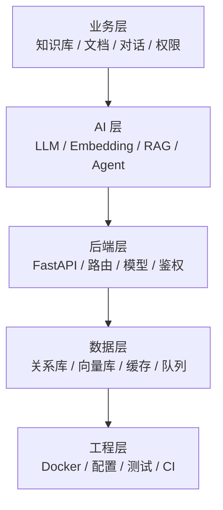
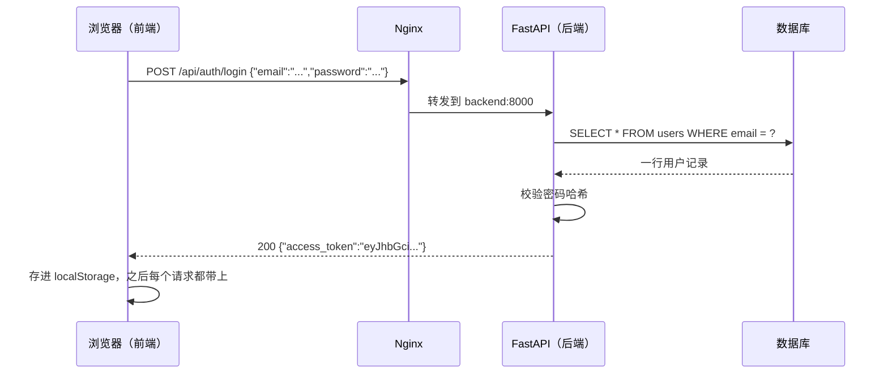
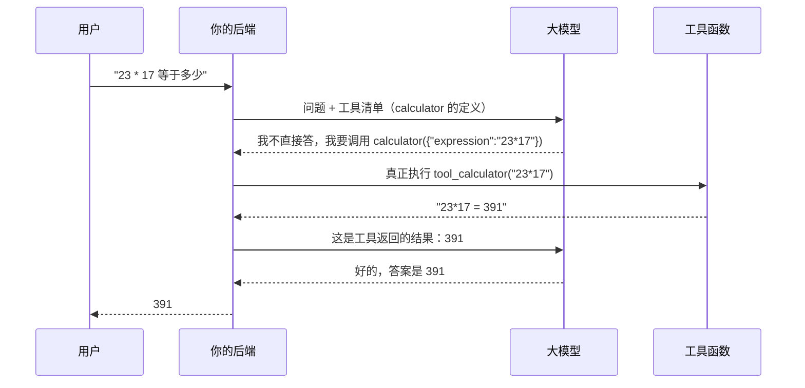
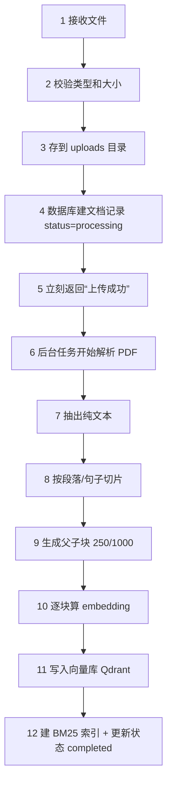

# 项目学习指导书 · 零基础精讲版

> 这份文档只解决一件事：**把《项目学习指导书》里那些"一看就懂、一做就懵"的地方，一句一句讲清楚。**

---

## 写在最前面：这份文档为什么存在

你的原话是：

> "每个部分我都需要详细了解，如果太笼统这是我初学者完全不能理解的内容。"

这个判断是对的。原《项目学习指导书》不是写得不好，而是**它写的是施工图，不是教科书**。

用盖房子打比方：

| 文档 | 它回答的问题 | 类比 |
|---|---|---|
| 原《项目学习指导书》 | 做什么、先做哪个、做到什么程度算过、哪里有坑 | 施工图 + 验收单 |
| **本文档** | 这是什么、为什么要有它、我现在应该看到什么、报错在说什么 | 师傅带你认工具、讲原理 |

施工图上写着"此处预埋 DN50 套管"，工程师一看就懂；但一个从没进过工地的人，需要有人告诉他：套管是什么、为什么预埋、不预埋会怎样、图纸上那个符号在哪。

**这份文档就是那个"师傅"。**

### 三条使用规则

1. **关键术语第一次出现必须解释。** 本文档里第一次出现的关键术语，都会给"一句话定义 + 生活比喻 + 在本项目哪里"。如果还有没解释的，是我写漏了，直接告诉我补。
2. **先看"你现在该看到什么"，再看"为什么"。** 新手最容易卡在"命令敲完了，不知道算不算成功"。所以每一段操作后面都有**可观察证据**。
3. **不要一次读完。** 这份文档按"你此刻要干的事"组织，不是按知识体系。今天要装环境，就只读第 5 章。

另外，**每章末尾都有一张「动手卡片」**：把该章的命令和验收清单压缩到一张卡片里，做完打勾即可。卡片里的命令可以直接复制，详细解释仍在本章正文里。

### 本文档与原指导书怎么配合


一句话：**原指导书告诉你"去哪"，本文档告诉你"脚下踩的是什么"。**

---

## 第 0 章 先看清全貌：你要造的到底是个什么东西

### 0.1 一句话版本

> 这是一个"**会自动读书的图书管理员**"：你把公司的手册、PDF 丢给它，它读完后，任何人用大白话提问，它都能翻到对应的那几页，用那几页的内容回答，并告诉你"这句话出自第几份文件的第几段"。

这句话里有四个动作，对应四个技术名词，后面会反复出现：

| 动作 | 技术名词 | 一句话解释 |
|---|---|---|
| 把书拆成小卡片 | **切片（Chunking）** | 整本书太长，模型一次看不完，先拆成一段一段 |
| 给每张卡片编"意思坐标" | **向量化（Embedding）** | 把一段文字变成一串数字，意思相近的数字也相近 |
| 你提问，它找最像的卡片 | **检索（Retrieval）** | 按"意思坐标"找距离最近的几张卡片 |
| 把卡片给模型，让它照着答 | **生成（Generation）** | 模型只根据这几张卡片回答，不许自由发挥 |

这四个动作连起来，就是本项目名字里的 **RAG**（Retrieval-Augmented Generation，检索增强生成）。

> [!note] 为什么叫"增强"
> 大模型本来不知道你公司的内部文档。RAG 的做法是：**先替它把资料找出来，再让它带着资料回答**。资料"增强"了它的回答能力，所以叫检索增强。

### 0.2 你点一次"发送"，系统里发生 12 件事

这是全书的骨架。后面每一章，都会回到这张表里的某一行。

| # | 发生了什么 | 用大白话说 | 对应代码 |
|---|---|---|---|
| 1 | 浏览器发一个 HTTP 请求 | 把你的问题打包寄出去 | `frontend/src/api/chat.ts` |
| 2 | Nginx 把请求转给后端 | 前台收件，转给后屋 | `frontend/nginx.conf` |
| 3 | 后端验证"你是谁" | 查身份证（JWT） | `app/utils/deps.py` |
| 4 | 后端验证"你能不能看这个库" | 查门禁卡（RBAC） | `app/utils/deps.py` |
| 5 | 把你的问题存进数据库，先占一个"回答中"的空位 | 挂号，留个病历位 | `app/routers/chat.py` |
| 6 | 把你的问题改写成 3 种说法 | 同一个意思换几种问法，提高命中率 | `app/retrieval/query_rewrite.py` |
| 7 | 每种说法算成一个向量 | 把文字变成坐标 | `app/services/vector_store.py` |
| 8 | 去向量库找最像的 20 个片段 | 按坐标找最近的卡片 | Qdrant / Chroma |
| 9 | 同时用关键词再找 20 个 | 另一路人马按"字面"找 | `app/retrieval/bm25_retriever.py` |
| 10 | 两路结果按名次融合，再精排出 5 个 | 两个猎头推荐的人选，合并面试 | `app/retrieval/hybrid.py` → `reranker.py` |
| 11 | 把 5 个片段拼成一段提示词，交给大模型 | 把资料和问题一起递给答题的人 | `app/services/rag_service.py` |
| 12 | 模型一个字一个字往外吐，前端边收边显示 | 打字机效果（SSE 流式） | `routers/chat.py` + `api/chat.ts` |

**先记住第 7、8、9、10 这四步。** 它们是这个项目最值钱的部分，也是面试问得最狠的部分。第 3 章会展开讲。

> [!tip] 怎么看这张表
> 不要背。每次看到代码里一个不认识的函数，问自己："它在 12 步里的第几步？" 只要能定位，你就不会迷路。

### 0.3 为什么这东西不好做：三个真问题

新手常以为"接个大模型 API 就完事了"。真做起来，难点在这三处：

**问题一：找得准。**
用户问"水果坏了能退吗"，文档里写的是"生鲜商品不支持七天无理由退货"。两句话**一个字都不重合**，但意思相关。纯按字面找，找不到；纯按语义找，遇到型号"XR-2000"又可能找错。
→ 所以本项目用**混合检索**：语义找一遍 + 关键词找一遍，再合并。

**问题二：答得实。**
模型有个坏毛病：资料里没有，它也会编一个很像的答案。企业知识库最怕这个。
→ 所以本项目做了**引用来源、拒答约束、句子级溯源校验**三件事。

**问题三：改得动。**
你把切片大小从 500 改成 300，效果是变好还是变差？凭感觉说不清。
→ 所以本项目有一套**评测体系**：先出考卷和标准答案，改一次代码跑一次分，用数字说话。

**这三个问题，是本项目大部分高级功能的由来。** 后面你看到"混合检索""评测体系""溯源校验"这些词，不要当成技术堆砌——每一个都是被具体问题逼出来的。

### 0.4 本章自测

1. 用一句话向别人解释这个项目是干什么的。
2. "切片"和"向量化"分别解决什么问题？
3. 12 步里，哪几步是"找资料"，哪几步是"用资料回答"？

答不上来就重读 0.1 和 0.2，不用往后翻。

### 动手卡片 · 第 0 章

**目标**：合上文档，能用 3 句话说清这个项目在干什么。

**没有命令**：这一章只建概念，跑不了任何东西。

**验收清单**
- [ ] 能说出"自动读书的图书管理员"这个比喻，并解释四个动作（切、算、找、答）
- [ ] 能按顺序说出 12 步链路，至少说对 10 步
- [ ] 能说出三个真问题，以及各自对应的功能（混合检索 / 引用与拒答 / 评测）

**卡住了**：回到 0.1 重读比喻，再对照 0.2 的表。不要在这里查资料，先记住骨架。

---

## 第 1 章 名词地图：先混个脸熟

> 这一章不要求记住，只要求"见过"。真正的理解发生在后面动手的时候。
> 用法：读到不懂的词，回这里查；查完还不懂，看 1.4 节的求助方法。

### 1.1 五层词汇，别混在一起

新手最容易犯的错，是把不同层的词当成一回事。比如把"向量数据库"和"业务数据库"混着理解，后面就全乱了。



**读法**：上层依赖下层。业务层的"知识库"，落到数据层就是一张表 + 一堆向量。面试时被问细节，你要能一路往下说。

### 1.2 核心 24 词（先看这一张）

| 词 | 一句话定义 | 生活比喻 | 在本项目哪里 |
|---|---|---|---|
| **大模型（LLM）** | 能理解和生成自然语言的神经网络 | 一个读了很多书、但没读过你公司文件的人 | 硅基流动 / DeepSeek 的 API |
| **Token** | 模型处理文本的最小单位，也是计费单位 | 按"字数"收费，但切法不是按字 | `.env` 里的长度限制、成本统计 |
| **Prompt（提示词）** | 你发给模型的全部内容，包括指令和资料 | 给答题人看的题目 + 参考资料 | `app/prompts/` |
| **上下文窗口** | 模型一次最多能看多少 Token | 桌子就这么大，资料多了放不下 | `CONTEXT_MAX_TOKENS` |
| **Embedding（向量化）** | 把文字变成一串数字（本项目 1024 个） | 给每句话发一个"意思坐标" | `services/vector_store.py` |
| **向量** | 那串数字本身 | 坐标点 | Qdrant 里存的东西 |
| **余弦相似度** | 衡量两个向量"方向"有多接近 | 两个人指的方向夹角越小越像 | 向量检索的打分 |
| **向量数据库** | 专门存向量、按相似度找邻居的数据库 | 按"意思"排序的图书馆索引 | Qdrant（生产）/ Chroma（开发） |
| **切片（Chunk）** | 把长文档切成的一段短文 | 把一本书拆成一叠卡片 | `services/text_splitter.py` |
| **Top-K** | 只取最相似的 K 个片段 | 只叫前 5 名进来面试 | `TOP_K=5` |
| **RAG** | 先检索资料、再让模型照着答 | 开卷考试 | 整个项目的主线 |
| **BM25** | 按关键词出现频率打分的经典算法 | 按"关键词命中次数"排名的老办法 | `retrieval/bm25_retriever.py` |
| **混合检索** | 语义找一遍 + 关键词找一遍 | 两个猎头各推一批人 | `retrieval/hybrid.py` |
| **RRF** | 按"名次"而不是"分数"融合两路结果 | 两个评委各排一个榜，看谁两家都上榜 | `hybrid.rrf()` |
| **Rerank（精排）** | 对初筛结果再用模型细看一遍 | 海选之后的复试 | `retrieval/reranker.py` |
| **Agent（智能体）** | 会自己决定"要不要用工具、用哪个"的模型 | 不是答题，是办事 | `services/agent_service.py` |
| **Function Calling** | 模型输出"我要调用某函数"的结构化请求 | 模型写一张申请单，你的代码去执行 | `TOOL_DEFINITIONS` |
| **ReAct** | 想 → 做 → 看结果 → 再想 的循环 | 边试边改 | `agent_service.chat()` |
| **SSE** | 服务器保持连接、持续推送数据的 HTTP 技术 | 打字机，而不是等全文写好再给你 | `/api/chat/stream` |
| **JWT** | 一段带签名的"身份证字符串" | 盖了章的通行证 | `utils/security.py` |
| **RBAC** | 按角色控制权限 | owner 能改，viewer 只能看 | `kb_members` 表 |
| **MCP** | 让外部客户端发现并调用你工具的标准协议 | 通用插座 | `app/mcp_server/` |
| **评测（Eval）** | 用固定考卷 + 标准答案给系统打分 | 月考 | `app/evaluation/` |
| **Docker** | 把程序和依赖打包成"集装箱" | 连厨房一起搬走 | `docker-compose.yml` |

### 1.3 六组最容易混的词

**① LLM 与 Embedding 模型：两个不同的东西**

- LLM 负责"说话"（生成答案），Embedding 模型负责"定位"（把文字变向量）。
- 它们通常由同一个服务商提供，但是**两个模型名**，要分别配置。
- 常见错误：只配了 `LLM_MODEL`，忘了 `EMBEDDING_MODEL` → 上传文档时向量化失败。

**② 关系数据库与向量数据库：存的东西不一样**

| | 关系数据库（PostgreSQL / SQLite） | 向量数据库（Qdrant / Chroma） |
|---|---|---|
| 存什么 | 用户、知识库、文档元数据、消息 | 每个切片的向量 + 原文 |
| 怎么查 | `WHERE id = 3`，精确匹配 | "找最像的 5 个"，模糊匹配 |
| 类比 | 户籍档案柜 | 按长相相似度找人的系统 |

本项目两个都用：**Postgres 管"是谁、有哪些文档"，Qdrant 管"哪段话意思最像"。**

**③ RAG 与微调：两条不同的路**

- RAG：**不动模型**，每次把资料塞给它。适合知识经常更新、要求引用出处。
- 微调（Fine-tuning）：**改模型参数**，让它学会某种风格或格式。适合固定任务、格式要求高。
- 一句话：**知识用 RAG，风格用微调。** 本项目主线是 RAG，微调只有一个示例脚本。

**④ Agent 与普通问答：一个答题，一个办事**

- 普通问答：问题进来 → 检索 → 回答。路径固定。
- Agent：问题进来 → 模型自己判断"要不要查知识库 / 要不要算数 / 要不要看时间" → 调工具 → 看结果 → 决定下一步。路径不固定。
- 关键区别：**Agent 的下一步是模型自己选的，不是你写死的。**

**⑤ 切片大小与父子分块：不是一回事**

- 切片大小：一段切多长（比如 500 字）。
- 父子分块：**用小块建索引（250 字），用大块返回给模型（1000 字）**。
- 为什么：小块词密度高、检索准；大块上下文完整、回答全。两个粒度各干各的事。

**⑥ Token 与字数：不是一比一**

- 中文大致一个字接近一个 Token，但**具体取决于模型的分词器**，标点、英文、数字的切法都不同。
- 所以"我的文档 1 万字"不等于"1 万 Token"。估算成本时留 30% 余量。

### 1.4 看到不懂的词，三步处理

1. **先查本文档附录 A**（60 词总表）。查到了，看完"一句话定义"就回到原文，不要陷进去。
2. **查不到，用固定句式问 AI**：

```text
我在读一个 RAG 项目，遇到一个词：【XXX】。
请按这个顺序回答，不要展开其他内容：
1. 它是什么？一句话。
2. 它解决什么问题？不用它会怎样？
3. 它在"文档上传→切片→向量化→检索→生成"这条链路里的哪一步？
4. 给一个生活比喻。
5. 我在这个项目里能在哪个文件看到它？
```

3. **记进生词本。** 一个词查过三次还记不住，说明它在你当前的学习阶段不重要——先跳过，不丢人。

> [!warning] 新手最大的时间黑洞
> 看到"Pydantic""依赖注入""联合类型收窄"就去系统学一遍 Python/TypeScript。
> **不要。** 这个项目的策略是"卡在哪补哪"。一个概念只要不影响你完成当前这一步，就先放着。

### 1.5 本章自测

1. "向量数据库"和"关系数据库"各自存什么？为什么不能只用一个？
2. RAG 和微调，什么情况下选哪个？
3. 父子分块里，"建索引"用的是父块还是子块？为什么？

### 动手卡片 · 第 1 章

**目标**：随机抽 10 个名词，能说出"它是什么、解决什么问题"。

**没有命令**：这一章是词汇表，不用敲任何东西。

**验收清单**
- [ ] 能区分 LLM 和 Embedding 模型（一个说话，一个定位）
- [ ] 能说出关系库和向量库各自存什么，为什么不能只用一个
- [ ] 能说出"知识用 RAG、风格用微调"的判断标准
- [ ] 能解释父子分块里"建索引用子块、返回用父块"的原因
- [ ] 从附录 A 随机抽 10 个词，至少答对 7 个

**卡住了**：查附录 A；还查不到，用 1.4 的固定句式问 AI，只问这一个词。

---

## 第 2 章 前置知识：只学这个项目用得到的那一点

> 这一章的目标不是让你学会编程，是让你**看得懂这个项目在干什么**。
> 每节末尾有自测，答对就往下走，不要恋战。

### 2.1 一个网页请求的一生

这是理解一切的地基。哪怕你后面什么都不记，记住这一节也够用了。

**场景**：你在登录页输入邮箱密码，点"登录"。



**逐项拆解**：

| 名词 | 是什么 | 在本例中 |
|---|---|---|
| **URL** | 请求的地址 | `/api/auth/login` |
| **HTTP 方法** | 动作类型。GET 取、POST 交、DELETE 删 | POST（提交登录信息） |
| **请求体（Body）** | 随请求发送的数据，通常是 JSON | `{"email":"...","password":"..."}` |
| **JSON** | 一种 `{键: 值}` 格式的文本 | 前后端之间的"普通话" |
| **状态码** | 结果代号。200 成功、400 参数错、401 没登录、403 没权限、404 不存在、500 服务器崩了 | 200 |
| **响应体** | 服务器返回的数据 | `{"access_token":"..."}` |
| **Token** | 登录后拿到的凭证，之后请求放在 `Authorization` 头里 | `Bearer eyJhbGci...` |

> [!important] 一个必须建立的直觉
> **前端不直接连数据库。** 前端只会"发请求"，所有数据都由后端从数据库取出来、加工成 JSON 再返回。
> 所以你在页面上看到的每一个数字，背后一定有一个接口。

**自己验证一次（装好环境后做）**：

1. 浏览器按 `F12` 打开开发者工具；
2. 切到 **Network（网络）** 面板；
3. 在页面上点一次"登录"；
4. 你会看到一条 `login` 请求，点开它：
   - **Headers** 里看请求地址、方法、状态码；
   - **Payload** 里看你发出去的用户名密码；
   - **Response** 里看后端返回的 token。

**这一刻比读十篇文章都有用**：你亲眼看见了"请求"和"响应"。

### 2.2 前后端分离：到底分的是什么

| | 前端 | 后端 |
|---|---|---|
| 代码在哪 | `frontend/` | `backend/` |
| 跑在哪 | 用户的浏览器 | 服务器（或你的电脑） |
| 负责什么 | 长什么样、点了之后发什么请求 | 数据怎么存、规则怎么算、权限怎么判 |
| 用什么写 | Vue 3 + TypeScript | Python + FastAPI |
| 怎么交流 | **只通过 HTTP + JSON** | 同左 |

**为什么要分**：

1. 可以分别部署、分别扩容（前端放 CDN，后端加机器）；
2. 换界面不用动业务逻辑；
3. 手机 App、小程序可以复用同一套后端接口。

**一个常见的误解**：前端代码里看到 `if (user.role === 'owner')` 就以为"权限在前端做"。不是。前端只是**决定按钮显不显示**，真正的拦截在后端 `require_kb_role()`。前端隐藏按钮只是体验，后端校验才是安全。

### 2.3 数据库：五个词就够

把数据库想成一个 Excel 文件：

- **表（Table）** = 一个 sheet，比如 `users`；
- **行（Row）** = 一条记录，比如"张三这个用户"；
- **列（Column）** = 一个字段，比如 `email`；
- **主键（Primary Key）** = 这一行的唯一编号，通常是 `id`；
- **外键（Foreign Key）** = 指向另一张表的 `id`，用来表达"属于关系"。

本项目的三张核心表（简化）：

```text
users
  id | email            | password_hash | role
  1  | zhang@example.com | $2b$12$...     | user

knowledge_bases
  id | name          | owner_id
  3  | 电商退换货政策 | 1          ← owner_id 是外键，指向 users.id

documents
  id | kb_id | filename          | status
  7  | 3     | 售后退换货政策.pdf | completed   ← kb_id 是外键，指向 knowledge_bases.id
```

**"行级数据隔离"是什么意思**：张三只能看到 `owner_id = 1` 或共享给他的知识库。这条规则写在每个查询的 `WHERE` 里，不是靠前端藏起来。

**索引是什么**：书的目录。没有索引，数据库要从第一页翻到最后一页（全表扫描）；有索引，直接翻到对应位置。
项目里的 `scripts/explain_index.py` 记录过一次实测：同一条列表查询，加复合索引后从 **2.62ms 降到 0.05ms**。

**SQLite 和 PostgreSQL 的区别**：

| | SQLite | PostgreSQL |
|---|---|---|
| 形态 | 一个文件（`knowledge_base.db`） | 一个独立运行的服务 |
| 适合 | 本地开发、单机、零配置 | 生产、多用户并发 |
| 本项目 | 裸跑时默认 | Docker 默认 |

### 2.4 容器：为什么不"装环境"，而是"发集装箱"

**先看问题**：

> 你电脑上跑得好好的，发给同事，他说"启动不了"。
> 原因是：你装的是 Python 3.11，他是 3.13；你有某个系统库，他没有。

**Docker 的思路**：不只发代码，把**代码 + 运行环境 + 依赖**一起打包。

| 名词 | 是什么 | 比喻 |
|---|---|---|
| **镜像（Image）** | 一个只读的包，含系统、Python、依赖、代码 | 做月饼的模具 |
| **容器（Container）** | 镜像跑起来的实例 | 压出来的月饼 |
| **Dockerfile** | 描述"怎么造镜像"的脚本 | 模具的图纸 |
| **docker-compose** | 描述"同时起哪几个容器、怎么连"的清单 | 一整条生产线的排班表 |
| **数据卷（Volume）** | 挂在容器外面的存储，容器删了数据还在 | 放在车间外面的仓库 |
| **端口映射** | 把容器内的端口暴露到宿主机 | 给厂房开一扇对外的门 |

**端口映射 `127.0.0.1:8000:8000` 三段分别是什么**：

```text
127.0.0.1 : 8000 : 8000
   ↑         ↑      ↑
 谁能访问   宿主机的端口   容器内的端口
```

- 第一段 `127.0.0.1` 表示**只有这台电脑能访问**。同一 Wi-Fi 下的手机打不开，这是故意的（Qdrant、Redis 没有密码）。
- 想用手机演示，只把 frontend 那行改成 `"80:80"`，其他别动。

**一个必须知道的坑**：`docker compose down` 会删容器，但**不会删数据卷**；`docker compose down -v` 会连数据卷一起删。后者等于清库，别乱敲。

### 2.5 配置文件 `.env`：为什么密钥不能写进代码

**问题**：代码要提交到 GitHub，但数据库密码、API Key 不能给别人看。

**做法**：代码里只写"去读环境变量"，真实值放在一个**不进版本库**的文件里。

| 文件 | 作用 | 进 Git 吗 |
|---|---|---|
| `.env.example` | 模板，列出所有配置项，值都是占位符 | 进，给别人看格式 |
| `.env` | 真实配置，含密钥 | 绝对不进 |

本项目的两层配置：

1. **仓库根目录 `.env`**：只放一个 `POSTGRES_PASSWORD`，给 `docker-compose.yml` 做变量替换；
2. **`backend/.env`**：应用的全部配置（数据库地址、LLM Key、各种开关），由容器通过 `env_file` 注入。

**为什么 `SECRET_KEY` 必须改**：

- 它是用来给 JWT 签名的"印章"。
- 如果全世界的代码里都用同一个默认值，等于所有人的印章长得一样——**任何人都能伪造任意用户的 token**。
- 所以本项目设计成：`DEBUG=false`（容器环境）时，检测到还是默认值就**直接拒绝启动**。这不是 bug，是故意的保护。

> [!tip] 记住这个模式
> **"配置错误就在启动时大声失败"，远好于"带着一个公开密钥悄悄对外服务"。**
> 这条思路在后面很多地方会重复出现（数据库没就绪就重试、失败要显式退出）。

### 2.6 本章自测

1. 浏览器点"登录"后，数据经过了哪几个环节？按顺序说。
2. 前端隐藏了一个按钮，等于权限做好了吗？为什么？
3. `127.0.0.1:8000:8000` 里的 `127.0.0.1` 限制了什么？
4. 为什么 `.env` 不能提交，而 `.env.example` 可以？

答案都在上文，答不出就回去找。**不要带着模糊往下走**，第 5 章会用到。

### 动手卡片 · 第 2 章

**目标**：能看懂"浏览器点一下，后端发生了什么"。

**可选命令**（需要环境已启动，仓库根执行）

```bash
curl -i http://localhost:8000/api/health
```

预期：`HTTP/1.1 200 OK`，响应体里 `"status":"healthy"`。

**验收清单**
- [ ] 能按顺序说出一次登录请求经过：浏览器 → Nginx → FastAPI → 数据库 → 返回 token
- [ ] 能解释 200 / 401 / 403 / 404 / 500 分别代表什么
- [ ] 能解释 `127.0.0.1:8000:8000` 三段各限制了什么
- [ ] 能说出 `.env` 和 `.env.example` 的区别，以及为什么 `.env` 不能提交
- [ ] 能解释"前端隐藏按钮"为什么不等于权限控制

**卡住了**：回到 2.1 的时序图，把每个箭头的"谁发给谁"念一遍。

---

## 第 3 章 RAG 到底怎么工作（本项目的灵魂）

> 这一章是全书最重要的一章。读完你应该能在白纸上画出"上传到回答"的完整流程，并说出每一步在干什么。

### 3.1 先说清楚：为什么不能把文档直接丢给大模型

三个原因，一个比一个现实：

**原因一：它没读过你的文档。**
大模型的知识来自训练数据，截止到某个时间点。你公司的制度、产品手册、售后政策，它一个字都没见过。

**原因二：它会编。**
你问"我们退款几个工作日到账"，它不知道，但它不会说"不知道"，而是编一个"通常 3-7 个工作日"。语气非常自信。这在企业场景是事故。

**原因三：装不下。**
一个知识库可能有几百份文档、几十万字。模型的上下文窗口有限（比如 32K Token），装不下；就算装得下，每次都把全部文档发过去，**又慢又贵**。

**RAG 的解法一句话**：**不要让它读全部，先替它找到最相关的几段，再让它只读这几段。**

### 3.2 五个动作：切、算、找、拼、答

#### 动作一：切（Chunking）

**做什么**：把一份 50 页的 PDF 切成几百个 500 字左右的小段。

**为什么**：

1. 整篇太长，塞不进上下文；
2. 检索需要"粒度"。你问一个具体问题，返回整篇文档没用，返回相关的那一段才有用；
3. 切片越聚焦，向量越能代表一个明确的意思。

**切多大**：本项目默认 `CHUNK_SIZE=500` 字，`CHUNK_OVERLAP=50` 字。

- **重叠（overlap）** 是干什么的：如果一句话正好被切在边界上，两边各留 50 字重复，保证这句话至少在一段里是完整的。
- 500 是万能值吗？**不是。** 它只是起点。制度类条文适合小一点（250-400），叙述类文档适合大一点（600-1000）。到底多少，用评测说话（第 9 章）。

**父子分块（本项目的一个设计）**：

| 粒度 | 大小 | 用来干什么 |
|---|---|---|
| 子块 | 250 字 | 建索引、算相似度、BM25 打分 |
| 父块 | 1000 字 | 最终交给模型阅读 |

为什么这么设计：

- 250 字里出现一次"XR-2000"，密度是 1/250；1000 字里出现一次，密度是 1/1000。**词密度高，关键词才好打分。**
- 但 250 字上下文不完整，模型可能看不懂。所以**打分用小粒度，返回用大粒度**。

一句话记住：**索引粒度和返回粒度可以不一样。** 这是父子分块的全部价值。

#### 动作二：算（Embedding）

**做什么**：把每段文字变成 1024 个小数。

**为什么这样能表示意思**：

模型在训练时见过海量句子。它学到的规律是：**经常出现在相似上下文里的句子，应该落在相近的位置**。所以"退货怎么办"和"如何申请退款"虽然字面不同，坐标却很近。

**关键认知**：

- Embedding 模型**不是**在"理解逻辑"，它在编码"共现模式"。
- 所以它对**否定词**（"不支持退货" vs "支持退货"）和**精确编号**（"XR-2000" vs "XR-2001"）不敏感。
- 这正是后面要加 BM25 的原因。

**本项目配置**：`EMBEDDING_MODEL=BAAI/bge-m3`，`EMBEDDING_DIM=1024`。

> [!warning] 一个高频错误
> 换 embedding 模型时，**维度必须一起改**。原来 1024 维，换成一个 768 维的模型，向量库里的旧数据全部对不上，检索会直接报错或返回垃圾。

#### 动作三：找（Retrieval）

**（1）向量检索怎么找**

把问题也算成一个向量，然后算它和库里每个向量的**余弦相似度**：

```text
相似度 = 两个向量夹角的余弦值
      = 1 表示方向完全相同
      = 0 表示毫不相关
      = -1 表示完全相反（文本里几乎不会出现）
```

取分数最高的 K 个（本项目 `TOP_K=5`）。

**（2）为什么还要 BM25**

设想文档里有个型号 `XR-2000`。用户问"XR-2000 的保修期多久"。

- 向量检索：它看到的是"型号 + 保修"的整体语义，可能把 `XR-2001`、`XR-3000` 的段落也找出来，因为"长得都差不多"。
- BM25：它只数关键词。`XR-2000` 这个罕见的词一旦命中，得分很高。

**BM25 的三个直觉**（不用背公式）：

| 因素 | 直觉 | 参数 |
|---|---|---|
| 词频（TF） | 一个词在这段里出现越多，越相关；但多到一定程度就"饱和"，不会无限加分 | `k1` |
| 逆文档频率（IDF） | 越罕见的词越有区分度。"的"出现在每段里，等于没信息；"XR-2000"只出现在一段里，信息量极大 | 无 |
| 长度归一化 | 长文档天然词多，要惩罚，否则长文档永远赢 | `b` |

> [!note] 中文为什么需要 jieba
> 英文单词有空格，`return policy` 天然是两个词。中文"退货政策"是一串，必须先切成"退货 / 政策"才能统计词频。
> 没装 jieba 时，本项目会退化成按单字匹配——效果明显变差，但不会报错。

**（3）两路怎么合：RRF**

问题来了：向量分数是 `[0,1]`，BM25 分数可能是 `0~15`。**两个量纲不同的分数，不能直接相加，也不能直接比大小。**

RRF 的做法很聪明：**不比分数，只比名次。**

```text
每个片段得分 = Σ  权重 × 1 / (k + 名次)
```

- `k` 是平滑常数，本项目 `RRF_K=60`；
- 名次从 0 开始，所以代码里写的是 `k + rank + 1`；
- 一个片段如果在两路里都排得靠前，得分会叠加，自然胜出。

**手算一遍（这是面试最爱问的）**：

假设向量路排名 `A, B, C`，BM25 路排名 `C, D, A`，权重各 0.5，k=60：

| 片段 | 向量路贡献 | BM25 路贡献 | 总分 |
|---|---|---|---|
| A | 1/61 = 0.01639 | 1/63 = 0.01587 | **0.03226** |
| C | 1/63 = 0.01587 | 1/61 = 0.01639 | **0.03226** |
| B | 1/62 = 0.01613 | — | 0.01613 |
| D | — | 1/62 = 0.01613 | 0.01613 |

结论：

- A 和 C 并列第一，因为**两路都提名了**；
- B 和 D 并列第二，因为只有一路提名；
- 注意：**A 在向量路第一，C 在 BM25 路第一，但融合后同分。** 这正是 RRF 的公平之处——它不看谁家分数高，只看"被多少人认可、排得多靠前"。

本项目权重是 `VECTOR_WEIGHT=0.6`、`BM25_WEIGHT=0.4`，所以 A 会略高于 C（0.01619 vs 0.01608）。这说明**权重会影响结果**，也是你做对照实验的一个变量。

**（4）Rerank（精排）**

- **召回**：从几万个片段里粗筛出 20 个。要求快、宽，宁可错杀不可放过。
- **精排**：对这 20 个逐一判断"和问题到底相关吗"，重新排序，取前 5 个。要求准，慢一点没关系。

为什么两阶段：让模型看 20 个片段，比让它看整个库便宜得多；但比只看向量分数准得多。

本项目默认用 **LLM 精排**（`RERANK_PROVIDER=llm`），每段只送前 200 字（`RERANK_MAX_CHARS=200`），因为判断"相关不相关"不需要看完整段——按 200/1000 字估算，这一条能省约 80% 的精排 token。

#### 动作四：拼（Prompt）

把检索到的 5 段资料编号，塞进系统提示词：

```text
你是企业知识库助手。请只根据下面的参考资料回答。
如果资料里没有答案，明确说"知识库中暂无相关资料"，不要编造。

## 参考资料
【资料1】（来源：售后退换货政策.pdf）
7天无理由退货自签收次日起算……

【资料2】（来源：生鲜品类规则.pdf）
生鲜商品不支持7天无理由退货……

用户问题：水果坏了能退吗
```

**三个细节，都是踩过坑才加的**：

1. **编号 + 来源**：模型回答时能引用"资料2"，前端才能显示来源卡片。
2. **"资料没有就说没有"**：不加这句，模型很可能编。
3. **资料边界包裹**：防止文档里藏着"忽略以上指令"这类注入攻击（`utils/guard.py` 的 `wrap_context`）。

#### 动作五：答（Generation）

模型开始生成。本项目用 **SSE 流式**：不是等全文生成完再返回，而是**生成一个字就发一个字**。

为什么这么做：

- 体感快。从"等十几秒才看到整段"变成"一两秒内看到第一个字"，用户不会以为卡死。
- 实现简单。SSE 就是普通 HTTP，只是服务器不关连接，持续写 `data: {...}\n\n`。

```text
data: {"token":"7"}
data: {"token":"天"}
data: {"token":"无"}
...
data: {"done":true,"sources":[...]}
```

前端用 `fetch` + `ReadableStream` 一段一段读，读到一个 `data:` 就渲染一段。

### 3.3 亲手做一次"假 RAG"（20 行，不用装任何东西）

在看 300 行的工业代码之前，先用 20 行理解"检索"到底在干什么。

新建一个文件 `demo.py`，粘贴：

```python
import math, re
from collections import Counter

def vec(text):
    # 用"相邻两个字"当特征：这是最粗糙的"字面指纹"
    chars = re.sub(r"\s+", "", text)
    grams = [chars[i:i+2] for i in range(len(chars)-1)]
    return Counter(grams)

def cosine(a, b):
    keys = set(a) | set(b)
    dot = sum(a.get(k, 0) * b.get(k, 0) for k in keys)
    na = math.sqrt(sum(v * v for v in a.values()))
    nb = math.sqrt(sum(v * v for v in b.values()))
    return dot / (na * nb) if na and nb else 0.0

docs = [
    "7天无理由退货自签收次日起算。",
    "生鲜商品不支持7天无理由退货。",
    "退款将在3个工作日内原路退回。",
]
q = "水果坏了能退吗"
for d in docs:
    print(round(cosine(vec(q), vec(d)), 3), d)
```

运行 `python3 demo.py`（Windows 用 `python demo.py`），输出是：

```text
0.0 7天无理由退货自签收次日起算。
0.0 生鲜商品不支持7天无理由退货。
0.0 退款将在3个工作日内原路退回。
```

**三行全是 0.0。** 但人一眼就知道第二句是相关的。

这就是**字面检索的死穴**：用户不会用文档里的词提问。他说"水果"，文档写"生鲜"；他说"坏了"，文档写"不支持无理由退货"。一个字都不重合，余弦相似度就是 0。

**怎么修**：把 `vec()` 从"字面指纹"换成真正的 Embedding 模型。模型见过大量"水果—生鲜""坏了—质量问题"的共现，会把它们放到相近的位置。这时第二句的分数会明显高于另外两句。

**这个 20 行实验告诉你三件事**：

1. 检索的本质是"算相似度、排序、取前 K"，不神秘；
2. 真正的难度在"怎么把意思表示成向量"，这就是 Embedding 模型的价值；
3. 字面匹配（BM25）和语义匹配（向量）各有盲区，所以要合起来用。

### 3.4 本项目的 RAG 比教科书多了什么

教科书版 RAG 只有五步。本项目在每个环节都加了东西，每一件都对应一个具体问题：

| 加的东西 | 解决什么问题 | 代码位置 | 默认 |
|---|---|---|---|
| 父子分块 | 小块检索准、大块上下文全 | `services/text_splitter.py` | 开 |
| 查询改写（Multi-Query） | 用户问法太口语，一次检索打不中 | `retrieval/query_rewrite.py` | 开，3 条 |
| HyDE | 问题太短，和文档文体不像 | 同上 | 关（多一次 LLM） |
| 混合检索 + RRF | 语义和关键词各有盲区 | `retrieval/hybrid.py` | 开 |
| Rerank 精排 | 初筛 20 个里有噪音 | `retrieval/reranker.py` | 开 |
| Self-RAG | 检索结果不够好，要不要重查 | `retrieval/self_rag.py` | 关（多 N 次 LLM） |
| 检索缓存 | 同一个问题重复算 embedding，浪费钱 | `services/retrieval_cache.py` | 开，600s |
| 溯源校验 | 模型说的话在资料里找不到依据 | `services/grounding_service.py` | 开 |
| 拒答约束 | 资料没有却硬答 | `prompts/system.py` | 开 |
| 上下文工程 | 历史对话太长，Token 超预算 | `context_engine/` | 部分接线 |

> [!important] 读代码前的心理准备
> 你打开 `rag_service.py` 会觉得"怎么这么短"——因为它只负责"编排"，具体活儿都分给上面这些模块了。
> **看主流程去 `rag_service.py`，看某个能力怎么实现去对应文件。** 不要在 `rag_service.py` 里找 BM25 的公式，它不在那儿。

### 3.5 一次检索的真实成本（为什么处处在省 token）

很多人以为 RAG 贵在"生成答案"。实际算一笔账（一次提问）：

| 步骤 | 调用次数 | 说明 |
|---|---|---|
| 查询改写成 3 条 | 1 次 LLM | 便宜 |
| 3 条查询分别 embedding | 3 次 | 每条都是新文本，缓存必然 miss |
| 向量检索 | 1 次 | 便宜 |
| BM25 | 0 次网络 | 本地算 |
| LLM 精排 | 1 次，20 个候选 | **最贵**：20 × 1000 字 ≈ 1.2-1.5 万 token |
| 生成答案 | 1 次 | 中等 |

所以本项目做了两个优化，都不改架构、只改参数：

1. **精排只看前 200 字** → 精排 token 降约 80%；
2. **批量 embedding**（`query_batch`）→ 3 次网络往返合成 1 次。

还有一个更隐蔽的：**检索缓存**。同一个问题第二次问，直接返回上次的片段，一次 embedding 都不算。

> [!tip] 这条思路可以迁移到任何 LLM 项目
> **问自己：这次调用要回答的问题，真的需要看完全部内容吗？**
> 精排要回答"这段相关吗"——前 200 字就够；裁判要回答"这段有幻觉吗"——得看全。
> 按"任务真正需要的信息量"给输入，而不是"手头有什么就给什么"。

### 3.6 本章自测

1. 为什么不能把整份文档直接塞给大模型？说三个原因。
2. 父子分块里，为什么 BM25 必须用子块建索引？
3. RRF 为什么不能直接比较向量分数和 BM25 分数？
4. 用上面的手算表，如果 `k` 从 60 改成 10，A 和 C 的分数会变大还是变小？为什么？

第 4 题答案：变大。分母变小，`1/(k+rank)` 整体变大，但**排序不变**（因为大家都在同一尺度上放大）。这也是 RRF 稳健的原因之一。

### 动手卡片 · 第 3 章

**目标**：用一个 20 行脚本，亲眼看到"字面检索为什么会失败"。

**命令**（任意空目录，不需要项目环境）

```bash
# 1. 新建 demo.py，粘贴 3.3 节的代码
# 2. 运行（WSL 用 python3，Windows 用 python）
python3 demo.py
```

预期：三行分数都是 `0.0`，但人一眼能看出第二句相关。

**验收清单**
- [ ] 能解释为什么三行都是 0.0（字面完全不重合）
- [ ] 能说出换成真正的 Embedding 后，哪一句分数会最高，为什么
- [ ] 能按顺序说出 RAG 五步：切 → 算 → 找 → 拼 → 答
- [ ] 能手算 3.2（3）的 RRF 表：A 和 C 为什么并列第一
- [ ] 能解释父子分块为什么"打分用小、返回用大"

**卡住了**：3.2（3）的 RRF 手算表；先照着数字算一遍，再合上重算。

---

## 第 4 章 Agent：从"会答题"到"会办事"

> 这一章理解两个点就够：Function Calling 到底谁在执行；ReAct 循环什么时候停。

### 4.1 普通问答与 Agent 的分岔点

| | 普通 RAG 问答 | Agent |
|---|---|---|
| 路径 | 固定：检索 → 拼 Prompt → 回答 | 不固定：模型自己决定下一步 |
| 能否算数 | 不能（模型心算经常错） | 能（调计算器工具） |
| 能否查时间 | 不能（它不知道现在几点） | 能（调时间工具） |
| 能否多次检索 | 不能（一次检索定生死） | 能（不够就换关键词再查） |
| 适合 | 有明确答案的知识问答 | 需要多步、需要外部动作的任务 |

### 4.2 Function Calling：模型不执行代码，它只"填申请单"

这是新手最大的误解，必须讲透。

**错误理解**：模型自己去执行了计算器。
**正确理解**：



**三个关键点**：

1. 模型输出的是一个 **JSON 结构的"调用请求"**，不是执行结果；
2. 真正执行的是**你的代码**（`TOOL_EXECUTORS`）；
3. 执行结果必须**再发回给模型**，它才知道发生了什么。

所以"工具"本质上是：**给模型看的说明书 + 你写的执行函数**，两样缺一不可。

**工具描述为什么决定成败**：

```python
# 差的描述：模型不知道什么时候该用
"description": "查询知识图谱"

# 好的描述：告诉它适用和不适用
"description": "查询知识图谱中的实体及其关系。适用于：询问两个概念之间的关系、
                跨文档关联。不适用于：查具体数值、条款原文——那类问题用 search_knowledge_base。"
```

模型是靠描述来决定调不调的。描述写得含糊，它要么不调，要么乱调。

### 4.3 ReAct 循环：想 → 做 → 看 → 再想

**ReAct = Reason + Act**。它不是一个库，是一种循环模式。

用"现在几点，顺便算一下 23×17"走一遍：

```text
第 1 轮
  想：用户问了两件事，先查时间
  做：调用 get_current_time()
  看：当前时间是 2026年11月03日 星期二 16:20:00
第 2 轮
  想：时间有了，还要算 23×17
  做：调用 calculator({"expression":"23*17"})
  看：23*17 = 391
第 3 轮
  想：两个问题都解决了，可以回答
  做：不再调用工具，直接输出最终答案
结束
```

**循环必须有终止条件**，否则模型可能一直调工具。本项目的三道闸：

| 闸 | 作用 |
|---|---|
| 模型不再请求工具 | 正常结束 |
| 最大轮数（`chat(max_iterations=4)`，默认 4 轮） | 防止死循环 |
| 工具预算（`TOOL_BUDGET=10`） | 防止工具太多把上下文撑爆 |

**为什么要有工具预算**：每个工具的定义都要占 Token。工具越多，Prompt 越长，模型越容易选错。10 个工具是经验上限。

### 4.4 本项目的三个工具

| 工具 | 什么时候用 | 实现 |
|---|---|---|
| `get_current_time` | 问现在几点、今天几号 | `datetime.now()` |
| `calculator` | 任何数学运算 | AST 白名单解析，只允许数字和运算符 |
| `search_knowledge_base` | 问公司内部信息 | 复用 `rag_service.retrieve()`，和普通问答同一套召回 |

**注意第三个**：`search_knowledge_base` **只在传入 `kb_id` 时才会注册**；不带知识库的 Agent 只有前两个工具。另外，Agent 检索时**不能直接查向量库**，必须复用 RAG 的检索链路。否则 Agent 模式的召回质量会低于普通问答——这是一个已经踩过的坑，代码里有注释。

**为什么计算器要用 AST 白名单**：如果直接 `eval("23*17")`，用户输入 `__import__('os').system('rm -rf /')` 就完蛋了。AST 白名单只允许数字、加减乘除、括号，其他一律拒绝。

### 4.5 本章自测

1. 模型调用工具时，真正执行代码的是谁？
2. 为什么工具执行完还要把结果发回给模型？
3. ReAct 循环如果不定终止条件，可能发生什么？

### 动手卡片 · 第 4 章

**目标**：能讲清"模型不执行代码，它只填申请单"。

**可选命令**（先激活 `backend/.venv`，再在 `backend/` 目录执行）

```bash
python -m pytest tests/test_agent_tools.py -q
```

预期：全部通过。它验证的是工具实现（计算器、时间），不需要真模型。

**验收清单**
- [ ] 能画出 Function Calling 的四步：模型要调用 → 你的代码执行 → 结果回传 → 模型作答
- [ ] 能说出本项目三个工具的名字和用途
- [ ] 能说出 ReAct 的三个终止条件
- [ ] 能解释计算器为什么用 AST 白名单，而不是 `eval()`
- [ ] 能解释"工具描述写得好不好，决定模型调不调"

**卡住了**：4.2 的时序图；把"谁执行"那一行用红笔圈出来。

---

## 第 5 章 环境：从零到能打开页面

> 这一章是纯操作。每条命令都按"直译 → 真正做了什么 → 你应该看到什么 → 报错怎么办"讲。

### 5.1 先搞清楚：你在哪个终端里敲命令

Windows 上有三种终端，新手第一大坑就是**在错误的终端里敲命令**。

| 终端 | 长什么样 | 路径写法 | 适合 |
|---|---|---|---|
| **PowerShell** | 蓝色窗口，提示符 `PS C:\...>` | `C:\Users\23981\...` | 跑 Windows 命令、`npm` |
| **Git Bash** | 黑窗口，提示符 `$` | `/c/Users/23981/...` | git、部分 Linux 命令 |
| **WSL2 Ubuntu** | 黑窗口，提示符 `$`，`pwd` 显示 `/home/...` | `/mnt/c/Users/23981/...` | **Docker 推荐** |

**怎么确认自己在哪**：

```bash
pwd          # 看当前路径：/mnt/c/... 是 WSL，/c/... 是 Git Bash，C:\ 是 PowerShell
uname -a     # 出现 Linux ... microsoft-standard-WSL2 就是 WSL
```

**三条实用规则**：

1. **Docker 命令推荐在 WSL2 Ubuntu 里敲**（本项目验证过的路径）。
2. **Python 虚拟环境不能跨系统混用**：WSL 里建的 `venv` 在 Windows 里跑不了，反之亦然。
3. **路径里有中文和空格**：一定要加引号。本项目路径含 `AI文档`、`+`、空格，不加引号必炸。

**终端差异小抄**（命令报"找不到"时先看这张表）：

| 操作 | WSL2 / Git Bash | PowerShell |
|---|---|---|
| 复制文件 | `cp a b` | `copy a b` |
| 列目录 | `ls` | `dir` |
| 看文件 | `cat 文件` | `type 文件` |
| 跑 Python | `python3`（或 `python`） | `python` |
| 路径写法 | `/mnt/c/Users/...` | `C:\Users\...` |
| 删文件 | `rm 文件` | `del 文件` |

> [!warning] 最常见的"命令找不到"
> 在 WSL 里敲 `python` 报 `command not found`，不是你装错了，是 Ubuntu 默认只有 `python3`。
> 三条规则：**宿主机 WSL 用 `python3`；容器内用 `python`；已激活 venv 后用 `python`。**
> 本文档第 5 章的命令都在宿主机执行，所以写 `python3`；第 9 章的评测命令在容器内执行，写 `python`。

### 5.2 需要装什么，为什么

| 工具 | 为什么需要 | 验证命令 | 什么时候需要 |
|---|---|---|---|
| **Docker Desktop** | 跑 5 个容器，不用你手动装 PostgreSQL/Qdrant | `docker --version` | 方式 A 必须 |
| **WSL2 + Ubuntu** | Docker Desktop 在 Windows 上的运行底座 | `wsl -l -v` | Windows 跑 Docker 必须 |
| **Git** | 版本管理，改坏了能回滚 | `git --version` | 强烈建议 |
| **Python 3.11** | 只有"裸跑后端"才需要 | `python3 --version`（Windows 用 `python --version`） | 方式 B |
| **Node.js 20** | 只有"裸跑前端"才需要 | `node -v` | 方式 B |
| **一个 LLM API Key** | 没有它，问答、向量化、评测全都跑不了 | 控制台能看到 `sk-` 开头 | 必须 |

> [!note] 最快路径
> 只装 **Docker Desktop + Git**，再申请一个 Key。**不用单独装 Python 和 Node**——镜像里都有。
> Python/Node 是你后面要打断点调试时才需要的。

**Key 怎么申请（以硅基流动为例）**：

1. 打开 `https://cloud.siliconflow.cn`，注册；
2. 左侧"API 密钥" → 新建；
3. 复制 `sk-` 开头的字符串；
4. 同一个 Key 同时支持对话模型和 Embedding 模型，不用申请两个。

### 5.3 五个容器分别是什么

| 容器 | 它是什么 | 存什么 | 端口 | 挂了会怎样 |
|---|---|---|---|---|
| **postgres** | 关系数据库 | 用户、知识库、文档元数据、消息 | 5432 | 后端连不上，启动失败 |
| **redis** | 内存数据库 | 缓存、Celery 队列、限流计数 | 6379 | 基础模式可降级；celery 模式直接报错 |
| **qdrant** | 向量数据库 | 每个切片的向量 | 6333 / 6334 | 检索返回空，问答"答非所问" |
| **backend** | FastAPI 应用 | 不存数据，只处理请求 | 8000 | 前端所有接口 502 |
| **frontend** | Nginx + 静态页面 | 不存数据，托管 Vue 打包产物 | 80 | 页面打不开 |

**为什么后端要等数据库"健康"才启动**：

`docker-compose.yml` 里写了 `depends_on: condition: service_healthy`。意思是：不是"容器起来了"就行，要等它的健康检查真的通过。

为什么这么严：数据库进程启动了，但还没准备好接受连接。后端这时候去连，会报 `Connection refused`，然后容器退出、重启、再退出——看起来像"后端有 bug"，其实是启动顺序问题。

> [!warning] 一个反直觉的点
> `depends_on` 默认只等"容器启动"，不等"服务就绪"。必须写 `condition: service_healthy`，而且被依赖的服务**必须真的配了 healthcheck**，否则 compose 会直接报错。
> Qdrant 官方镜像里没有 `curl`，所以本项目用 bash 的 `/dev/tcp` 探活——这是被逼出来的写法，不是随便写的。

### 5.4 逐条命令：每一条到底在干什么

#### 第 1 条：进入仓库根目录

```bash
cd "/mnt/c/Users/23981/Desktop/AI文档/BewhY_L知识库/全栈工程知识库/99-项目实战/企业级智能知识库 + AI Agent 平台/企业级智能知识库 + AI Agent 平台"
```

**为什么是这个路径**：外层是 Obsidian 库，内层同名目录才是 git 仓库根（有 `docker-compose.yml` 的那一层）。

**怎么确认走对了**：

```bash
ls
# 应该看到：README.md  backend  docker  docker-compose.yml  frontend  scripts
```

如果看到的是 `项目前期构建`、`docs`、`开发指导`，说明你少进了一层。

#### 第 2 条：复制配置文件

```bash
# 只在 backend/.env 不存在时执行；已存在就跳过
if [ ! -f backend/.env ]; then cp backend/.env.example backend/.env; fi
```

**直译**：如果 `backend/.env` 不存在，才把模板复制一份过去。

**为什么**：`.env.example` 是模板（进 Git），`.env` 是真实配置（不进 Git）。程序只读 `.env`。

> [!danger] 不要无条件 `cp`
> 这条命令会**覆盖**已有文件。你这台机器上的 `backend/.env` 已经填了真实的 `LLM_API_KEY` 和 `SECRET_KEY`，直接 `cp` 会把它们清空成占位符。
> 判断方法：`ls -l backend/.env`。文件存在且大小不是 0，就**跳过这一步**。

**你应该看到**：没有任何输出。Linux 的哲学是"没消息就是好消息"。

**验证**：

```bash
ls -l backend/.env
# 应该是一个普通文件，大小几千字节
```

**报错**：`cp: cannot create regular file 'backend/.env': Is a directory`
→ 说明 `backend/.env` 被 Docker 建成了目录。跑 `python3 scripts/preflight.py --fix` 会自动删掉空目录。

#### 第 3 条：生成一个真正的 SECRET_KEY

```bash
python3 -c "import secrets; print(secrets.token_urlsafe(48))"
```

**直译**：用 Python 的 `secrets` 模块生成 48 字节的随机熵，编码后大约 64 个字符。

**为什么**：`SECRET_KEY` 是给 JWT 签名的印章。模板里那个 `your-secret-key-change-this-in-production` 是公开的，用它等于没锁门。

**你应该看到**：一串类似 `Xq7v...` 的随机字符（约 64 个字符）。

**然后**：打开 `backend/.env`，把 `SECRET_KEY=` 后面替换成这串字符。

> [!warning] 三个细节
> 1. **`.env` 必须存成 UTF-8**。用 GBK 保存后，中文配置会变乱码，而且不报错——`APP_NAME` 会把 Swagger 标题写成 `浼佷笟鏅鸿...`。
> 2. 容器里 `DEBUG=false`，如果检测到还是默认值，后端会**直接拒绝启动**并打印原因。这是故意的。
> 3. 改 `SECRET_KEY` 会让已登录的 token 全部失效，重新登录即可——这不是故障。

#### 第 4 条：填 LLM 配置

打开 `backend/.env`，改这四行：

```ini
LLM_API_KEY=sk-你的真实key
LLM_BASE_URL=https://api.siliconflow.cn/v1
LLM_MODEL=zai-org/GLM-5.3-Flash
EMBEDDING_MODEL=BAAI/bge-m3
```

**每一项是什么**：

| 配置 | 作用 | 填错会怎样 |
|---|---|---|
| `LLM_API_KEY` | 身份凭证 | 401 Unauthorized |
| `LLM_BASE_URL` | 服务商地址，必须 OpenAI 兼容 | 404 或连接超时 |
| `LLM_MODEL` | 对话模型名 | 400 模型不存在 |
| `EMBEDDING_MODEL` | 向量模型名 | 上传文档时报"embedding 不支持" |

**模型名去哪查**：服务商的"模型广场"页面，复制**完全一致的 ID**。多一个后缀、少一个版本号都会 400。

> [!warning] 换 embedding 模型时，维度必须一起改
> `EMBEDDING_MODEL` 和 `EMBEDDING_DIM` 必须匹配（`BAAI/bge-m3` 是 1024 维）。
> 改了模型或维度，**旧向量全部作废**：要清空向量库、重新上传文档，否则检索结果会是乱的。

#### 第 5 条：启动前体检

```bash
python3 scripts/preflight.py --fix
```

**这条命令在干什么**：

1. 检查 `backend/.env` 是不是被 Docker 建成了目录；
2. 检查 `backend/uploads`、`backend/data` 存不存在；
3. 检查 compose 配置有没有明显矛盾；
4. 检查 runtime 配置（比如密钥是不是还是默认值）。

**为什么需要它**：Docker 的 bind mount 有个静默陷阱——**源路径不存在时，Docker 会替你建一个空目录**。于是：

- `backend/.env` 变成目录 → 报 `is a directory`，看不出真因；
- `uploads` 变成空目录 → 不报错，但上传的文件"消失"了；
- `data` 变成空目录 → 不报错，但检索结果空了。

**你应该看到**（正常时只有一行 ✓；补建目录时会多一行 `·`）：

```text
工程根目录: /mnt/c/.../企业级智能知识库 + AI Agent 平台

  · 已补建 backend/uploads

  ✓ 体检通过，可以执行: docker compose up -d
```

**如果看到 `✗`**：说明有必须人工处理的问题，最后一行会写 `体检未通过：N 项需要处理`。按它给的命令处理，不要跳过。

#### 第 6 条：启动五个容器

```bash
docker compose up -d --build
```

**逐段拆解**：

| 片段 | 含义 |
|---|---|
| `docker compose` | 用当前目录的 `docker-compose.yml` |
| `up` | 创建并启动所有服务 |
| `-d` | detached，后台运行，不占着终端 |
| `--build` | 先根据 Dockerfile 重新构建镜像（改了代码或依赖时必须加） |

**第一次会慢**：要下载 PostgreSQL、Redis、Qdrant 镜像，还要装 Python 依赖和 npm 包。10-20 分钟正常。

**你应该看到**：

```text
[+] Running 5/5
 ✔ Container knowledge-base-platform-postgres-1  Healthy
 ✔ Container knowledge-base-platform-redis-1     Healthy
 ✔ Container knowledge-base-platform-qdrant-1    Healthy
 ✔ Container knowledge-base-platform-backend-1   Healthy
 ✔ Container knowledge-base-platform-frontend-1  Started
```

**注意**：`postgres/redis/qdrant/backend` 都应该是 **Healthy**，不只是 Started。

#### 第 7 条：看状态

```bash
docker compose ps
```

**看什么**：

- `STATUS` 列是不是 `Up (healthy)`；
- `PORTS` 列是不是 `127.0.0.1:8000->8000/tcp` 这种格式。

#### 第 8 条：看日志

```bash
docker compose logs -f backend
```

**`-f` 是 follow**：持续输出，按 `Ctrl+C` 退出（不会停容器）。

**正常日志长这样**：

```text
INFO:     Started server process [1]
INFO:     Waiting for application startup.
INFO:     Application startup complete.
INFO:     Uvicorn running on http://0.0.0.0:8000
```

**看到 `Application startup complete` 才算真的起来了。**

#### 第 9 条（可选）：执行数据库迁移

```bash
docker compose exec backend python scripts/migrate_add_rbac.py
```

**`exec` 是什么**：在一个**正在运行**的容器里执行命令。类比：进到集装箱里面操作。

**为什么要跑**：这是给旧库补 RBAC 字段的幂等脚本。新库可能已经包含，但跑一次不会有副作用（幂等 = 跑多少次结果都一样）。

### 5.5 成功的四个可观察证据

不要凭感觉，逐条对（更细的版本在本章末尾的动手卡片里）：

- [ ] `docker compose ps` 里 5 个容器都是 `Up`
- [ ] 浏览器打开 `http://localhost` 能看到登录页
- [ ] 浏览器打开 `http://localhost:8000/docs` 能看到 Swagger 接口文档
- [ ] 注册一个账号，能登录成功

四个全过，环境就算好了。**少一个都不算。**

### 5.6 报错怎么读：三步法

新手看到一大段红字就慌。其实报错有固定结构：

```text
Traceback (most recent call last):
  File "/app/app/services/rag_service.py", line 143, in chat
    sources = await self.aretrieve(kb_id, question)
  File "/app/app/services/rag_service.py", line 68, in aretrieve
    return await run_in_threadpool(self.retrieve, kb_id, question, top_k)
ConnectionError: HTTPConnectionPool(host='api.siliconflow.cn', port=443): Max retries exceeded
```

**三步法**：

1. **看最后一行**：`ConnectionError ... api.siliconflow.cn` —— 这是根因类别。
2. **看倒数第二层"你的代码"**：`rag_service.py line 68` —— 这是触发位置。
3. **忽略中间的库代码**：`site-packages/...` 那些是框架内部，新手不用看。

**六个高频报错翻译**：

| 报错关键词 | 真实含义 | 怎么办 |
|---|---|---|
| `Connection refused` | 目标端口没有进程在听 | 服务没起，或端口写错 |
| `EAI_NONAME` / `failed to resolve host` | 域名解析不了，**不是**连不上 | 依赖的容器没起（如 postgres） |
| `401 Unauthorized` | Key 错 / 过期 / 没带 | 检查 `LLM_API_KEY`，用 curl 直接测 |
| `400 model not found` | 模型 ID 写错 | 去服务商模型广场复制完整 ID |
| `is a directory` | 本该是文件的地方是目录 | 多半是 Docker 建的空目录，跑 preflight |
| `no such column: users.role` | 数据库缺字段 | 没跑迁移脚本 |

> [!tip] 求助的正确姿势
> 不要只发一句"报错了"。按这个模板发：
> **① 我在做什么**（第 5.4 节第 6 条，启动容器）
> **② 完整报错**（从 `Traceback` 到最后一行，不要截断）
> **③ 我已经试过什么**（重启过、改过 .env）
> **④ 相关配置**（`.env` 里非密钥的部分）
>
> 这四样齐全，问题通常一次就能定位。

### 动手卡片 · 第 5 章

**目标**：五个容器全部 Up（关键服务 healthy），前端能登录，接口文档能打开。

**在哪执行**：WSL2 Ubuntu 终端，仓库根目录（`docker-compose.yml` 所在那一层）。

**命令（按顺序，可复制）**

| # | 命令 | 用途 | 成功标志 |
|---|---|---|---|
| 1 | `cd "/mnt/c/Users/23981/Desktop/AI文档/BewhY_L知识库/全栈工程知识库/99-项目实战/企业级智能知识库 + AI Agent 平台/企业级智能知识库 + AI Agent 平台"` | 进仓库根 | `ls` 能看到 `docker-compose.yml` |
| 2 | `if [ ! -f backend/.env ]; then cp backend/.env.example backend/.env; fi` | 不存在才生成（已存在跳过，避免覆盖 Key） | 无输出 |
| 3 | `python3 -c "import secrets; print(secrets.token_urlsafe(48))"` | 生成密钥 | 得到约 64 个随机字符 |
| 4 | 编辑 `backend/.env`：填 `SECRET_KEY`、`LLM_API_KEY`、`LLM_BASE_URL`、`LLM_MODEL`、`EMBEDDING_MODEL` | 配置密钥与模型（已有值就保留） | 保存为 UTF-8 |
| 5 | `python3 scripts/preflight.py --fix` | 启动前体检 | 最后一行 `✓ 体检通过` |
| 6 | `docker compose up -d --build` | 构建并启动 5 个服务 | 第一次 10-20 分钟 |
| 7 | `docker compose ps` | 看状态 | postgres/redis/qdrant/backend 为 `healthy` |
| 8 | `docker compose logs -f backend` | 看启动日志 | `Application startup complete` |
| 9 | `curl -i http://localhost:8000/api/health` | 探活 | `200 OK` + `"status":"healthy"` |

**验收清单**
- [ ] `docker compose ps` 里 5 个容器都是 `Up`（frontend 没有 healthcheck，显示 `Up` 即可）
- [ ] 前四个服务是 `healthy`，不是只有 `Up`
- [ ] `http://localhost` 能打开登录页
- [ ] `http://localhost:8000/docs` 能打开 Swagger
- [ ] 能注册并登录
- [ ] 建一个空知识库，问一句能收到回复（哪怕是"资料不足"，说明 LLM Key 生效）
- [ ] `backend/.env` 里 `SECRET_KEY` 已不是默认值

**卡住了**：5.6 的三步法 + 报错翻译表；先看最后一行，再看你自己代码的最后一层。

---

## 第 6 章 第一次跑通：一次上传背后的 12 件事

> 环境好了，现在做一件最重要的事：**亲手走一遍，并且看懂每一步。**

### 6.1 上传一份 PDF，后端按顺序做了什么

你在页面上点"上传"，感觉是一瞬间。实际上后端做了这些：



**关键设计：第 5 步先返回，第 6-12 步在后台做。**

为什么？一份 100 页的 PDF，解析 + 向量化可能要 30 秒到几分钟。如果同步做，用户会以为页面卡死。
这叫**异步处理**。基础模式用线程（`ASYNC_MODE=thread`），生产模式用 Celery 队列。

**代价**：如果后台任务失败，用户看不到。所以文档状态会停在 `processing` 或变成 `failed`——这是你要盯的地方。

### 6.2 对着日志看一遍

上传时另开一个终端：

```bash
docker compose logs -f backend
```

你会看到类似这样的输出。**下面是示意，不是逐字匹配**——不同版本措辞会有差异，你要认的是"步骤"，不是"文字"：

```text
INFO  收到上传请求：售后退换货政策.pdf (2.3 MB)
INFO  文件已保存：/app/uploads/7_售后退换货政策.pdf
INFO  文档记录已创建：id=7, status=processing
INFO  开始解析文档 7
INFO  解析完成：共 18432 字
INFO  切片完成：父块 19 个，子块 74 个
INFO  embedding 开始：74 个子块
INFO  embedding 完成：74/74，缓存命中 0
INFO  向量写入完成：74 条
INFO  BM25 索引更新完成：74 条
INFO  文档 7 处理完成，status=completed
```

**逐行翻译**：

| 日志 | 含义 | 如果这行出问题 |
|---|---|---|
| `收到上传请求` | 请求到了后端 | 没这行 → 前端/网络问题 |
| `文件已保存` | 落到 `uploads/` | 路径不存在 → preflight 没跑 |
| `文档记录已创建` | 数据库有记录了 | 数据库连不上 |
| `开始解析` | 后台任务启动 | 一直不出现 → 异步模式没配好 |
| `解析完成：18432 字` | PDF 抽文本成功 | 0 字 → 扫描版 PDF，需要 OCR |
| `切片完成` | 切成了父子块 | 数量异常 → `CHUNK_SIZE` 配错 |
| `embedding 完成` | 向量算完了 | 卡住/报错 → Key 或模型名错 |
| `向量写入完成` | 进了 Qdrant | 0 条 → `VECTOR_PROVIDER` 配错 |
| `BM25 索引更新完成` | 关键词索引建好 | 失败 → 检索退化成纯向量 |
| `status=completed` | 全流程成功 | 停在 processing → 后台任务失败 |

> [!tip] 一个非常实用的习惯
> **每做一次操作，都去看一眼日志。** 你会慢慢建立"哪个动作对应哪几行日志"的直觉。
> 这个直觉比任何文档都值钱——出问题时，你能立刻知道"断在哪一步"。

### 6.3 亲眼看数据长什么样

光看日志还不够，要看到"数据真的存在"。

**方式一：通过接口看（最简单）**

1. 打开 `http://localhost:8000/docs`；
2. 找到 `GET /api/documents` 之类的接口；
3. 点 **Try it out** → **Execute**；
4. 看返回的 JSON 里有没有你刚上传的文档，`status` 是不是 `completed`。

**需要登录的接口**：先调 `/api/auth/login` 拿 token，点页面右上角 **Authorize**，填 `Bearer <token>`。

**方式二：直接看向量库**

浏览器打开 `http://localhost:6333/dashboard`（Qdrant 自带面板），能看到 collection 和点的数量。

**方式三：看数据库**

```bash
docker compose exec postgres psql -U postgres -d knowledge_base -c "select id, filename, status from documents;"
```

**这条命令在干什么**：进入 postgres 容器，用 `psql` 客户端连上 `knowledge_base` 库，执行一条 SQL。

### 6.4 提问时，那些字为什么是一个一个蹦出来的

打开浏览器 `F12` → **Network** → 发一个提问 → 点开 `chat/stream` 请求 → 看 **Response** 或 **EventStream** 标签。

你会看到数据是这样流动的：

```text
data: {"token":"7"}
data: {"token":"天"}
data: {"token":"无"}
data: {"token":"理"}
data: {"token":"由"}
...
data: {"done":true,"sources":[...]}
```

**为什么不是一次性返回**：

| 方式 | 体验 | 原理 |
|---|---|---|
| 普通 HTTP | 等十几秒，突然出现一整段 | 服务器算完才返回 |
| **SSE 流式** | 一两秒内出现第一个字，之后持续输出 | 服务器保持连接，算出一个字发一个字 |

**SSE 是什么**：Server-Sent Events，服务器单向推送。它本质上还是一个 HTTP 响应，只是 `Content-Type: text/event-stream`，且服务器不主动关闭连接。

**为什么不用 WebSocket**：WebSocket 是双向的，适合聊天室、协同编辑。这里只需要服务器往客户端推，SSE 更简单，还能走普通 HTTP 代理。

**前端怎么读**：`fetch` 拿到 `response.body`（一个 `ReadableStream`），用 `TextDecoder` 一段段解码，按 `\n\n` 切分事件。

### 6.5 本章自测

1. 上传文档后，为什么页面立刻显示"上传成功"，但文档状态还是 `processing`？
2. 日志里 `解析完成：0 字` 说明什么？
3. SSE 和普通 HTTP 的区别是什么？

第 2 题答案：多半是扫描版 PDF（图片型），文本层是空的，需要 OCR 或多模态解析。

### 动手卡片 · 第 6 章

**目标**：完整走通一次"上传 → 切片 → 检索 → 流式回答 → 来源引用"。

**准备**：3 份文档（1 份 PDF、1 份 Word、1 份 TXT 或 MD），内容是你熟悉的领域。

**命令（另开终端，仓库根执行）**

| # | 命令 | 用途 | 看什么 |
|---|---|---|---|
| 1 | `docker compose logs -f backend` | 跟踪后端日志 | 上传后是否出现"解析 / 切片 / embedding / 写入" |
| 2 | `docker compose exec postgres psql -U postgres -d knowledge_base -c "select id, filename, status from documents order by id desc limit 5;"` | 查最近 5 个文档 | `status` 应为 `completed` |
| 3 | `curl -s http://localhost:8000/api/health` | 确认服务还活着 | `"status":"healthy"` |

**验收清单**
- [ ] 3 种格式都能上传成功
- [ ] 文档详情里能看到切片（数量与文档长度大致匹配）
- [ ] 问一个文档里有答案的问题，回答是逐字出现的（流式）
- [ ] 回答下方有来源引用，能点开看到原文片段
- [ ] 问一个文档里没有的问题，系统明确拒答，而不是编造
- [ ] Agent 页问"现在几点"，能看到工具调用状态
- [ ] 看板、设置、评测中心、Wiki、GraphRAG 页面都能打开

**卡住了**：6.2 的日志逐行翻译；先定位断在哪一步，再查对应模块。

---

## 第 7 章 怎么读代码：不是"读"，是"拆"

> 这一章解决一个具体问题：**打开一个 300 行的文件，从哪看起？**

### 7.1 新手读代码的四个坏习惯

| 坏习惯 | 表现 | 为什么无效 |
|---|---|---|
| **从头读到尾** | 从第 1 行 import 开始，逐行往下 | 代码不是按阅读顺序写的，是按"定义顺序"写的；主流程可能在第 150 行 |
| **每个字都要查** | 遇到 `AsyncGenerator` 就停下来学半小时 | 你会在一棵树上吊死，看不到森林 |
| **只读不跑** | 盯着屏幕想象执行过程 | 人脑模拟不了异步和状态变化，必须跑 |
| **读完不输出** | 合上文件，感觉懂了 | 没有输出就没有检验，"感觉懂"是最危险的错觉 |

### 7.2 四个正确方法

**方法一：入口法（最常用）**

不要从文件开头读，**从"谁调用它"开始读**。

```text
前端点发送
  → POST /api/chat/stream          （routers/chat.py，找 @router.post）
  → rag.chat_stream(...)           （services/rag_service.py）
  → self.aretrieve(...)            （同一个文件）
  → self._retrieve_uncached(...)   （同一个文件）
  → hybrid_retriever.retrieve(...) （retrieval/hybrid.py）
```

顺着调用链走，你永远知道"我现在读的这段，是被谁、在什么情况下调用的"。

**方法二：断点法（最有效）**

在关键行打个断点，发一个请求，让程序停在那里，然后看变量。

- VS Code 里点行号左边，出现红点就是断点；
- 需要"方式 B 裸跑"（`uvicorn app.main:app --reload`）才能打断点；
- 停下来后，左侧面板能看到所有变量的真实值——**这比读十遍代码都直观**。

新手最该打的三个断点：

1. `rag_service.retrieve()` 第一行：看 `question` 和 `kb_id` 到底是什么；
2. `hybrid.rerank()` 之前：看融合后的候选列表长什么样；
3. `_build_prompt()` 返回处：看最终发给模型的 Prompt 全文。

**方法三：改一行法**

想确认某行代码的作用，就改它，看现象变不变。

- 把 `TOP_K` 从 5 改成 1，回答是不是变差了？
- 把 `RERANK_ENABLED` 关掉，同一个问题答案有没有区别？
- 把 `RRF_K` 从 60 改成 10，排序变了吗？

**改一行 → 跑一次 → 看差异**，这是建立因果直觉最快的方式。

**方法四：画图法**

读完一个模块，用纸画出"数据怎么流动"。画不出来，说明没读懂。

不要画类图，画**数据流**：

```text
PDF 文件 → [parser] → 纯文本 → [splitter] → 子块列表 + 父块列表
        → [embedding] → 向量列表 → [vector_store] → Qdrant
```

### 7.3 后端目录逐个讲：每个包为什么存在

先看全貌。这张表比原指导书的"目录树"多了两列：**为什么存在**、**什么时候会用到**。

| 目录 | 里面是什么 | 为什么存在 | 你什么时候会碰它 |
|---|---|---|---|
| `app/main.py` | 应用入口 | 挂路由、开 CORS、启动时建连接 | 加新路由、改中间件 |
| `app/config.py` | 所有配置项 | 把"开关"集中在一处，改行为先看这里 | 想知道某个功能默认开不开 |
| `app/models/` | 数据库表定义（SQLAlchemy） | 用 Python 类描述表结构 | 加字段、加表 |
| `app/schemas/` | 接口的入参出参（Pydantic） | 校验前端传来的数据格式 | 改接口字段 |
| `app/routers/` | 13 个业务路由模块 | 一个业务一组接口，别全堆在 main.py | 找接口在哪、加接口 |
| `app/services/` | 业务逻辑 | 路由只管"收请求/返响应"，真正的活在这儿 | 读主流程 |
| `app/retrieval/` | 检索算法 | 检索是这个项目的核心竞争力，单独成包 | 读 BM25/RRF/Rerank |
| `app/context_engine/` | 记忆、压缩、Token 预算 | 上下文窗口有限，需要工程手段管理 | 阶段 2 进阶 |
| `app/evaluation/` | 评测 | 效果好不好要能量化 | 做评测闭环 |
| `app/wiki/` | LLM Wiki 编译层 | 把文档编译成结构化百科页 | 阶段 2 横向 |
| `app/orchestration/` | LangGraph 编排 | 把 Agent 流程画成图，可控可持久化 | 阶段 3 |
| `app/mcp_server/` | MCP 服务 | 把能力暴露给外部客户端 | 阶段 2 |
| `app/observability/` | Langfuse 追踪 | 出问题要知道慢在哪一步 | 阶段 3 |
| `app/protocols/` | A2A 协议 | Agent 之间互相调用 | 阶段 4 |
| `app/multimodal/` | OCR / VLM | 图片和表格里的信息也要能检索 | 阶段 4 |
| `app/tasks/` | Celery 异步任务 | 文档处理太慢，不能阻塞请求 | 生产化 |
| `app/middleware/` | 限流等中间件 | 在请求进入业务前做统一处理 | 安全加固 |
| `app/utils/` | 工具函数 | 鉴权、日志、安全清洗 | 到处都会引用 |
| `app/prompts/` | Prompt 模板 | 提示词也是代码，需要版本管理 | 改 Prompt |
| `tests/` | 测试 | 改代码前确认基线，改完确认没弄坏 | 每次改完都跑 |

**一句话记忆**：

> `routers` 收活 → `services` 干活 → `models` 存数据 → `schemas` 管格式 → `utils` 打杂。

### 7.4 八个核心文件：每个解决什么问题

只讲最重要的八个。每个都给"问题 → 关键函数 → 读的时候看什么 → 一句话总结"。

#### ① `services/document_parser.py`（155 行）

- **解决什么问题**：PDF / Word / TXT / MD 格式各不相同，要先统一成纯文本。
- **关键函数**：`parse_document(file_path)` 按扩展名分派。
- **读的时候看什么**：解析失败怎么处理？扫描版 PDF 会怎样？
- **一句话**：把各种格式的文档"榨"成一段字符串。

#### ② `services/text_splitter.py`（176 行）

- **解决什么问题**：长文本要切成模型能吃的小段，还不能把句子切断。
- **关键函数**：`split_text()`、`split_parent_child()`。
- **读的时候看什么**：
  - 先按段落切，超长段落再按句子切（`_split_long_paragraph`）；
  - `overlap` 怎么实现（`_get_overlap_text`）；
  - 父子块怎么保证一一对齐。
- **一句话**：按语义边界切，加重叠防断句，父子两套粒度。

#### ③ `services/vector_store.py`（441 行）

- **解决什么问题**：屏蔽 Chroma 和 Qdrant 的差异，上层只调 `query()`。
- **关键函数**：`get_vector_store()`（工厂）、`add_documents()` / `add_parent_child_documents()`、`query()`、`query_batch()`、`_embed()`。
- **读的时候看什么**：
  - `get_vector_store()` 怎么按 `VECTOR_PROVIDER` 返回不同实现；
  - embedding 缓存怎么算 key、怎么落盘；
  - 为什么必须有 `query_batch()`（3 条改写查询合成 1 次网络往返）。
- **一句话**：向量库的"统一插座"，顺便管 embedding 缓存。

> [!warning] 这个文件里藏着本项目最贵的一个教训
> 曾经有代码写 `from ..services.vector_store import vector_store`（模块级 Chroma 单例），绕过了 `get_vector_store()`。
> 结果：生产用 Qdrant 时，写入进 Qdrant、查询查 Chroma，**向量检索永远返回空，只剩 BM25 在扛，零报错**。
> 表现是"答得出来但不如本地准"，很容易被误判成"切片没调好"。读这个文件时，重点看工厂函数为什么必须存在。

#### ④ `services/rag_service.py`（299 行）

- **解决什么问题**：把"检索 → 拼 Prompt → 调模型"串起来。
- **关键函数**：`retrieve()`、`aretrieve()`、`_build_prompt()`、`chat()`、`chat_stream()`。
- **读的时候看什么**：见 7.5 的完整带读。
- **一句话**：RAG 的"总调度"，自己不干具体活。

#### ⑤ `services/llm_service.py`（185 行）

- **解决什么问题**：所有模型调用都从这里走，统一处理重试、超时、流式。
- **关键函数**：`chat()`、`chat_stream()`、重试装饰。
- **读的时候看什么**：
  - OpenAI 兼容接口怎么适配不同服务商；
  - 重试几次、退避多久；
  - 流式怎么把 chunk 一个个 yield 出来。
- **一句话**：模型的"总机"，换服务商只改配置不改代码。

#### ⑥ `services/agent_service.py`（272 行）

- **解决什么问题**：让模型自己决定调不调工具、调哪个。
- **关键函数**：`TOOL_DEFINITIONS`（工具说明书）、`_prepare()`（按 kb_id 决定给几个工具）、`_execute_tool()`（真正执行）、`chat()` / `chat_stream()`（ReAct 循环）。
- **读的时候看什么**：
  - 工具描述怎么写（决定模型调不调）；
  - 循环的终止条件；
  - `_execute_tool` 为什么是 `async` 且用 `run_in_threadpool`（工具里可能有阻塞 IO）。
- **一句话**：给模型一份工具清单，然后循环"让它选、你执行、把结果还给它"。

#### ⑦ `retrieval/`（6 个核心文件，共约 640 行）

- **解决什么问题**：怎么找得准。
- **关键文件**：
  - `bm25_retriever.py`：关键词打分 + jieba 分词 + 缺依赖降级；
  - `hybrid.py`：两路召回 + RRF 融合；
  - `reranker.py`：LLM / Cohere 精排；
  - `query_rewrite.py`：Multi-Query、HyDE；
  - `self_rag.py`：检索后自检、不足重查。
- **一句话**：一家"猎头公司"，多个渠道找人，再统一面试排序。

#### ⑧ `evaluation/`（5 个文件）

- **解决什么问题**：把"效果好"变成可比较的数字。
- **关键文件**：
  - `metrics.py`：Hit@K、MRR、Context Precision/Recall（纯计算，最好读）；
  - `runner.py`：跑一条用例的完整流程；
  - `llm_judge.py`：让模型当裁判打分；
  - `run_eval.py`：命令行入口。
- **一句话**：考卷 + 阅卷器 + 成绩单。

#### ⑨ 其余模块：知道它们存在就够了

下面这些**现在不用读**。列出来是为了让你看到全貌时不慌——它们不是"你漏掉的重要东西"，是"以后需要时再来看"的东西。

| 模块 | 一句话 | 什么时候读 |
|---|---|---|
| `services/memory_service.py` | 长期事实记忆，写 `long_memory.json` | 做上下文工程时 |
| `services/document_service.py` | 文档增删改、同名替换 | 改上传逻辑时 |
| `services/graph_builder.py` / `graph_retriever.py` | 抽实体关系、图谱检索 | 做 GraphRAG 扩展时 |
| `services/structured_service.py` | 强约束 JSON 输出 + 解析失败降级 | 做结构化回答时 |
| `services/grounding_service.py` | 句子级溯源校验 | 讲"幻觉治理"时 |
| `services/cache.py` / `retrieval_cache.py` | 缓存实现与检索缓存 | 讲性能优化时 |
| `services/reasoning_service.py` | 推理模型（带思考链）调用 | 阶段 4 |
| `context_engine/` | 记忆、历史压缩、Token 预算 | 阶段 2 进阶 |
| `wiki/` | 把文档编译成结构化百科页 | 阶段 2 横向 |
| `orchestration/` | LangGraph 三种编排 | 阶段 3 |
| `mcp_server/` | 把知识库暴露成 MCP 工具 | 阶段 2 第 6 周 |
| `observability/` | Langfuse 全链路追踪 | 阶段 3 |
| `protocols/a2a_server.py` | A2A 协议（默认关闭） | 阶段 4 |
| `multimodal/parser.py` | OCR / VLM / 表格抽取 | 阶段 4 |
| `tasks/` | Celery 异步任务 | 生产化 |
| `middleware/` | 限流 | 安全加固 |

> [!tip] 一个反焦虑的算法
> 这个项目有 100 多个 Python 文件。**你真正需要精读的只有 8 个，需要知道存在的有 16 个，剩下的可以暂时不看。**
> 判断标准：**它在不在主链路上？** 在，就读；不在，就等用到再读。

### 7.5 带读 `rag_service.py`：这个文件只有 5 件事

> 下面的行号以 2026-11-03 的代码为准。**代码一改行号就会漂移，认函数名，不要背行号。**

打开文件，不要逐行看。先找这五块：

```text
1. __init__        → 准备两个依赖：LLM 和 向量库
2. retrieve        → 带缓存的检索入口
3. _retrieve_uncached → 三个分支：Self-RAG / 混合 / 纯向量
4. _build_prompt   → 把四样东西拼成消息列表
5. chat / chat_stream → 组装 + 调用模型
```

**第 1 块：`__init__`（第 26-28 行）**

```python
def __init__(self, llm=None, vector_store=None):
    self.llm = llm or LLMService()
    self.vector_store = vector_store or get_vector_store()
```

- `llm or LLMService()` 的意思是：传了就用传的，没传就新建一个。
- 为什么要这样写：**测试时可以传一个假模型**，不联网、不花钱。这就是"依赖注入"最朴素的用法。

**第 2 块：`retrieve`（第 30-47 行）**

```python
use_cache = settings.RETRIEVAL_CACHE_ENABLED and top_k is None
if use_cache:
    hit = retrieval_cache.get(kb_id, question)
    if hit is not None:
        return hit
sources = self._retrieve_uncached(kb_id, question, top_k)
if use_cache:
    retrieval_cache.set(kb_id, question, sources)
```

- 三个问题：缓存开没开？指定了 `top_k` 吗？命中了吗？
- **为什么指定 `top_k` 就不缓存**：不同 `top_k` 召回集不同，缓存 key 会爆炸，收益还低。
- **缓存怎么失效**：按知识库版本号。文档增删改后版本号变，旧 key 自然不命中——不用手动清理。

**第 3 块：`_retrieve_uncached`（第 49-58 行）**

```python
if settings.SELF_RAG_ENABLED:      return self_rag...
if settings.RETRIEVAL_MODE == "hybrid":  return hybrid...
return self.vector_store.query(...)
```

- 这就是"三个分支"的真相。**没有第四个 GraphRAG 分支**——所以架构图上图谱是虚线。
- 面试如果问"图谱怎么融合进检索"，正确回答是"目前没有融合，是独立接口"，而不是硬编一个权重。

**第 4 块：`_build_prompt`（第 77-133 行）**

它按顺序拼四段：

```text
## 历史对话摘要   ← 长期记忆（可选）
## 知识百科       ← Wiki 页面（可选，高优先级）
## 参考资料       ← 检索到的片段（核心）
用户问题          ← 当前问题
```

三个细节，每个都有原因：

1. **为什么摘要和资料要过 `neutralize()`**：防止文档里藏"忽略以上指令"这类注入，跨轮存活。
2. **为什么当前问题不清洗**：它是已登录用户本轮输入的，注入自己的 Prompt 对他没收益。判断标准是"这段文本谁写的、会不会被重复使用"。
3. **为什么没检索到时要加 `NO_CONTEXT_PROMPT`**：明确告诉模型"资料为空，请拒答"，否则它会自由发挥。

**第 5 块：`chat_stream`（第 220-242 行）**

```python
sources_json = json.dumps(sources, ensure_ascii=False)
yield f"[[SOURCES]]{sources_json}[[/SOURCES]]\n\n"
async for token in self.llm.chat_stream(messages):
    yield token
```

- 先发一个特殊标记把来源推给前端，再逐字发正文。
- 前端的解析逻辑就是：看到 `[[SOURCES]]` 就截出来存进变量，剩下的当正文。

**读完这五块，你应该能回答**：

1. 一次问答经过哪几个函数？
2. 缓存什么时候用、什么时候不用？
3. 检索有几个分支？GraphRAG 在不在里面？
4. Prompt 由哪几段组成？为什么当前问题不清洗？

答得出，这个文件就算读懂了。

### 7.6 前端三个文件，只看这三个就够

| 文件 | 作用 | 看什么 |
|---|---|---|
| `src/api/chat.ts` | 封装问答接口 | `fetch` + `ReadableStream` 怎么读 SSE、怎么按 `\n\n` 切事件 |
| `src/views/Chat.vue` | 问答页面 | 消息列表怎么维护、来源卡片怎么渲染、流式时怎么追加文字 |
| `src/stores/` | 全局状态（Pinia） | 用户信息、当前知识库、token 存哪 |

**前端新手最容易被卡住的两个点**：

1. `script setup` 是 Vue 3 的写法，里面所有顶层变量自动暴露给模板，不用 `return`；
2. `ref()` 的值要用 `.value` 访问（模板里除外），忘了加就"数据变了页面不变"。

### 7.7 读完一个模块，必须留下的三样东西

不要用"我读完了"当结论。用这三样检验：

1. **一张数据流图**（手画，拍照存档）；
2. **三句话总结**：它解决什么问题 / 输入是什么 / 输出是什么；
3. **一个能改的点**：如果让你优化，你会改哪里？为什么？

第三样最重要。它是"读懂"和"看过"的分界线。

### 动手卡片 · 第 7 章

**目标**：读完 `rag_service.py`，能用 5 句话讲清它做了什么。

**命令（仓库根执行；第 1 条需先激活 `backend/.venv`，第 2 条还需先 `pip install ruff`）**

| # | 命令 | 用途 | 看什么 |
|---|---|---|---|
| 1 | `cd backend && pytest -q` | 跑基线测试 | 记下 passed / skipped，改代码前必须干净 |
| 2 | `cd backend && ruff check app tests scripts` | 静态检查 | 无输出即通过（ruff 需单独装） |
| 3 | `git grep -n "^ *from \.\.services\.vector_store import vector_store"` | 查"绕过统一入口" | 应无输出（注释里的提及不算） |
| 4 | `git log --oneline` | 看提交历史 | 至少有一条基线提交 |

**验收清单**
- [ ] 能画出"上传 → 解析 → 切片 → 向量化 → 入库"的数据流
- [ ] 能说出 `rag_service.py` 的五块：`__init__` / `retrieve` / `_retrieve_uncached` / `_build_prompt` / `chat(_stream)`
- [ ] 能说出检索的三个分支，并确认没有 GraphRAG 分支
- [ ] 能解释缓存为什么"指定 top_k 就不缓存"
- [ ] 能解释当前问题为什么不做注入清洗
- [ ] 留下一张手画数据流图 + 三句话总结 + 一个能改的点

**卡住了**：7.2 的入口法——从 `routers/chat.py` 的 `@router.post("/chat/stream")` 往下跟。

---

## 第 8 章 手动部分：六件事逐项拆解

> 原指导书列了六个必须亲手做的任务。这一章把每一件拆成：**在干什么 / 为什么不能外包 / 具体动作 / 完成的证据 / 常见卡点**。

### 8.1 为什么有些事必须你亲手做

先讲清楚底层逻辑，否则你会觉得"这是折磨我"。

**第一层：面试是口试，不是笔试。**
面试官不会让你打开仓库看代码，他会问"你这个检索为什么用 RRF 不用加权求和"。你答不上来，仓库里有多少代码都没用。

**第二层：AI 写的代码，你没有"改得动"的把握。**
现成代码跑得通，但一旦报错，你不知道从哪下手。亲手写过一遍，你才知道哪个参数敏感、哪里容易错。

**第三层：可信度。**
面试官听过太多"我做了个 RAG 项目"。能说出"我把 Hit@5 从 0.62 提到 0.85（数字换成你自己跑出来的），因为我发现 BM25 用父块建索引导致词频稀释"的人，和只会说"用了向量数据库"的人，完全不是一个档次。

### 8.2 任务一：配好环境跑起来

| 项 | 内容 |
|---|---|
| **在干什么** | 让 5 个容器在你电脑上跑起来，能注册、能上传、能问答 |
| **为什么不能外包** | 环境配置是全栈岗的日常；而且报错排查能力只能自己练 |
| **具体动作** | 照第 5 章逐条做；卡住就按 5.6 的三步法读报错 |
| **完成的证据** | 5 个容器 `Up`（其中 4 个 `healthy`）；`http://localhost` 能登录；`/docs` 能打开；问一句话有回复 |
| **常见卡点** | ① 路径少进一层；② `SECRET_KEY` 没改导致拒绝启动；③ `.env` 存成 GBK；④ 端口 80 被占用 |

**端口 80 被占用怎么办**：把 `docker-compose.yml` 里 frontend 的 `"127.0.0.1:80:80"` 改成 `"127.0.0.1:8080:80"`，然后访问 `http://localhost:8080`。

### 8.3 任务二：逐行读懂核心模块 + 白板手写

| 项 | 内容 |
|---|---|
| **在干什么** | 把 6 个核心算法读到"关掉参考能默写" |
| **为什么不能外包** | 技术面会让你当场推导、画图、说取舍 |
| **具体动作** | 按 7.2 的四个方法读；每读完一个，白纸限时 15 分钟默写；对着源码批改 |
| **完成的证据** | 6 张手写稿 + 能对着白板讲 5 分钟不卡 |
| **常见卡点** | ① 想一次读懂全部 → 贪多；② 只读不写 → 假懂；③ 卡在一个名词上停三天 |

**读的顺序**（不要跳）：

```text
document_parser → text_splitter → vector_store → rag_service
→ llm_service → routers/chat.py → api/chat.ts
```

理由：这是数据的真实流动顺序。你顺着数据走，每一站的输入都是上一站的输出，不会断片。

### 8.4 任务三：扩充 golden QA + 跑通评测闭环（最重要）

| 项 | 内容 |
|---|---|
| **在干什么** | 给自己的文档出一份"考卷 + 标准答案"，然后改代码看分数变化 |
| **为什么不能外包** | 这是简历上唯一能量化的数字来源；也是中小 AI 公司最看重的能力 |
| **具体动作** | 见第 9 章完整流程 |
| **完成的证据** | 40-50 条用例；1 份基线报告；2 轮"只改一个变量"的对比报告；一页结论 |
| **常见卡点** | ① `kb_id` 填错 → 全部 0 分；② JSON 少逗号；③ 同时改两个变量 → 无法归因 |

### 8.5 任务四：真实数据走查 + bad case 日记

| 项 | 内容 |
|---|---|
| **在干什么** | 用你熟悉的文档问 30-50 个问题，把答得不好的记下来，归因到某一层 |
| **为什么不能外包** | 面试必问"你遇到最难的问题是什么"，没有真实踩坑故事就讲不活 |
| **具体动作** | 建 `badcase.md`，每条记五栏：问题 / 检索到了什么 / 答案差在哪 / 归因（切片·检索·生成）/ 怎么修 |
| **完成的证据** | 15 条以上，每条有归因和结论 |
| **常见卡点** | 只记"答错了"，不记"为什么错"——那等于没记 |

**归因怎么判断（这是核心技能）**：

| 现象 | 多半是哪一层的问题 | 怎么验证 |
|---|---|---|
| 检索结果里根本没有正确片段 | 切片 / 向量化 / 检索 | 打印 `sources`，看有没有那段 |
| 正确片段在，但排在很后面 | 排序（Rerank / RRF） | 看 `rerank_rank` |
| 正确片段在第一位，答案还是错 | 生成（Prompt / 模型） | 把最终 Prompt 打出来看 |
| 答案对，但引用了错误的文档 | 引用拼接 | 看 `sources` 的 `document_name` |

**这张表比任何"调参技巧"都值钱**。因为大多数人的问题是"不知道该改哪"，不是"不会改"。

### 8.6 任务五：自主扩展 1-2 个功能

| 项 | 内容 |
|---|---|
| **在干什么** | 自己设计并实现一个小功能，证明"改得动" |
| **为什么不能外包** | 现成代码是 AI 写的，面试官会怀疑你的动手能力 |
| **具体动作** | 从原指导书 §3.2 任务五的四个方向里选一个；推荐先做 GraphRAG 接 Agent |
| **完成的证据** | 页面上能演示 + 能脱稿讲 60 秒设计取舍 + 测试仍全绿 |
| **常见卡点** | ① 一上来就想做大功能；② 改完不跑测试；③ 讲不清"为什么这么设计" |

**选题原则**：**小、完整、有取舍**。

- 小：40-80 行代码，半天到两天；
- 完整：从工具定义到前端展示，端到端能跑；
- 有取舍：能说出"为什么选 A 不选 B"。

反面例子："加一个用户管理页面"——纯 CRUD，证明不了任何东西。
正面例子："让 Agent 自己判断什么时候查图谱"——涉及工具描述、执行器、降级策略。

> [!note] 一处文档漂移，以代码为准
> 原指导书 §3.4 说 `_execute_tool` 是同步方法、直接 `asyncio.run()` 会报错。但当前代码里它已经是：
> ```python
> async def _execute_tool(...):
>     result = await run_in_threadpool(executor, **args)
> ```
> 说明这个坑已经被"并发模型改造"顺手填了。**你实现时不用再改执行器，直接加工具定义和执行器映射即可。**
> 这类"文档写得比代码旧"的情况会一直存在。判断标准只有一条：**以当前代码为准，文档只是地图，地图可能过期。**
>
> 另外，验收用例已经预置在 `backend/tests/test_graph_tool.py`，当前是 `skip`。你实现完工具后，删掉文件顶部那行 `pytestmark = pytest.mark.skip(...)`，再跑 `python -m pytest tests/test_graph_tool.py -q`，它就会真正开始验收。

### 8.7 任务六：部署上线 + 求职材料

| 项 | 内容 |
|---|---|
| **在干什么** | 买服务器、配域名、HTTPS、Nginx，把项目挂到公网 |
| **为什么不能外包** | 踩坑经历本身就是面试素材；"上线过"和"本地跑过"是两个量级 |
| **具体动作** | 照原指导书 §5.8 和 `docs/部署文档.md` |
| **完成的证据** | 一个 HTTPS 地址；线上能注册、上传、问答；两版话术能讲完 |
| **常见卡点** | ① 忘了改默认密码；② CORS 没配域名；③ 内存不够（2C4G 起步）；④ 证书过期 |

**上线前必做的四件事**：

1. 改 `SECRET_KEY`、数据库密码；
2. 确认 `DEBUG=false`；
3. `CORS_ORIGINS` 只填你的域名；
4. 确认 `A2A_ENABLED=false`（别把内部知识库匿名暴露）。

### 8.8 六个白板算法：每个只要写对三样东西

不要试图背完整代码。白板考的是"结构 + 关键参数 + 为什么"。

| # | 算法 | 白板必须写出 | 最容易漏的 |
|---|---|---|---|
| 1 | **BM25** | 三件事：TF 饱和、IDF 罕见词权重、长度归一化；写出 `k1`、`b` 的含义 | 忘了说"为什么需要长度归一化" |
| 2 | **RRF** | 公式 `Σ w/(k+rank+1)`；手算两路融合；说出"为什么不用分数" | 忘了 `rank` 从 0 开始，分母要 +1 |
| 3 | **Hit@K / MRR** | 定义 + 一个手算例子 | 把 MRR 说成"平均排名"（是倒数排名的平均） |
| 4 | **ReAct** | 循环图 + 终止条件 + 消息协议（assistant 发 tool_calls，tool 回结果） | 忘了说"模型不执行代码" |
| 5 | **SSE** | 后端 `yield "data: ...\n\n"`；前端 `ReadableStream` 按 `\n\n` 切 | 忘了说"为什么不用 WebSocket" |
| 6 | **RAG 全链路** | 切 → 算 → 找 → 拼 → 答，每步标一个文件名 | 把 GraphRAG 画进主链路（实际没有） |

**白板练习的正确方法**：

1. 关掉所有参考，限时 15 分钟；
2. 写完对着源码批改，用红笔标漏的点；
3. 合上，第二天再写一遍；
4. 连续三次全对，才算过。

### 8.9 本章自测

1. 六个任务里，哪一个能产出"简历上唯一能量化的数字"？
2. bad case 归因的四个层次分别是什么？
3. 自主扩展选题的三个标准是什么？

### 动手卡片 · 第 8 章

**目标**：六件事至少完成前三件（环境、精读、评测闭环），后三件按节奏推进。

**命令（按任务分）**

> 本地 Python 命令要先激活 `backend/.venv`；`docker compose ...` 开头的命令不需要。

| 任务 | 命令 | 在哪执行 |
|---|---|---|
| 任务一 环境 | 见第 5 章卡片 | 仓库根 |
| 任务二 精读 | `pytest -q` | `backend/` |
| 任务三 评测 | `docker compose exec backend python -m app.evaluation.run_eval --no-judge` | 仓库根 |
| 任务五 扩展 | `python -m pytest tests/test_graph_tool.py -q`（当前应为 1 skipped；实现后删 skip） | `backend/` |
| 每次改完 | 后端 `pytest -q`；前端 `npm run test` + `npm run build` | 分别在 `backend/`、`frontend/` |
| 里程碑 | `git add . && git commit -m "practice: ..."` | 仓库根 |

**验收清单**
- [ ] 任务一：5 个容器 Up（其中 4 个 healthy），能登录、上传、问答
- [ ] 任务二：6 个核心算法能白板默写（BM25 / RRF / Hit@K·MRR / ReAct / SSE / RAG 全链路）
- [ ] 任务三：40-50 条 golden QA + 1 份基线 + 2 轮对比报告
- [ ] 任务四：`badcase.md` 15 条以上，每条有归因
- [ ] 任务五：1 个可演示的扩展 + 能脱稿讲 60 秒设计取舍
- [ ] 任务六：HTTPS 地址 + 两版话术
- [ ] 每次提交都有意义：`practice:` / `experiment:` / `fix:`

**卡住了**：8.5 的归因表——先判断是"没找到"、"找错了"还是"答错了"。

---

## 第 9 章 评测：为什么"感觉变好了"不算数

> 这一章教你做一件大多数人跳过、但面试官最看重的事：**用数字证明你的改动有效**。

### 9.1 没有评测会发生什么

你会陷入这种循环：

```text
觉得答得不好 → 把切片从 500 改成 300 → 试了三个问题，好像好一点
→ 又把 Rerank 关了 → 试了另外三个问题，好像差一点
→ 不知道到底哪个改动有用 → 最后全凭感觉
```

**问题不在你不会调参，在于你没有"考卷"**。三个问题样本量太小，且每次试的题不一样，根本无法比较。

评测体系解决的就是这件事：**固定考卷、固定评分标准、每次改动都跑同一套**。

### 9.2 golden QA 是什么

一句话：**一份"问题 + 标准答案 + 应该命中哪份文档"的清单**，存在 `backend/app/evaluation/data/golden_qa.json`。

它长这样（每条 7 个字段）：

```json
{
  "id": "ec_021",
  "kb_id": 1,
  "category": "售后-退款",
  "question": "商品已经签收第 8 天了，还能申请 7 天无理由退货吗？",
  "reference_answer": "7 天无理由退货自签收次日起算，第 8 天已超过期限，通常不支持无理由退货；若是商品质量问题可走售后质量退换流程。",
  "must_contain_keywords": ["7 天", "次日", "质量问题"],
  "expected_document_names": ["售后退换货政策.pdf"]
}
```

### 9.3 七个字段逐个解释

| 字段 | 是什么 | 不填会怎样 |
|---|---|---|
| `id` | 用例唯一编号 | 报告里分不清是哪条，没法追踪 |
| `kb_id` | 这条用例属于哪个知识库 | **填错 = 检索不到 = 全部 0 分**，最高频的坑 |
| `category` | 分类，如"售后-退款""拒答-超纲" | 无法按题型分析强弱项；拒答题也识别不出来 |
| `question` | 用户真实会怎么问 | 照抄文档原句 → 测出来虚高，因为你不会那样说话 |
| `reference_answer` | 人工核对过的标准答案 | 只能算检索指标，算不了答案正确率 |
| `must_contain_keywords` | 答案里必须出现的事实词 | 算不了关键词覆盖率，也判不了"有没有答到点上" |
| `expected_document_names` | 应该被命中的文档名 | 算不了 Hit@K / MRR（这两个指标全靠它） |

**相关性是怎么判定的**（这点必须知道，否则指标看不懂）：

> 一个检索结果，只要**文档名包含期望文档名**，或者**文本包含任一关键事实词**，就算"相关"。

这是 `metrics.py` 里的 `is_relevant()`。它是**确定性判定**，不调模型、可复现——所以能进 CI。

**四类题型，各占多少**：

| 题型 | 占比 | 例子 | 考什么 |
|---|---|---|---|
| 事实型 | 40% | "7 天无理由从哪天算？" | 能不能找到明确事实 |
| 聚合型 | 25% | "退货有哪几种方式？分别什么条件？" | 能不能跨多个片段汇总 |
| 多跳型 | 25% | "生鲜第 5 天想退，能退吗？走哪个流程？" | 能不能串联多个文档 |
| 拒答型 | 10% | "明年年终奖多少？"（文档里没有） | 会不会编 |

**为什么要专门测拒答**：不测的话，模型会养成"什么都敢答"的习惯。而企业场景里，**编一个答案比说"不知道"危险得多**。

### 9.4 手算一遍 Hit@K 和 MRR

假设某条用例，系统返回 5 个片段，相关性如下（✓ 相关，✗ 不相关）：

```text
排名:  1    2    3    4    5
相关:  ✗    ✓    ✗    ✓    ✗
```

**Hit@3**：前 3 名里有没有至少一个相关？

- 第 2 名是相关的 → **Hit@3 = 1**（有就是 1，没有就是 0）

**MRR**：第一个相关片段排在第 2 名 → **MRR = 1/2 = 0.5**

再看一个更差的：

```text
排名:  1    2    3    4    5
相关:  ✗    ✗    ✓    ✗    ✗
```

- Hit@3 = 1（第 3 名命中了）
- Hit@5 = 1
- MRR = 1/3 ≈ 0.333

再看一个全错的：

```text
排名:  1    2    3    4    5
相关:  ✗    ✗    ✗    ✗    ✗
```

- Hit@3 = 0，Hit@5 = 0，MRR = 0

**三个指标的直觉**：

| 指标 | 回答什么问题 | 取值范围 | 越高说明 |
|---|---|---|---|
| **Hit@K** | 前 K 个里有没有对的？ | 0 或 1（单条） | 能不能"捞到" |
| **MRR** | 第一个对的排多靠前？ | 0 ~ 1 | 能不能"排得准" |
| **Context Precision** | 相关的片段是不是都排在前面？ | 0 ~ 1 | 排序质量 |
| **Context Recall** | 该找到的，找到了多少？ | 0 ~ 1 | 召回全不全 |

**为什么 Hit@K 和 MRR 要一起看**：

- 只看 Hit@5：只要捞到就行，排第 5 也算成功——但模型读 5 段，噪音多；
- 只看 MRR：排第一的对了就满分，但可能只找到 1 条，其他都漏了。

**成对看，才不会被单一指标骗。**

### 9.5 跑一次评测，看懂报告

**两种跑法，别搞混**：

```bash
# 方式 A：Docker（推荐，环境已就绪）
docker compose exec backend python -m app.evaluation.run_eval --no-judge

# 方式 B：本地裸跑（先进 backend，再激活 venv）
cd backend
source .venv/bin/activate          # Windows Git Bash 用 source .venv/Scripts/activate
python -m app.evaluation.run_eval --no-judge
```

**两个常用参数**（当前 CLI 只有这两个，接在上面的命令后面）：

| 参数 | 作用 | 什么时候用 |
|---|---|---|
| `--no-judge` | 不调 LLM 裁判，只算检索指标 | 调试、省 token、只验证检索 |
| `--kb-id 3` | 全部用例按知识库 3 跑，覆盖 JSON 里的 `kb_id` | 知识库 id 不是 1，或不想逐条改 JSON |

> [!note] 想改用例文件或 k 值怎么办
> 当前 `run_eval.py` 没有 `--dataset` / `--top-k` 参数。两个替代办法：
> - 改用例文件：改 `.env` 里的 `EVAL_DATASET_PATH`；
> - 改 k：改 `.env` 里的 `TOP_K`（注意这会同时改变检索返回数量，不只是换指标口径）。

**报告里你会看到**（下面是示意值，用来讲怎么读；你的真实数字会不同。字段名以代码为准）：

```text
=== 评测汇总 ===
cases: 45
hit@k: 0.911
mrr: 0.734
context_precision: 0.681
context_recall: 0.756
answer_keyword_coverage: 0.803
citation_coverage: 0.842
refusal_recall: 0.900
false_refusal_rate: 0.045
```

> [!warning] `hit@k` 里的 k 是 `TOP_K`，默认 5
> 所以默认跑出来的是 **Hit@5**，报告里**没有单独的 Hit@3**。
> 想改 k，要改 `.env` 里的 `TOP_K`——但注意：这会同时改变检索返回的数量，不只是换个指标口径。**做对照实验时，k 必须前后一致。**

**怎么读**：

1. **先看 `hit@k`**：如果低于 0.8，说明"根本没捞到"，问题在切片或检索，不在生成。
2. **再看 `mrr`**：如果 `hit@k` 高但 `mrr` 低，说明"捞到了但排得后"，问题在排序（Rerank / RRF）。
3. **然后看 `context_precision`**：低说明噪音多，模型容易被带偏。
4. **接着看 `context_recall`**：低说明该找到的没找全，多半是切片太碎或 Top-K 太小。
5. **最后看生成层**：`answer_keyword_coverage` 低，说明"资料对了但答案没说全"，问题在 Prompt。
6. **`citation_coverage` 是溯源覆盖率**：答案里的句子有多少能在资料里找到依据。它低不代表答案错，但代表"无法证明它对"。
7. **拒答两个指标一起看**：只看 `refusal_recall` 会诱导模型过度拒答；只看 `false_refusal_rate` 又会放过幻觉。

**报告存在哪**：

- 本地裸跑：`backend/eval_reports/`；
- Docker：`backend/data/eval_reports/`（容器内是 `/app/data/eval_reports`，通过 volume 映射出来）。

**每次跑完先改个名**，比如 `baseline-20261103.json`，否则会被下一次覆盖。

### 9.6 做一轮对照实验（完整示范）

**实验题目**：Rerank 到底有没有用？

> 下面用一组**示意数字**走完流程，不是本项目的实测值。你要学的是方法，不是记数字。

**第 1 步：跑基线（Rerank 开着）**

```bash
python -m app.evaluation.run_eval --no-judge
# 记录：Hit@5=0.911, MRR=0.734
```

**第 2 步：只改一个变量**

打开 `backend/.env`：

```ini
RERANK_ENABLED=False
```

重启后端：

```bash
docker compose restart backend
```

**第 3 步：再跑一次**

```bash
python -m app.evaluation.run_eval --no-judge
# 记录：Hit@5=0.889, MRR=0.512
```

**第 4 步：解读**

| 指标 | 开 Rerank | 关 Rerank | 变化 |
|---|---|---|---|
| Hit@5 | 0.911 | 0.889 | 略降 |
| MRR | 0.734 | 0.512 | **明显下降** |

结论：Rerank 对"能不能捞到"影响不大（因为召回阶段本来就能捞到），但对"排得准不准"影响很大——MRR 掉了 0.22。这正好解释了 Rerank 的作用：**它不扩大召回，它只重排。**

**这句话就是面试时的答案**，而且是你自己跑出来的，不是背的。

**第 5 步：记录**

建一个 `experiments.md`，每次实验记四行：

```markdown
## 2026-11-03 Rerank 开关
- 变量：RERANK_ENABLED true → false
- 指标：Hit@5 0.911→0.889，MRR 0.734→0.512
- 结论：Rerank 主要提升排序质量，不影响召回
- 备注：知识库 45 条用例，未开 LLM 裁判
```

**这份记录就是简历数字的来源，也是面试故事的骨架。**

### 9.7 推荐的三组实验

| 实验 | 变量 | 看什么指标 | 你能学到什么 |
|---|---|---|---|
| 切片大小 | `CHUNK_SIZE` 300 / 600 / 1000 | Hit@K、Context Precision | 小切片精准但碎，大切片全但稀释 |
| 重排开关 | `RERANK_ENABLED` true/false | MRR、Context Precision | Rerank 只重排，不扩召回 |
| 检索路数 | 纯向量 vs 混合 | 关键词类问题命中率 | 向量对型号/专有名词为什么不敏感 |

**铁律：一次只改一个变量。** 同时改切片和 Rerank，指标变了你也不知道是谁的功劳。

### 9.8 本章自测

1. `kb_id` 填错，报告会是什么样？为什么？
2. 系统返回 5 条，相关性是 `✗ ✓ ✗ ✓ ✗`，Hit@3 和 MRR 分别是多少？
3. Hit@5 很高但 MRR 很低，说明哪一层有问题？

答案：（1）全部 0，因为检索按错误的库查，命不中期望文档；（2）Hit@3=1，MRR=0.5；（3）排序层（Rerank / RRF），不是召回层。

### 动手卡片 · 第 9 章

**目标**：跑出第一份基线报告，并完成一轮"只改一个变量"的对照实验。

**命令（二选一）**

```bash
# Docker（推荐）
docker compose exec backend python -m app.evaluation.run_eval --no-judge

# 本地裸跑
cd backend
python -m app.evaluation.run_eval --no-judge
```

> [!note] 本地裸跑要先激活 venv
> 先进 `backend/` 目录，再激活：Windows Git Bash 用 `source .venv/Scripts/activate`，WSL 用 `source .venv/bin/activate`。不激活就用 `python`，很可能找不到项目依赖。

**改完配置后**：Docker 执行 `docker compose restart backend`；裸跑等 uvicorn 自动 reload。

**提交前校验 JSON**（仓库根执行）

```bash
python3 -c "import json;json.load(open('backend/app/evaluation/data/golden_qa.json',encoding='utf-8'));print('JSON OK')"
```

**验收清单**
- [ ] golden QA 40-50 条，覆盖事实 / 聚合 / 多跳 / 拒答四类
- [ ] 每条 `kb_id` 与真实知识库一致（否则全 0 分）
- [ ] 有一份基线报告，已改名为 `baseline-YYYYMMDD.json`
- [ ] 完成两轮对照，每轮只改一个变量（如 `CHUNK_SIZE`、`RERANK_ENABLED`）
- [ ] `experiments.md` 里每次实验有四行：变量 / 指标 / 结论 / 备注
- [ ] 能解释"为什么 Rerank 对 MRR 的影响通常大于对 Hit@K 的影响"

**卡住了**：9.3 的七字段表 + 9.5 的报告解读顺序。

---

## 第 10 章 学习节奏：每周干什么，怎么知道没白学

### 10.1 前 12 周：从零到"能跑、能讲、能证明"

> 这是一个**最小闭环**，不是全部课程。12 周后按原指导书的阶段 3-5 继续。
> 节奏按每周 15-20 小时算。如果你每天只有 2 小时，整体乘 1.5。

| 周 | 目标 | 主要动作 | 本周结束时的可观察证据 |
|---|---|---|---|
| 1 | 建立概念 + 跑起来 | 读本文档 0-2 章；装 Docker；启动 5 容器 | 能登录、能打开 `/docs` |
| 2 | 走通全流程 | 读第 6 章；上传 3 份文档；看日志；看 SSE | 能说出日志每行在干什么 |
| 3 | 读懂主链路（上） | `document_parser` → `text_splitter` → `vector_store` | 能画出"上传到入库"的数据流 |
| 4 | 读懂主链路（下） | `rag_service` → `llm_service` → `routers/chat.py` | 能说出一次问答经过哪几个函数 |
| 5 | 前端流式 | `api/chat.ts` → `Chat.vue` | 能在 Network 面板指出 SSE 帧 |
| 6 | 评测入门 | 读 `metrics.py`；手算 Hit@3/MRR；跑一次 `--no-judge` | 有第一份基线报告 |
| 7 | 扩充考卷 | 读自己的文档，补 20-30 条 golden QA | 40-50 条用例，JSON 校验通过 |
| 8 | 第一轮优化 | 改 `CHUNK_SIZE`，跑对比 | 一份前后对比表 + 结论 |
| 9 | 第二轮优化 | 开关 Rerank，跑对比 | 能解释 MRR 为什么变 |
| 10 | 检索算法 | `bm25` → `hybrid` → `reranker`；白板默写 | 两张手写稿（BM25、RRF） |
| 11 | Agent | `agent_service`；让它查时间/算数/查库 | 能画出 ReAct 循环并讲终止条件 |
| 12 | 收口 | 写 badcase 15 条；整理 3 份报告；讲一遍全链路 | 能脱稿讲 10 分钟 |

**12 周后你应该能做到**：

- 对着白板画出完整 RAG 链路，标出每个文件；
- 解释混合检索、RRF、Rerank 各自解决什么问题；
- 拿出一份基线 + 两轮优化报告，说清每次指标变化的原因；
- 讲 3 个真实 bad case 及其归因。

这四件事做到，已经超过大多数"做过 RAG 项目"的候选人。

### 10.2 每天两小时的模板

| 时段 | 做什么 | 为什么这样安排 |
|---|---|---|
| 0-20 分钟 | 复习昨天的笔记，复述昨天学的一个概念 | 遗忘曲线，不复述等于白学 |
| 20-60 分钟 | 读一个新模块（只读一个） | 专注时间，别贪多 |
| 60-100 分钟 | 动手：跑一次、改一行、打个断点 | 读十遍不如跑一遍 |
| 100-120 分钟 | 写三行笔记：今天学了什么 / 哪里没懂 / 明天先干什么 | 输出倒逼输入 |

**笔记只写三行，不要写长篇**。长篇笔记会让你产生"我很努力"的错觉，但记不住。

### 10.3 三个"自欺欺人"的信号

| 信号 | 表现 | 真相 |
|---|---|---|
| **收藏即学会** | 存了 20 篇文章，一篇没读 | 收藏是拖延的伪装 |
| **看懂即会写** | 读代码时频频点头，一关文件就空白 | 识别和理解是两种能力 |
| **跑通即掌握** | 容器起来了，功能点了一遍 | 那是 AI 写的代码在跑，不是你 |

**检验方法只有一个**：合上所有参考，用白纸或白板复现。复现不出来，就是不会。

### 10.4 卡住时的求助模板

不要问"这个报错怎么办"，用这个结构：

```text
【我在做什么】第 5 章 5.4 第 6 条，启动 docker compose
【完整报错】
Traceback ...
最后一行：ConnectionError: ...
【我已经试过】
1. 重启过 backend 容器
2. 确认 .env 里 LLM_API_KEY 已填
3. 用 curl 直接请求过 API，返回 401
【我的判断】
可能是 key 没生效，但不确定是 .env 没被读到还是 key 本身错了
【我想要】
告诉我怎么验证"容器里的进程到底读到了哪个 key"，不要直接给我改好的配置
```

最后一句很重要：**要方法，不要答案**。要答案只能解决这一次，要方法能解决这一类。

### 10.5 一份可以打印的检查表

- [ ] 我能用一句话解释这个项目
- [ ] 我能画出 12 步链路，并说出每步的文件
- [ ] 我能解释为什么需要混合检索
- [ ] 我能手算 RRF 融合
- [ ] 我能手算 Hit@3 和 MRR
- [ ] 我能解释父子分块为什么"打分用小、返回用大"
- [ ] 我能讲清 Function Calling 里谁在执行代码
- [ ] 我有 40 条以上 golden QA
- [ ] 我有 1 份基线 + 2 轮对比报告
- [ ] 我有 15 条 bad case，每条有归因
- [ ] 我能脱稿讲 10 分钟不卡

十条以上打勾，说明你已经在"会"的路上了。

### 动手卡片 · 第 10 章

**目标**：12 周走完最小闭环，能脱稿讲 10 分钟。

**命令（每周复盘时执行，仓库根）**

```bash
git log --oneline --since="7 days ago"   # 这周做了什么
git status --short                       # 有没有没提交的改动
```

**三个里程碑**
- [ ] 第 4 周：能画出完整数据流图，说出每个文件的职责
- [ ] 第 8 周：有 40+ 条 golden QA，跑完第一轮对照实验
- [ ] 第 12 周：能脱稿讲 10 分钟，拿出基线 + 两轮报告 + 15 条 bad case

**验收清单**
- [ ] 每周至少 4 次有意义的提交（`practice:` / `experiment:`）
- [ ] 10.5 的检查表至少打勾 8 项
- [ ] 能说出 3 个已知短板及改进方向

**后续阶段验收（照原书 §八，做到再打勾）**
- [ ] 阶段 3：能用 LangGraph 写多步 Agent；Langfuse 里能看到完整 trace
- [ ] 阶段 4：能讲清 RAG vs 微调、GraphRAG vs 混合检索、单 Agent vs 多 Agent 的取舍
- [ ] 阶段 5：公网 HTTPS 可访问；GitHub Actions 两个 job 全绿；两版话术能讲完

**上线前一条命令**（把域名换成你的，期望 404）

```bash
curl -i https://<你的域名>/a2a/.well-known/agent.json
```

**卡住了**：10.4 的求助模板；把"我在做什么 / 报错 / 试过什么 / 我的判断"写全再问。

---

## 附录 A 术语总表（可打印）

### A.1 AI 与 RAG

| 词 | 一句话 |
|---|---|
| LLM | 能理解和生成自然语言的大模型 |
| Token | 模型处理文本的最小单位，也是计费单位 |
| Prompt | 发给模型的全部内容（指令 + 资料 + 问题） |
| 上下文窗口 | 模型一次最多能处理的 Token 数 |
| Embedding | 把文字变成一串数字（向量） |
| 向量维度 | 那串数字的长度，本项目 1024 |
| 余弦相似度 | 两个向量方向的接近程度 |
| 向量数据库 | 按相似度检索向量的数据库 |
| 切片 / Chunk | 长文档切出的一段 |
| 重叠 / Overlap | 相邻切片重复的一段，防止断句 |
| 父子分块 | 小块建索引、大块返回 |
| Top-K | 取相似度最高的 K 个 |
| RAG | 先检索资料再生成答案 |
| BM25 | 按关键词频率和罕见度打分的算法 |
| IDF | 越罕见的词权重越高 |
| TF | 词在文档里出现的频率 |
| 混合检索 | 向量 + 关键词两路召回 |
| RRF | 按名次融合多路结果 |
| Rerank | 对初筛结果再精排 |
| 召回 | 从大库里粗筛出候选 |
| 精排 | 对候选细排 |
| 查询改写 | 把一个问题改写成多个说法 |
| Multi-Query | 多查询改写 |
| HyDE | 先让模型编一个假答案，再用它检索 |
| Self-RAG | 检索后自检，不够就重查 |
| GraphRAG | 用实体关系图谱辅助检索 |
| 微调 / Fine-tuning | 用数据改模型参数 |
| 幻觉 | 模型编造不存在的事实 |
| 拒答 | 资料不足时明确说不知道 |
| 溯源 / Grounding | 校验答案是否有资料依据 |
| LLM 裁判 | 用模型给答案打分 |
| RAGAS | 一套 RAG 评测框架 |
| Hit@K | 前 K 个里有没有相关结果 |
| MRR | 第一个相关结果排名的倒数 |
| Context Precision | 相关结果是否排在前面 |
| Context Recall | 该找到的找到了多少 |

### A.2 Agent 与协议

| 词 | 一句话 |
|---|---|
| Agent | 会自己决定用不用工具的模型 |
| Function Calling | 模型输出"我要调用某函数"的结构化请求 |
| 工具 / Tool | 给模型看的说明书 + 你写的执行函数 |
| ReAct | 想 → 做 → 看 → 再想 的循环 |
| Plan-and-Execute | 先列计划再逐步执行 |
| 多智能体 | 多个角色分工协作 |
| LangGraph | 把 Agent 流程画成图的框架 |
| MCP | 让外部客户端调用你工具的标准协议 |
| A2A | Agent 之间互相调用的协议 |
| Agent Card | A2A 里的"名片"，描述能力 |
| JSON-RPC | 一种远程调用协议 |

### A.3 后端与数据

| 词 | 一句话 |
|---|---|
| FastAPI | Python 的 Web 框架 |
| 路由 / Router | 一个 URL 对应一个处理函数 |
| Pydantic | 校验数据格式的库 |
| SQLAlchemy | Python 操作数据库的 ORM |
| ORM | 用类描述表，用对象操作行 |
| 主键 | 一行的唯一编号 |
| 外键 | 指向另一张表的编号 |
| 索引 | 数据库的目录，加速查询 |
| 事务 | 一组要么全成功、要么全失败的操作 |
| 迁移 / Migration | 数据库结构的版本管理 |
| Alembic | SQLAlchemy 的迁移工具 |
| JWT | 带签名的身份凭证 |
| RBAC | 按角色控制权限 |
| 限流 | 限制单位时间内的请求数 |
| CORS | 浏览器跨域访问的白名单 |
| SSE | 服务器持续推送的 HTTP 技术 |
| 异步 / async | 等待 IO 时不阻塞其他任务 |
| 线程池 | 把阻塞任务丢到别的线程执行 |
| 缓存 | 把算过的结果存起来 |
| 版本号失效 | 数据变了就让旧缓存自然过期 |
| Celery | 异步任务队列 |
| Redis | 内存数据库，常用作缓存/队列 |
| 幂等 | 执行多次结果和执行一次一样 |

### A.4 前端与工程

| 词 | 一句话 |
|---|---|
| Vue 3 | 前端框架 |
| 组合式 API | Vue 3 用函数组织逻辑的写法 |
| `ref` | 包裹响应式变量的函数，取值要 `.value` |
| Pinia | Vue 的状态管理库 |
| Vite | 前端构建工具 |
| TypeScript | 带类型的 JavaScript |
| 联合类型 | 写作 `A` 或 `B`，表示可能是两者之一 |
| 类型收窄 | 用判断把联合类型缩小到具体一种 |
| vitest | 前端测试框架 |
| pytest | Python 测试框架 |
| CI | 持续集成，push 后自动跑测试 |
| Docker | 把程序和依赖打包 |
| 镜像 / 容器 | 模具 / 月饼 |
| Volume | 容器外的持久化存储 |
| 端口映射 | 把容器端口暴露到宿主机 |
| bind mount | 把宿主机目录挂进容器 |
| healthcheck | 容器的健康检查 |
| overlay | 在基础 compose 上叠加的配置 |

---

## 附录 B 命令速查

> 卡片里只放每章必需的命令，这里放全量。标「危险」的命令会改数据，执行前先看清楚。

### B.1 通用终端

| 命令 | 一句话 |
|---|---|
| `cd "路径"` | 进入目录，路径有中文/空格必须加引号 |
| `ls` | 列出当前目录 |
| `pwd` | 显示当前完整路径 |
| `cp a b` | 复制文件 |
| `cat 文件` | 查看文件全部内容 |
| `python3 -c "..."` | 执行一小段 Python 代码（容器/venv 里用 `python`） |

### B.2 Docker 与服务

| 命令 | 一句话 |
|---|---|
| `docker compose up -d --build` | 构建并后台启动 5 个服务 |
| `docker compose -f docker-compose.yml -f docker-compose.prod.yml up -d --build` | 叠加生产 overlay（多一个 celery-worker） |
| `docker compose ps` | 看容器状态 |
| `docker compose logs -f backend` | 持续看后端日志，Ctrl+C 退出 |
| `docker compose restart backend` | 重启后端（改了 `.env` 后必须执行） |
| `docker compose exec backend bash` | 进入后端容器内部 |
| `docker compose exec backend python -m app.evaluation.run_eval --no-judge` | 在容器里跑评测 |
| `docker compose exec postgres psql -U postgres -d knowledge_base` | 进数据库交互终端 |
| `docker compose config` | 打印合并后的 compose 配置（排查 overlay 用） |
| `docker compose down` | 停止并删除容器（保留数据卷） |
| **危险** `docker compose down -v` | 连数据卷一起删，等于清库 |

### B.3 后端（在 `backend/` 执行）

> 默认已激活 `backend/.venv`。没激活时 `python` 可能找不到依赖；不要用 `python3` 硬绕，先激活环境。

| 命令 | 一句话 |
|---|---|
| `pytest -q` | 跑全部后端测试 |
| `python -m pytest tests/test_graph_tool.py -q` | 只跑一个测试文件 |
| `ruff check app tests scripts` | 静态检查（ruff 需单独装） |
| `alembic current` | 看当前数据库版本 |
| `alembic upgrade head` | 把数据库升到最新版本 |
| `python scripts/db_bootstrap.py` | 建库/补版本/升级，三合一（容器入口会调用） |
| `python scripts/migrate_add_rbac.py` | 给旧库补 RBAC 字段（幂等） |
| `python -m app.evaluation.run_eval --no-judge` | 只跑检索指标，不调 LLM 裁判 |
| `python -m app.evaluation.run_eval --kb-id 3` | 统一按知识库 3 评测 |
| `python3 -c "import json;json.load(open('backend/app/evaluation/data/golden_qa.json',encoding='utf-8'));print('JSON OK')"` | 校验考卷 JSON 语法（仓库根执行，只用标准库） |
| `git grep -n "关键词"` | 在版本库里搜代码（比 grep 干净） |

### B.4 前端（在 `frontend/` 执行）

| 命令 | 一句话 |
|---|---|
| `npm install` | 装依赖 |
| `npm run dev` | 本地开发服务器（热更新） |
| `npm run test` | 跑一次前端测试 |
| `npm run test:watch` | 监听模式，改文件自动重跑 |
| `npm run build` | 构建（含 `vue-tsc` 类型检查） |
| `npm run build:no-check` | 跳过类型检查构建，只用于临时看产物 |

### B.5 Git

| 命令 | 一句话 |
|---|---|
| `git status --short` | 看改了哪些文件（简洁模式） |
| `git diff` | 看具体改了哪几行 |
| `git add .` | 暂存所有改动（提交前先 `git status` 看一眼） |
| `git commit -m "practice: ..."` | 提交，消息写清做了什么 |
| `git log --oneline` | 看提交历史 |
| `git checkout -- .` | **危险**：丢弃所有未提交改动，不可恢复 |
| `git remote add origin <地址>` | 绑定远程仓库（只做一次） |
| `git push -u origin main` | 首次推送并建立跟踪关系 |

### B.6 探活与接口

| 命令 | 一句话 |
|---|---|
| `curl -i http://localhost:8000/api/health` | 后端探活，期望 200 + `"status":"healthy"` |
| `curl -i https://<域名>/a2a/.well-known/agent.json` | 上线前检查 A2A，期望 404（说明没对外暴露） |

---

## 附录 C 报错翻译表（扩展版）

| 报错 | 真实含义 | 处理 |
|---|---|---|
| `EAI_NONAME` | 容器名解析不了，依赖没起 | `docker compose ps` 看 postgres 起没起 |
| `Connection refused` | 端口没进程监听 | 服务没起 / 端口写错 |
| `is a directory` | 文件位置被建成了目录 | `python3 scripts/preflight.py --fix`（Windows 用 `python`） |
| `RuntimeError: 拒绝启动：DEBUG=false 但 SECRET_KEY 仍是默认值` | 默认密钥保护 | 生成新密钥写进 `.env` |
| `401 Unauthorized` | Key 错/过期/没带 | 检查 `LLM_API_KEY` |
| `400 model not found` | 模型 ID 不对 | 复制服务商页面上的完整 ID |
| `no such column` | 数据库缺字段 | 跑迁移脚本 |
| `has no healthcheck configured` | depends_on 要求健康检查但对方没配 | 给被依赖服务加 healthcheck |
| `container is unhealthy` | 健康检查一直失败 | 看该容器日志 |
| `port is already allocated` | 端口被占用 | 改端口或停掉占用进程 |
| `No module named xxx` | 依赖没装 | 进对应环境 `pip install` |
| `Cannot find module` | 前端依赖没装 | `npm install` |
| `vue-tsc` 报类型错误 | TS 类型不匹配 | 按报错改类型，别绕过 |
| `CUDA out of memory` | 显存不够 | 本项目用 API，一般不会遇到 |
| `context length exceeded` | 超过上下文窗口 | 减小 Top-K / 截断历史 |
| `Rate limit exceeded` | 触发限流 | 等一会儿 / 提高配额 |

---

## 附录 D 二十个"为什么"（面试自问自答）

> 用法：遮住答案，自己先说一遍，再对照。说不出来就回去看对应章节。

1. **为什么不用纯向量检索？**
   向量对专有名词、型号、编号不敏感，因为它是按语义相似度找的。BM25 补这一块。→ 第 3 章

2. **RRF 为什么比加权求和好？**
   两路分数尺度不同，向量是 0-1，BM25 可能到 10+。加权求和会让量纲大的一路无条件胜出。RRF 只看名次，对尺度免疫。→ 3.2

3. **为什么要父子分块？**
   打分粒度和返回粒度可以不同。小块词密度高、检索准；大块上下文全、回答完整。→ 3.2

4. **Rerank 提升了什么指标？**
   主要提升 MRR 和 Context Precision，不扩大召回。所以 Hit@K 变化小，MRR 变化大。→ 9.6

5. **为什么 Rerank 只送前 200 字？**
   它要回答的是"这段相关吗"，前 200 字就够。全送会多花约 80% token，效果基本不变。→ 3.5

6. **检索缓存为什么按版本号失效？**
   文档增删改后版本号变，旧 key 自然不命中。不用扫描、不用手动清理。→ 7.5

7. **为什么缓存检索结果却不缓存答案？**
   答案受多轮上下文、权限、时效影响，缓存命中就是事故。检索结果只依赖"问题 + 知识库版本"。→ 7.5

8. **Function Calling 是谁在执行？**
   模型只输出"我要调用 X，参数是 Y"的 JSON，真正执行的是你的代码。执行结果要再发回给模型。→ 4.2

9. **ReAct 什么时候停？**
   模型不再请求工具 / 达到最大轮数 / 工具预算耗尽。→ 4.3

10. **为什么工具描述要写"不适用于"？**
    模型靠描述决定调不调。只写"能干什么"，它会到处乱调；写清边界，它才知道什么时候该换工具。→ 4.2

11. **SSE 和 WebSocket 怎么选？**
    只需要服务器单向推，用 SSE，简单且走普通 HTTP；需要双向实时，才用 WebSocket。→ 6.4

12. **为什么当前问题不做 Prompt 注入清洗？**
    它是已登录用户本轮实时输入的，注入自己的 Prompt 没有收益。会跨轮存活的历史和摘要才必须洗。→ 7.5

13. **为什么要测拒答？**
    企业场景里编答案比说不知道危险。但只看拒答率会诱导过度拒答，所以要同时看误拒率。→ 9.5

14. **为什么检索指标能进 CI，生成指标不能？**
    检索指标是确定性计算（字符串匹配），可复现；生成指标要调 LLM，有随机性和成本。→ 9.3

15. **为什么索引和查询必须走同一个入口？**
    写入进 Qdrant、查询查 Chroma，会静默返回空。这类 bug 不报错，只表现为"效果变差"。→ 7.4

16. **为什么绝对阈值不可靠？**
    BM25 的绝对分随语料规模变化。固定阈值在小语料上会把结果全杀光，而且不报错。要用"绝对 + 相对头名"取小。→ 原指导书 10.3

17. **为什么 JWT 登出需要额外状态？**
    JWT 是自包含的，服务端不存 session，所以天然无法吊销。要真吊销就得引入 `jti` + Redis。→ 原指导书 10.4

18. **为什么文档处理要异步？**
    解析 + 向量化可能几十秒到几分钟，同步会阻塞请求。基础模式用线程，生产用 Celery。→ 6.1

19. **为什么 GraphRAG 不在主检索链路里？**
    `rag_service.retrieve()` 只有三个分支（Self-RAG / hybrid / vector），图谱是独立接口。架构图上它是虚线。→ 7.5

20. **这个项目最大的短板是什么？**
    同步检索、限流单机、BM25 整文件读写、`/uploads` 无鉴权。知道边界比吹满更可信。→ 原指导书 9.3

---

## 附录 E 与原指导书的对应关系

| 本文档 | 原《项目学习指导书》对应章节 | 说明 |
|---|---|---|
| 第 0 章 | §项目简介 / §系统架构 | 本文档补了"12 步链路" |
| 第 1 章 | 无 | 原书假设你懂这些词 |
| 第 2 章 | 无 | 原书假设你有 Web 基础 |
| 第 3 章 | §2.1 已完成能力清单 / §5.3 | 本文档补了原理和手算 |
| 第 4 章 | §3.2 任务五 / §5.3 第 17 项 | 本文档补了 Function Calling 机制 |
| 第 5 章 | §5.1 启动项目 | 本文档逐条注解命令 |
| 第 6 章 | §5.2 第一次上传 | 本文档补了日志解读 |
| 第 7 章 | §5.3 精读路线 / §7 代码地图 | 本文档补了"怎么读"的方法 |
| 第 8 章 | §3.1-3.3 六大任务 | 本文档补了"为什么"和卡点 |
| 第 9 章 | §5.4-5.5 评测 | 本文档补了手算和报告解读 |
| 第 10 章 | §四 五阶段路线 | 本文档把它压缩成 12 周最小闭环 |

**两份文档的分工**：

- 要看完整施工细节（生产 overlay、部署踩坑、事故复盘） → 看原指导书；
- 要理解、要名词解释、要知道"我现在该看到什么" → 看本文档正文；
- 只想一张卡片看完"这章要敲什么、怎么算过" → 看每章末尾的动手卡片（原书 §5.1 / §5.2 / §5.4 / §5.5 / §八 的压缩版）。

---

## 最后一段：关于"我是新手"这件事

新手不是缺点，是**信息差**。这份文档能补的，只是信息差的一部分。

真正决定你能走多远的，是三个习惯：

1. **遇到不懂的词，停下来查，但只查到"够用"为止**——不要陷进去；
2. **每做一步，都问"我应该看到什么"**——没有预期，就无法判断对错；
3. **每学一个模块，都用白纸复现一次**——复现不出来，就是没学会。

这个项目有 1 万多行代码，你不需要全部读懂。你需要读懂的是**那条主链路**，以及**为什么每个环节要这么设计**。

剩下的，交给时间和练习。

---

## License

MIT

