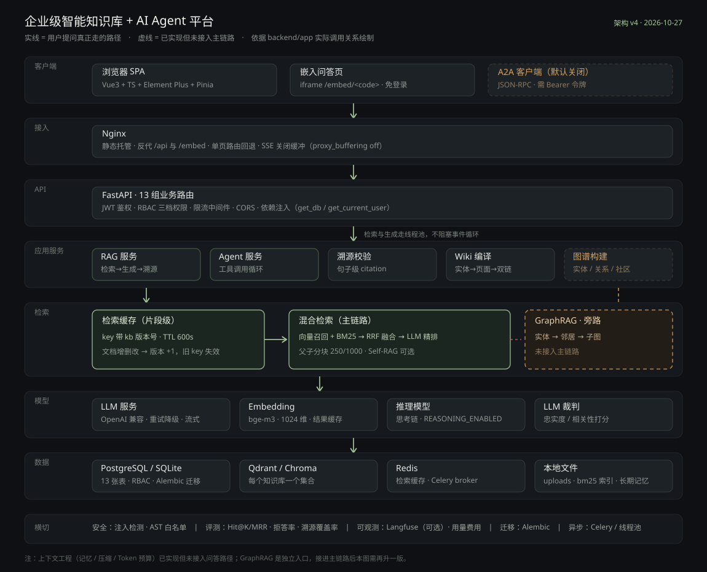
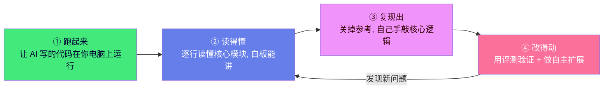
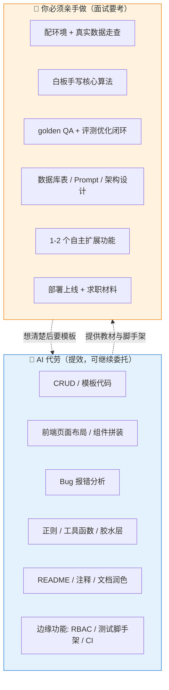
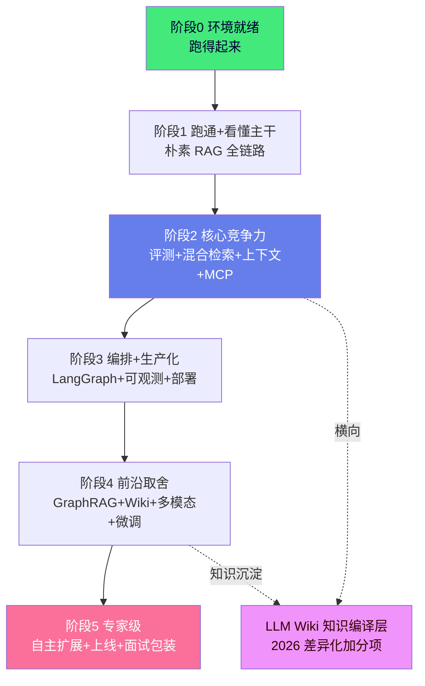
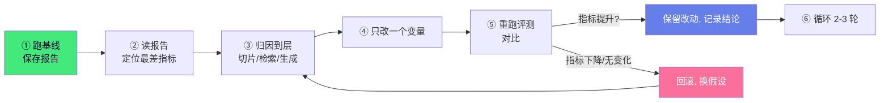

# 项目学习指导书 · 企业级智能知识库 + AI Agent 平台

> 基于 RAG 检索增强生成和 Function Calling 的企业级智能知识库系统，支持文档上传、智能问答、多轮对话、来源引用、AI Agent 工具调用、SSE 流式输出，并内置**混合检索、上下文工程、RAG 评测体系、MCP / A2A 协议、Agent 编排、可观测性**等生产级能力。

> [!warning] 先分清三份文档，别搞混
> | 文档 | 位置 | 给谁看 | 是否进仓库 |
> |---|---|---|---|
> | **本文件（指导书）** | `项目前期构建/项目学习指导书.md` | 你自己：学什么、怎么做、做到什么程度算过 | ❌ 绝对不进 |
> | **仓库 README** | `企业级智能知识库 + AI Agent 平台/README.md` | 面试官/HR：项目是什么、怎么跑 | ✅ 进 |
> | **产品文档** | `项目前期构建/docs/`（8 篇） | 你自己：部署、接口、面试材料 | ❌ 不进 |
>
> 原因：本文件明确写了"AI 写了 90% 的代码、你负责剩下的 10%"，同时还有商务包装的措辞。**一旦进公开仓库，等于把底牌摊给面试官。**

## 项目简介

这是一个完整的 **AI 全栈项目**，把企业的 PDF / Word / TXT 文档构建成向量知识库，员工用自然语言提问，系统自动检索相关内容并由大模型生成带来源的回答。还内置了 AI Agent，能自动调用工具（查时间、数学计算等）。

**两套业务包装（一套代码，两地通吃）：**
- 投杭州电商公司：电商客服知识库 + 商品问答助手
- 投上海企业服务公司：企业内部知识管理 + 智能助手平台

## 系统架构



> **v4（2026-10-27）**：在 v3 基础上补进了这一轮的新变化——**检索缓存**（版本号失效）、**线程池边界**（检索与生成不阻塞事件循环）、**溯源校验**（句子级 citation）。
> 分七层 + 一条横切：客户端 → 接入（Nginx）→ API（FastAPI）→ 应用服务 → 检索 → 模型 → 数据；横切安全 / 评测 / 可观测 / 迁移 / 异步。
> **实线 = 用户提问真正走的路径**；**虚线 = 代码已实现但没接进主链路**（GraphRAG、上下文工程）。

> [!note] v2 / v3 已归档，别再引用（`architecture.svg`、`architecture-v3.svg`）
> 旧图把 GraphRAG 画成"RAG 核心检索三路之一"，但 `rag_service.retrieve()` 只有三个分支：Self-RAG / hybrid / vector，**没有图谱**。图谱是独立接口 + 独立页面。
> 这类"图画得比代码先进"的错误最危险：面试官顺着图问一句"图谱怎么融合、权重多少"，就直接暴露了。**架构图必须能对应到具体函数**，这也是为什么 v3 每层都标了类名/函数名。

> [!tip] 这张图你能怎么用
> 1. **面试白板**：照着 v3 默画一遍，边画边讲"一次提问经过哪几层、每层失败是什么症状"；
> 2. **自查**：改完代码发现图和代码对不上，说明你要么改了架构，要么改了幻觉——两种都值得停下来确认；
> 3. **演进**：§3.4 把 GraphRAG 接进 Agent 后，本图要再升一版（把虚线连成实线）。

## 技术栈

| 分层 | 技术 |
|------|------|
| 前端 | Vue3 + TypeScript + Vite + Element Plus（按需）+ Pinia + Vue Router |
| 后端 | Python + FastAPI + SQLAlchemy + Pydantic v2 |
| 数据库 | SQLite（开发）/ PostgreSQL（Docker 默认） |
| 向量库 | Chroma（开发）/ Qdrant（Docker 默认） |
| 检索 | 向量检索 + BM25 关键词检索（混合，RRF 融合 + Rerank 重排 + 查询改写） |
| AI 能力 | LLM（OpenAI 兼容接口，支持豆包/通义/DeepSeek）+ Embedding |
| Agent | 原生 ReAct 循环；可选 LangGraph（ReAct / Plan-and-Execute / 多智能体） |
| 协议 | MCP（stdio / HTTP）、A2A（JSON-RPC，**默认关闭**） |
| 评测 | 确定性检索/生成指标 + LLM 裁判 + 可选 RAGAS |
| 可观测 | 可选 Langfuse（trace / span / 延迟） |
| 核心技术 | RAG / Agentic RAG、Function Calling、SSE 流式、JWT、限流、缓存、Prompt 注入防护 |
| 部署 | Docker + docker-compose + Nginx；可选 Redis + Celery 异步任务 |
| 可视化 | ECharts（按需引入） |

## 核心功能

**基础能力**
- 用户注册登录、JWT 鉴权、bcrypt 密码加密、多租户行级数据隔离
- **知识库协作（RBAC）**：库级 owner / editor / viewer 三档权限，`kb_members` 中间表，成员邀请 / 移除，列表区分"我的"和"共享给我的"
- 知识库创建、删除、编辑（多知识库隔离）
- 文档上传（PDF/Word/TXT/MD），后台异步解析、切片、向量化
- 文档增量更新（同 ID 替换，自动删除旧向量并重建）
- 朴素 RAG 问答 + 来源引用 + 相似度展示
- Agentic RAG：Agent 自主决定是否检索、检索什么、资料不足自动换关键词重查
- SSE 流式输出（含 Agent“正在检索/计算”状态）
- 多轮对话、历史管理、消息复制、重新生成、Markdown 渲染 + 代码高亮
- 回答点赞 / 点踩反馈
- 数据统计看板（问答趋势、文档分布，ECharts）
- 网站嵌入：公开免登录问答窗口，iframe 可直接嵌入外部网站
- 多模型切换：按用户选择的模型真正生效

**生产级高级能力（详见 `docs/高级能力与可选依赖.md`）**
- **混合检索**：向量 + 自研 BM25（jieba 分词，缺依赖自动降级），RRF 融合、LLM/Cohere Rerank、Multi-Query 查询改写、HyDE
- **上下文工程**：短期滑动窗口记忆、长期事实记忆、历史 LLM 压缩、Token 预算裁剪、工具数量预算
- **RAG 评测体系**：golden QA 数据集、Hit@K / MRR / Context Precision/Recall / 关键词覆盖、LLM 忠实度与相关性裁判、RAGAS 对接、一键跑分与报告
- **MCP Server**：把知识库检索/问答暴露为 MCP 工具（stdio / streamable-http），可被 Claude Desktop、IDE 等接入
- **Agent 编排**：LangGraph 版 ReAct、Plan-and-Execute、Supervisor 多智能体（可选切换）
- **可观测性**：Langfuse 全链路 trace（检索 span + 生成 + 延迟）
- **A2A 协议**：Agent Card + JSON-RPC，需 Bearer 令牌；**默认关闭**（作品集不对公网暴露内部知识库）
- **结构化回答**：要点 / 对比表 / 时间线三种模板，强约束 JSON + 解析失败自动降级为要点
- **多模态解析**：图片 OCR、VLM 图像描述、PDF 表格抽取
- **微调示例**：golden QA → jsonl → OpenAI 兼容微调脚本，附 RAG/微调选型文档
- **安全防护**：Prompt 注入启发式检测、检索资料边界包裹、危险工具 AST 白名单
- **生产化**：Redis 缓存、Celery 异步任务、PostgreSQL 切换、GitHub Actions CI

## 仓库与目录结构

> [!important] 2026-10-26 起，代码已拆成**独立仓库**，不再是旧的 `产品/` 目录
> | 位置 | 用途 | 进 Git |
> |---|---|---|
> | `企业级智能知识库 + AI Agent 平台/`（与上级同名，仓库根） | 代码、配置、对外 README | ✅ 独立仓库，可推 GitHub，CI 已能生效 |
> | `项目前期构建/`（本文件所在） | 指导书、`docs/`、开发指导、旧代码备份 | ❌ 私人区 |
>
> 铁律：**代码只在仓库里改，文档只在私人区改。** 旧 `产品/` 是拆分前的快照，只作备份，不要再改。

```text
企业级智能知识库 + AI Agent 平台/     ← git 仓库根
├── backend/
│   ├── app/                   # 112 个 .py / 约 1.02 万行
│   │   ├── main.py            # 应用入口（lifespan 建表、挂路由、限流、CORS）
│   │   ├── config.py          # 所有开关都在这（改行为先看这里）
│   │   ├── models/            # 12 张表（含 kb_member）
│   │   ├── schemas/           # Pydantic 模型
│   │   ├── routers/           # 13 个业务路由模块（含 structured / embed / a2a 另挂）
│   │   ├── services/          # LLM / RAG / Agent / 文档 / Wiki / 图谱 / 结构化
│   │   ├── retrieval/         # BM25 / RRF / Rerank / 改写 / Self-RAG
│   │   ├── context_engine/    # 记忆 / 压缩 / 组装
│   │   ├── evaluation/        # 金标集 / 指标 / LLM 裁判 / RAGAS
│   │   ├── wiki/ orchestration/ mcp_server/ observability/ tasks/ protocols/
│   │   └── utils/             # security / deps（RBAC 权限函数在这里）
│   ├── scripts/               # 微调脚本、migrate_add_rbac.py（幂等迁移）
│   ├── tests/                 # 18 个测试文件 + conftest，106 个用例（105 passed + 1 skipped）
│   └── requirements.txt
├── frontend/                  # Vue3 + TS，30 个 ts/vue 文件 / 约 4900 行
│   ├── src/{api,stores,router,views,utils}
│   └── tests/                 # vitest，5 个用例
├── docker/                    # 可选：宿主机级 Nginx 参考配置（域名 + HTTPS）
├── scripts/preflight.py       # 启动前体检：.env 类型/编码、bind mount 目录
├── docker-compose.yml         # 开发/预发：5 服务
├── docker-compose.prod.yml    # 生产 overlay：+ Celery worker
└── .github/workflows/         # ci.yml（pytest + vitest + build）、deploy.yml
```

## 快速开始

> 环境细节见 §5.1，这里只给最短路径。

### 方式 A：Docker（推荐）

```bash
cd "企业级智能知识库 + AI Agent 平台"        # 仓库根 = docker-compose.yml 所在目录
cp backend/.env.example backend/.env         # 填 LLM_API_KEY / LLM_BASE_URL / LLM_MODEL
python scripts/preflight.py --fix            # 启动前体检：拦 .env 变目录、补建 uploads/data
docker compose up -d --build                 # 5 服务：postgres redis qdrant backend frontend

# 需要 Celery 异步处理（练生产化）时，叠加生产 overlay：
docker compose -f docker-compose.yml -f docker-compose.prod.yml up -d --build
docker compose exec backend python scripts/migrate_add_rbac.py
```

前端 `http://localhost`，接口文档 `http://localhost:8000/docs`。

> [!note] 端口只绑本机（127.0.0.1）
> compose 里每个端口都写成 `"127.0.0.1:xxxx:xxxx"`，只有这台电脑能访问，同一 Wi-Fi 的手机打不开。
> 这是刻意的：Qdrant / Redis 都没有鉴权。需要用手机演示时，只把 frontend 那行改成 `"80:80"`，其余别动。

### 方式 B：本地裸跑（要打断点时用）

```bash
cd backend
python -m venv .venv && .venv/Scripts/pip install -r requirements.txt
uvicorn app.main:app --reload --port 8000
```

> [!warning] 裸跑前必读两条
> 1. **仓库里的 `.env` 是 Docker 版**（`DATABASE_URL=postgresql://…`、`VECTOR_PROVIDER=qdrant`）。裸跑要么先 `docker compose up -d postgres redis qdrant`，要么临时改 `sqlite:///./knowledge_base.db` + `chroma`（别提交这份改动）。
> 2. **Python 用 3.11**（与 Docker 镜像、CI 一致）。3.13 上 `requirements.txt` 的全量依赖没有验证过——`jieba` 本身能装，但 `chromadb` 等重型依赖不保证；跑不通就换 3.11。

### 跑测试（改代码前先确认基线）

```bash
cd backend  && pytest -q        # 105 passed + 1 skipped（用假 OpenAI/Chroma，不联网、不花钱）
cd frontend && npm run test     # 5 passed（vitest，纯函数）
cd frontend && npm run build    # 含 vue-tsc 类型检查
```

## 评测驱动（本项目的核心方法论）

```bash
cd backend
# 跑 golden QA 评测（检索 + 生成指标 + LLM 裁判）
python -m app.evaluation.run_eval
# 或通过接口：POST /api/evaluation/run，GET /api/evaluation/latest
```

每做一次检索 / Prompt / 模型优化，都先用评测跑出量化指标，形成 **「发现问题 → 定位到层 → 优化 → 指标提升」** 的闭环。

## 学习提示

- 主干：`backend/app/services/`（rag_service / vector_store / agent_service）
- 进阶：`retrieval/`、`context_engine/`、`evaluation/` 三个包是面试差异化重点
- 前端流式：`src/api/chat.ts`（fetch + ReadableStream）
- 各可选模块如何启用见 `docs/高级能力与可选依赖.md`
- 面试问题与简历话术见 `docs/求职面试材料.md`（原文件名是"面试材料"，已核对）

---

## 🎓 从零到专家：完整学习指南（AI 协作版）

> [!abstract] 这份指南解决什么问题
> 本项目的**代码骨架与大部分高级能力由 AI 提前搭好**（截至 2026-10-26：后端 `app/` 112 个 `.py` / 约 1.02 万行，前端 30 个 ts/vue / 约 4900 行，**87 个 pytest + 5 个 vitest**，全部通过；`npm run build` 与 `vue-tsc` 干净）。你不是对着空白文件从零敲，而是要回答两个问题：
> 1. **AI 已经替我写完的部分，我该怎么"利用"，而不是抄完就交？**
> 2. **剩下必须我亲手做的部分，具体每一步怎么完成？**
>
> 本指南把这两件事拆成可执行的清单，配合 `开发指导/` 目录下的深度学习文档，带你从零基础走到能独立面试、能上手干活的专家水平。
>
> 与上一版（10-14）相比，本轮最大的变化是**代码已拆成独立仓库、CI 能真正跑起来、RBAC 与结构化回答的后端基座补齐**。这三件事直接改变了"哪些是你必须做的"——详见 §3.2 任务五与 §九。

> [!tip] 不想看长文？今天就做这 3 件事（约 2 小时）
> 1. **把系统跑起来**：照 [5.1 启动项目](#51-启动项目两种方式推荐-docker) 用 Docker 起五容器，浏览器打开 `http://localhost` 能登录（对照阶段 0 的 checklist 逐项打勾）。
> 2. **亲手走一遍完整链路**：照 [5.2 第一次上传文档全流程](#52-第一次上传文档全流程建议照着点一遍)，上传 1-2 份 PDF 并提问，亲眼看到"上传 → 切片 → 检索 → 流式回答 + 来源"。
> 3. **读第一个核心文件**：打开 `backend/app/services/rag_service.py`，对照 [5.3 精读路线](#53-核心模块精读路线按这个顺序读每文件带着问题读) 第 4 步，搞懂一次问答在代码里走了哪几个函数。
>
> 做完这 3 件就完成了"跑起来"，之后再按 [第四章·五阶段路线](#四零基础到专家的五阶段学习路线) 循序推进即可。
>
> **从第一天起记住 3 条底线**：① 跑不通先自己读报错、定位层级，再问 AI；② 6 个核心算法（见 [3.3 白板手写清单](#33-必须白板手写的-6-个核心算法流程)）必须能脱稿默写；③ 每次优化只改一个变量、用评测数据说话，不凭感觉调。

---

### 一、先搞懂：这份代码是怎么来的

#### 1.1 项目现状：AI 已搭好"骨架 + 高级能力"，你负责"灵魂 + 验证"

代码工程已经提前落地了一个**可直接运行的完整系统**，能力分三层：

| 能力层 | 状态 | 说明 |
|--------|------|------|
| 基础业务全链路 | ✅ 已完成 | 注册登录、知识库、文档上传、RAG 问答、多轮对话、Agent、流式、看板 |
| P0 核心竞争力 | ✅ 代码级完成 | 混合检索、上下文工程、RAG 评测体系、MCP Server |
| P1/P2 进阶亮点 | ✅ 代码级完成 | LangGraph 编排、Langfuse 可观测、生产化、A2A、多模态、微调脚本、GraphRAG、LLM Wiki |

> [!important] 关键认知转变
> **"代码在仓库里" ≠ "能力在你脑子里"。** 面试官考的是你能不能讲清楚原理、能不能动手改、遇到问题能不能排查。所以这份 AI 写好的代码，对你来说不是"答案"，而是**教材 + 实验环境**。

#### 1.2 学习方式的根本转变：四步闭环

不要从零敲（10 个月做不完），也不要直接抄（面试一问就露馅），而是走四步闭环：



- **跑起来**：环境就绪、能上传文档、能问答（本指南第五章手把手教）。
- **读得懂**：对照 `开发指导/P0P1P2深度学习/` 的深度指南，逐行读核心代码。
- **复现出**：新建一个空文件，不看参考，自己把核心算法/流程敲出来。
- **改得动**：用 golden QA 评测验证效果，再做 1-2 个属于自己的功能扩展。

#### 1.3 一张图看懂分工：AI 负责什么 vs 你负责什么



---

### 二、AI 已经替你完成了什么（如何"利用"而非"抄"）

#### 2.1 已完成能力清单（含验证方式与精读优先级）

> 精读优先级：⭐⭐⭐ = 面试必问、必须逐行吃透；⭐⭐ = 要懂原理、能讲取舍；⭐ = 知道有这东西、会用即可。
> 行数列只是规模参考，改动后会漂移，**不要背数字**，看职责和验证方式即可。

**后端核心服务（`backend/app/services/`）**

| 文件 | 行数 | 职责 | 怎么验证它能用 | 精读优先级 |
|------|------|------|---------------|-----------|
| `rag_service.py` | 259 | RAG 问答主流程：检索→拼上下文→生成 | 上传文档后在问答页提问 | ⭐⭐⭐ |
| `vector_store.py` | 330 | Chroma 向量库 + Embedding 缓存 | 上传文档后看 `chroma_db/` 生成 | ⭐⭐⭐ |
| `qdrant_store.py` | 270 | Qdrant 向量库实现（生产级） | 切 `VECTOR_PROVIDER=qdrant` | ⭐⭐ |
| `agent_service.py` | 271 | 原生 ReAct 循环 + Function Calling（检索工具复用 `rag_service.retrieve`，与普通问答同一套召回） | Agent 页让它"查时间/算数" | ⭐⭐⭐ |
| `llm_service.py` | 183 | LLM 客户端封装、重试、流式 | 任意对话能回复即正常 | ⭐⭐⭐ |
| `text_splitter.py` | 176 | 文档切片（父子分块策略） | 上传后在文档详情看切片 | ⭐⭐⭐ |
| `document_parser.py` | 157 | PDF/Word/TXT/MD 解析 | 分别上传 4 种格式 | ⭐⭐ |
| `document_service.py` | 188 | 文档增删改、增量更新 | 重新上传同名文档看替换 | ⭐⭐ |
| `memory_service.py` | 108 | 长期事实记忆 | 多轮对话后看 `long_memory.json` | ⭐⭐ |
| `graph_builder.py` / `graph_retriever.py` | 204/226 | GraphRAG 实体抽取与图谱检索 | GraphRAG 页面构建图谱 | ⭐⭐ |
| `reasoning_service.py` | 162 | 推理模型（deepseek-r1）调用 | 开深度问答模式 | ⭐ |
| `structured_service.py` | 153 | 结构化回答：强约束 JSON + 解析 + 降级 | 调 `/api/structured/generate` 切三种模板 | ⭐⭐ |
| `cache.py` / `usage_service.py` / `active_learning.py` | 63/147/186 | 缓存、用量统计、主动学习 | 看板/设置页观察 | ⭐ |

**检索增强（`backend/app/retrieval/`）—— 面试差异化重点**

| 文件 | 行数 | 职责 | 精读优先级 |
|------|------|------|-----------|
| `bm25_retriever.py` | 190 | 自研 BM25（jieba 分词，缺依赖自动降级；带进程内 mtime 缓存） | ⭐⭐⭐ |
| `hybrid.py` | 122 | 向量 + BM25 的 RRF 融合 | ⭐⭐⭐ |
| `reranker.py` | 102 | LLM/Cohere 重排 | ⭐⭐⭐ |
| `query_rewrite.py` | 75 | Multi-Query 查询改写、HyDE | ⭐⭐ |
| `self_rag.py` | 129 | Self-RAG / CRAG 自我纠错检索 | ⭐⭐ |
| `tokenizer.py` | 29 | 分词工具（BM25 依赖） | ⭐⭐ |

**四大进阶包（P0/P1/P2）**

| 包 | 关键文件 | 职责 | 精读优先级 |
|----|---------|------|-----------|
| `evaluation/` | `metrics.py`、`runner.py`、`llm_judge.py`、`ragas_runner.py`、`run_eval.py` | golden QA、Hit@K/MRR、LLM 裁判、RAGAS | ⭐⭐⭐ |
| `context_engine/` | `memory.py`、`compressor.py`、`assembler.py` | 记忆、历史压缩、Token 预算组装 | ⭐⭐⭐ |
| `mcp_server/` | `server.py`、`run_stdio.py`、`run_http.py` | 把知识库暴露为 MCP 工具 | ⭐⭐ |
| `orchestration/` | `react_graph.py`、`plan_execute.py`、`multi_agent.py`、`__init__.py` | LangGraph 三种编排 + 工厂切换 | ⭐⭐ |
| `wiki/` | `compiler.py`、`page_manager.py`、`entity_extractor.py`、`conflict_detector.py`、`linker.py`、`version_service.py`、`wiki_retriever.py`（共 7 个） | LLM Wiki 编译型知识库 | ⭐⭐ |
| `observability/` | 1 个（`tracer.py`） | Langfuse 全链路 trace | ⭐ |
| `protocols/` | `a2a_server.py` | A2A 协议（Agent Card + JSON-RPC） | ⭐ |
| `multimodal/` | 1 个（`parser.py`） | OCR / VLM / 表格抽取 | ⭐ |

**前端页面（`frontend/src/views/` 共 13 个 .vue：11 个业务页 + Layout/NotFound）**

| 页面 | 作用 | 精读优先级 |
|------|------|-----------|
| `Chat.vue` | 问答主界面（SSE 流式渲染、来源展示） | ⭐⭐⭐ |
| `src/api/chat.ts` | fetch + ReadableStream 流式解析（前端高频考点） | ⭐⭐⭐ |
| `KnowledgeList.vue` / `KnowledgeDetail.vue` | 知识库与文档管理、上传 | ⭐⭐ |
| `AgentDemo.vue` | Agent 工具调用演示 | ⭐⭐ |
| `Evaluation.vue` | 评测中心（一键跑分、指标卡片、逐用例明细） | ⭐⭐ |
| `Wiki.vue` / `GraphRAG.vue` | Wiki 页面、知识图谱可视化 | ⭐ |
| `Dashboard.vue` / `Settings.vue` / `Login.vue` / `Register.vue` | 看板、设置、登录注册 | ⭐ |

#### 2.2 正确利用 AI 成果的四步法（每个模块都这样过一遍）

> [!tip] 以"混合检索"模块为例
> **第一步·跑起来**：`.env` 里设 `RETRIEVAL_MODE=hybrid`、`RERANK_ENABLED=true`，上传文档，提问，确认回答正常。
> **第二步·读得懂**：打开 `retrieval/hybrid.py`，对照《02-检索增强三件套深度指南》，搞懂 RRF 公式 `score = Σ 1/(k+rank)`，在白板上能手推。
> **第三步·复现出**：新建 `my_hybrid.py`，不看源码，自己实现一遍向量检索 + BM25 + RRF 融合，再和原文件对比差异。
> **第四步·改得动**：把 RRF 的 k 从 60 改成 20，跑评测看 Hit@K 变化；或关掉 Rerank 看 MRR 下降多少——用真实数据理解每个参数的作用。

#### 2.3 让 AI 继续帮你的场景（放心委托）

这些属于"CRUD / 胶水层"，写多了浪费时间，应该让 AI 代劳，你把时间省下来攻核心：

| 场景 | 怎么对 AI 提要求 |
|------|-----------------|
| 加一个新 CRUD 接口 | "参照现有 `routers/knowledge.py` 的风格，给我加一个 XX 资源的增删改查，模型字段是……" |
| 加一个前端页面 | "参照 `KnowledgeList.vue` 的布局，用 Element Plus 做一个 XX 管理页，调 `/api/xx` 接口" |
| 排查报错 | 把**完整报错堆栈 + 相关代码 + 你已经试过什么**一起贴给 AI，让它分析根因 |
| 写正则 / 工具函数 | "写一个解析 XX 的函数，要求处理 A/B/C 三种边界，加注释" |
| 补测试 / 文档 | "为 `hybrid.py` 的 RRF 函数写 pytest 用例，覆盖空列表、单路、重复结果三种情况" |
| 加边缘功能 | 更多文档解析器、CI 增强、E2E 测试 —— ⚠️ RBAC 与前端测试脚手架已于 2026-10-26 完成，别重复做 |

#### 2.4 让 AI 给你"讲代码"的 Prompt 模板（复制即用）

读不懂 AI 写的代码时，不要跳过，用下面的模板追问，直到每一行都能讲：

```text
你是资深 Python/FastAPI 工程师，也是我的老师。请逐行讲解这个文件【粘贴文件路径或代码】：
1. 这段代码整体解决什么问题？在 RAG 全链路的哪一步？
2. 每个函数的输入、输出、副作用是什么？
3. 第 X 行为什么要这么写？有没有更简单的写法？为什么作者选了这种？
4. 这里用到的 XX 概念（如 RRF / 依赖注入 / 异步生成器），用生活化比喻讲一遍。
5. 新手最容易在哪些地方踩坑？
6. 最后出 3 道由浅入深的问题考我，我答完你再批改。
```

背算法时用：

```text
我要白板手写【BM25 打分公式 / RRF 融合 / ReAct 循环 / SSE 流式】，请：
1. 先告诉我这个算法解决什么问题，输入输出是什么；
2. 把推导步骤拆成 5 步以内，每步一句话；
3. 给一个最小可运行的纯 Python 示例（不依赖项目其他代码）；
4. 列出 3 个最容易写错的细节；
5. 等我手写拍照后，逐行帮我批改。
```

#### 2.5 三条红线（避免"抄完就交、一问就露馅"）

> [!warning] 红线
> 1. **不能直接交差**：任何你没读过、讲不清的代码，都不能写进简历当"我做的"。
> 2. **不能不看就粘**：AI 生成的每一行核心代码，至少要能说出它在整体流程里的位置。
> 3. **核心模块必须白板复现**：下一章列出的 6 个核心算法/流程，必须做到关了 AI 能默写。

---

### 三、你必须亲手完成的部分（面试命根子）

这些是 AI 替代不了的——面试官考的是你脑子里的东西，不是仓库里的东西。按优先级排列，每项都给出"为什么 / 怎么做 / 验收标准 / 产出物"。

#### 3.1 六大核心任务总览

| # | 任务 | 为什么必须亲手做 | 建议耗时 | 对应章节 |
|---|------|----------------|---------|---------|
| 1 | 配好真实环境并跑通 | 一切的前提，也是"来了就能干活"的证明 | 0.5-1 天 | 5.1 / 5.2 |
| 2 | 逐行读懂核心模块 + 白板手写 | 面试技术面的核心，露馅与否全在这 | 贯穿全程 | 3.3 / 5.3 |
| 3 | 扩充 golden QA + 跑通评测优化闭环 | 简历上唯一能量化的数字，最大杀手锏 | 3-5 天 | 5.4 / 5.5 |
| 4 | 真实数据走查 + bad case 日记 | 面试必问"最难的问题"，要真实踩坑故事 | 2-3 天 | 5.2 |
| 5 | 自主扩展 1-2 个功能 | 证明你"改得动"，不是只会跑现成代码 | 3-5 天（后端基座已就绪） | 3.2 任务五 |
| 6 | 部署上线 + 求职材料 | 踩坑经历本身就是素材，话术要能讲 | 第 9-10 月 | 5.8 / 6.5 |

#### 3.2 任务详解

**任务一：配好真实环境跑起来**

- **为什么**：连环境都跑不起来，后面一切免谈；而且环境配置是全栈/AI 岗的日常基本功。
- **怎么做**：照本指南第 5.1 节，推荐 Docker 一键起（已配好 PostgreSQL + Redis + Qdrant + 后端 + 前端五容器），再去硅基流动/DeepSeek 申请 Key 填入 `.env`。
- **验收标准**：浏览器打开 `http://localhost` 能登录，打开 `http://localhost:8000/docs` 能看到 Swagger 文档。
- **产出物**：5 个容器全部 `Up`，后端日志无报错。

**任务二：逐行读懂核心模块并白板手写**

- **为什么**：技术面会让你当场推导公式、画流程图、说设计取舍。
- **怎么做**：照第 5.3 节"精读路线"，每周精读 1-2 个文件，配合 `P0P1P2深度学习/` 对应指南，读完关文件手写，录音/录像自查。
- **验收标准**：见 3.3 节清单，每项都能脱稿在白板写出来并讲明白。
- **产出物**：6 份手写笔记 + 自拍讲解视频。

**任务三：扩充 golden QA 并跑通评测优化闭环（最重要）**

- **为什么**：这是中小 AI 公司最看重的能力——"你能不能把效果调上去"。"跑评测→发现问题→定位到层→优化→指标提升"这个闭环故事，是面试最大杀手锏，也是简历唯一能量化的数字来源（如"把 Hit@5 从 0.62 提到 0.85"）。
- **怎么做**：
  1. 准备 5-10 份你熟悉领域的真实文档（如电商退换货政策、员工手册）；
  2. 照第 5.4 节，在现有 20 条模板基础上把 golden QA 补到 **40-50 条**（再添 20-30 条你自己的真实问答），覆盖四类题型（事实型、聚合型、多跳型、拒答型）；
  3. 跑基线评测，保存报告；
  4. 做至少 **2 轮有记录的优化**：如调整 `CHUNK_SIZE` 对比 Hit@K、开/关 Rerank 对比 MRR、改 TopK 对比 Context Precision；
  5. 每次前后报告留档。
- **验收标准**：能拿出一份"基线报告 + 2 轮优化对比报告"，并说清每次指标变化的原因。
- **产出物**：`backend/app/evaluation/data/golden_qa.json`（40-50 条）、`eval_reports/` 下 3 份报告、一页优化结论。

**任务四：真实数据走查 + bad case 日记**

- **为什么**：面试必问"你遇到过什么最难的问题、怎么解决的"，没有真实踩坑故事的项目讲不活。
- **怎么做**：建一个 `badcase.md`，每遇到一个回答不好的问题，记录四栏：用户问题 / 系统检索到了什么 / 答案差在哪 / 归因到哪一层（切片·检索·生成），以及你的修复。
- **验收标准**：积累至少 15 条真实 bad case，每条都有归因和修复结论。
- **产出物**：`badcase.md` 日记（这份文档是你独有的，面试讲出来非常真实）。

**任务五：自主扩展 1-2 个功能（证明"改得动"）**

- **为什么**：现成代码是 AI 写的，面试官会怀疑"你到底能不能动手"。有 1-2 个你自己设计、自己实现的功能，才能证明能力。
- **四个方向的后端基座已由 AI 补齐（2026-10-26），现在缺的是「前端 + 你自己的判断」**：

| 方向 | 后端现状 | 你要做的 | 必须能回答的问题 |
|---|---|---|---|
| **Agent 轨迹可视化**（★★★★） | `/api/agent/multi-agent` 已返回 `steps`（planner / researcher / writer / supervisor 四角色），`AgentDemo.vue` 已用时间线渲染 | 给每个 step 加 `duration_ms`（用 `time.perf_counter()` 包住 `_plan` / `retrieve` / `_write` / `_supervise`），前端显示耗时 | 为什么单 Agent 的 `/api/agent/chat` 不返回 steps，而多 Agent 返回？ |
| **RBAC 协作**（★★★★） | 已完成：`models/kb_member.py`、`utils/deps.require_kb_role`、`GET/POST/DELETE /kb/{id}/members`、列表区分"我的/共享" | 写 `views/KbMembers.vue`；**并复核表设计**（为什么 owner 不写中间表？为什么加唯一约束？为什么 role 有两套？） | 一个用户在 A 库是 owner、B 库是 viewer，代码怎么表达？ |
| **结构化回答**（★★★） | 已完成：`/api/structured/generate`、`services/structured_service.py`、前端 `utils/structured_parse.ts` + 5 个 vitest 用例 | 写 `components/StructuredAnswer.vue`，按 `result.template` 分支渲染 | 模型不返回 JSON 时，链路为什么不能抛异常？降到什么程度算"可接受"？ |
| **前端测试**（★★★） | 已完成：vitest 配置 + 5 个用例（空输入 / bullets / comparison 行不齐 / timeline 脏数据 / 未知模板） | 亲手加 2 个用例（如 rows 不是数组、events 全是空对象） | 为什么测错误输入比测正确输入更有价值？ |

> [!note] 为什么后端我先写了
> 这三块都是"机械骨架"：写出来要 2-3 周，但学到的东西和读一遍差不多。**真正的学习发生在「复核 → 改 → 讲」**。所以每个方向我都留了一道"必须能回答的问题"——答不上来，说明你还只是使用者，不是作者。

- **验收标准**：功能在页面上可用 + 那道题能脱稿答 60 秒 + 能说出表结构/降级策略的取舍。
- **产出物**：可演示的新功能 + 一段设计说明（建议写进 `badcase.md` 的同级 `design-notes.md`）。

**任务六：部署上线 + 求职材料**

- **为什么**：亲手买服务器、配域名、HTTPS、Nginx 走一遍，踩坑经历就是面试素材。
- **怎么做**：照第 5.8 节和 `docs/部署文档.md`；技术博客、3 分钟/10 分钟两版话术参考 `docs/求职面试材料.md`。
- **验收标准**：有一个公网可访问的 HTTPS 地址；两版话术能流畅讲完。
- **产出物**：线上地址、1-2 篇技术博客、两版项目话术、简历量化成果（用评测真实数字）。

#### 3.3 必须白板手写的 6 个核心算法/流程

> 这 6 个是面试高频中的高频，标准是"关掉参考、能默写、能讲为什么"。

| # | 要手写的内容 | 对应代码 | 配套指南 | 过关标准 |
|---|-------------|---------|---------|---------|
| 1 | **BM25 打分公式**（IDF + 词频饱和 + 长度归一化） | `retrieval/bm25_retriever.py` | 02 检索增强 | 能写出公式并解释 k1、b 参数含义 |
| 2 | **RRF 融合公式** `1/(k+rank)` | `retrieval/hybrid.py` | 02 检索增强 | 能手算两路检索的融合结果 |
| 3 | **Hit@K / MRR 计算** | `evaluation/metrics.py` | 01 评测体系 | 给一个检索结果列表能算出两个指标 |
| 4 | **Agent ReAct 循环**（Thought→Action→Observation 循环 + 终止条件） | `services/agent_service.py` | 06 Agent 编排 | 能画出循环流程图并讲 Function Calling 消息协议 |
| 5 | **SSE 流式前后端配合** | `routers/chat.py` + `frontend/src/api/chat.ts` | 本地启动指南 | 能讲清后端如何 yield、前端如何用 ReadableStream 解析 |
| 6 | **RAG 完整链路**（切分→向量化→检索→Rerank→拼 Prompt→生成→引用） | `services/rag_service.py` | 02 检索增强 | 能画一张从上传文档到回答的完整数据流图 |

> [!success] 自测方法
> 每学完一个，拿一张白纸，限时 15 分钟写出来，然后对着源码批改；讲不清的地方用 2.4 节的 Prompt 让 AI 追问，直到能给"完全不懂的同学"讲明白为止。

---

#### 3.4 任务五·方向五（推荐第一个做）：把 GraphRAG 接进 Agent

**先说清楚现状，别再被架构图误导。**

GraphRAG 在项目里是一套**完整垂直功能**，五个部分都在：

| 层 | 文件 | 作用 |
|---|---|---|
| 模型 | `models/graph_entity.py`、`graph_relation.py`、`graph_community.py` | 实体 / 关系 / 社区三张表 |
| 构建 | `services/graph_builder.py` | 抽实体与三元组、聚合同名实体、划社区 |
| 检索 | `services/graph_retriever.py` | `local_search`（实体匹配→1 跳邻居→子图）、`global_search`（社区 map-reduce） |
| 接口 | `routers/graphrag.py` | build / status / graph / local / global |
| 页面 | `views/GraphRAG.vue` | 图谱可视化 + 构建按钮 + 提问框 |

**但它在主链路上是断的**，四条证据：

1. `graph_retriever` 全项目只被 `routers/graphrag.py` 引用；
2. `rag_service.retrieve()` 只有三个分支（Self-RAG / hybrid / vector），没有第四个；
3. `agent_service` 的工具清单只有 `get_current_time`、`calculator`、`search_knowledge_base`；
4. 上传文档只触发 Wiki 编译，**不会自动建图**，必须手动点「构建」。

结果就是：你在 Chat 页问"退款和七天无理由是什么关系"，系统一个字都不会查图谱；想去用，得切到 GraphRAG 页，而那边答完又不进对话历史。

**目标**：让 Agent 自己判断"这是关系型问题"，然后调图谱工具。

| 方案 | 改哪里 | 代价 | 收益 |
|---|---|---|---|
| **A. Agent 加图谱工具**（本次要做） | `agent_service` 工具定义 + 执行器 | 半天，不碰主链路 | Agent 自主决定何时查图谱，语义最干净 |
| B. 第三路召回并入 RRF | `rag_service.retrieve()` 加 graph 分支 | 2-3 天 | 最彻底，但有个粒度坑（见下） |
| C. 查询路由 | 问题分类后分流 | 1-2 天 | 全局/总结类问题提升明显 |

> [!warning] 为什么 B 不是"加一行代码"
> `GraphEntity` 只记了 `source_doc_ids`（**文档级**），没有 `chunk_id`（**切片级**）。向量路和 BM25 路的候选粒度是切片，图谱路的候选粒度是实体/文档——**粒度对不上，不能直接丢进 `rrf()`**。要做得先解决"实体怎么映射回切片"，这是设计题，不是编码题。所以先做 A。

**工具契约（你按这个实现，其余不动）**

```text
工具名   query_knowledge_graph
参数     {"query": string}          必填，用自然语言描述要查的实体或关系
返回     字符串，必须含三段：
         ① 命中实体：名称 / 类型 / 摘要（最多 5 个）
         ② 实体关系：A -[关系]-> B（最多 10 条）
         ③ 兜底话术（两种情况都要覆盖）：
            - 图谱未构建 → "该知识库尚未构建知识图谱，请改用 search_knowledge_base"
            - 命中为空   → "图谱中没有与该问题相关的实体，请改用 search_knowledge_base"
描述     （给模型看的，决定它调不调）
         "查询知识图谱中的实体及其相互关系。适用于：询问两个概念/流程/条款之间的关系、
          跨文档的关联、某个实体的上下游。不适用于：查具体数值、条款原文、流程步骤
          ——那类问题用 search_knowledge_base。"
```

**你会踩的四个坑（先给你，别卡死）**

| # | 坑 | 说明 |
|---|---|---|
| 1 | async 陷阱 | `_execute_tool` 是同步方法，`local_search` 是 `async def`。直接 `asyncio.run()` 会报 `cannot be called from a running event loop`——正解是把执行器改成 async，`chat()` 与 `chat_stream()` 两处都要 `await` |
| 2 | 图谱没建 | `local_search` 会返回"知识图谱尚未构建"。这是**正常业务结果**，要原样交给模型，不能抛异常 |
| 3 | 工具描述写不好 | 模型要么不调、要么乱调。照抄上面契约里"适用于/不适用于"的写法 |
| 4 | 测试桩不支持 tool_call | `tests/conftest.py` 的假模型对带工具的请求默认直接返回答案，要测工具分支得让 stub 第一次返回 `tool_calls`、第二次返回答案 |

**验收标准（缺一不算过）**

- [ ] 问"退款和七天无理由是什么关系"：后端日志出现 `query_knowledge_graph` 调用，答案引用了图谱里的实体
- [ ] 问"退款几天到账"：**不**调图谱，走 `search_knowledge_base`
- [ ] 图谱未构建时：Agent 不崩，自动退回普通检索并正常作答
- [ ] `pytest -q` 仍是 105 passed + 1 skipped（补了用例就按新增后的数字）；不破坏现有行为
- [ ] 能在 60 秒内讲清"为什么用工具而不是并入 RRF"

**时间盒**：读代码 30 分钟 → 实现 2 小时 → 自测 30 分钟。卡在坑 1 超过 40 分钟，回来问我"只给方向不给代码"。

> [!tip] 测试桩已经就绪（2026-10-27）
> `tests/conftest.py` 新增 `tool_script` fixture：能让假模型按脚本发起工具调用，并记录回灌给模型的 tool 消息。
>
> - 验收用例已写在 `tests/test_graph_tool.py`，当前是 `skip`；实现完删掉那行 skip 即可；
> - 想先确认桩本身没问题：`python -m pytest tests/test_agent_tool_harness.py -q` 应为 1 passed；
> - 你的失败如果发生在"工具没注册/没实现"，报错会直接告诉你（`Agent 没有执行 query_knowledge_graph`）。

#### 3.5 顺带一课：「契约」不是 Agent 的专利

你问"工具契约是不是只有 Agent 需要"——不是。**契约 = 把口头约定变成可校验的结构**，只要一次调用的两端由不同东西解释（人/代码/模型/数据库），就需要契约。

项目里已经有六处，你可能没意识到它们是同一件事：

| 契约 | 两端是谁 | 载体 | 违约会怎样 |
|---|---|---|---|
| HTTP 接口 | 前端 ↔ 后端 | Pydantic `schemas/` | 400/422，字段名对不上 |
| 前后端类型 | TS ↔ Python | `api/*.ts` 的 interface | 运行时 undefined，页面白屏 |
| Agent 工具 | 模型 ↔ 代码 | `TOOL_DEFINITIONS` 的 JSON Schema | 模型不调用 / 参数解析失败 |
| 结构化回答 | 模型 ↔ 前端渲染 | `structured_service` 的三种 JSON 结构 | 解析失败 → 降级（已做） |
| MCP / A2A | 外部 Agent ↔ 本服务 | MCP tool 定义 / Agent Card | 外部客户端无法发现或调用 |
| 评测数据集 | 数据 ↔ 指标计算 | `golden_qa.json` 的 7 个字段 | 指标全 0（kb_id 填错就这现象） |

**判断标准一句话**：换个解释器（换个人、换个模型、换个前端框架），这套约定还对得上吗？对不上，就该把它写成 schema/类型/字段说明。

**现在缺的三处**（都能当小扩展）：

1. Agent 工具的描述没有统一规范——`search_knowledge_base` 写得不错，新工具容易写成"一句话功能"；
2. MCP Server 的工具描述是简版，接进 Claude Desktop 后模型未必会用；
3. A2A 的 Agent Card 是静态常量，`url` 写死 `localhost`，上线前要改成配置项。

---

### 四、零基础到专家的五阶段学习路线

> 按顺序学，前一阶段是后一阶段的前置。每阶段给出"目标 / 学什么（对应文档）/ 做什么 / 验收标准 / 学时"。
> 学习节奏参考：工作日每天 2-3 小时 + 周末 6 小时 ≈ 每周 20 小时。

#### 路线总览（能力六层）



> [!abstract] 基础不牢？先补这些，别从头系统学
> 项目需要的前置基础，以及"不会就补到什么程度"：
>
> | 你发现自己不熟的 | 补什么（够用即可） | 补到什么程度 |
> |---|---|---|
> | Python 基础 | 类型注解、`async/await`、列表/字典推导、虚拟环境与 pip | 能看懂 FastAPI 路由、会建 venv 装包 |
> | FastAPI | 路由/请求体、Pydantic 模型校验、依赖注入 | 能照着写一个带 `@router` 的 CRUD 接口 |
> | Vue3 + TypeScript | 组合式 API（`ref`/`reactive`）、`props/emit`、Pinia | 能看懂 `.vue` 的 `script setup`、改页面 |
> | 工程基础 | Git 提交、看报错堆栈、HTTP/JSON、JWT 概念 | 会 commit/checkout、能读懂报错层级 |
> | 数学/算法 | 不用专门补，BM25/RRF 用到时跟着指南推导 | 能手算文档里给的小例子即可 |
>
> 原则：**边做边补、以项目为线索**。不要先花一两个月系统看完 Python/Vue 课再做项目（很容易坚持不下来）。项目跑到哪、卡在哪，就补哪，补完立刻回到项目。

#### 阶段 0：环境就绪（已完成，先做验证）

| 项 | 内容 |
|----|------|
| 目标 | 让五个容器（叠 prod overlay 是六个）在你电脑上跑起来 |
| 学什么 | 不用学理论，照 5.1 节复制命令即可 |
| 做什么 | 验证 Docker 容器、申请 LLM Key、填 `.env`、跑一次迁移、打开前端 |
| 验收标准 | 见下方 checklist，全部 ✅ 才算过 |
| 学时 | 0.5-1 天 |

- [ ] `docker ps` 看到 5 个容器 Up（叠 prod overlay 是 6 个，多一个 celery-worker）；容器名形如 `knowledge-base-platform-backend-1`——compose 不设 `container_name`，这样才能 `--scale`、也能再用另一个项目名并排跑一套
- [ ] `docker compose ps` 里 postgres / redis / qdrant / backend 都显示 `(healthy)`：`depends_on` 的 `service_healthy` 要求被依赖服务**确有 healthcheck**，否则启动直接失败
- [ ] `http://localhost` 能打开前端登录页
- [ ] `http://localhost:8000/docs` 能看到 Swagger 接口文档
- [ ] 能注册账号并登录
- [ ] `.env` 里 LLM_API_KEY 已填，对话有回复
- [ ] 跑过 `docker compose exec backend python scripts/migrate_add_rbac.py`，输出里有 `users.role` 的处理结果
- [ ] `pytest -q` 是 **105 passed + 1 skipped**、`npm run test` 是 **5 passed**（动手改之前先确认基线干净）
- [ ] 仓库 `git log --oneline` 能看到第一条提交（不是空仓库）

> 当前推荐配置（OpenAI 兼容，一个 Key 同时支持 LLM + Embedding）：
> - 服务商：硅基流动 `https://api.siliconflow.cn/v1`
> - LLM：`zai-org/GLM-5.3-Flash`（也可选 `deepseek-ai/DeepSeek-V3` 系列，在硅基流动「模型市场」挑当前可用版本）
> - Embedding：`BAAI/bge-m3`（1024 维，中文效果好）

#### 阶段 1：跑通 + 看懂主干（朴素 RAG 全链路）

| 项 | 内容 |
|----|------|
| 目标 | 能完整走通"上传文档→问答→看到来源"，并看懂主链路代码 |
| 学什么 | 阅读 `docs/本地启动指南.md`、`docs/API接口文档.md`；精读 `services/` 主干 |
| 做什么 | 上传 3-5 份真实文档，走查所有页面；照 5.3 精读 RAG 主链路 |
| 验收标准 | 能画出"上传到回答"的完整数据流图，说出每个文件在哪一步 |
| 学时 | 1-2 周 |

**精读顺序**：`document_parser.py` → `text_splitter.py` → `vector_store.py` / `qdrant_store.py` → `rag_service.py` → `llm_service.py` → `routers/chat.py`（后端）→ `frontend/src/api/chat.ts` → `Chat.vue`（前端）。

#### 阶段 2：核心竞争力（P0，必须掌握，约 7 周）

> 这是拉开和普通应届生差距的关键，对应 `开发指导/P0P1P2深度学习/` 01-04 + 08-11 篇。

| 周 | 学什么（文档） | 做什么 | 验收标准 |
|----|--------------|--------|---------|
| 1-2 | [[01-RAG评测体系深度指南]] | 在现有 20 条基础上把 golden QA 补到 40-50 条，跑基线报告 | 能手推 Hit@K/MRR，产出基线报告 |
| 3-4 | [[02-检索增强三件套深度指南]] | 白板写 BM25/RRF；做切片/Rerank 两轮优化 | 评测指标有可量化提升并留档 |
| 5 | [[03-上下文工程深度指南]] | 调记忆/压缩/Token 预算开关 | 能讲清有限 context window 里装什么、为什么 |
| 6 | [[04-MCP模型上下文协议深度指南]] | 写一个 FastMCP Server，把知识库接进 Claude Desktop/IDE | 能在 MCP 客户端里调用知识库工具 |
| 7 | [[08-Agentic-RAG进阶-SelfRAG与GraphRAG]] + [[10-结构化输出与健壮性]] | 开 Self-RAG 开关做对比；理解结构化输出 | 能讲清 Self-RAG 何时自我纠错 |
| 穿插 | [[11-LLM Wiki编译型知识库深度指南]] | 照《实战-LLM Wiki编译层接入》验证已完成的 Wiki 代码 | 能演示文档写入后编译成结构化页面 |

#### 阶段 3：编排 + 生产化（P1，加分项，约 3.5 周）

| 周 | 学什么（文档） | 做什么 | 验收标准 |
|----|--------------|--------|---------|
| 1-2 | [[05-生产化与可观测性]] | 接 Langfuse，trace 一次完整 RAG；理解 Redis/Celery | 能在 Langfuse 看到检索 span + 生成 + 延迟 |
| 2-3 | [[06-Agent编排与LangGraph]] | 用 LangGraph 写一个多步 Agent（如周报生成），切换三种编排 | 能讲清 ReAct / Plan-Execute / 多智能体差异 |
| 穿插 | [[09-生产优化三件套]] | 理解 Semantic Cache、模型路由、Citation 出处 | 能讲清降本手段与取舍 |

> 切换 LangGraph 编排：`.env` 设 `ORCHESTRATION_BACKEND=langgraph`（工厂在 `orchestration/__init__.py` 的 `get_orchestrator()`），未装依赖会给出安装指引。

#### 阶段 4：前沿取舍（P2，了解即可，约 1-2 周）

| 学什么（文档） | 做什么 | 验收标准 |
|---------------|--------|---------|
| [[07-A2A与多模态与微调选型]] | 跑通 A2A Agent Card、多模态解析；读微调选型文档 | 能讲清"什么时候用 RAG、什么时候用微调" |
| `开发指导/前沿能力补齐学习指导/` 01-05 | 读 GraphRAG、推理模型、多 Agent、微调、推理部署 5 篇 | 知道每个技术适用什么场景、成本多少 |

> 重点是**取舍判断**而非全部实现。面试时能说出"这个需求我为什么选 A 不选 B"，比堆技术更重要。

#### 阶段 5：专家级（自主扩展 + 上线 + 面试包装）

| 项 | 内容 |
|----|------|
| 目标 | 从"能跑别人的代码"变成"能独立设计、优化、上线、讲清楚" |
| 做什么 | ① 完成 3.2 任务五的 1-2 个自主扩展；② 按 5.8 部署上线；③ 读 `docs/求职面试材料.md`、`docs/技术博客.md`，准备两版话术和简历量化成果 |
| 配套 | `开发指导/四层能力补齐学习指导/`（Wiki 收尾→核心体验→生产化→前沿探索） |
| 验收标准 | 见第八章"终极验收清单"全部勾选 |
| 学时 | 2-4 周（叠加求职准备） |

#### 阶段间的依赖关系（别跳级）

> [!warning] 为什么不能跳
> - 不懂阶段 1 的朴素 RAG，阶段 2 的混合检索就不知道在"增强"什么；
> - 不懂评测（阶段 2 开头），你做的所有优化都无法证明有效——所以**评测是第一件要学的事**，不是最后；
> - 不懂单 Agent ReAct，阶段 3 的多智能体编排就是空中楼阁；
> - 前沿技术（阶段 4）放最后，因为性价比最低、面试最不看重"有没有"、最看重"懂不懂取舍"。

---

### 五、手把手操作手册（手动部分怎么做）

#### 5.1 启动项目（两种方式，推荐 Docker）

**动手前先确认：你电脑上有这些（Docker 方式只需要 Docker + Git + Key）**

| 工具 | 版本要求 | 验证命令 | 什么时候需要 |
|------|---------|---------|-------------|
| Docker Desktop（Windows 用 WSL2 后端） | 最新稳定版，安装时勾选 WSL2 | `docker --version`、`docker compose version` | **方式 A 必须**；裸跑不需要 |
| WSL2 + Ubuntu | Windows 11 装 Docker Desktop 时会自动配置 | `wsl -l -v` | Windows 上跑 Docker 必须 |
| Git | 任意较新版本 | `git --version` | 建立版本安全网（强烈建议，见本节末尾） |
| Python | **3.11**（与镜像/CI 一致；3.13 未验证全量依赖） | `python --version` | 仅方式 B 裸跑后端需要 |
| Node.js | 18+（推荐 20 LTS） | `node -v`、`npm -v` | 仅方式 B 裸跑前端需要 |
| LLM API Key | 硅基流动等 OpenAI 兼容服务（一个 Key 同时支持 LLM + Embedding） | 控制台创建后能看到 `sk-` 开头 | 问答、向量化、评测都需要 |

> [!note] 只想最快看到系统跑起来？
> 走方式 A，只需装好 **Docker Desktop（自带 WSL2）+ Git**，再申请一个 Key——**不用单独装 Python / Node**，镜像里都有。Python/Node 是后面方式 B 打断点调试才需要的。

**方式 A：Docker 一键启动（推荐，已含 PostgreSQL + Redis + Qdrant）**

Windows 上建议在 WSL2 终端里执行（中文路径已验证可用）：

```bash
# 进入仓库根（WSL2 路径；注意是"同名嵌套"那一层，不是 产品/）
cd "/mnt/c/Users/23981/Desktop/AI文档/DouBao Document/BewhY_L知识库/全栈工程知识库/99-项目实战/企业级智能知识库 + AI Agent 平台/企业级智能知识库 + AI Agent 平台"

# 基础编排：5 个服务（启动前先体检，见下方警告）
python scripts/preflight.py --fix
docker compose up -d --build

# 需要 Celery 异步处理时：叠加生产 overlay（6 个服务）
docker compose -f docker-compose.yml -f docker-compose.prod.yml up -d --build

# 查看状态 / 看日志 / 停止 / 改完 .env 重启
docker compose ps
docker compose logs -f backend
docker compose down
docker compose restart backend
```

启动后：前端 `http://localhost:80`，后端文档 `http://localhost:8000/docs`。

> [!warning] 四个"不报错但会坑人"的点（都在这台 Windows 上真踩过）
> 1. **bind mount 源路径不存在时，Docker 会静默建空目录**：`backend/.env` 一旦变成目录，`env_file` 只报 `is a directory`，看不出真因；`backend/uploads`、`backend/data` 变成空目录则完全不报错，表现是"上传的文件不见了""检索结果空了"。启动前跑一次 `python scripts/preflight.py` 就能拦住。
> 2. **所有端口都绑在 `127.0.0.1`**：宿主机的浏览器能访问，同一局域网的手机/另一台电脑不行。这是有意的——Qdrant、Redis 都没有鉴权。
> 3. **`depends_on` 不等于"服务就绪"**：默认只等容器启动。写 `condition: service_healthy` 时，被依赖服务必须真的配了 `healthcheck`，否则 compose 直接失败并提示 `container xxx has no healthcheck configured`（qdrant 官方镜像不带 healthcheck，本仓库用 bash 的 `/dev/tcp` 探 6333）。
> 4. **`.env` 必须存成 UTF-8**：用 GBK 保存或经历"UTF-8→GBK→UTF-8"两次转码后，中文配置值会变成乱码。曾经 `APP_NAME` 就因此把 Swagger 标题写成了 `浼佷笟鏅鸿...`，且不报任何错。

**方式 B：本地裸跑（学习单模块时用，方便打断点调试）**

```bash
# 后端
cd backend
python -m venv venv
# Windows PowerShell
venv\Scripts\Activate.ps1
# 如遇执行策略报错：Set-ExecutionPolicy -Scope CurrentUser RemoteSigned
pip install -r requirements.txt
copy .env.example .env
#   编辑 .env 填入 LLM_API_KEY；本地裸跑可用默认 SQLite + Chroma
uvicorn app.main:app --reload --port 8000

# 前端（另开一个终端）
cd frontend
npm install
npm run dev
```

> [!warning] 裸跑前先看 `.env`：当前默认指向 Docker 的 PostgreSQL + Qdrant
> 仓库里的 `backend/.env` 已按 Docker 生产配置写好（`DATABASE_URL=postgresql+psycopg2://...`、`VECTOR_PROVIDER=qdrant`、`QDRANT_URL=http://qdrant:6333`）。注意这里写的是**容器网络里的服务名**，不是 localhost——`qdrant` 只在 compose 网络内可解析；宿主机上调试才用 `http://localhost:6333`（端口已绑 127.0.0.1）。裸跑后端时若这两个依赖没起，会连不上。两种选法：
> - **推荐（能调试 + 数据一致）**：只起基础设施三个容器，后端在本地裸跑连它们：
>   `docker compose up -d postgres redis qdrant`
> - **完全轻量（不依赖 Docker）**：临时把 `.env` 改成 `DATABASE_URL=sqlite:///./knowledge_base.db`、`VECTOR_PROVIDER=chroma`、`EMBEDDING_DIM=1024`，用本地 SQLite + Chroma 跑（学习检索/Agent 单模块时够用，注意别提交这份改动）。

> 详细步骤见 `docs/本地启动指南.md`。**学习核心代码时建议用方式 B**（能直接在 VS Code 里打断点单步调试），**演示和部署用方式 A**。

**改任何代码前：先把基线提交掉（重要，5 分钟）**

仓库**已经 `git init -b main` 并暂存了 195 个文件**，只差提交（本机还没配 git 身份）：

```bash
cd "企业级智能知识库 + AI Agent 平台"     # 仓库根
git config user.name  "你的名字"
git config user.email "你的邮箱"          # 建议与 GitHub 账号一致
git commit -m "chore: 可运行基线（106 pytest + 5 vitest + CI）"
git remote add origin <你的 GitHub 仓库地址>
git push -u origin main
```

之后每完成一个里程碑提交一次：

```bash
#   复现完 RRF    -> git add . && git commit -m "practice: 手写 RRF 融合"
#   做完一组对照  -> git commit -m "experiment: 关掉 Rerank 看 MRR"
#   改坏了丢弃    -> git checkout -- .
```

> [!danger] 两条不能碰的线
> 1. **`backend/.env` 里有真实 API Key**，已被 `.gitignore` 排除。永远不要 `git add -f backend/.env`，也不要把整个文件夹打包发给别人。
> 2. 旧的 `项目前期构建/产品/` 是拆分前快照，**不要再改**；也不要把它里面的 `.env`、`chroma_db` 复制回仓库。

> [!tip] 为什么提交历史本身是证据
> 一条条 "practice / experiment" 的提交，比口头说"我亲手做过"有说服力。面试时打开 commit 列表，就能讲出你的实验过程。

#### 5.2 第一次上传文档全流程（建议照着点一遍）

1. 浏览器打开 `http://localhost:80`（裸跑是 `http://localhost:5173`）。
2. 注册账号 → 登录。
3. 进入"知识库"页 → 新建一个知识库（比如命名"电商退换货政策"）。
4. 进入该知识库 → 上传文档：准备 1 份 PDF、1 份 Word、1 份 TXT/MD。
5. 观察后端：后台会自动 **解析 → 切片 → 向量化 → 入库**。
   - 看日志：`docker compose logs -f backend`
   - 看数据：PostgreSQL 存元数据、Qdrant/Chroma 存向量
6. 上传完成后进入"问答"页，提问文档里有答案的问题，确认：
   - 回答是**流式**逐字出现的；
   - 回答下方有**来源引用**（能定位到是哪份文档、哪一段）；
   - 有相似度分数展示。
7. 再去 Agent 页，让它"现在几点了"或"算 23*17"，验证工具调用（会显示"正在调用工具"状态）。
8. 走查看板、设置、评测中心、Wiki、GraphRAG 页面，确保每个页面都能打开。

> [!tip] 做 bad case 日记
> 这一遍走查时，凡是回答不对、来源不准、报错的，都记到 `badcase.md`（见 3.2 任务四），这是你最宝贵的真实素材。

#### 5.3 核心模块精读路线（按这个顺序读，每文件带着问题读）

> 每读一个文件，回答三个问题：**它在全链路哪一步？输入输出是什么？最关键的 10 行代码在干什么？** 读不下去就用 2.4 节 Prompt 让 AI 讲。

**第一条线：RAG 主链路（阶段 1，必读）**

| 顺序 | 文件 | 带着这些问题读 |
|------|------|---------------|
| 1 | `services/document_parser.py` | 不同格式分别怎么解析？解析失败怎么办？ |
| 2 | `services/text_splitter.py` | 切片大小/重叠怎么定？父子分块解决什么问题？ |
| 3 | `services/vector_store.py` | Embedding 怎么调？缓存如何避免重复计费？向量怎么存？ |
| 4 | `services/rag_service.py` | 检索结果如何拼进 Prompt？引用怎么带回前端？ |
| 5 | `services/llm_service.py` | 重试/超时/流式怎么封装？OpenAI 兼容接口怎么适配？ |
| 6 | `routers/chat.py` | SSE 用什么格式逐帧推送？鉴权怎么挂？ |
| 7 | `frontend/src/api/chat.ts` | 前端怎么用 ReadableStream 边收边渲染？ |
| 8 | `views/Chat.vue` | Markdown 渲染、来源卡片、多轮历史怎么组织？ |

**第二条线：检索增强（阶段 2，面试重点）**

| 顺序 | 文件 | 带着这些问题读 |
|------|------|---------------|
| 9 | `retrieval/tokenizer.py` → `bm25_retriever.py` | jieba 为什么对中文必要？BM25 公式怎么实现？缺依赖怎么降级？ |
| 10 | `retrieval/hybrid.py` | 向量路和关键词路怎么并行？RRF 怎么融合两路排名？ |
| 11 | `retrieval/reranker.py` | Rerank 为什么能提精度？LLM 打分和 Cohere 打分区别？ |
| 12 | `retrieval/query_rewrite.py` | Multi-Query 怎么改写？HyDE 为什么先让 LLM 编答案？ |
| 13 | `retrieval/self_rag.py` | Self-RAG/CRAG 怎么判断检索结果要不要用、要不要重查？ |

**第三条线：评测 + 上下文 + 编排（阶段 2-3）**

| 顺序 | 文件 | 带着这些问题读 |
|------|------|---------------|
| 14 | `evaluation/metrics.py` | Hit@K、MRR、Context Precision/Recall 分别怎么算？ |
| 15 | `evaluation/runner.py` → `llm_judge.py` | 一条 golden QA 怎么跑通？LLM 裁判 Prompt 怎么写？ |
| 16 | `context_engine/memory.py` → `compressor.py` → `assembler.py` | 短期/长期记忆怎么管？历史怎么压缩？Token 预算怎么裁剪？ |
| 17 | `services/agent_service.py` | ReAct 循环怎么写？Function Calling 消息协议长什么样？ |
| 18 | `orchestration/react_graph.py` → `plan_execute.py` → `multi_agent.py` | LangGraph 怎么把 ReAct 画成图？三种编排各自适用什么任务？ |
| 19 | `mcp_server/server.py` | 怎么把检索/问答封装成 MCP 工具？stdio 和 http 区别？ |

#### 5.4 扩充 golden QA 实操（评测闭环的弹药）

golden QA 文件在 `backend/app/evaluation/data/golden_qa.json`，**已内置 20 条模板，覆盖 14 个业务场景**（售后/物流/人事/财务/行政/IT + 全局理解）。你要在自己上传的真实文档上，再补 20-30 条，把总数补到 **40-50 条**，并确保覆盖四类题型：

| 题型 | 占比 | 示例（以电商退换货文档为例） |
|------|------|------------------------------|
| 事实型 | 40% | "7 天无理由退货从哪天开始算？" |
| 聚合型 | 25% | "退货一共有哪几种处理方式？分别要什么条件？" |
| 多跳型 | 25% | "我买的是生鲜商品，第 5 天想退货，能退吗？走哪个流程？"（需跨多个文档片段） |
| 拒答型 | 10% | "公司明年年终奖多少？"（知识库没有，应明确拒答而非编造） |

每条用例都是 `cases` 数组里的一个 JSON 对象，**7 个字段**（文件顶部的 `fields_guide` 也有说明）：

| 字段 | 含义 | 怎么填 |
|------|------|--------|
| `id` | 用例唯一编号 | 按顺序排，如 `ec_021`、`ec_022` |
| `kb_id` | 所属知识库 ID | 必须与你实际创建的知识库一致（数据库里查，模板默认是 1；评测时也可用命令行/API 统一覆盖） |
| `category` | 问题分类（对应上面的题型/业务线） | 如 `售后-退款`、`多跳-跨流程`、`拒答-超纲` |
| `question` | 用户真实问题 | 尽量口语化，别照搬文档原句 |
| `reference_answer` | 标准答案 | 用人工核对、算答案正确率 |
| `must_contain_keywords` | 答案/正确资料中必须出现的事实词（数组） | 如 `["退款", "工作日", "原路"]` |
| `expected_document_names` | 应被命中的来源文档名（数组） | 如 `["售后退换货政策.pdf"]`，用于算 Hit@K / MRR |

> [!note] `must_contain_keywords` 和 `expected_document_names` 至少填一类
> 这两类决定检索指标能不能算出来：填了文档名才算 Hit@K/MRR，填了关键词才算覆盖率。建议两类都填。

**直接照抄一条，改成你自己的内容**（注意最后一条前面要有逗号、最后一条不要逗号）：

```json
{
  "id": "ec_021",
  "kb_id": 1,
  "category": "售后-退款",
  "question": "商品已经签收第 8 天了，还能申请 7 天无理由退货吗？",
  "reference_answer": "7 天无理由退货自签收次日起算，第 8 天已超过期限，通常不支持无理由退货；若是商品质量问题可走售后质量退换流程。",
  "must_contain_keywords": ["7 天", "次日", "质量问题"],
  "expected_document_names": ["售后退换货政策.pdf"]
}
```

实操建议：
1. 先把你上传的 5-10 份文档读一遍，每个文档人工出 3-5 个问题，`id` 从 `ec_021` 接着往后排；
2. 每条的 `kb_id` 一定填你自己知识库的真实 ID（可在数据库或接口里确认），否则评测会因为命中文档对不上而全部 0 分；
3. 拒答型（约占 10%）专门问"文档里没有的内容"，`expected_document_names` 可留空数组 `[]`，用来测系统会不会胡编；
4. 多跳型故意设计成需要跨 2-3 个片段才能回答；
5. 保存后用 `python -c "import json;json.load(open('backend/app/evaluation/data/golden_qa.json',encoding='utf-8'))"` 校验 JSON 没有语法错误（少逗号、中文引号是高频坑）；
6. 再运行评测（见 5.5），看哪些用例答不好，回头修正问题或补充文档。

#### 5.5 跑一轮评测优化闭环（完整示范，照做一遍）

这是整个项目的核心方法论，也是简历数字的来源。完整走一遍：



具体命令：

```bash
cd backend

# 0) 调试期先在 golden_qa.json 里只留 3-5 条用例，跑通流程再全量
# 1) 先跑一版"不调 LLM 裁判"的，只看检索指标（Hit@K/MRR），省 token：
python -m app.evaluation.run_eval --no-judge

# 2) 检索指标正常后，再完整跑（含 LLM 裁判的忠实度/相关性）：
python -m app.evaluation.run_eval

# 3) 你的知识库 id 不是 1 时，用参数统一指定，不用逐条改 JSON：
python -m app.evaluation.run_eval --kb-id 1

# 4) 改一个变量（如 .env 里 RERANK_ENABLED 关掉、或调 CHUNK_SIZE），
#    每次只改一个变量，否则无法归因；重启后端（Docker 用）：
docker compose restart backend

# 5) 再跑一次对比；终端最后一行会打印报告路径，报告在 eval_reports/ 带时间戳
```

`run_eval` 两个实用参数：

| 参数 | 作用 | 什么时候用 |
|------|------|-----------|
| `--no-judge` | 不调 LLM 裁判，只算检索指标 | 调试阶段、想省 token、只验证检索 |
| `--kb-id N` | 全部用例都按知识库 N 跑（覆盖 JSON 里的 `kb_id`） | 知识库 id 不是 1、或懒得逐条改 JSON |

> [!tip] 控制评测花费（会消耗 token）
> - 调试时先 **3-5 条用例 + `--no-judge`**，确认流程与检索后，再全量、再开裁判；
> - Embedding 缓存默认开启（`EMBEDDING_CACHE_ENABLED=true`，存 `embedding_cache.json`），**重复评测不会为同一段文本重复付 embedding 费用**；
> - LLM 裁判、Rerank、查询改写（Multi-Query / HyDE）都会额外调 LLM，对照实验之外平时按需开，不必全开。

推荐做的 3 组对照实验（每组都有故事可讲）：

| 实验 | 变量 | 观察的指标 | 你能学到什么 |
|------|------|-----------|-------------|
| 切片大小 | `CHUNK_SIZE` 300 vs 600 vs 1000 | Hit@K、Context Precision | 小切片精准但碎、大切片全但稀释 |
| 重排开关 | `RERANK_ENABLED` true/false | MRR、Context Precision | Rerank 为什么能把相关段落顶到前面 |
| 检索路数 | 纯向量 vs 加 BM25 混合 | 召回率、关键词类问题命中率 | 向量检索对"专有名词/型号"为什么不敏感 |

> [!important] 每次只改一个变量
> 这是实验科学性的底线。同时改切片和 Rerank，指标变了你也不知道是谁的功劳。把"基线 → 改动 → 结果"记成表，面试时直接讲。

#### 5.6 关掉 AI 自己复现的方法（检验是否真会）

1. **新建空文件**：如 `backend/playground/my_hybrid.py`，不看原代码。
2. **只看需求**：用自己的话写"输入两组排好序的 doc_id，输出 RRF 融合后的 top-k"。
3. **手写实现**：自己写完整代码 + 造几条测试数据，跑通。
4. **对比源码**：打开 `retrieval/hybrid.py` 逐行对比，找出自己漏了什么（如空列表、重复 id、排序稳定性）。
5. **再擦掉重写**：直到不看参考能一次写对。
6. 六个核心算法（3.3 节）逐个过。

#### 5.7 配置开关速查表（`.env` 里的开关怎么开/关）

改完 `.env` 后：裸跑 uvicorn 会自动 reload；Docker 用 `docker compose restart backend`。

| 开关 | 作用 | 现状（2026-10-26 核对过代码） |
|------|------|-------------|
| `RETRIEVAL_MODE` | `vector` / `hybrid`（BM25 + 向量 RRF） | 默认 hybrid；做对照实验时切换 |
| `RERANK_ENABLED` / `RERANK_PROVIDER` | 是否精排、用 LLM 还是 Cohere | 默认开 + llm；Cohere 需单独 Key |
| `QUERY_REWRITE_ENABLED` / `MULTI_QUERY_COUNT` | 多查询改写（每题多 1 次 LLM） | 生效；省 token 时可关 |
| `HYDE_ENABLED` | 假设文档生成 | 默认关（再多 1 次 LLM） |
| `SELF_RAG_ENABLED` | 检索后自检、不足则重查 | 默认关；开了每问会多 N 次 LLM |
| `MEMORY_ENABLED` / `HISTORY_KEEP_TURNS` | 长期记忆 / 保留轮数 | 生效（写 `long_memory.json`） |
| `HISTORY_COMPRESS_ENABLED` / `CONTEXT_MAX_TOKENS` | 历史压缩 / Token 预算 | ⚠️ **当前不生效**：`ContextAssembler.assemble()` 没有被任何路径调用，历史是硬编码 `history[-12:]` |
| `TOOL_BUDGET` | Agent 工具数量预算 | 生效（`agent_service._prepare`） |
| `LLM_JUDGE_ENABLED` | 评测时用 LLM 裁判 | 跑评测时开，会花 token |
| `LANGFUSE_ENABLED` | 全链路追踪 | 默认关；阶段 3 再接 |
| `ORCHESTRATION_BACKEND` | `native` / `langgraph` | 默认 native；切 langgraph 需装依赖 |
| `WIKI_ENABLED` / `WIKI_AUTO_COMPILE` / `WIKI_RETRIEVAL_ENABLED` | Wiki 编译与检索 | 默认开，主问答里会先查 Wiki 页 |
| `GRAPHRAG_ENABLED` | 总开关 | 生效（关掉后 `/api/graphrag/*` 返回 503），但**不在主问答链路** |
| `REASONING_ENABLED` / `REASONING_MODEL` | 推理模型 | 生效（关掉后 `/chat/reasoning` 回落普通问答） |
| `A2A_ENABLED` / `A2A_TOKEN` | A2A 协议开关与令牌 | **默认关闭**；要开必须同时配 Token，否则一律拒绝 |
| `VECTOR_PROVIDER` | `chroma` / `qdrant` | Docker 用 qdrant，裸跑用 chroma |
| `ASYNC_MODE` | `thread` / `celery` | 基础编排是 thread；叠 prod overlay 自动变 celery |
| `MULTIMODAL_ENABLED` | 图片理解（VLM/OCR） | 生效但依赖可选包（pillow / pdfplumber），缺了会降级 |
| `RATE_LIMIT_ENABLED` / `COST_TRACKING_ENABLED` | 限流 / 成本统计 | 生效 |
| `GROUNDING_ENABLED` / `GROUNDING_SENTENCE_THRESHOLD` / `GROUNDING_MIN_COVERAGE` | 答案溯源校验（句子级覆盖率、低置信阈值） | 默认开；阈值 0.30 / 0.60，偏保守 |
| `RETRIEVAL_CACHE_ENABLED` / `RETRIEVAL_CACHE_TTL` | 片段级检索缓存（版本号失效，不缓存答案） | 默认开，600s；多实例需 Redis |
| `AUTO_CREATE_TABLES` | 启动时是否 `create_all` 建表 | 开发 true；生产应 false，改用 Alembic |
| `DEBUG` | FastAPI debug（返回堆栈） | 容器里被 compose 置为 `false` |

> [!warning] 别再被"有开关就等于能用"骗了
> 上表标 ⚠️ 那一行里的两个开关（`HISTORY_COMPRESS_ENABLED`、`CONTEXT_MAX_TOKENS`）是真实存在的死配置。**把死配置接活，是很好的一个自主扩展题**：接入 `ContextAssembler.assemble()`，再用评测集对比"接入前/后"的答案完整度——这比新写一个页面更能证明你懂 RAG。

#### 5.8 部署上线（第 9-10 月做）

1. 准备一台云服务器（2C4G 起步，带 Docker），或先用本地 Docker 验证。
2. 完整步骤见 `docs/部署文档.md`（Docker 构建、Nginx 反代、HTTPS、静态资源）。
3. 必做的生产化改造：
   - 改默认 `SECRET_KEY`、数据库密码（`docker-compose.yml` 里 `kb_password` 只是示例）；
   - 确认 `DEBUG=false`（compose 已注入）；
   - 配好 CORS 白名单（`CORS_ORIGINS` 只填你的域名）；
   - 首次启动后执行一次 `docker compose exec backend python scripts/migrate_add_rbac.py`。
4. 部署后用真实账号走一遍注册 / 上传 / 问答，确认线上可用。
5. 把踩的坑（端口、权限、证书、内存）记进博客素材。

> [!danger] 生产编排的三条铁律（踩过）
> 叠加 `docker-compose.prod.yml` 时，**overlay 绝不能重写 `DATABASE_URL` / `VECTOR_PROVIDER` / `QDRANT_URL`**。
> 一旦重写：backend 与 celery-worker 会各自连到容器内的 SQLite / Chroma，表现为
> **「文档永远停在 processing」+「检索结果为空」**，而且日志里没有任何报错。
>
> 另外两条同源：① `ASYNC_MODE` 必须在 overlay 里设为 `celery`，否则 worker 拿不到任务；② worker 与 backend 必须挂同一个 `/app/data`（BM25 索引、Embedding 缓存、长期记忆都在里面），否则 worker 建的索引 API 读不到。

> [!tip] 备份三件套
> 上线后要能重装：`postgres_data`（业务库）、`qdrant_data`（向量）、`backend/uploads`（原始文件）。其余都能重建。

#### 5.9 部署到公网前的最后一件事：确认 A2A 是关的

```bash
# 期望返回 404（A2A_ENABLED=False 时，连 Agent Card 都不暴露）
curl -i http://<你的域名>/a2a/.well-known/agent.json
```

如果返回 200，说明 `.env` 里开了 `A2A_ENABLED`。简历项目**不要**把内部知识库以匿名 JSON-RPC 方式暴露在公网。

#### 5.10 日常工具箱：调试 / 接口测试 / 前端构建（卡住时翻这里）

**后端断点调试（VS Code，方式 B 裸跑时可用）**

1. 用方式 B 启动后端（`uvicorn app.main:app --reload`），在想停的代码行号左侧点一下设红点断点；
2. 最简单：在代码里临时加 `print(变量)` 看输出；正规做法用 VS Code 左侧"运行和调试" → "Python: FastAPI"，目标选 `app.main:app`；
3. 触发接口（前端点一下、或在 Swagger 里 Execute），程序会停在断点，左侧面板看变量值、调用栈，F10 单步、F5 继续；
4. 断点进不去时，检查右下角 Python 解释器是不是裸跑用的那个 `venv`（不是系统 Python）。

**不写前端也能测接口（Swagger）**

- 打开 `http://localhost:8000/docs`，所有接口都能在线填参数、点 **Execute** 试；
- 要登录的接口：先调 `/api/auth/login` 拿到 `access_token`，点页面右上角 **Authorize**，填 `Bearer <粘贴token>`，之后所有请求自动带鉴权。

**前端调试**

- 浏览器 `F12`：**Network** 面板点问答请求，看 SSE 流式返回；**Console** 看报错；
- 给 `.vue` / `.ts` 打断点需装 VS Code 官方扩展 **Vue - Official**，或直接在浏览器 Sources 面板下断点。

**前端构建的类型检查坑**

- `npm run build` 会先跑 `vue-tsc --noEmit` 做 TS 类型检查，**类型报错会让构建失败**——这是在逼你写对类型，别绕过；
- 仅当想快速看构建产物、临时绕开类型检查时用 `npm run build:no-check`；正式部署前必须让 `npm run build` 干净通过。

**前端单元测试（2026-10-26 新增）**

```bash
cd frontend
npm run test        # 一次性跑（vitest run）
npm run test:watch  # 监听模式，改文件自动重跑
```

- 测试文件在 `frontend/tests/`，配置在 `vitest.config.ts`（独立于 `vite.config.ts`）；
- 只测纯函数，不碰 DOM，所以 `environment: 'node'` 就够，跑一次不到 1 秒；
- 改了 `src/utils/structured_parse.ts` 必须跑一遍，这是唯一有测试保护的纯逻辑。

**后端质量三连（改完代码先跑这三条）**

```bash
cd backend
ruff check app tests scripts   # 静态检查：能抓 undefined name 这类真 bug
pytest -q                      # 98 个用例（含迁移、检索回归、溯源）
alembic current                # 看当前数据库版本
```

> `ruff` 不在 requirements 里，CI 单独装（`pip install ruff==0.17.2`）。本地想用就 `pip install ruff`。

---

### 六、AI 协作规范（怎么用 AI 不被反噬）

#### 6.1 基本原则：70% 自己写，30% AI 辅助

AI 是**工具**不是**替身**。判断标准很简单：**面试会不会考、工作中能不能复用**。会的，你必须自己写；不会的，你必须自己想清楚；纯体力活，才让 AI 代劳。

#### 6.2 什么能用 AI、什么必须自己（红线对照表）

| 场景 | 可以让 AI 生成 | 必须自己写 / 想清楚 |
|------|---------------|-------------------|
| **数据库表设计** | ❌ 不建议直接用 | ✅ 表结构、字段、索引、外键、租户隔离（⚠️ 本轮 RBAC 两张表是 AI 代写的，你必须能解释每一列为啥存在，见 3.2 任务五） |
| **RAG 核心流程** | 先自己写一遍，再用 AI 检查优化 | ✅ 切片策略、检索逻辑、Prompt 组装、引用拼接 |
| **Agent 编排逻辑** | 参考 AI 示例，理解后自己搭 | ✅ 工具定义、决策流程、状态机、终止条件 |
| **检索优化** | 让 AI 给思路，你自己改 | ✅ 为什么这样调、评测指标怎么变 |
| **Prompt 设计** | 让 AI 出初稿 | ✅ 自己反复调、结合 bad case 迭代 |
| **评测数据集** | AI 帮你扩充候选 | ✅ 你必须自己设计问题、定标准答案、验准确性 |
| **CRUD 接口** | ✅ 可以 | 理解输入输出即可 |
| **前端页面** | ✅ 布局、组件可让 AI 生成 | 核心交互（SSE 流式）自己写 |
| **测试用例** | ✅ 可以让 AI 按规则写 | ✅ 测试场景、边界条件自己设计 |
| **报错排查** | ✅ 贴给 AI 分析根因 | 你要看懂错误堆栈，不能只会复制粘贴 |
| **文档 / README** | ✅ 可以让 AI 起草 | ✅ 技术细节、面试话术自己写 |
| **边缘功能** | ✅ CI、部署脚本、脚手架（RBAC 已于 2026-10-26 代做，见上） | 理解原理即可 |

#### 6.3 各阶段 AI 使用比例（来自《开发计划》，随学习阶段调整）

| 月份 | AI 占比 | 阶段重点 | 为什么是这个比例 |
|------|--------|---------|-----------------|
| 第 1 月 | 30% | 打基础 FastAPI+Vue3 | 基础必须自己写，AI 只能帮调错 |
| 第 2 月 | 50% | 项目搭框架 | 配置和样板代码可参考 AI，核心逻辑自己写 |
| 第 3 月 | 40% | RAG 核心 | 核心检索和 Prompt 必须自己把控 |
| 第 4 月 | 40% | Agent 核心 | 编排逻辑和工具定义是面试重点 |
| 第 5 月 | 60% | P0 高级功能 | 混合检索、上下文工程、评测体系，AI 帮写代码，你做决策 |
| 第 6 月 | 50% | P1 生产化 | 编排参考 AI，你做架构设计 |
| 第 7 月 | 60% | P2 前沿功能 | 快速验证概念，不纠结实现细节 |
| 第 8 月 | 40% | 测试优化 | 测试代码可让 AI 写，但优化思路必须自己想 |
| 第 9 月 | 70% | 部署运维 | 配置脚本、Dockerfile 可以让 AI 写 |
| 第 10 月 | 60% | 求职准备 | 面试话术、博客可以让 AI 辅助，但项目内容必须自己讲 |

> 核心规律：**打基础阶段 AI 少用，核心能力阶段自己主导，体力/部署阶段可以放开用。**

#### 6.4 四条黄金原则（打印贴在屏幕上）

1. **先自己写，再让 AI 改**：先自己写至少 10 分钟，有了自己的思路再让 AI 看，进步最快。
2. **复制粘贴是底线**：任何 AI 生成的代码，必须能解释清楚每行含义，不理解就不用。
3. **想清楚再动手**：动手前先想清楚"要解决什么问题、有什么输入输出"，再让 AI 写。
4. **核心逻辑不能全外包**：RAG 流程、Agent 编排、检索优化、Prompt 设计、评测体系——这 5 块是你的，谁也替代不了。

#### 6.5 面试怎么讲（既不撒谎又不傻）

- **诚实 + 转化**：不要说"所有代码都是我写的"，风险极高。话术：
  > "项目架构由我设计，核心模块（RAG 检索策略、Prompt 工程、Agent 编排、评测体系）由我手写。我用 AI 辅助快速搭建了 CRUD 脚手架和部分前端页面，同时建立了完整的评测体系，把 Hit@5 从 0.62 优化到 0.85（用你真实数字）。"
- **聚焦"你做了什么"**：简历重点写"我设计了什么、我优化了什么、我解决了什么问题"，而不是"用了什么技术"。
- **用数字说话**：评测指标、bad case 数量、优化轮次、文档数、接口数——这些是你亲手做的证据。
- **提前想好"最难的问题"**：答案就从你的 `badcase.md` 和部署踩坑记录里挑。
- **详细话术**：见 `docs/求职面试材料.md`。

> [!danger] 三句千万别在面试里说（代码不支持）
> 1. "GraphRAG 接在了主检索链路里" → 没有，它是旁路接口，只在独立页面可用。
> 2. "上下文有 Token 预算和自动压缩" → 配置写了，但 `ContextAssembler` 没接进问答路径，实际是硬编码 `history[-12:]`。
> 3. "并发没问题，可以直接上生产" → 检索里的 embedding 与 LLM 精排是同步调用，跑在事件循环里，单进程并发有上限。
>
> 被问到时，正确答法是"目前是 X，瓶颈在 Y，下一步会做 Z"——**知道自己代码的边界，比吹满更可信**。

---

#### 6.6 该自己写，还是交给 AI：一张判断表

每次动手前问四个问题，**任意两个答"是"就自己写**：

| 判断维度 | 自己写 | 交给 AI |
|---|---|---|
| 面试会不会追问设计取舍？ | 会 → 自己写 | 不会（样式、配置、脚注）→ AI |
| 改错了会不会**静默降质**？ | 会（检索、上下文、权限、Prompt）→ 自己写 | 会直接报错（CI、部署脚本）→ AI |
| 是不是重复劳动？ | 不是 → 自己写 | 是（CRUD、表单、表格、样板）→ AI |
| 你能脱稿讲 3 分钟吗？ | 现在不能 → 自己写，写完就能 | 不需要讲 → AI |

**这次的结论：GraphRAG 接 Agent，你自己写**（见 §3.4）。三个理由：

1. 这是你简历里**唯一能讲"我改动了检索架构"**的抓手——前端两个页面只能证明你会写 UI；
2. 代码只有 40-60 行，但横跨「工具定义 → Function Calling 循环 → 异步执行器」三层；
3. 有个真实陷阱（同步执行器里调 async 函数），撞过一次才能讲清"为什么 Agent 的执行器要改成异步"。

**同一批任务里，这些该交给 AI**：

- `KbMembers.vue` 的表格 / 弹窗布局（Element Plus 样板，照抄改字段即可）
- `StructuredAnswer.vue` 的三种渲染分支（结构已定，纯拼装）
- CI 配置、迁移脚本、部署脚本（机械且容易写错，收益极低）

> [!tip] 一条实用规则
> **先自己写 30 分钟，写不动再问 AI。** 这 30 分钟会精准暴露你真正不懂的那个点——带着这个点去问，比直接要答案记得牢 5 倍。

> [!note] 反面情形：什么情况下反过来
> 如果这周就要投简历、必须马上有个能演示的版本，那就让 AI 写、你事后补理解。**先有再懂，好过又慢又空。** 但只要时间允许，面试能讲清楚的那部分，必须是你自己敲的。

---

### 七、代码地图 + 文档导航（迷路时看这里）

#### 7.1 后端包结构速览（按面试重要性排序）

| 包/目录 | 干什么 | 面试重要性 |
|---------|--------|-----------|
| `app/services/rag_service.py` | RAG 问答主流程 | ⭐⭐⭐ |
| `app/retrieval/` | 混合检索全家桶（BM25/RRF/Rerank/改写/Self-RAG） | ⭐⭐⭐ |
| `app/evaluation/` | 评测体系（指标/runner/LLM裁判/RAGAS） | ⭐⭐⭐ |
| `app/services/agent_service.py` | 原生 ReAct Agent | ⭐⭐⭐ |
| `app/context_engine/` | 记忆/压缩/Token 预算 | ⭐⭐⭐ |
| `app/services/vector_store.py`、`qdrant_store.py` | 向量库适配 | ⭐⭐⭐ |
| `app/orchestration/` | LangGraph 三种编排 | ⭐⭐ |
| `app/mcp_server/` | MCP 工具服务 | ⭐⭐ |
| `app/wiki/` | LLM Wiki 编译层（实体抽取/冲突检测/链接/版本） | ⭐⭐ |
| `app/services/graph_builder.py`、`graph_retriever.py` | GraphRAG | ⭐⭐ |
| `app/utils/deps.py` | 鉴权依赖 + RBAC 权限函数（`require_kb_role`） | ⭐⭐⭐ |
| `app/routers/`（13 个模块） | 各业务接口（含 `structured`、`embed`、A2A 另挂） | ⭐⭐ |
| `app/models/`（12 张表）、`schemas/`（8 个） | ORM 模型、Pydantic 模型 | ⭐⭐ |
| `app/observability/` | Langfuse 追踪 | ⭐ |
| `app/protocols/a2a_server.py` | A2A 协议 | ⭐ |
| `app/multimodal/` | OCR/VLM/表格 | ⭐ |
| `app/tasks/`（2 个：celery_app / document_tasks） | Celery 异步任务 | ⭐ |
| `app/middleware/`（1 个：限流） | 中间件（限流等） | ⭐ |
| `tests/`（18 个测试文件 + conftest，共 106 个用例） | 现成测试，可学测试写法 | ⭐⭐ |

#### 7.2 前端结构速览

```
frontend/
├── src/
│   ├── api/          # 接口封装（重点看 chat.ts 流式；另有 structured.ts、knowledge.ts 的 memberApi）
│   ├── stores/       # Pinia 状态管理
│   ├── router/       # Vue Router（含登录守卫）
│   ├── views/        # 13 个 .vue（11 业务页 + Layout / NotFound）
│   ├── utils/        # structured_parse.ts —— 全仓唯一有单测保障的纯逻辑
│   └── assets/       # 样式与静态资源
└── tests/            # vitest 用例（5 个）
```

#### 7.3 学习指导文档地图（`开发指导/`）

| 文档 | 用途 | 什么时候读 |
|------|------|-----------|
| `开发计划.md` | 10 个月完整路线 + 各月 AI 使用比例 + 里程碑 | 开始前先读一遍 |
| `项目现状分析与优化建议.md` | 当前项目该做什么、优先级、简历怎么写 | 开始前读 |
| `8个月求职冲刺路线图.md` | 求职导向的冲刺计划 | 临近求职读 |
| `P0P1P2深度学习/00-总览MOC.md` | 五层能力地图 + 11 篇索引 + 7 条验收标准 | 阶段 2-4 主线 |
| `P0P1P2深度学习/01-04` | 评测 / 检索 / 上下文 / MCP（P0 核心） | 阶段 2 逐篇精读 |
| `P0P1P2深度学习/05-07` | 可观测 / 编排 / A2A+多模态+微调（P1/P2） | 阶段 3-4 |
| `P0P1P2深度学习/08-10` | Self-RAG+GraphRAG / 生产优化 / 结构化输出 | 阶段 2-3 |
| `P0P1P2深度学习/11-LLM Wiki编译型知识库` | Wiki 差异化专题 | 阶段 2 横向 |
| `四层能力补齐学习指导/00-04` | Wiki 收尾→核心体验→生产化→前沿探索 | 阶段 5 |
| `前沿能力补齐学习指导/00-05` | GraphRAG/推理/多Agent/微调/部署 5 篇 | 阶段 4 |
| `实战-RAG企业知识库问答系统.md` | 完整企业级 RAG 实战（7400+ 行） | 当工具书，不懂就查 |
| `实战-FastAPI+RAG知识库问答.md` | FastAPI 版 RAG 实战 | 补 FastAPI 时查 |
| `实战-LLM Wiki编译层接入.md` | Wiki 接入实战 | 做 Wiki 专题时查 |
| `实战-Agent自动化办公助手.md` | Agent 实战 | 做 Agent 扩展时查 |
| `四扩展学习指南.md`（私人区根目录，不在 开发指导/ 里） | RBAC / 结构化回答 / 前端测试 / Agent 轨迹四件事的具体步骤 | 做 §3.2 任务五时逐节做 |

#### 7.4 产品文档地图（`docs/`，位于私人区，不进代码仓库）

| 文档 | 用途 |
|------|------|
| `本地启动指南.md` | 环境准备、本地裸跑步骤 |
| `API接口文档.md` | 所有接口的入参出参 |
| `部署文档.md` | Docker / Nginx / HTTPS / 生产化 |
| `高级能力与可选依赖.md` | 各高级模块如何开启、需要装什么依赖 |
| `求职面试材料.md` | 简历包装、3 分钟/10 分钟话术、技术问答 |
| `技术博客.md` | 可发的博客素材 |
| `微调与RAG选型.md` | 什么时候该微调、什么时候该 RAG |
| `architecture-v4.svg` | 系统架构图（当前版本，含缓存 / 线程池 / 溯源） |
| `architecture-v3.svg` | 上一版（缺缓存与溯源，已归档） |
| `architecture.svg` | 最初版 v2（GraphRAG 三路的错误就在这张，别引用） |

---

### 八、终极验收清单（从零基础到专家）

> 全部勾选完毕，才说明你真正"吃透"了这个项目，而不是"跑过"这个项目。

#### 8.1 阶段验收 checkbox

**阶段 0：环境就绪**
- [ ] 五容器 Up（叠 prod 是六容器），前端/后端文档都能打开
- [ ] 能注册登录、能上传文档、能问答
- [ ] `.env` 里 LLM 和 Embedding 配置正确并验证生效
- [ ] `pytest -q` = 105 passed + 1 skipped、`npm run test` = 5 passed（基线干净）
- [ ] 仓库已提交并推到 GitHub，`git log --oneline` 有历史

**阶段 1：跑通 + 看懂主干**
- [ ] 能画出"上传文档→解析→切片→向量→检索→Rerank→拼 Prompt→生成→引用"完整数据流图
- [ ] 能说清 RAG 主链路每个文件的职责
- [ ] 能讲清前端 SSE 流式如何边收边渲染

**阶段 2：核心竞争力（P0）**
- [ ] 能白板写出 BM25、RRF 公式，能手推 Hit@K / MRR
- [ ] golden QA 从 20 条补到 40-50 条，覆盖四类题型
- [ ] 跑出基线报告，并完成至少 2 轮"只改一个变量"的优化对比
- [ ] 能讲清混合检索为什么比纯向量好、Rerank 为什么提升 MRR
- [ ] 能讲清上下文工程在有限 Token 里装什么、记忆/压缩/预算怎么配合
- [ ] 能自己写一个 MCP Server 并接进 MCP 客户端
- [ ] 能演示 LLM Wiki 编译，讲清它和传统 RAG 的区别
- [ ] badcase.md 积累 15 条以上，每条有归因和修复

**阶段 3：编排 + 生产化（P1）**
- [ ] 能白板画出 ReAct 循环并讲 Function Calling 消息协议
- [ ] 用 LangGraph 写过一个多步 Agent，能讲清三种编排差异
- [ ] 接通过 Langfuse，能在面板看到完整 trace
- [ ] 能讲清 Semantic Cache、模型路由、Citation 怎么降本

**阶段 4：前沿取舍（P2）**
- [ ] 能讲清 RAG vs 微调、GraphRAG vs 混合检索、单 Agent vs 多 Agent 的选型逻辑
- [ ] 跑通过 A2A / 多模态中至少一个能力
- [ ] 面对一个新需求，能说出"我选什么、为什么不选别的"

**阶段 5：专家级**
- [ ] 完成 1-2 个自主扩展功能，能现场演示
- [ ] 项目部署到公网，有 HTTPS 地址，走查全部流程
- [ ] 代码仓库 push 成功，GitHub Actions 两个 job 都是绿的
- [ ] commit 历史里能看到 `practice:` / `experiment:` 这类真实过程
- [ ] 写完 1-2 篇技术博客
- [ ] 3 分钟和 10 分钟两版话术能流畅讲完
- [ ] 简历上的每个数字都有评测报告/代码佐证
- [ ] 能主动说出项目 3 个已知短板（同步检索、限流单机、无 Alembic）及改进方案

#### 8.2 面试能力自测（来自 P0/P1/P2 总览的 7 条验收标准）

合上讲义，能回答下列问题才算过关：

1. 不看资料，画出 RAG 完整链路，说出每一层"出问题是什么症状、怎么修"？
2. 为什么要混合检索？BM25 解决了向量检索的什么短板？RRF 怎么融合？
3. 如何证明你的检索/生成是"好"的？Hit@K、MRR、Context Precision 分别衡量什么？
4. 给你一份新需求，你怎么决定上 RAG、微调、GraphRAG 还是 LLM Wiki？
5. 一个 ReAct Agent 的循环长什么样？什么时候该用 Plan-and-Execute 或多智能体？
6. 上下文窗口只有 8K，你往里放什么、丢什么、压缩什么？怎么算 Token 预算？
7. 怎么把知识库的能力暴露给 Claude Desktop / IDE？MCP 解决了什么问题？

#### 8.3 常见坑点与排查（学习途中对照）

| 现象 | 可能原因 | 排查方向 |
|------|---------|---------|
| 后端启动报 LLM 401 | Key 错 / Base URL 错 / 模型名错 | 看 `.env`，用 curl 直接测接口 |
| 回答报"embedding 不支持" | 对话模型和向量模型用了不兼容的服务 | 用一个同时支持 LLM+bge-m3 的服务商（如硅基流动） |
| 中文 BM25 效果差 | 没装 jieba | `pip install jieba`，否则会退化成字符级匹配 |
| 上传文档后答非所问 | 切片太大/太小、embedding 没入库 | 看日志切片数、向量库点数，调 `CHUNK_SIZE` |
| 评测分数全是 0 | golden QA 里 kb_id 与实际不符 / 数据集为空 | 先确认知识库 id，再核对 golden QA 字段 |
| 改了 `.env` 不生效 | 没重启服务 | 裸跑等 reload，Docker 执行 `docker compose restart backend` |
| 切 langgraph 报缺依赖 | 没装 langgraph | 按报错提示安装，或看 `高级能力与可选依赖.md` |
| 前端收不到流式 | 代理/缓冲问题 | 看 `chat.ts` 是否正确读 ReadableStream，确认 Nginx 关了缓冲 |
| 容器反复重启 | 数据库/向量库没就绪、端口冲突 | `docker compose logs backend` 看具体报错，`docker ps` 看端口 |
| 生产编排后文档一直 processing | overlay 覆盖了 `DATABASE_URL`，worker 连到容器内 SQLite | `docker compose config` 看 backend / worker 的 `DATABASE_URL` 是否都指向 postgres |
| 文档处理成功但检索为空 | worker 写 Chroma、API 读 Qdrant，两边向量库不一致 | 两边 `VECTOR_PROVIDER` / `QDRANT_URL` 必须一致 |
| `pip install` 报依赖构建失败 | Python 版本与 requirements 不匹配 | 用 3.11 或 Docker（`jieba` 本身在 3.13 可装，问题多在 chromadb 一系） |
| 接口报 `no such column: users.role` | 拉新代码后没跑迁移 | `python scripts/migrate_add_rbac.py` |
| push 了但 CI 没动静 | workflow 不在仓库根 | 必须在仓库根 `.github/workflows/`（本轮已修） |
| LLM 调用很慢/超时 | 推理模型慢、网络问题 | 检查代理，非必要关 `REASONING_ENABLED` |
| 问答胡编（该拒答却答） | 没有拒答约束、召回为空还硬答 | Prompt 加"资料不足必须拒答"，用拒答型 golden QA 测试 |

> [!tip] 遇到问题的标准动作
> 先看日志（`docker compose logs -f backend`）→ 定位是配置、依赖、数据还是网络 → 用最小例子复现 → 把"完整报错 + 相关代码 + 已试过的办法"贴给 AI。**不要凭感觉乱改。**

---

### 九、变更记录与遗留清单（2026-10-26 ~ 10-27）

#### 9.1 这一轮改了什么

| 项 | 之前 | 现在 |
|---|---|---|
| 代码位置 | `项目前期构建/产品/`（在 Obsidian 库的 git 里） | 独立仓库 `企业级智能知识库 + AI Agent 平台/`，`.git` 独立 |
| CI | workflow 在库根之外，从未触发 | 在仓库根，push 即跑 pytest + vitest + build |
| 生产编排 | overlay 覆盖 `DATABASE_URL`，worker 与 API 数据不一致 | overlay 只加 `ASYNC_MODE=celery`，数据卷共享 |
| RBAC | 只有规划 | 表 + 权限函数 + 3 个接口 + 全链路改造（27 个调用点） |
| 结构化回答 | 只有规划 | 接口 + 解析 + 降级 + 5 个前端用例 |
| A2A | 无鉴权、默认回落到 1 号库 | 令牌校验、默认关闭、必须显式传库 |
| 检索栈 | Agent 直连向量库，比普通问答弱 | Agent 复用 `rag_service.retrieve`（混合 + 精排） |
| 测试 | 79 pytest，前端 0 | **105 pytest + 5 vitest**（共 106 个测试函数，1 个待启用） |
| 数据库变更 | 只有 `create_all` + 手写脚本 | **Alembic 基线**（13 表 / 50 索引），迁移本身有测试兜底 |
| 查询性能 | 8 个外键列没索引 | 补齐 + 5 个复合索引；`scripts/explain_index.py` 实测 **2.62ms → 0.05ms** |
| CI 门禁 | 只跑 pytest + build | **lint / 迁移 / 检索回归 / 前端 / 镜像构建** 五道门 |
| 幻觉治理 | 只有 Prompt 约束 | **句子级溯源校验** + **拒答召回 / 误拒率** 两个指标 |
| 并发模型 | 同步检索卡住事件循环 | `aretrieve()` 走线程池；心跳测试守住（>80ms 即失败） |
| 缓存 | `cache.py` 零调用、`MemoryCache` 的 ttl 是摆设 | 片段级缓存 + **版本号失效**；TTL 真正生效 |
| Prompt | 硬编码在 py 文件，改了就没了 | `app/prompts/` 注册表 + `prompt_version` 落库（含一次迁移） |
| 死配置 | `GRAPHRAG_ENABLED` / `REASONING_ENABLED` / `DEBUG` 不生效 | 已接线；`CONTEXT_MAX_TOKENS` 仍未接（见 5.7） |
| 架构图 | v2 把 GraphRAG 画成"三路召回"之一，与代码不符 | **v4**（`docs/architecture-v4.svg`）：补缓存、线程池边界、溯源校验 |
| 测试桩 | 工具调用只能拿真模型试，没法写用例 | `tool_script` fixture：脚本化 `tool_calls` + 回灌记录；GraphRAG 验收用例已预置 |
| 文档门禁 | 文档漂移靠人肉发现 | `check_docs.py` 进 CI：测试数 / 路径 / 接口 / **私有文件**四类断言 |

#### 9.2 现在按这个顺序做

1. **提交 + 推仓库**（5 分钟）——没有第一次 commit，后面所有实验都没法回滚（§5.1）。
2. **复核 RBAC 两张表**（30 分钟）——`users.role` 与 `kb_members` 是 AI 写的，你要能解释：为什么 owner 不写中间表、为什么要唯一约束、为什么有两套 role。
3. **写 `KbMembers.vue`**（半天）——接口和类型都已就绪，重点是 `my_role` 控制按钮显隐。
4. **写 `StructuredAnswer.vue`**（半天）——练联合类型收窄与脏数据降级。
5. **加 2 个 vitest 用例**（1 小时）——边界输入才是真本事。
6. **把 GraphRAG 接进 Agent**（2-3 小时，§3.4）——这是唯一能讲"我改了检索架构"的抓手，代码只 40-60 行。
7. **Agent step 加 `duration_ms`**（2 小时，可选）——面试讲"可观测性"时的实证。
8. **回到主线：扩 golden QA → 跑评测闭环**（§5.4/5.5）——这才是简历数字的来源。

> [!important] 顺序不能反
> 1-7 是"把 AI 补的东西变成自己的"，8 才是"证明你能调效果"。**没有 8，前面七项都只是功能演示。**

#### 9.3 已知技术债（知道就行，别现在做）

| 债 | 症状 | 正确做法 |
|---|---|---|
| 同步检索阻塞事件循环 | 并发 2 个请求就开始排队 | embedding / 精排改线程池或异步客户端 |
| 限流是单进程内存窗口 | 多副本时形同虚设 | 换 Redis 计数 |
| BM25 整文件读写 | 十万级切片时慢 | 换倒排索引服务 |
| 无 Alembic | 改表只能删库或手写 ALTER | 引入迁移版本管理 |
| `/uploads` 无鉴权 | 拿到 URL 就能读原文 | 签名 URL 或经接口鉴权转发 |
| 成本不归因到用户 | `/stats/cost` 只有全局数 | 把 `user_id` 透传到 `LLMService` |

#### 9.4 这三块怎么讲（面试版，各 60 秒）

**① 迁移与索引**

- 事实：13 张表 / 50 个索引，空库 `alembic upgrade head` 一条命令重建；`scripts/explain_index.py` 灌 5 万行实测，同一条列表查询 **2.62ms → 0.05ms**，执行计划从 `SCAN` 变 `SEARCH`，`USE TEMP B-TREE FOR ORDER BY` 消失。
- 讲法："我先用 `EXPLAIN QUERY PLAN` 证明它是全表扫，再补 `(kb_id, created_at)` 复合索引——注意把**排序列**也放进索引，否则过滤走了索引、排序还得建临时 B 树。最后把这条查询写成回归测试，防止有人改模型时把索引删掉。"

**② CI 五道门，第一天就抓到一个真 bug**

- 事实：加 ruff 后立刻报 `F821 undefined name`——`wiki/page_manager.py` 里 `kb_id=kb_id`（应为 `page.kb_id`），而这段被 `try/except Exception` 吞掉，表现为**"Wiki 更新已有页面"从来没成功过**，只记了一条 failed 统计。
- 讲法："静态检查不是形式主义。这个 NameError 单测没覆盖、异常又被吞了，只有 pyflakes 能抓出来。顺带说一句：`except Exception` 加日志，比加 `pass` 重要得多。"

**③ 溯源校验 + 拒答指标**

- 事实：句子级字符二元组覆盖率，**零 LLM 调用**、可复现、能进 CI；`/api/chat` 返回 `grounding`（coverage / unsupported / citations）；评测汇总新增 `citation_coverage`、`refusal_recall`、`false_refusal_rate`。
- 讲法："幻觉治理要能量化，而且要成对看：只看'该拒的有没有拒'会诱导模型过度拒答，只看'误拒率'又会放过幻觉。两个指标一起看，才谈得上调优。"
- **主动说局限**：二元组对齐对大幅改写的句子偏保守，所以它是**提示**不是**判决**；要做判决得上 LLM 裁判或 NLI 模型，成本翻倍。

**④ 顺手修的测试不隔离（这个故事最像真实工程）**

- 两个坑：BM25 索引按 `kb_id` 落盘，而每个测试的知识库 id 都从 1 开始 → 上个用例的切片混进这次检索；假 embedding 用内置 `hash()`，它受 `PYTHONHASHSEED` 影响 → 同一段文本在不同进程落到不同维度。
- 讲法："这就是典型的'本地过、CI 挂'。前者是资源没隔离，后者是随机源没固定。修完连跑两次才敢说稳定。"

#### 9.5 接下来的五项怎么改（按性价比排序）

> **进度（2026-10-26）**：① 文档同步、② 并发模型、④ 检索缓存、⑤ 的 Prompt 版本管理 **已完成**。
> 留给你的是 **③ GraphRAG 接 Agent**（§3.4 有契约）与 **⑤ 的 Agent 落库**（可选）。

| 顺序 | 事项 | 工时 | 为什么排这个位置 |
|---|---|---|---|
| 1 | 文档同步 | 半天 | 成本最低，先消除"文档与代码不一致"的误导 |
| 2 | 并发模型 | 1 天 | 底层能力，面试必问 async/线程/进程取舍 |
| 3 | GraphRAG 接 Agent | 1 天 | 你自己写，见 §3.4；和 ② 一起做正好 |
| 4 | 检索缓存 | 半天 | 缓存失效设计是真考点，比"加个缓存"值钱 |
| 5 | Prompt 版本 / Agent 落库 | 0.5 天 / 2-3 天 | 前者必做，后者有余力再上 |

**① 文档同步（半天）**

- `docs/部署文档.md`：3 处 `产品/` 旧路径（第 165-167 行的备份命令）+ 补"overlay 不重写 DATABASE_URL"铁律 + 换成 `scripts/db_bootstrap.py`。
- `docs/API接口文档.md`：补 RBAC 成员 3 个、结构化 1 个、A2A 2 个接口，以及 `role` 字段和 `/api/chat` 新增的 `grounding`。
- 新增 `docs/ADR.md`：5 条决策各一页——为什么 hybrid 不是纯向量、为什么父子分块 250/1000、为什么 owner 不写中间表、为什么 A2A 默认关、为什么溯源用二元组而不是 LLM 裁判。
- 可选：`scripts/check_docs.py` 在 CI 里 grep 禁止词（`产品/`、`79 个`），防止再次漂移。

**② 并发模型：把同步检索挪出事件循环（1 天）**

现状：`rag_service.retrieve()` 是同步方法，内部 embedding 与 LLM 精排都是同步 HTTP，却被 `async def chat()` 直接调用——单进程下一个慢请求会卡住所有人。

改法（**不要**把 `rag.chat()` 整个丢进线程池，它内部有 `await`，会直接报错）：

1. 在 `RAGService` 加一个异步壳：
   ```python
   async def aretrieve(self, kb_id, question, top_k=None):
       return await run_in_threadpool(self.retrieve, kb_id, question, top_k)
   ```
2. 5 个调用点改成 `await`：`routers/chat.py` 三处、`routers/structured.py` 一处、`agent_service._search`（这个要等执行器改成 async，正好和 §3.4 合并做）。
3. 验收用**心跳测试**：monkeypatch 让 `vector_store.query` `sleep(0.2)`，同时起一个每 10ms tick 的协程记录间隔；断言最大间隔 < 80ms（改造前会是 200ms+）。
4. 坑：SQLAlchemy 的 session 不要跨线程传；`retrieve` 不碰 DB，所以这一步安全。

**③ GraphRAG 接 Agent（1 天）**

契约、四个坑、验收标准都在 §3.4。唯一补充：**把 `_execute_tool` 改成 async 时，顺手把 ② 的调用点一起改**，两次改动合成一次回归。

**④ 检索缓存（半天）**

- 现状：`services/cache.py` 写好了 `MemoryCache` / `RedisCache` / `cache_key`，但**零调用**。
- 只缓存**检索结果**，不缓存答案：答案受多轮上下文、权限、时效影响，缓存命中就是事故。
- 失效用**版本号法**：key 里带 `kb:{id}:ver`，文档增删改时 `INCR` 版本号，旧 key 自然失效——不要用 `KEYS *` 扫描。
- 验收：同一问题第二次检索明显变快；上传新文档后同一问题的旧 key 必须 miss。
- 坑：`MemoryCache.set()` 的 `ttl` 参数**根本没实现**（只有 Redis 版生效），本地开发用它之前必须补 TTL，否则永不过期。

**⑤ Prompt 版本管理（0.5 天）→ Agent 落库（2-3 天，可选）**

- 最小版：建 `app/prompts/` 包，每个模板一个 `Prompt(name, version, template)`；给 `LLMUsage` 加一列 `prompt_version`（**正好练一次迁移**）；成本报表按版本聚合。
- Agent 落库：`agent_runs(id, kb_id, user_id, question, status, steps JSON, created_at)` + `POST /api/agent/runs/{id}/resume` + 危险工具 `pending_approval` 状态。ROI 中等，前面四项做完再考虑。

> [!warning] 这五项里不要做的事
> 别做"答案级语义缓存"（命中即事故）、别上 K8s、别换向量库（接口已抽象，换库证明不了能力）。

#### 9.6 事故复盘：私有文档误入公开仓库（2026-10-27）

**事实**：`项目学习指导书.md`（含"AI 写了 90% 的代码""商务包装"等表述）被 `git add -A` 一起提交，随 `9b3049c` 推到了公开仓库根目录，并在此后两次推送中一直在远端。

**怎么发现的**：你引用文档时给的是仓库内路径（`企业级智能知识库 + AI Agent 平台/项目学习指导书.md`），我核对 `git ls-files` 与远端树时发现该路径真实存在，且与私有区那份 `diff` 完全一致。

**处置四步**：

```bash
git rm --cached 项目学习指导书.md          # 1. 从索引移除（保留本地文件可不删）
rm -f 项目学习指导书.md                     # 2. 删除仓库内副本（私有区已有权威版本）
echo "项目学习指导书.md" >> .gitignore      # 3. 防止再次误加
FILTER_BRANCH_SQUELCH_WARNING=1 git filter-branch --force \
  --index-filter "git rm --cached --ignore-unmatch '*项目学习指导书.md'" \
  --prune-empty -- --all                   # 4. 从全部历史中抹掉该路径
rm -rf .git/refs/original && git reflog expire --expire=now --all && git gc --prune=now
git push --force origin main               # 覆盖远端历史
```

**验证方式**（不能只看 `git log`，要逐提交看树）：

```bash
for c in $(git rev-list --all); do
  git ls-tree -r "$c" --name-only | grep -q "指导书" && echo "残留: $c"
done
```

**残留风险**：GitHub 可能仍缓存一段时间的不可达对象（知道旧 SHA 仍能访问）。彻底做法是**删除仓库重建**——当前仓库只有 6 次提交、无协作者，成本很低。

**防复发**：

1. `.gitignore` 写入该文件名；
2. `check_docs.py` 新增「私有文件」检查：`git ls-files` 里出现 `项目学习指导书.md` 或 `backend/.env` 即 CI 红；
3. 提交前用 `git status --short` 扫一眼根目录，`git add -A` 是这类事故的主要入口。

**教训**：这不是"整理问题"，是**安全边界问题**。规则应该是：**代码仓只放能给面试官看的东西，其余一律放在仓外**。文档写"绝对不进仓库"没有用，能自动拦住才有用。

---

> [!quote] 最后一句话
> 这份代码的价值，不在于"你有一个项目"，而在于**你能不能用它讲清楚每一个技术决策、能不能亲手把效果调上去、能不能动手改出新东西**。AI 帮你把 90% 的体力活干完了，剩下的 10%——那些要动脑、要理解、要在白板上讲清楚的部分——才是决定你能不能拿到 offer 的全部。按上面的路线一步步来，从跑通到能打，不需要天赋，只需要把每一步做到验收通过。

---

## License

MIT
